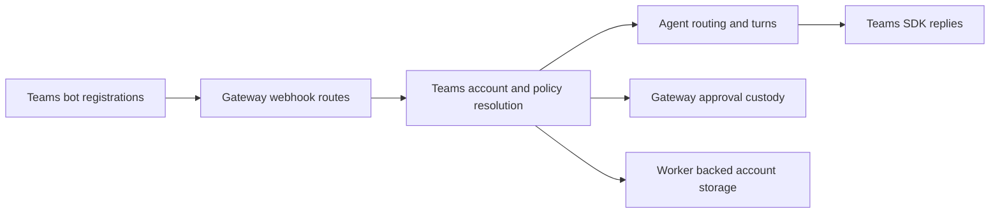

Codex review: needs real behavior proof before merge.

## What this changes

This PR lets one Gateway run multiple Microsoft Teams bots with account-specific credentials, routes, policies, approvals, and stored state.

**Example:** An operator runs main and support Teams bots on Gateway port 18789.
- **Before:** Teams exposes one default bot identity.
- **After:** The default bot receives callbacks at /api/messages and support receives callbacks at /api/messages/support, with account bindings selecting their agents.

## Review scores

| Measure | Result | What it means |
|---|---|---|
| **Overall readiness** | 🦪 silver shellfish **(2/6)** | The implementation has substantial owner-boundary coverage and no discrete introduced defect established here, but current multi-account behavior and published-updater compatibility remain incompletely evidenced. |
| **Proof confidence** | 🦪 silver shellfish **(2/6)** | Real behavior proof is necessary before merge. See [Before merge](#before-merge). |
| **Patch quality** | 🐚 platinum hermit **(4/6)** | No actionable review findings were identified. |

## Product

**Kind:** Feature · **Worth it:** Needs a maintainer decision · **Fix scope:** Complete
**User problem:** Operators currently need separate Gateways to give different agents separate Teams bot identities.
**Reason:** The capability has demonstrated demand and a coherent plugin-owned implementation, but the existing approval for its new public account and persistence contract needs verification.

## Merge readiness

⛔ **Blocked before merge - 4 items remain**

Keep this PR open: it supplies meaningful Teams multi-bot support that current main lacks, preserves the root single-bot path, and remains the active implementation.

**Priority:** P2
**Reviewed head:** `29fae3e45a583b2ca7b4d7ce6b6841876d2f2d2f`
**Owner decision:** Required. See [Decision needed](#decision-needed).

## Decision needed

- **Question:** Does the cited existing repair-and-land direction approve accounts/defaultAccount, shared root policies, and account-scoped persistent state as the public Teams contract?
- **Recommendation:** **Confirm the existing approved scope:** Have the feature owner verify that the cited direction covers the public account and persistence contract, and retain that decision as the review basis.
- **Why:** The public body attributes direction to steipete, but the inspected discussion exposes security approval rather than that contract decision; verify the existing approval without requesting a second approval if it already covers this scope.

## Before merge

- [ ] **Add real behavior proof** - The inspected historical Teams screenshot shows two bot replies, and the current body reports a successful exact-head default-account Gateway/Teams SDK canary, replacing the earlier 404 result. That canary exercises only default through a loopback Connector, while the screenshot predates the current Gateway-route implementation. Provide redacted logs, live output, terminal screenshots, or a recording showing default and support receiving callbacks and replying through their distinct current routes; remove credentials, IPs, phone numbers, and non-public endpoints. The inspected Gateway/SQLite fixture and reported passing run address the earlier sibling and disablement/removal settlement request, so that same proof is not requested again. After adding proof, update the PR body; ClawSweeper should re-review automatically. If it does not, the PR author or someone with repository write access can comment `@clawsweeper re-review`.
- [ ] **Complete next step** - Attribute the two exact-head failed test jobs using accessible logs before treating CI as qualified; repair only failures shown to be caused by this diff.
- [ ] **Resolve maintainer decision** - Resolve the maintainer decision shown above before merge.
- [ ] **Add data-model compatibility proof** - The review found that existing stored data may not work after upgrade. Show that existing data still loads and works with this change.

## Findings

None.

### Provenance

- `Core diagnostic, worker-type, auth-deadline, and migration refactors`: original intent not found (unknown: The body describes inherited lint and size-limit repairs; inspected hunks move existing operations and types without changing their apparent ordering or contracts, but the host's provenance coverage is partial.)

### Tests

- Missing end-to-end proof: Supply current default-plus-named callback/reply evidence through both Gateway routes and the completed published 2026.9.9 upgrade run.

<strong>Agent review details</strong>

### How this fits together

The Teams plugin translates authenticated Bot Framework activities into account-scoped agent turns and sends replies through the Teams SDK, using Gateway-owned HTTP routes, approval settlement, and worker-backed plugin storage.

### Technical review

Best possible solution:

Finish this implementation under the existing Teams and Gateway owners, preserving root credentials and default storage while validating the account contract.

Do we have a high-confidence way to reproduce the issue?

This is a feature request: inspected main source establishes the single-account limitation, and no target code was executed during this review.

Is this the best way to solve the issue?

Using the existing channel-account, Gateway HTTP, approval-custody, and plugin-state owners is a fitting implementation; inspected source preserves root single-bot configuration and supersedes the old webhook-port finding.

AGENTS.md: found and applied where relevant.

Codex review notes: model internal, reasoning medium; reviewed against [3cfb066c0224](https://github.com/openclaw/openclaw/commit/3cfb066c0224328abbe696900ebf69dca0a31add).

### Provenance checked

- `Teams HTTP ingress` keeps the original intent (8864423309d3b97e33b693f47be5ea4c330fa426: Move Teams callbacks to Gateway-owned routes while preserving SDK authentication and Doctor-owned legacy-port migration.)
- `Native Teams approvals` keeps the original intent (ea78c2488b052eb2324f9c63f7e4faf5f91c38a2: Provide token-bound approval cards resolved through the shared Gateway owner while preserving text fallback.)
- `Single-account configuration and setup adapters` changes intended behavior with a stated reason (7cce91cda98490110ed2d3fa5911a48d44d2abe0: Unify channel account and setup adapters; this PR extends Teams account selection while retaining the root default path.)

### Testing

Proof path: in-process harness.

### Security

None.

### Evidence

What I checked:

- **Current main still has one Teams identity:** The fetched main channel adapter resolves root credentials and always returns DEFAULT_ACCOUNT_ID; named-account support remains necessary. ([`extensions/msteams/src/channel-config.ts:25`](https://github.com/openclaw/openclaw/blob/3cfb066c0224328abbe696900ebf69dca0a31add/extensions/msteams/src/channel-config.ts#L25), [3cfb066c0224](https://github.com/openclaw/openclaw/commit/3cfb066c0224328abbe696900ebf69dca0a31add))
- **Pinned introduction and root compatibility:** The verified merge-base-to-head diff adds account resolution; default retains merged root configuration while named accounts clear inherited bot identity. The author's setup-example concern does not establish a runtime compatibility defect. ([`extensions/msteams/src/accounts.ts:149`](https://github.com/openclaw/openclaw/blob/29fae3e45a583b2ca7b4d7ce6b6841876d2f2d2f/extensions/msteams/src/accounts.ts#L149), [29fae3e45a58](https://github.com/openclaw/openclaw/commit/29fae3e45a583b2ca7b4d7ce6b6841876d2f2d2f))
- **Final-effect approval coverage:** The inspected production-owner fixture exercises allowed support settlement, an authorized sales sibling, and account disablement, channel disablement, and removal immediately before commit; negative cases assert pending durable state, no released permission, and no resolution event. The body reports this coverage passing. ([`src/gateway/server-instance-runtime.approvals.test.ts:156`](https://github.com/openclaw/openclaw/blob/29fae3e45a583b2ca7b4d7ce6b6841876d2f2d2f/src/gateway/server-instance-runtime.approvals.test.ts#L156), [29fae3e45a58](https://github.com/openclaw/openclaw/commit/29fae3e45a583b2ca7b4d7ce6b6841876d2f2d2f))
- **Default storage keys remain intact:** Default namespaces remain unchanged; named namespaces use normalized account hashes. Inspected conversation and SSO tests seed original keys and exercise isolated reads, writes, removal, and reopen. ([`extensions/msteams/src/sqlite-state.ts:8`](https://github.com/openclaw/openclaw/blob/29fae3e45a583b2ca7b4d7ce6b6841876d2f2d2f/extensions/msteams/src/sqlite-state.ts#L8), [29fae3e45a58](https://github.com/openclaw/openclaw/commit/29fae3e45a583b2ca7b4d7ce6b6841876d2f2d2f))
- **Historical media and current proof scope:** The downloaded screenshot shows separate bot replies in Teams. The current body reports an exact-head real Gateway/Teams SDK default-account canary, explicitly using a loopback Connector and mock model, and explicitly leaves the published 2026.9.9 updater cell unfinished. ([29fae3e45a58](https://github.com/openclaw/openclaw/commit/29fae3e45a583b2ca7b4d7ce6b6841876d2f2d2f))
- **Existing webhook ownership decision:** https://github.com/openclaw/openclaw/pull/158939 moved Teams callbacks to Gateway routes and assigned retired webhook.port migration to Doctor; this PR retains that ownership instead of restoring a private listener manager. ([`extensions/msteams/src/monitor.ts`](https://github.com/openclaw/openclaw/blob/8864423309d3b97e33b693f47be5ea4c330fa426/extensions/msteams/src/monitor.ts), [8864423309d3](https://github.com/openclaw/openclaw/commit/8864423309d3b97e33b693f47be5ea4c330fa426))

Likely related people:

- **Peter Steinberger:** Raw commit c872a4314686c33789b86b4a08d27f2c68b4f688 adds extensions/msteams/src/graph.ts:68 relative to its recorded parents. This identifies author metadata, not feature responsibility or a PR merger. (role: source-line author; confidence: high; commits: [c872a4314686](https://github.com/openclaw/openclaw/commit/c872a4314686c33789b86b4a08d27f2c68b4f688); files: `extensions/msteams/src/graph.ts`)
- **Shakker:** Raw commit c5fa2ac1d9bbc305ab61873781e15e35f67386b1 adds extensions/msteams/src/graph.ts:277 relative to its recorded parents. This identifies author metadata, not feature responsibility or a PR merger. (role: source-line author; confidence: high; commits: [c5fa2ac1d9bb](https://github.com/openclaw/openclaw/commit/c5fa2ac1d9bbc305ab61873781e15e35f67386b1); files: `extensions/msteams/src/graph.ts`)
- **Onur:** Raw commit 1c73d4510601a00b55289ad950a140be7b99a3ed adds src/msteams/monitor.ts:81 relative to its recorded parents. This identifies author metadata, not feature responsibility or a PR merger. (role: source-line author; confidence: medium; commits: [1c73d4510601](https://github.com/openclaw/openclaw/commit/1c73d4510601a00b55289ad950a140be7b99a3ed); files: `src/msteams/monitor.ts`)

### PR surface

PR surface statistics unavailable: the file list is incomplete.

### Review metrics

| Metric | Value | Why it matters |
|---|---|---|
| **Public configuration additions** | 2 channel-level keys: accounts and defaultAccount | These establish the durable public multi-bot configuration contract and require owner acceptance and upgrade validation. |

### Labels

Label changes:

- remove `merge-risk: 🚨 session-state`: Current PR review merge-risk labels are `merge-risk: 🚨 compatibility`.

Label justifications:

- `P2`: This is a useful channel capability for multi-bot deployments rather than an established urgent regression.
- `merge-risk: 🚨 compatibility`: The PR expands public Teams configuration and changes account selection and persistent namespace resolution; the published stable-updater proof is unfinished.
- `rating: 🦪 silver shellfish`: Overall readiness is 🦪 silver shellfish; proof is 🦪 silver shellfish and patch quality is 🐚 platinum hermit.
- `status: 📣 needs proof`: The PR needs real behavior proof before ClawSweeper can clear the contributor ask.
- `proof: 📸 screenshot`: Contributor real behavior proof includes screenshot evidence.

### Rank-up moves

Optional improvements that raise the rating; they are not merge blockers.

- Show callbacks and replies for default and support through the current Gateway routes.
- Finish the published stable-updater cell with existing settings and Teams state intact.

### Rating scale

6/6 🦀 challenger crab · 5/6 🦞 diamond lobster · 4/6 🐚 platinum hermit · 3/6 🦐 gold shrimp · 2/6 🦪 silver shellfish · 1/6 🧂 unranked krab. Overall follows the weaker of proof and patch quality; ✨ marks media proof (a screenshot, video, or linked artifact) that directly shows the changed behavior.

### Workflow

ClawSweeper edits this one comment on every review. Comment `@clawsweeper re-review` for a fresh review only; repair and merge need explicit maintainer commands such as `@clawsweeper autofix` or `@clawsweeper automerge`.

### History

Review history (209 earlier review cycles; latest 8 shown)

<!-- clawsweeper-review-history v=1 total=209 -->
- reviewed 2026-09-21T11:56:39.809Z sha 469f1f27a9dc7c09184e9353c2c77adc041f1e21 :: needs real behavior proof before merge. :: none
- reviewed 2026-09-21T13:48:58.033Z sha f7ad2fc9e43201db3f8688fcb2b6ad153e24c23c :: needs real behavior proof before merge. :: [P2] [P2] Preserve the webhook port when selecting environment credentials
- reviewed 2026-09-24T23:40:27.399Z sha f7ad2fc9e43201db3f8688fcb2b6ad153e24c23c :: needs real behavior proof before merge. :: [P2] Preserve the webhook port with environment credentials
- reviewed 2026-10-10T05:07:58.407Z sha ca6196a70da6f612699cc2911a42b4647c837d9b :: needs real behavior proof before merge. :: [P2] Preserve the webhook port when selecting environment credentials
- reviewed 2026-10-10T05:52:30.637Z sha ca6196a70da6f612699cc2911a42b4647c837d9b :: needs real behavior proof before merge. :: [P2] Preserve the webhook port when selecting environment credentials
- reviewed 2026-10-10T08:30:47.370Z sha cc598fdec0710372240c538b10d79fa5bada7704 :: needs real behavior proof before merge. :: [P2] Point webhook recovery guidance at the selected account
- reviewed 2026-10-10T09:04:36.878Z sha 5775e3e9304a41e379a1cc417439bfbb4ed84984 :: needs real behavior proof before merge. :: none
- reviewed 2026-10-10T09:46:26.720Z sha 5775e3e9304a41e379a1cc417439bfbb4ed84984 :: needs real behavior proof before merge. :: none

_Reviewed October 10, 2026, 2:32 PM ET / 18:32 UTC (Revision 210)._

<!-- clawsweeper-verdict:needs-human item=112811 sha=29fae3e45a583b2ca7b4d7ce6b6841876d2f2d2f confidence=high updated_at=2026-10-10T18:25:12Z reviewed_at=2026-10-10T18:32:34.774Z lease_owner=github-run-38075618406-1 lease_comment_id=6100764816 source_revision=f5a4f25bb87849a5099a49dc6be6d30e9bc2192f08886c9bacd426aa2613cd11 live_verification=absent hold=blocked findings=0 -->
<!-- clawsweeper-review-state:blocked item=112811 sha=29fae3e45a583b2ca7b4d7ce6b6841876d2f2d2f v=1 -->

<!-- clawsweeper-review-version item=112811 reviewed_at=2026-10-10T18:32:34.774Z sha=29fae3e45a583b2ca7b4d7ce6b6841876d2f2d2f source_revision=f5a4f25bb87849a5099a49dc6be6d30e9bc2192f08886c9bacd426aa2613cd11 lease_owner=github-run-38075618406-1 lease_comment_id=6100764816 v=1 -->

<!-- clawsweeper-review item=112811 -->