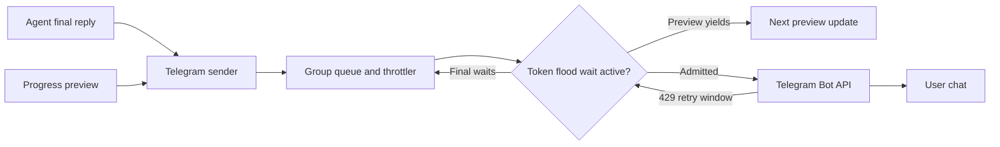

Codex review: needs maintainer review before merge. _Reviewed September 24, 2026, 3:59 PM ET / 19:59 UTC (Revision 6)._

# ClawSweeper review

## What this changes

The Telegram plugin moves outbound 429 waits into its per-token limiter so final replies can retry while previews yield, and extends flood-control tests and Test Server fault injection.

## Merge readiness

✅ **Ready for maintainer review**

Current main still lacks a bot-token-wide Telegram flood wait. The PR has relevant Test Server evidence and focused boundary coverage, and this review found no blocking introduced defect.

**Priority:** P1
**Reviewed head:** `732cf33078e31eab5bebd39b05afc22236c7478d`

## Review scores

| Measure | Result | What it means |
|---|---|---|
| **Overall readiness** | 🐚 platinum hermit **(4/6)** | Detailed live flood traces and discriminating boundary cases support a coherent repair, with the forum-topic live scenario disclosed as a limit. |
| **Proof confidence** | 🦞 diamond lobster **(5/6)** | Sufficient (live_output): The Telegram account limiter and final-send path were exercised in a Test Server Gateway run with injected Bot API 429s; the recorded after-fix result delivered the real answer after three waits, while focused HTTP-boundary cases cover queued forum topics and replaced writers. A live concurrent forum-topic fault run remains a disclosed coverage gap. No stored-data contract changes. |
| **Patch quality** | 🐚 platinum hermit **(4/6)** | No actionable review findings were identified. |

## Verification

| Check | Result | Evidence |
|---|---|---|
| **Real behavior** | Verified | Sufficient (live_output): The Telegram account limiter and final-send path were exercised in a Test Server Gateway run with injected Bot API 429s; the recorded after-fix result delivered the real answer after three waits, while focused HTTP-boundary cases cover queued forum topics and replaced writers. A live concurrent forum-topic fault run remains a disclosed coverage gap. No stored-data contract changes. |
| **Evidence reviewed** | 6 items | Current main remains affected: The current-main account throttler has per-chat scheduling but no token-wide flood gate; the current-main send retry predicate still retries 429 per call. Introduced flood owner: The introduced account limiter holds non-replaceable requests through a bounded token-wide gate and checks caller authority at the network admission point after queue waits. Final-effect authority coverage: The HTTP-boundary cases check that a queued topic send does not reach Telegram during a 429 wait and that replacing its writer prevents the final send. |
| **Findings** | None | None. |
| **Security** | None | None. |

## How this fits together

The Telegram plugin turns agent replies and progress previews into Bot API requests. Its token limiter and group queue control when those requests reach Telegram and what users see in chats and topics.

## Before merge

None.

<strong>Agent review details</strong>

### Security

None.

### PR surface

Source +241, Tests +421, Docs +23, Other +59. Total +744 across 18 files.

View PR surface stats

| Area | Files | Added | Removed | Net |
|---|---:|---:|---:|---:|
| Source | 6 | 358 | 117 | +241 |
| Tests | 7 | 501 | 80 | +421 |
| Docs | 2 | 26 | 3 | +23 |
| Config | 0 | 0 | 0 | 0 |
| Generated | 0 | 0 | 0 | 0 |
| Other | 3 | 75 | 16 | +59 |
| **Total** | **18** | **960** | **216** | **+744** |

### Review metrics

| Metric | Value | Why it matters |
|---|---|---|
| **Implementation and validation growth** | production +241, tests +421, Test Server harness +59 lines | The production growth is tied to consolidating flood policy at the token limiter, with boundary and live-scenario coverage. |

### Technical review

Best possible solution:

Keep one bounded flood policy in the Telegram account limiter, with final replies checked for current writer authority after every wait and queue.

Do we have a high-confidence way to reproduce the issue?

Yes: injecting three final-send 429 responses with a five-second retry_after is a concrete path, and the PR records the failure on its base Test Server run. Current main retains the same per-call retry mechanism, though this review did not run it.

Is this the best way to solve the issue?

Yes: the existing Telegram account limiter is the narrow owner for token-wide waits, and the patch rechecks writer authority where queued requests leave for Telegram.

AGENTS.md: found and applied where relevant.

Codex review notes: model internal, reasoning high; reviewed against [510d72b2efec](https://github.com/openclaw/openclaw/commit/510d72b2efecb4cd7a3d97b9f197fe067a158737).

### Labels

Label changes:

No label changes.

Label justifications:

- `P1`: Telegram flood control can suppress a real final reply and leave users with a delivery-warning notice.
- `merge-risk: 🚨 message-delivery`: The new token-wide gate and group queue behavior directly control when final replies and previews reach Telegram.
- `rating: 🐚 platinum hermit`: Overall readiness is 🐚 platinum hermit; proof is 🦞 diamond lobster and patch quality is 🐚 platinum hermit.
- `status: 👀 ready for maintainer look`: ClawSweeper has no concrete contributor-facing blocker left for this PR. Sufficient (live_output): The Telegram account limiter and final-send path were exercised in a Test Server Gateway run with injected Bot API 429s; the recorded after-fix result delivered the real answer after three waits, while focused HTTP-boundary cases cover queued forum topics and replaced writers. A live concurrent forum-topic fault run remains a disclosed coverage gap. No stored-data contract changes.
- `proof: sufficient`: Contributor real behavior proof is sufficient. The Telegram account limiter and final-send path were exercised in a Test Server Gateway run with injected Bot API 429s; the recorded after-fix result delivered the real answer after three waits, while focused HTTP-boundary cases cover queued forum topics and replaced writers. A live concurrent forum-topic fault run remains a disclosed coverage gap. No stored-data contract changes.
- `proof: telegram-e2e`: This PR needs Telegram Test Server proof with the repository E2E skill. Under a flood wait, Telegram users visibly receive the final answer instead of a delivery-warning notice.

### Evidence

What I checked:

- **Current main remains affected:** The current-main account throttler has per-chat scheduling but no token-wide flood gate; the current-main send retry predicate still retries 429 per call. ([`extensions/telegram/src/account-throttler.ts:188`](https://github.com/openclaw/openclaw/blob/510d72b2efecb4cd7a3d97b9f197fe067a158737/extensions/telegram/src/account-throttler.ts#L188), [510d72b2efec](https://github.com/openclaw/openclaw/commit/510d72b2efecb4cd7a3d97b9f197fe067a158737))
- **Introduced flood owner:** The introduced account limiter holds non-replaceable requests through a bounded token-wide gate and checks caller authority at the network admission point after queue waits. ([`extensions/telegram/src/account-throttler.ts:135`](https://github.com/openclaw/openclaw/blob/732cf33078e31eab5bebd39b05afc22236c7478d/extensions/telegram/src/account-throttler.ts#L135), [732cf33078e3](https://github.com/openclaw/openclaw/commit/732cf33078e31eab5bebd39b05afc22236c7478d))
- **Final-effect authority coverage:** The HTTP-boundary cases check that a queued topic send does not reach Telegram during a 429 wait and that replacing its writer prevents the final send. ([`extensions/telegram/src/send.proxy.test.ts:162`](https://github.com/openclaw/openclaw/blob/732cf33078e31eab5bebd39b05afc22236c7478d/extensions/telegram/src/send.proxy.test.ts#L162), [732cf33078e3](https://github.com/openclaw/openclaw/commit/732cf33078e31eab5bebd39b05afc22236c7478d))
- **Live behavior evidence:** The captured PR body reports a Telegram Test Server before/after run: three injected final-send 429s produced the failure notice on base and delivered the answer after the waits on head 2237e953. It also reports a token-wide pause during concurrent delivery. The author explicitly notes that a live concurrent forum-topic fault run was unavailable; the forum case is covered at the HTTP boundary. ([2237e953b8bc](https://github.com/openclaw/openclaw/commit/2237e953b8bc8356556fb6a6de40b48fea26a95c))
- **Previous review continuity:** The captured current PR body now describes a fixed one-second pause for bare 429s, addressing the previous review's documentation request. Earlier writer, typing, and group-queue concerns have corresponding introduced boundary cases. ([`extensions/telegram/src/account-throttler.test.ts:416`](https://github.com/openclaw/openclaw/blob/732cf33078e31eab5bebd39b05afc22236c7478d/extensions/telegram/src/account-throttler.test.ts#L416), [732cf33078e3](https://github.com/openclaw/openclaw/commit/732cf33078e31eab5bebd39b05afc22236c7478d))
- **Area history:** Current-main history shows earlier Telegram account-limiter work by gaoanze888, merged delivery work by Ayaan Zaidi, and recent limiter and stream refactors by Peter Steinberger. Exact source-line introduction could not be established from the partial local object set. ([`extensions/telegram/src/account-throttler.ts`](https://github.com/openclaw/openclaw/blob/510d72b2efecb4cd7a3d97b9f197fe067a158737/extensions/telegram/src/account-throttler.ts), [510d72b2efec](https://github.com/openclaw/openclaw/commit/510d72b2efecb4cd7a3d97b9f197fe067a158737))

Likely related people:

- **obviyus:** Suggested for follow-up; no historical authorship or introduction is verified. (role: unverified routing candidate; confidence: low)
- **Peter Steinberger:** Suggested for follow-up; no historical authorship or introduction is verified. (role: unverified routing candidate; confidence: low)
- **gaoanze888:** Suggested for follow-up; no historical authorship or introduction is verified. (role: unverified routing candidate; confidence: low)

### Rating scale

| Score | Internal tier | Crab rank | Meaning |
|---:|:---:|---|---|
| **6/6** | S | 🦀 challenger crab | Exceptional readiness |
| **5/6** | A | 🦞 diamond lobster | Very strong readiness |
| **4/6** | B | 🐚 platinum hermit | Good normal PR; ordinary maintainer review |
| **3/6** | C | 🦐 gold shrimp | Useful, but confidence is limited |
| **2/6** | D | 🦪 silver shellfish | Proof or implementation needs work |
| **1/6** | F | 🧂 unranked krab | Not merge-ready |
| N/A | NA | 🌊 off-meta tidepool | Rating does not apply |

Overall follows the weaker of proof and patch quality.
Shiny media proof means a screenshot, video, or linked artifact directly shows the changed behavior. Runtime, network, CSP, and security claims still need visible diagnostics.

### Workflow

- ClawSweeper keeps one durable marker-backed review comment per issue or PR.
- Re-runs edit this comment so the latest verdict, findings, and automation markers stay together instead of adding duplicate bot comments.
- A fresh review can be triggered by eligible `@clawsweeper re-review` comments, exact-item GitHub events, scheduled/background review runs, or manual workflow dispatch.
- PR/issue authors and users with repository write access can comment `@clawsweeper re-review` or `@clawsweeper re-run` on an open PR or issue to request a fresh review only.
- Maintainers can also comment `@clawsweeper review` to request a fresh review only.
- Fresh-review commands do not start repair, autofix, rebase, CI repair, or automerge.
- Maintainer-only repair and merge flows require explicit commands such as `@clawsweeper autofix`, `@clawsweeper automerge`, `@clawsweeper fix ci`, or `@clawsweeper address review`.
- Maintainers can comment `@clawsweeper explain` to ask for more context, or `@clawsweeper stop` to stop active automation.

### History

Review history (5 earlier review cycles)

<!-- clawsweeper-review-history v=1 total=5 -->
- reviewed 2026-09-24T15:14:25.958Z sha 13947ee0481b2cd7a1d264f681e02612096ac4fe :: needs real behavior proof before merge. :: [P1] Recheck writer authority before each flood retry | [P2] Feed typing 429s into the shared flood gate
- reviewed 2026-09-24T16:07:13.998Z sha ae2ab2441c47b63f138a1d10b42ddfc88acb4e60 :: needs real behavior proof before merge. :: [P1] Recheck the flood gate inside the group request queue
- reviewed 2026-09-24T16:48:26.114Z sha 731418d8ae2a93d56d485bd625ea15eb9c2a9e5c :: needs maintainer review before merge. :: none
- reviewed 2026-09-24T17:20:16.773Z sha 549cb8e8aa1cfedaf9e2eabcf7019fddc9b65f61 :: blocked before merge. :: [P2] Preserve newer flood strikes when an older request succeeds
- reviewed 2026-09-24T19:11:56.820Z sha 2237e953b8bc8356556fb6a6de40b48fea26a95c :: needs changes before merge. :: none

<!-- clawsweeper-verdict:needs-human item=157349 sha=732cf33078e31eab5bebd39b05afc22236c7478d confidence=high updated_at=2026-09-24T19:55:01Z reviewed_at=2026-09-24T19:59:13.095Z lease_owner=github-run-36051038119-1 lease_comment_id=5821199348 source_revision=9f3e0f0ed10ed3eafcfdde59585fd7f3bf4c0b7a504d39c0c86d5644dc050596 live_verification=absent -->
<!-- clawsweeper-review-state:ready item=157349 sha=732cf33078e31eab5bebd39b05afc22236c7478d v=1 -->

<!-- clawsweeper-review-version item=157349 reviewed_at=2026-09-24T19:59:13.095Z sha=732cf33078e31eab5bebd39b05afc22236c7478d source_revision=9f3e0f0ed10ed3eafcfdde59585fd7f3bf4c0b7a504d39c0c86d5644dc050596 lease_owner=github-run-36051038119-1 lease_comment_id=5821199348 v=1 -->

<!-- clawsweeper-review item=157349 -->