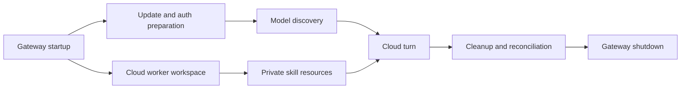

Codex review: blocked before merge. _Reviewed September 3, 2026, 3:28 PM ET / 19:28 UTC._

# ClawSweeper review

## What this changes

The PR gives Gateway update checks, provider-auth preparation, and remote skill-resource copies explicit lifecycle ownership so they are cancelled, joined, and cleaned up during shutdown.

## Merge readiness

⛔ **Blocked before merge - 7 items remain**

Keep open for maintainer review: the source repair is coherent, but it adds a public provider-plugin hook and lacks the requested exact-head concurrent cloud cleanup proof.

**Priority:** P2
**Reviewed head:** `18879f98baa48ca3c1b8a0f5c52ccfff628f277a`
**Owner decision:** Required. See [Decision needed](#decision-needed).

## Review scores

| Measure | Result | What it means |
|---|---|---|
| **Overall readiness** | 🦐 gold shrimp **(3/6)** | The implementation is coherent in source review, but merge readiness is limited by the unresolved public contract decision and pending exact-head cloud proof. |
| **Proof confidence** | 🦐 gold shrimp **(3/6)** | Not applicable: The author is a repository member, so the external-contributor proof gate does not apply; the separate exact-head cloud lifecycle evidence remains a merge-risk gap. |
| **Patch quality** | 🐚 platinum hermit **(4/6)** | No actionable review findings were identified. |

## Verification

| Check | Result | Evidence |
|---|---|---|
| **Real behavior** | Not applicable | Not applicable: The author is a repository member, so the external-contributor proof gate does not apply; the separate exact-head cloud lifecycle evidence remains a merge-risk gap. |
| **Evidence reviewed** | 8 items | Remote resource owner boundary: The transfer sends only the authoritative remote workspace path, allocates a UUID-named directory, and validates the returned filesystem identity before later operations. Authoritative cleanup: The finalizer passes the attached placement workspace and validates the turn claim; cleanup errors become the execution error instead of being suppressed. Gateway lifecycle join: Replacement startup joins its predecessor, while stop aborts and awaits all registered work before later teardown proceeds. |
| **Findings** | None | None. |
| **Security** | None | None. |

## How this fits together

Gateway startup prepares update status, provider availability, and remote worker inputs before dispatching cloud turns. Those resources feed model discovery and Codex worker environments, then must be reclaimed before Gateway shared state shuts down.

## Decision needed

| Question | Recommendation |
|---|---|
| Should OpenClaw adopt ProviderPlugin.prepareSyntheticAuth as a supported public asynchronous provider-auth contract alongside resolveSyntheticAuth? | **Adopt the documented hook:** Accept the public contract and require the pending exact-head cloud lifecycle proof before merge. |

Why: The optional hook is source-compatible but reaches external plugin authors and establishes a permanent core-to-plugin lifecycle boundary.

## Before merge

- [ ] **Resolve merge risk (P1)** - The optional public ProviderPlugin.prepareSyntheticAuth hook creates a lasting third-party plugin contract without recorded SDK-owner acceptance.
- [ ] **Resolve merge risk (P1)** - Startup, cancellation, and remote cleanup paths changed together, while the requested exact-head concurrent cloud allocation/cancellation/reclamation proof remains pending.
- [ ] **Complete next step (P2)** - Obtain maintainer acceptance for the public provider hook and attach exact-head concurrent cloud-session and cleanup proof before merge.
- [ ] **Resolve review confidence** - ClawSweeper must reach high confidence before merge readiness is known.
- [ ] **Resolve maintainer decision** - Resolve the maintainer decision shown above before merge.
- [ ] **Review config compatibility** - Confirm compatibility and upgrade impact for the changed config or default surface before merge.
- [ ] **Add data-model compatibility proof** - Confirm migration or upgrade compatibility proof before merge.

<strong>Agent review details</strong>

### Security

None.

### PR surface

PR surface statistics unavailable: the file list is incomplete.

### Review metrics

| Metric | Value | Why it matters |
|---|---|---|
| **Production versus test delta** | production +800; tests/support +1,792; docs +22 | The repair materially grows lifecycle and auth-preparation code; final cloud proof and public API acceptance remain pending. |

### Stored data model

Persistent data-model change detected: `serialized state: extensions/anthropic/cli-auth-seam.ts`, `serialized state: src/agents/test-helpers/prepared-model-catalog-worker-fixture.ts`, `unknown-data-model-change: extensions/anthropic/cli-auth-seam.ts`, `unknown-data-model-change: src/agents/test-helpers/prepared-model-catalog-worker-fixture.ts`, `unknown-truncated-pull-files`. Confirm migration or upgrade compatibility proof before merge.

### Merge-risk options

**Maintainer options:**
1. **Accept the API and prove the lifecycle (recommended)**  
   Record SDK-owner acceptance and attach exact-head concurrent cloud allocation, cancellation, and cleanup evidence before merging.
2. **Hold the combined change**  
   Pause or split the stack if the public contract decision or real cloud proof cannot be supplied.

### Technical review

Best possible solution:

Retain one documented asynchronous provider contract after SDK-owner acceptance, then demonstrate exact-head concurrent allocation, cancellation, and reclamation through the real cloud path.

Do we have a high-confidence way to reproduce the issue?

No high-confidence final-head reproduction is available: the PR records earlier local and Windows evidence, but its exact-head concurrent cloud cleanup scenario remains pending.

Is this the best way to solve the issue?

Unclear: source inspection shows coherent ownership boundaries, but the permanent plugin API direction and real concurrent teardown behavior still need maintainer confirmation and proof.

AGENTS.md: found and applied where relevant.

Codex review notes: model internal, reasoning high; reviewed against [a50ffb75e834](https://github.com/openclaw/openclaw/commit/a50ffb75e834dbca165b8d0c77be8084df675900).

### Labels

Label justifications:

- `P2`: This is a bounded cloud-worker and Gateway lifecycle reliability change without evidence of an emergency outage.
- `merge-risk: 🚨 compatibility`: The PR adds optional prepareSyntheticAuth to the exported ProviderPlugin contract used by third-party plugins.
- `merge-risk: 🚨 availability`: Gateway startup and teardown behavior changes while exact-head concurrent cloud cleanup evidence is still pending.
- `rating: 🦐 gold shrimp`: Overall readiness is 🦐 gold shrimp; proof is 🦐 gold shrimp and patch quality is 🐚 platinum hermit.
- `status: 👀 ready for maintainer look`: ClawSweeper has no concrete contributor-facing blocker left for this PR. Not applicable: The author is a repository member, so the external-contributor proof gate does not apply; the separate exact-head cloud lifecycle evidence remains a merge-risk gap.

### Evidence

What I checked:

- **Remote resource owner boundary:** The transfer sends only the authoritative remote workspace path, allocates a UUID-named directory, and validates the returned filesystem identity before later operations. ([`src/gateway/worker-environments/skill-resource-transfer.ts:91`](https://github.com/openclaw/openclaw/blob/18879f98baa48ca3c1b8a0f5c52ccfff628f277a/src/gateway/worker-environments/skill-resource-transfer.ts#L91), [18879f98baa4](https://github.com/openclaw/openclaw/commit/18879f98baa48ca3c1b8a0f5c52ccfff628f277a))
- **Authoritative cleanup:** The finalizer passes the attached placement workspace and validates the turn claim; cleanup errors become the execution error instead of being suppressed. ([`src/gateway/worker-environments/workspace-result-finalize.ts:364`](https://github.com/openclaw/openclaw/blob/18879f98baa48ca3c1b8a0f5c52ccfff628f277a/src/gateway/worker-environments/workspace-result-finalize.ts#L364), [18879f98baa4](https://github.com/openclaw/openclaw/commit/18879f98baa48ca3c1b8a0f5c52ccfff628f277a))
- **Gateway lifecycle join:** Replacement startup joins its predecessor, while stop aborts and awaits all registered work before later teardown proceeds. ([`src/infra/update-startup.ts:128`](https://github.com/openclaw/openclaw/blob/18879f98baa48ca3c1b8a0f5c52ccfff628f277a/src/infra/update-startup.ts#L128), [18879f98baa4](https://github.com/openclaw/openclaw/commit/18879f98baa48ca3c1b8a0f5c52ccfff628f277a))
- **Public plugin SDK expansion:** ProviderPlugin now exposes optional asynchronous prepareSyntheticAuth, and the type is exported from the plugin author entrypoint. ([`src/plugins/provider-plugin.types.ts:617`](https://github.com/openclaw/openclaw/blob/18879f98baa48ca3c1b8a0f5c52ccfff628f277a/src/plugins/provider-plugin.types.ts#L617), [18879f98baa4](https://github.com/openclaw/openclaw/commit/18879f98baa48ca3c1b8a0f5c52ccfff628f277a))
- **Parent-only auth preparation:** Provider auth captures are completed before worker dispatch, while worker restoration consumes prepared facts rather than probing externally. ([`src/plugins/provider-runtime.ts:1014`](https://github.com/openclaw/openclaw/blob/18879f98baa48ca3c1b8a0f5c52ccfff628f277a/src/plugins/provider-runtime.ts#L1014), [18879f98baa4](https://github.com/openclaw/openclaw/commit/18879f98baa48ca3c1b8a0f5c52ccfff628f277a))
- **Codex workspace contract:** The directly inspected Codex app-server validates absolute environment paths, defaults workspace roots to cwd, and validates selections; this is compatible with the canonical remote workspace path supplied here. ([`codex-rs/app-server/src/request_processors.rs:634`](https://github.com/openai/codex/blob/41e22fee981a63b3698df7ed36bad393cda24715/codex-rs/app-server/src/request_processors.rs#L634), [41e22fee981a](https://github.com/openai/codex/commit/41e22fee981a63b3698df7ed36bad393cda24715))

Likely related people:

- **steipete:** Suggested for follow-up; no historical authorship or introduction is verified. (role: unverified routing candidate; confidence: low)

### Rank-up moves

Optional improvements that raise the rating; they are not merge blockers.

- Record explicit SDK contract acceptance for prepareSyntheticAuth.
- Attach exact-head concurrent cloud allocation, cancellation, and cleanup evidence with secrets redacted.

### Rating scale

| Score | Internal tier | Crab rank | Meaning |
|---:|:---:|---|---|
| **6/6** | S | 🦀 challenger crab | Exceptional readiness |
| **5/6** | A | 🦞 diamond lobster | Very strong readiness |
| **4/6** | B | 🐚 platinum hermit | Good normal PR; ordinary maintainer review |
| **3/6** | C | 🦐 gold shrimp | Useful, but confidence is limited |
| **2/6** | D | 🦪 silver shellfish | Proof or implementation needs work |
| **1/6** | F | 🧂 unranked krab | Not merge-ready |
| N/A | NA | 🌊 off-meta tidepool | Rating does not apply |

Overall follows the weaker of proof and patch quality.
Shiny media proof means a screenshot, video, or linked artifact directly shows the changed behavior. Runtime, network, CSP, and security claims still need visible diagnostics.

### Workflow

- ClawSweeper keeps one durable marker-backed review comment per issue or PR.
- Re-runs edit this comment so the latest verdict, findings, and automation markers stay together instead of adding duplicate bot comments.
- A fresh review can be triggered by eligible `@clawsweeper re-review` comments, exact-item GitHub events, scheduled/background review runs, or manual workflow dispatch.
- PR/issue authors and users with repository write access can comment `@clawsweeper re-review` or `@clawsweeper re-run` on an open PR or issue to request a fresh review only.
- Maintainers can also comment `@clawsweeper review` to request a fresh review only.
- Fresh-review commands do not start repair, autofix, rebase, CI repair, or automerge.
- Maintainer-only repair and merge flows require explicit commands such as `@clawsweeper autofix`, `@clawsweeper automerge`, `@clawsweeper fix ci`, or `@clawsweeper address review`.
- Maintainers can comment `@clawsweeper explain` to ask for more context, or `@clawsweeper stop` to stop active automation.

### History

Review history (8 earlier review cycles)

<!-- clawsweeper-review-history v=1 total=8 -->
- reviewed 2026-09-03T06:20:45.094Z sha 8fd6f4151fd2c25eb849f21af5b0ee46aa4f32ab :: blocked before merge. :: none
- reviewed 2026-09-03T06:29:37.475Z sha 8fd6f4151fd2c25eb849f21af5b0ee46aa4f32ab :: blocked before merge. :: none
- reviewed 2026-09-03T07:15:00.168Z sha 8fd6f4151fd2c25eb849f21af5b0ee46aa4f32ab :: blocked before merge. :: none
- reviewed 2026-09-03T09:44:45.506Z sha 6a42de19702bd9a2a4a21d4c6028b9f28a7455d8 :: blocked before merge. :: none
- reviewed 2026-09-03T09:59:25.407Z sha 5e09242395c1721f41c7d4823718f449996d7811 :: blocked before merge. :: none
- reviewed 2026-09-03T11:14:04.066Z sha ae39681f1672ce7381ccc22e0000cf93f2167918 :: blocked before merge. :: none
- reviewed 2026-09-03T12:11:46.127Z sha ae39681f1672ce7381ccc22e0000cf93f2167918 :: blocked before merge. :: [P2] Bind the advertised resource root to the receiver ID
- reviewed 2026-09-03T18:54:34.444Z sha d50195cca8e78e51343b78d22d381c05705c6db9 :: blocked before merge. :: none

<!-- clawsweeper-verdict:needs-human item=137071 sha=18879f98baa48ca3c1b8a0f5c52ccfff628f277a confidence=medium updated_at=2026-09-03T19:23:29Z reviewed_at=2026-09-03T19:28:33.190Z lease_owner=github-run-33795930145-1 lease_comment_id=5530947110 source_revision=db2c772bb182dc4426241e07502d99ad25ba03897adb94eb5fc84a711ba4c05d live_verification=absent -->
<!-- clawsweeper-review-state:blocked item=137071 sha=18879f98baa48ca3c1b8a0f5c52ccfff628f277a v=1 -->

<!-- clawsweeper-review-version item=137071 reviewed_at=2026-09-03T19:28:33.190Z sha=18879f98baa48ca3c1b8a0f5c52ccfff628f277a source_revision=db2c772bb182dc4426241e07502d99ad25ba03897adb94eb5fc84a711ba4c05d lease_owner=github-run-33795930145-1 lease_comment_id=5530947110 v=1 -->

<!-- clawsweeper-review item=137071 -->