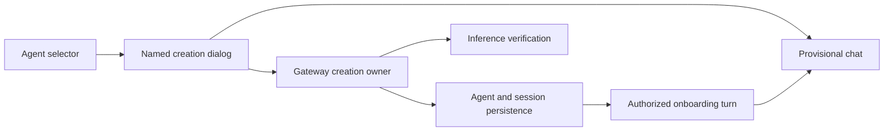

Codex review: needs changes before merge.

## What this changes

This PR opens named-agent chats immediately, adds conversational onboarding, and simplifies agent selection and Claws discovery.

**Example:** Create an agent named Scout and choose Researcher.
- **Before:** New agent opens Crestodian’s creation flow.
- **After:** Scout’s chat opens immediately with a greeting, followed by a plain-text role question and a tailored research follow-up.

## Review scores

| Measure | Result | What it means |
|---|---|---|
| **Overall readiness** | 🐚 platinum hermit **(4/6)** | Useful, source-supported work with strong behavioral evidence and no concrete introduced finding; failed exact-head checks still require attribution before landing. |
| **Proof confidence** | 🦞 diamond lobster **(5/6)** ✨ media proof bonus | Sufficient (screenshot): Inspected screenshots and supplied isolated-Gateway results cover the named dialog, immediate chat, saved greeting, plain-text role question, tailored follow-up, and reload ordering; the public-WebSocket test supplies forbidden-principal provider-effect evidence. |
| **Patch quality** | 🐚 platinum hermit **(4/6)** | No actionable review findings were identified. |

## Product

**Kind:** Feature · **Worth it:** Yes · **Fix scope:** Complete
**User problem:** Creating another agent redirects users away from their intended chat and delays useful feedback.
**Reason:** The maintainer-authored direction provides immediate named-chat feedback, conversational onboarding, and simpler navigation; no additional product approval is required.

## Merge readiness

⛔ **Needs changes before merge - 1 item remains**

This PR delivers an approved redesign that current main does not provide; no concrete introduced defect was found, but two exact-head CI failures remain unattributed.

**Priority:** P2
**Reviewed head:** `6ca42753c192be9ef1575e9d476f01a505eb3e3a`

## Before merge

- [ ] **Complete next step** - Inspect the two failed checks’ detailed output and classify each against the pinned base; repair only failures caused by this PR.

## Findings

None.

### Provenance

- `Runtime, metadata, and transcript internals`: original intent not found (unknown: Local path-history searches found relevant refactors, but unavailable historical blobs prevented complete changed-line provenance; no introduction claim is made for uncovered lines.)

<strong>Agent review details</strong>

### How this fits together

The Control UI presents provisional creation state while Gateway agent, config, session, and inference owners validate and persist the agent and conversation.

### Technical review

Best possible solution:

Keep creation in the existing agent and session owners, with display-only provisional chat state and shared catalog presentation.

Do we have a high-confidence way to reproduce the issue?

This is a feature redesign; current-main source confirms the prior Crestodian navigation, and supplied real-Gateway evidence demonstrates the replacement flow.

Is this the best way to solve the issue?

The inspected implementation coherently reuses existing creation, transcript, authority, recovery, and catalog owners rather than creating a parallel backend.

AGENTS.md: found and applied where relevant.

Codex review notes: model internal, reasoning medium; reviewed against [7d732724b773](https://github.com/openclaw/openclaw/commit/7d732724b77369bc8627001a1cad3a5a9a49c4b2).

### Provenance checked

- `Agents overview and selector` changes intended behavior with a stated reason (https://github.com/openclaw/openclaw/pull/141097: The roster-first page made configured agents and their conversations discoverable; this PR explicitly replaces that overview with selector-based access and discovery-only Claws.)
- `Agent navigation and pins` changes intended behavior with a stated reason (https://github.com/openclaw/openclaw/pull/174984: The earlier change emphasized agent navigation and quick access; this PR deliberately replaces pin controls with compact rows and direct settings actions.)
- `Memory indexing lifecycle` keeps the original intent (https://github.com/openclaw/openclaw/pull/174718: Cold startup avoids opening every memory index while reload resumes watched indexing; the PR narrows reload restoration to previously demanded configured agents.)

### Testing

Proof path: shipped entry point.

### Security

None.

### Evidence

What I checked:

- **Current-main behavior:** The fetched main revision still routes the selector’s new-agent action to Crestodian; the named-dialog flow remains distinct work. ([`ui/src/components/app-sidebar-agent-menu.tsx`](https://github.com/openclaw/openclaw/blob/7d732724b77369bc8627001a1cad3a5a9a49c4b2/ui/src/components/app-sidebar-agent-menu.tsx), [7d732724b773](https://github.com/openclaw/openclaw/commit/7d732724b77369bc8627001a1cad3a5a9a49c4b2))
- **Creation and authority ownership:** Inference verification checks current mutation authority and active config before persistence; detached onboarding retains operator-run authority and releases it after the chat owner completes. ([`src/gateway/server-methods/agents.ts:206`](https://github.com/openclaw/openclaw/blob/6ca42753c192be9ef1575e9d476f01a505eb3e3a/src/gateway/server-methods/agents.ts#L206), [6ca42753c192](https://github.com/openclaw/openclaw/commit/6ca42753c192be9ef1575e9d476f01a505eb3e3a))
- **Forbidden-principal proof:** The supplied public-WebSocket integration exercises an authorized creator, refuses a read-only creator before persistence or provider I/O, and revokes the detached creator before resuming the real chat handler, asserting rejection without another provider POST. ([`src/gateway/agents-create.inference-authority.integration.test.ts:281`](https://github.com/openclaw/openclaw/blob/6ca42753c192be9ef1575e9d476f01a505eb3e3a/src/gateway/agents-create.inference-authority.integration.test.ts#L281), [6ca42753c192](https://github.com/openclaw/openclaw/commit/6ca42753c192be9ef1575e9d476f01a505eb3e3a))
- **Inspected visual and live evidence:** Inspected the prepared before/after screenshots and later GitHub images showing the named dialog, ordinary-text role question, Researcher follow-up, and agent first after reload; Patrick’s live walkthrough is recorded at https://github.com/openclaw/openclaw/pull/175291#issuecomment-6306293687.
- **Stored-data upgrade:** The full PR body records a disposable v2026.10.5 upgrade retaining Scout’s name, session identity, original messages, and successful subsequent turn; the greeting uses the existing transcript format and creation transaction. ([`src/gateway/session-create-initial-assistant.ts:66`](https://github.com/openclaw/openclaw/blob/6ca42753c192be9ef1575e9d476f01a505eb3e3a/src/gateway/session-create-initial-assistant.ts#L66), [6ca42753c192](https://github.com/openclaw/openclaw/commit/6ca42753c192be9ef1575e9d476f01a505eb3e3a))
- **Exact-head CI failures:** checks-fast-baseline-ratchets and checks-ui (3/3) failed on the reviewed head. Ratchet annotations name paths outside this diff; detailed logs redirect to a blocked storage host, so neither failure is attributed to this PR. ([6ca42753c192](https://github.com/openclaw/openclaw/commit/6ca42753c192be9ef1575e9d476f01a505eb3e3a))

### PR surface

PR surface statistics unavailable: the file list is incomplete.

### Review metrics

| Metric | Value | Why it matters |
|---|---|---|
| **Creation protocol additions** | 2 optional request fields | agentId separates internal identity from display name, and onboarding requests verification and initial conversation creation. |
| **Browser persistence** | 1 automatic preference field | sidebarRecentlyCreatedAgentId retains roster ordering after reload without adding a user-facing configuration control. |

### Labels

Label changes:

- add `status: ⏳ waiting on author`: ClawSweeper has contributor-facing work open and is waiting for author action.
- remove `status: 👀 ready for maintainer look`: Current PR status label is `status: ⏳ waiting on author`.

Label justifications:

- `P2`: This improves agent creation and navigation without evidence of an urgent production outage.
- `rating: 🐚 platinum hermit`: Overall readiness is 🐚 platinum hermit; proof is 🦞 diamond lobster and patch quality is 🐚 platinum hermit.
- `status: ⏳ waiting on author`: ClawSweeper has contributor-facing work open and is waiting for author action.
- `proof: sufficient`: Contributor real behavior proof is sufficient.
- `proof: 📸 screenshot`: Contributor real behavior proof includes screenshot evidence.

### Rating scale

6/6 🦀 challenger crab · 5/6 🦞 diamond lobster · 4/6 🐚 platinum hermit · 3/6 🦐 gold shrimp · 2/6 🦪 silver shellfish · 1/6 🧂 unranked krab. Overall follows the weaker of proof and patch quality; ✨ marks media proof (a screenshot, video, or linked artifact) that directly shows the changed behavior.

### Workflow

ClawSweeper edits this one comment on every review. Comment `@clawsweeper re-review` for a fresh review only. Repair and merge execution lanes are retired.

### History

Review history (29 earlier review cycles; latest 8 shown)

<!-- clawsweeper-review-history v=1 total=29 -->
- reviewed 2026-10-20T21:54:58.488Z sha 0f15e7cbd4a575035d1d044c29d841f26ba678d7 :: needs changes before merge. :: [P3] Remove the superseded MCP pairing helper
- reviewed 2026-10-20T22:39:24.165Z sha 4a0bcd0d60c00ff9e29fc6da401c9ed4f46a7201 :: needs changes before merge. :: [P2] Filter Claws navigation with its Labs availability | [P2] Project the visible pending agent into the sidebar identity | [P2] Mount pending-chat fixtures through the registered bridge | [P2] Align sidebar assertions with the replacement menu | [P3] Remove the retired capabilities navigation method
- reviewed 2026-10-20T23:03:31.797Z sha 4d666888d9c65aaf5a748fb295075e9660dd4434 :: needs maintainer review before merge. :: none
- reviewed 2026-10-21T00:43:40.603Z sha 1fdf70892048c279cb8b50cf3f58d82be2c70c34 :: needs changes before merge. :: [P2] [P2] Derive avatar footer state without an unbudgeted effect
- reviewed 2026-10-21T01:28:30.551Z sha a85bc2c25b6343affe78d63f7b99eb96387e4431 :: needs changes before merge. :: [P2] Derive avatar footer state without an unbudgeted effect | [P2] Update the Plugins header test for the shared renderer | [P2] Remove the superseded catalog-header implementation
- reviewed 2026-10-21T02:20:58.766Z sha a546d89b080de2402ca0659cc7b48ff058b8209f :: needs changes before merge. :: [P2] Remove the superseded catalog-header implementation
- reviewed 2026-10-21T05:59:38.234Z sha d62ed8cf68f4c3db9256892946a8cd3a8d49817e :: needs changes before merge. :: [P2] Remove the superseded catalog-header implementation
- reviewed 2026-10-21T10:53:58.745Z sha 8a4af5c6284e052f5a557d203dfa07bfdd8b0133 :: needs maintainer review before merge. :: none

_Reviewed October 21, 2026, 7:43 AM ET / 11:43 UTC (Revision 30)._

<!-- clawsweeper-verdict:needs-changes item=175291 sha=6ca42753c192be9ef1575e9d476f01a505eb3e3a confidence=high updated_at=2026-10-21T11:33:28Z reviewed_at=2026-10-21T11:43:02.933Z lease_owner=github-run-39592666610-1 lease_comment_id=6314635676 source_revision=d077f61a9b1c587833438ba5862709f03a693f911aeaea6292e5fd0b26cb711a -->
<!-- clawsweeper-review-state:needs-changes item=175291 sha=6ca42753c192be9ef1575e9d476f01a505eb3e3a v=1 -->

<!-- clawsweeper-review-version item=175291 reviewed_at=2026-10-21T11:43:02.933Z sha=6ca42753c192be9ef1575e9d476f01a505eb3e3a source_revision=d077f61a9b1c587833438ba5862709f03a693f911aeaea6292e5fd0b26cb711a lease_owner=github-run-39592666610-1 lease_comment_id=6314635676 v=1 -->

<!-- clawsweeper-review item=175291 -->