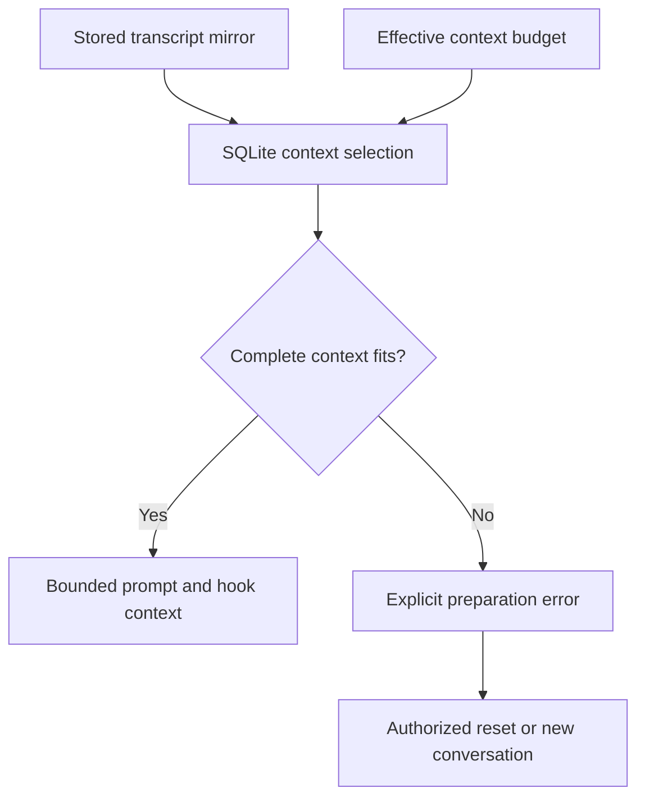

Codex review: blocked before merge. _Reviewed September 15, 2026, 9:31 PM ET / September 16, 2026, 01:31 UTC (Revision 4)._

# ClawSweeper review

## What this changes

Bounds the history loaded for Codex prompt and compaction hooks before allocating message bodies, adds optional SDK read limits and regression coverage, and repairs related test fixtures and typecheck partitioning.

## Merge readiness

⛔ **Blocked before merge - 2 items remain**

This remains a useful fix absent from current main and v2026.9.4. No blocking introduced defect was found; the recorded recovery decision resolves the earlier compatibility question.

**Priority:** P2
**Reviewed head:** `2effc2396fc5b9452c475e261df4c51792d52b57`

## Review scores

| Measure | Result | What it means |
|---|---|---|
| **Overall readiness** | 🐚 platinum hermit **(4/6)** | A focused repair with meaningful allocation and recovery evidence, preserved read invariants, and no blocking findings. |
| **Proof confidence** | 🐚 platinum hermit **(4/6)** | Sufficient (logs): Recorded synthetic runs exercise the production SQLite history reader and authorized prompt hook, showing reduced payload and clone allocation with unchanged stored history; six real reset/new handler cases restore bounded reads. All eight production files match the proof head. This proves the isolated changed path, not live provider continuity or total Gateway memory. |
| **Patch quality** | 🐚 platinum hermit **(4/6)** | No actionable review findings were identified. |

## Verification

| Check | Result | Evidence |
|---|---|---|
| **Real behavior** | Verified | Sufficient (logs): Recorded synthetic runs exercise the production SQLite history reader and authorized prompt hook, showing reduced payload and clone allocation with unchanged stored history; six real reset/new handler cases restore bounded reads. All eight production files match the proof head. This proves the isolated changed path, not live provider continuity or total Gateway memory. |
| **Evidence reviewed** | 11 items | Introduced implementation: The pinned merge-base-to-head diff adds byte sizing before payload hydration, preserves complete tool-result ownership, and constructs a detached context without transcript writes. Existing bounded reader is a different contract: The existing active-context reader carries writable transcript ancestry and full stored payloads; it does not provide this detached, projected, tool-frame-preserving read. Extending openModelContext avoids substituting that different contract. Admission and cancellation retained: Async reads still snapshot their inputs and revalidate admission, context version, cancellation, and completed-turn anchors before returning the detached result. The added limits do not grant new authority. |
| **Findings** | None | None. |
| **Security** | None | None. |

## How this fits together

OpenClaw stores a transcript mirror alongside Codex’s native conversation state. Its model-context reader supplies that mirror to prompt preparation and compaction hooks; this change limits those reads without rewriting stored history.

## Before merge

- [ ] **Resolve merge risk (P1)** - Existing sessions whose newest required frame or boundary exceeds the limit will stop preparation and require /reset or /new, losing active conversation continuity; this tradeoff is explicitly accepted in the discussion.
- [ ] **Resolve merge risk (P1)** - The recorded memory and recovery measurements do not establish production-wide RSS bounds or bounded allocation inside third-party full-history before_reset hooks.

<strong>Agent review details</strong>

### Security

None.

### PR surface

Source +215, Tests +440, Docs +11. Total +666 across 14 files.

View PR surface stats

| Area | Files | Added | Removed | Net |
|---|---:|---:|---:|---:|
| Source | 8 | 226 | 11 | +215 |
| Tests | 5 | 441 | 1 | +440 |
| Docs | 1 | 11 | 0 | +11 |
| Config | 0 | 0 | 0 | 0 |
| Generated | 0 | 0 | 0 | 0 |
| Other | 0 | 0 | 0 | 0 |
| **Total** | **14** | **678** | **12** | **+666** |

### Review metrics

| Metric | Value | Why it matters |
|---|---|---|
| **Production versus test growth** | Production +215 lines; tests +436; typecheck configuration +4 | Production growth implements pre-hydration sizing and tool-frame-safe selection; most added coverage checks preservation and rejection behavior. |
| **SDK compatibility** | 2 existing read methods gain optional limits; 0 new user settings | Existing callers retain their previous behavior when the new limits argument is omitted. |

### Merge-risk options

**Maintainer options:**
1. **Retain the recorded recovery tradeoff (recommended)**  
   Keep bounded reads enabled and accept explicit reset recovery for oversized required context, as already decided in the discussion.

### Technical review

Best possible solution:

Keep bounded selection in the canonical model-context reader, preserve unlimited SDK reads when limits are omitted, and retain the approved explicit reset recovery.

Do we have a high-confidence way to reproduce the issue?

Yes: current main still materializes the complete selected history, and the recorded 5,001-message reader-to-hook reproduction isolates that allocation path. This read-only review did not execute it.

Is this the best way to solve the issue?

Yes: selecting projected payloads before hydration addresses the allocation source while preserving storage and read fences; the existing writable bounded reader has a different contract.

AGENTS.md: found and applied where relevant.

Codex review notes: model internal, reasoning medium; reviewed against [6b23f3a39e38](https://github.com/openclaw/openclaw/commit/6b23f3a39e3848c10e32be2ea4d0f59b078dac4c).

### Labels

Label changes:

- add `proof: sufficient`: Contributor real behavior proof is sufficient. Recorded synthetic runs exercise the production SQLite history reader and authorized prompt hook, showing reduced payload and clone allocation with unchanged stored history; six real reset/new handler cases restore bounded reads. All eight production files match the proof head. This proves the isolated changed path, not live provider continuity or total Gateway memory.

Label justifications:

- `P2`: This is a focused memory-use repair for long-running Codex sessions with measured allocation improvement.
- `merge-risk: 🚨 compatibility`: Enabled limits can interrupt an existing oversized session and require an explicitly accepted continuity-clearing reset.
- `rating: 🐚 platinum hermit`: Overall readiness is 🐚 platinum hermit; proof is 🐚 platinum hermit and patch quality is 🐚 platinum hermit.
- `status: 👀 ready for maintainer look`: ClawSweeper has no concrete contributor-facing blocker left for this PR. Sufficient (logs): Recorded synthetic runs exercise the production SQLite history reader and authorized prompt hook, showing reduced payload and clone allocation with unchanged stored history; six real reset/new handler cases restore bounded reads. All eight production files match the proof head. This proves the isolated changed path, not live provider continuity or total Gateway memory.
- `proof: sufficient`: Contributor real behavior proof is sufficient. Recorded synthetic runs exercise the production SQLite history reader and authorized prompt hook, showing reduced payload and clone allocation with unchanged stored history; six real reset/new handler cases restore bounded reads. All eight production files match the proof head. This proves the isolated changed path, not live provider continuity or total Gateway memory.

### Evidence

What I checked:

- **Introduced implementation:** The pinned merge-base-to-head diff adds byte sizing before payload hydration, preserves complete tool-result ownership, and constructs a detached context without transcript writes. ([`src/config/sessions/session-accessor.sqlite-model-context.ts:156`](https://github.com/openclaw/openclaw/blob/2effc2396fc5b9452c475e261df4c51792d52b57/src/config/sessions/session-accessor.sqlite-model-context.ts#L156), [2effc2396fc5](https://github.com/openclaw/openclaw/commit/2effc2396fc5b9452c475e261df4c51792d52b57))
- **Existing bounded reader is a different contract:** The existing active-context reader carries writable transcript ancestry and full stored payloads; it does not provide this detached, projected, tool-frame-preserving read. Extending openModelContext avoids substituting that different contract. ([`src/config/sessions/session-accessor.sqlite-active-context.ts:112`](https://github.com/openclaw/openclaw/blob/2effc2396fc5b9452c475e261df4c51792d52b57/src/config/sessions/session-accessor.sqlite-active-context.ts#L112), [2effc2396fc5](https://github.com/openclaw/openclaw/commit/2effc2396fc5b9452c475e261df4c51792d52b57))
- **Admission and cancellation retained:** Async reads still snapshot their inputs and revalidate admission, context version, cancellation, and completed-turn anchors before returning the detached result. The added limits do not grant new authority. ([`src/agents/sessions/session-manager.ts:267`](https://github.com/openclaw/openclaw/blob/2effc2396fc5b9452c475e261df4c51792d52b57/src/agents/sessions/session-manager.ts#L267), [2effc2396fc5](https://github.com/openclaw/openclaw/commit/2effc2396fc5b9452c475e261df4c51792d52b57))
- **Still necessary on main and latest release:** Inspected the history reader at fetched main and v2026.9.4: both call openModelContextAsync without limits. The main SQLite reader also lacks the introduced bounded selection. ([`extensions/codex/src/app-server/session-history.ts:108`](https://github.com/openclaw/openclaw/blob/6b23f3a39e3848c10e32be2ea4d0f59b078dac4c/extensions/codex/src/app-server/session-history.ts#L108), [6b23f3a39e38](https://github.com/openclaw/openclaw/commit/6b23f3a39e3848c10e32be2ea4d0f59b078dac4c))
- **Recorded memory and recovery evidence:** The supplied body and https://github.com/openclaw/openclaw/pull/149520#issuecomment-5689819656 report the real SQLite history reader and prompt-hook path reducing returned data from 31,022,852 to 1,005,282 bytes, with newest-message and transcript-hash checks passing. Six real-handler synthetic reset/new cases recover bounded reads. These observations establish the isolated allocation and recovery behavior, not production-wide RSS or a subsequent provider turn. ([6abbefe92076](https://github.com/openclaw/openclaw/commit/6abbefe92076b91bbdf7c6a0e4ae806259d95a9c))
- **Proof continuity:** The comparison returned no differences in all eight production files between the recorded memory/recovery proof head and the reviewed head. ([2effc2396fc5](https://github.com/openclaw/openclaw/commit/2effc2396fc5b9452c475e261df4c51792d52b57))

Likely related people:

- **Peter Steinberger:** Suggested for follow-up; no historical authorship or introduction is verified. (role: unverified routing candidate; confidence: low)
- **Josh Lehman:** Suggested for follow-up; no historical authorship or introduction is verified. (role: unverified routing candidate; confidence: low)

### Rating scale

| Score | Internal tier | Crab rank | Meaning |
|---:|:---:|---|---|
| **6/6** | S | 🦀 challenger crab | Exceptional readiness |
| **5/6** | A | 🦞 diamond lobster | Very strong readiness |
| **4/6** | B | 🐚 platinum hermit | Good normal PR; ordinary maintainer review |
| **3/6** | C | 🦐 gold shrimp | Useful, but confidence is limited |
| **2/6** | D | 🦪 silver shellfish | Proof or implementation needs work |
| **1/6** | F | 🧂 unranked krab | Not merge-ready |
| N/A | NA | 🌊 off-meta tidepool | Rating does not apply |

Overall follows the weaker of proof and patch quality.
Shiny media proof means a screenshot, video, or linked artifact directly shows the changed behavior. Runtime, network, CSP, and security claims still need visible diagnostics.

### Workflow

- ClawSweeper keeps one durable marker-backed review comment per issue or PR.
- Re-runs edit this comment so the latest verdict, findings, and automation markers stay together instead of adding duplicate bot comments.
- A fresh review can be triggered by eligible `@clawsweeper re-review` comments, exact-item GitHub events, scheduled/background review runs, or manual workflow dispatch.
- PR/issue authors and users with repository write access can comment `@clawsweeper re-review` or `@clawsweeper re-run` on an open PR or issue to request a fresh review only.
- Maintainers can also comment `@clawsweeper review` to request a fresh review only.
- Fresh-review commands do not start repair, autofix, rebase, CI repair, or automerge.
- Maintainer-only repair and merge flows require explicit commands such as `@clawsweeper autofix`, `@clawsweeper automerge`, `@clawsweeper fix ci`, or `@clawsweeper address review`.
- Maintainers can comment `@clawsweeper explain` to ask for more context, or `@clawsweeper stop` to stop active automation.

### History

Review history (3 earlier review cycles)

<!-- clawsweeper-review-history v=1 total=3 -->
- reviewed 2026-09-15T23:51:09.485Z sha 8dc4ed5dde05d5a35231aebf2d6ef2beae26e5ff :: blocked before merge. :: none
- reviewed 2026-09-16T00:07:30.617Z sha 8dc4ed5dde05d5a35231aebf2d6ef2beae26e5ff :: blocked before merge. :: none
- reviewed 2026-09-16T00:52:21.220Z sha 6abbefe92076b91bbdf7c6a0e4ae806259d95a9c :: blocked before merge. :: none

<!-- clawsweeper-verdict:needs-human item=149520 sha=2effc2396fc5b9452c475e261df4c51792d52b57 confidence=high updated_at=2026-09-16T01:23:35Z reviewed_at=2026-09-16T01:31:01.469Z lease_owner=github-run-35043751244-1 lease_comment_id=5690603420 source_revision=15daf3197c0dd1b7611e4690d451d8ce0cdf7d097455ef091fcaf06cea475739 live_verification=absent -->
<!-- clawsweeper-review-state:blocked item=149520 sha=2effc2396fc5b9452c475e261df4c51792d52b57 v=1 -->

<!-- clawsweeper-review-version item=149520 reviewed_at=2026-09-16T01:31:01.469Z sha=2effc2396fc5b9452c475e261df4c51792d52b57 source_revision=15daf3197c0dd1b7611e4690d451d8ce0cdf7d097455ef091fcaf06cea475739 lease_owner=github-run-35043751244-1 lease_comment_id=5690603420 v=1 -->

<!-- clawsweeper-review item=149520 -->