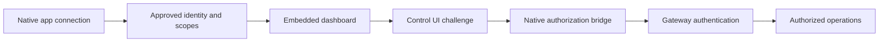

Codex review: blocked before merge. _Reviewed September 28, 2026, 6:04 PM ET / 22:04 UTC (Revision 7)._

# ClawSweeper review

## What this changes

The branch lets embedded Android, macOS, and Linux dashboards authenticate through their native app’s approved Gateway connection, with Control UI handshake changes and platform coverage.

## Merge readiness

⛔ **Blocked before merge - 3 items remain**

The native authentication repair remains useful and is not on current main. One previously reported P1 defect remains at the pinned head: a macOS Primary dashboard authenticated by a device grant can be replaced with a reconnecting failure page during a route update.

**Priority:** P2
**Reviewed head:** `2ac72c49d019bd7526270f32deb7f6ed17f80a14`

## Review scores

| Measure | Result | What it means |
|---|---|---|
| **Overall readiness** | 🦐 gold shrimp **(3/6)** | The branch has substantial cross-boundary validation, but the repeatable macOS tokenless refresh defect blocks readiness. |
| **Proof confidence** | 🦞 diamond lobster **(5/6)** | Not applicable: This member-authored PR is exempt from the ordinary contributor proof gate. Its captured body reports a production Rust signer-to-real-Gateway final-operation trace and exact-head macOS runtime success; installed Android/Linux GUI timing remains unobserved, and no stored-data contract changes. |
| **Patch quality** | 🦐 gold shrimp **(3/6)** | 1 actionable review finding remain. |

## Verification

| Check | Result | Evidence |
|---|---|---|
| **Real behavior** | Not applicable | Not applicable: This member-authored PR is exempt from the ordinary contributor proof gate. Its captured body reports a production Rust signer-to-real-Gateway final-operation trace and exact-head macOS runtime success; installed Android/Linux GUI timing remains unobserved, and no stored-data contract changes. |
| **Evidence reviewed** | 9 items | Introduced tokenless dashboard path: The PR constructs native-device dashboard authorization from the accepted binding; the shared token and password can both be absent.<br>Device-grant binding: A device-token native connection projects an empty legacy shared-credential map, while the dashboard still has an accepted native binding.<br>Unresolved Primary route guard: On a changed route or credentials, this guard admits only a shared credential or browser identity and otherwise replaces the dashboard with a failure page. The URL-update branch at line 359 has the same omission. |
| **Findings** | 1 actionable finding | [P1] Admit tokenless native bindings on Primary route updates |
| **Security** | None | None. |

## How this fits together

Native apps open the Gateway-hosted Control UI inside an embedded dashboard. The app supplies a current signed authorization for the browser’s Gateway handshake, which then controls access to Gateway operations.



## Before merge

- [ ] **Admit tokenless native bindings on Primary route updates (P1)** - The new native-device configuration can have an accepted binding with neither token nor password. On a route or TLS change, `handleEndpointState` still admits only `hasCredential` or browser identity and replaces that valid dashboard with the reconnecting failure page; its URL-update branch has the same omission. Include `hasAcceptedNativeBinding` in both guards and cover a device-grant-only refresh.
- [ ] **Resolve merge risk (P1)** - A macOS Primary dashboard using an accepted device grant without shared credentials can lose its page on a route, TLS, or URL refresh and show the reconnecting failure page.
- [ ] **Complete next step (P2)** - Admit accepted tokenless native bindings in both macOS Primary route guards and verify a device-grant-only route refresh before merge.

## Findings

- [P1] Admit tokenless native bindings on Primary route updates — `apps/macos/Sources/OpenClaw/DashboardManager+Construction.swift:242-246`


<details>
<summary><strong>Agent review details</strong></summary>

### Security

None.

### PR surface

Source +440, Tests +1483, Docs +6, Config +3, Other +3923. Total +5855 across 59 files.

<details>
<summary>View PR surface stats</summary>

| Area | Files | Added | Removed | Net |
|---|---:|---:|---:|---:|
| Source | 6 | 609 | 169 | +440 |
| Tests | 11 | 1642 | 159 | +1483 |
| Docs | 1 | 6 | 0 | +6 |
| Config | 1 | 3 | 0 | +3 |
| Generated | 0 | 0 | 0 | 0 |
| Other | 40 | 4392 | 469 | +3923 |
| **Total** | **59** | **6652** | **797** | **+5855** |

</details>

### Review metrics

| Metric | Value | Why it matters |
|---|---|---|
| **Production versus test growth** | production/support +3066/-413; tests +3586/-384 | The substantial production growth covers three native transport adapters and the Control UI, with larger regression coverage across those boundaries. |

### Merge-risk options

**Maintainer options:**
1. **Repair tokenless Primary refresh (recommended)**  
   Accept the current native binding in both macOS route guards and prove a device-grant-only route update retains the dashboard.

<details>
<summary>Copy recommended automerge instruction</summary>

```text
@clawsweeper automerge

Special instructions:
Repair both macOS Primary route guards for accepted tokenless native bindings and add a focused device-grant-only refresh regression; preserve the native-only identity path.
```

</details>

### Technical review

Best possible solution:

Keep native signing as the dashboard identity owner, admit an accepted native binding through both macOS Primary route guards, and protect tokenless refresh with a focused regression.

Do we have a high-confidence way to reproduce the issue?

Yes, from source: start a macOS Primary dashboard on an accepted device grant with no shared token, then refresh its route or TLS state. The new native binding reaches guards that reject it; I did not execute the app locally.

Is this the best way to solve the issue?

No, not yet: native signing is the right owner-level repair, but both Primary route guards must recognize its accepted tokenless binding.

Full review comments:

- [P1] Admit tokenless native bindings on Primary route updates — `apps/macos/Sources/OpenClaw/DashboardManager+Construction.swift:242-246`
  The new native-device configuration can have an accepted binding with neither token nor password. On a route or TLS change, `handleEndpointState` still admits only `hasCredential` or browser identity and replaces that valid dashboard with the reconnecting failure page; its URL-update branch has the same omission. Include `hasAcceptedNativeBinding` in both guards and cover a device-grant-only refresh.
  Confidence: 0.97

Overall correctness: patch is incorrect
Overall confidence: 0.94

AGENTS.md: found and applied where relevant.

Codex review notes: model internal, reasoning high; reviewed against [0a5ef7d9e0c6](https://github.com/openclaw/openclaw/commit/0a5ef7d9e0c696163e367aade4bef24befbfa2a2).

### Labels

Label changes:

- remove `proof: sufficient`: Current real behavior proof status is not_applicable, not sufficient.

Label justifications:

- `P2`: The dashboard authentication repair affects several native apps, while the remaining proven defect is limited to macOS Primary refresh.
- `merge-risk: 🚨 compatibility`: An existing tokenless native-device setup can lose dashboard access after a Primary route update.
- `merge-risk: 🚨 security-boundary`: The change carries native authentication across embedded browser and Gateway boundaries, where current route and grant checks matter beyond green CI.
- `rating: 🦐 gold shrimp`: Overall readiness is 🦐 gold shrimp; proof is 🦞 diamond lobster and patch quality is 🦐 gold shrimp.
- `status: ⏳ waiting on author`: ClawSweeper has contributor-facing work open and is waiting for author action. Not applicable: This member-authored PR is exempt from the ordinary contributor proof gate. Its captured body reports a production Rust signer-to-real-Gateway final-operation trace and exact-head macOS runtime success; installed Android/Linux GUI timing remains unobserved, and no stored-data contract changes.

### Evidence

Acceptance criteria:

- [P1] swift test --package-path apps/macos --filter DashboardGatewaysTests.
- [P1] swift build --package-path apps/macos --build-system native --build-tests.

What I checked:

- **Introduced tokenless dashboard path:** The PR constructs native-device dashboard authorization from the accepted binding; the shared token and password can both be absent. ([`apps/macos/Sources/OpenClaw/DashboardManager+Construction.swift:242`](https://github.com/openclaw/openclaw/blob/2ac72c49d019bd7526270f32deb7f6ed17f80a14/apps/macos/Sources/OpenClaw/DashboardManager%2BConstruction.swift#L242), [2ac72c49d019](https://github.com/openclaw/openclaw/commit/2ac72c49d019bd7526270f32deb7f6ed17f80a14))
- **Device-grant binding:** A device-token native connection projects an empty legacy shared-credential map, while the dashboard still has an accepted native binding. ([`apps/macos/Sources/OpenClaw/GatewayConnection+ControlUIAuth.swift:31`](https://github.com/openclaw/openclaw/blob/2ac72c49d019bd7526270f32deb7f6ed17f80a14/apps/macos/Sources/OpenClaw/GatewayConnection%2BControlUIAuth.swift#L31), [2ac72c49d019](https://github.com/openclaw/openclaw/commit/2ac72c49d019bd7526270f32deb7f6ed17f80a14))
- **Unresolved Primary route guard:** On a changed route or credentials, this guard admits only a shared credential or browser identity and otherwise replaces the dashboard with a failure page. The URL-update branch at line 359 has the same omission. ([`apps/macos/Sources/OpenClaw/DashboardManager.swift:341`](https://github.com/openclaw/openclaw/blob/2ac72c49d019bd7526270f32deb7f6ed17f80a14/apps/macos/Sources/OpenClaw/DashboardManager.swift#L341), [2ac72c49d019](https://github.com/openclaw/openclaw/commit/2ac72c49d019bd7526270f32deb7f6ed17f80a14))
- **Missing route regression case:** The ready-state route revisions in the macOS dashboard tests supply shared tokens; they do not exercise a device-grant-only Primary refresh. ([`apps/macos/Tests/OpenClawIPCTests/DashboardGatewaysTests.swift:434`](https://github.com/openclaw/openclaw/blob/2ac72c49d019bd7526270f32deb7f6ed17f80a14/apps/macos/Tests/OpenClawIPCTests/DashboardGatewaysTests.swift#L434), [2ac72c49d019](https://github.com/openclaw/openclaw/commit/2ac72c49d019bd7526270f32deb7f6ed17f80a14))
- **Current-main check:** Fetched main still has the original credential-or-browser-identity route guard and does not include this native dashboard repair. ([`apps/macos/Sources/OpenClaw/DashboardManager.swift:332`](https://github.com/openclaw/openclaw/blob/0a5ef7d9e0c696163e367aade4bef24befbfa2a2/apps/macos/Sources/OpenClaw/DashboardManager.swift#L332), [0a5ef7d9e0c6](https://github.com/openclaw/openclaw/commit/0a5ef7d9e0c696163e367aade4bef24befbfa2a2))
- **Authority boundary:** The Linux bridge rechecks the live document route after awaiting the native connection and immediately before the native signer; Android likewise checks its current operator lease and page before returning a signed authorization. ([`apps/linux/src-tauri/src/gateway_windows.rs:3009`](https://github.com/openclaw/openclaw/blob/2ac72c49d019bd7526270f32deb7f6ed17f80a14/apps/linux/src-tauri/src/gateway_windows.rs#L3009), [2ac72c49d019](https://github.com/openclaw/openclaw/commit/2ac72c49d019bd7526270f32deb7f6ed17f80a14))

Likely related people:

- **Peter Steinberger:** Suggested for follow-up; no historical authorship or introduction is verified. (role: unverified routing candidate; confidence: low)
- **RoboClaw:** Suggested for follow-up; no historical authorship or introduction is verified. (role: unverified routing candidate; confidence: low)

### Rank-up moves

Optional improvements that raise the rating; they are not merge blockers.

- Fix both macOS Primary route guards and show the tokenless device-grant refresh regression failing before and passing after the repair.

### Rating scale

| Score | Internal tier | Crab rank | Meaning |
|---:|:---:|---|---|
| **6/6** | S | 🦀 challenger crab | Exceptional readiness |
| **5/6** | A | 🦞 diamond lobster | Very strong readiness |
| **4/6** | B | 🐚 platinum hermit | Good normal PR; ordinary maintainer review |
| **3/6** | C | 🦐 gold shrimp | Useful, but confidence is limited |
| **2/6** | D | 🦪 silver shellfish | Proof or implementation needs work |
| **1/6** | F | 🧂 unranked krab | Not merge-ready |
| N/A | NA | 🌊 off-meta tidepool | Rating does not apply |

Overall follows the weaker of proof and patch quality.
Shiny media proof means a screenshot, video, or linked artifact directly shows the changed behavior. Runtime, network, CSP, and security claims still need visible diagnostics.

### Workflow

- ClawSweeper keeps one durable marker-backed review comment per issue or PR.
- Re-runs edit this comment so the latest verdict, findings, and automation markers stay together instead of adding duplicate bot comments.
- A fresh review can be triggered by eligible `@clawsweeper re-review` comments, exact-item GitHub events, scheduled/background review runs, or manual workflow dispatch.
- PR/issue authors and users with repository write access can comment `@clawsweeper re-review` or `@clawsweeper re-run` on an open PR or issue to request a fresh review only.
- Maintainers can also comment `@clawsweeper review` to request a fresh review only.
- Fresh-review commands do not start repair, autofix, rebase, CI repair, or automerge.
- Maintainer-only repair and merge flows require explicit commands such as `@clawsweeper autofix`, `@clawsweeper automerge`, `@clawsweeper fix ci`, or `@clawsweeper address review`.
- Maintainers can comment `@clawsweeper explain` to ask for more context, or `@clawsweeper stop` to stop active automation.

### History

<details>
<summary>Review history (6 earlier review cycles)</summary>

<!-- clawsweeper-review-history v=1 total=6 -->
- reviewed 2026-09-27T20:04:49.803Z sha 896bfbeda06d4a8dfe49e6829a1dbd38fba3efe1 :: blocked before merge. :: [P1] Preserve dashboard access on older Android WebViews
- reviewed 2026-09-28T07:47:07.832Z sha 790fc72d1267e61a5c920964d917a7fe2fd120b1 :: needs real behavior proof before merge. :: [P1] Keep dashboards usable during staggered upgrades
- reviewed 2026-09-28T20:47:57.612Z sha df31e1389052e723151ac774f04868bf6717b9b4 :: needs maintainer review before merge. :: none
- reviewed 2026-09-28T21:08:47.962Z sha f14a80c01c713032fed58f8e5cc3256e39c45ecb :: blocked before merge. :: none
- reviewed 2026-09-28T21:44:12.091Z sha 2ac72c49d019bd7526270f32deb7f6ed17f80a14 :: blocked before merge. :: [P1] Accept native device authorization during dashboard refresh
- reviewed 2026-09-28T21:56:23.109Z sha 2ac72c49d019bd7526270f32deb7f6ed17f80a14 :: needs changes before merge. :: [P1] Admit tokenless native bindings on Primary route updates

</details>

</details>

<!-- clawsweeper-verdict:needs-human item=159860 sha=2ac72c49d019bd7526270f32deb7f6ed17f80a14 confidence=high updated_at=2026-09-28T22:01:05Z reviewed_at=2026-09-28T22:04:56.106Z lease_owner=github-run-36489590467-1 lease_comment_id=5879531237 source_revision=6cb3e2486895d20648071a5602bfc8c34f0a0a5a4c3fcadb828b2d0358245fd0 live_verification=absent -->
<!-- clawsweeper-review-state:blocked item=159860 sha=2ac72c49d019bd7526270f32deb7f6ed17f80a14 v=1 -->

<!-- clawsweeper-review-version item=159860 reviewed_at=2026-09-28T22:04:56.106Z sha=2ac72c49d019bd7526270f32deb7f6ed17f80a14 source_revision=6cb3e2486895d20648071a5602bfc8c34f0a0a5a4c3fcadb828b2d0358245fd0 lease_owner=github-run-36489590467-1 lease_comment_id=5879531237 v=1 -->

<!-- clawsweeper-review item=159860 -->