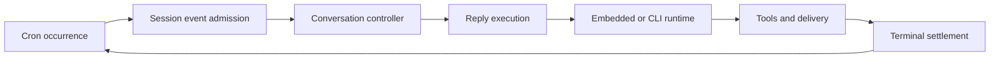

Codex review: needs changes before merge.

## What this changes

Routes explicitly conversation-targeted scheduled turns through ordinary session admission, execution, delivery, and settlement.

**Example:** A scheduled report targets session:agent:main:project:inbox while another turn is active.
- **Before:** Cron uses its separate execution path after waiting for the conversation.
- **After:** The report joins the conversation’s ordinary queue, and Cron waits for terminal settlement.

## Review scores

| Measure | Result | What it means |
|---|---|---|
| **Overall readiness** | 🦪 silver shellfish **(2/6)** | Useful ownership consolidation with meaningful runtime and authority evidence, but the remaining premature-completion regression blocks merge. |
| **Proof confidence** | 🐚 platinum hermit **(4/6)** | Sufficient (terminal): For this maintainer-authored PR, the supplied isolated Gateway continuation run and production-owner controls cover allowed execution, queued revocation, forbidden workspace access, and revocation during publication; the latest route regression rejects the stale destination before the transport adapter while controls still send. |
| **Patch quality** | 🦪 silver shellfish **(2/6)** | 1 actionable review finding remain. |

## Product

**Kind:** Refactor · **Worth it:** Yes · **Fix scope:** Complete
**User problem:** Scheduled conversation work has a separate execution owner, making conversation queueing, authority, workspace custody, and completion harder to keep consistent.
**Reason:** The maintainer-authored direction consolidates existing responsibility, preserves later migration boundaries, and explicitly approves the additive Claw review variants.

## Regression provenance

Possible regression — suspected (reviewed change). No predecessor PR is attributed.

## Merge readiness

⛔ **Needs changes before merge - 2 items remain**

Keep this maintainer-authored PR open: the session-admission cutover is useful, but the previously reported scheduled-send finality regression remains unfixed.

**Priority:** P2
**Reviewed head:** `78c8fa1884a7b5fc434f0b2b3e286d77b17bfb0a`

## Before merge

- [ ] **Preserve Cron’s nonfinal default for scheduled message sends (P1)** - This previously reported finding remains unfixed. For a session-targeted announce job that sends to its configured destination with final omitted and then updates a ledger, both adapters consume this builder without messageToolFinalByDefault. resolveMessageToolSourceReplyFinal consequently defaults to true, and the embedded terminal hook can complete the turn immediately after the send, skipping the ledger update. Forward scheduledAutomation.sourceDelivery.messageTool.finalByDefault here and cover continued execution after the send, preserving the contract from https://github.com/openclaw/openclaw/pull/176141.
- [ ] **Explain or restore the original intent of Scheduled message-send finality** - 075b46634555fa317782a0f4d88e158faa935e42: A configured Cron destination must not end the job when final is omitted, because post-send steps still need to run.

## Findings

- [P1] Preserve Cron’s nonfinal default for scheduled message sends — `src/auto-reply/reply/agent-runner-run-params.ts:173-177`

### Provenance

- `Scheduled message-send finality` changes intended behavior without addressing why it exists (075b46634555fa317782a0f4d88e158faa935e42: A configured Cron destination must not end the job when final is omitted, because post-send steps still need to run.)

### Tests

- Missing end-to-end proof: The supplied proof does not exercise a session-targeted same-destination send with final omitted followed by a real ledger write.

<strong>Agent review details</strong>

### How this fits together

Cron supplies scheduled work and captured authority to the session controller; ordinary reply execution produces tool effects, delivery evidence, and a terminal result for Cron history.

### Technical review

Best possible solution:

Forward Cron’s existing message-tool finality default through the shared candidate builder and preserve send-then-continue behavior through ordinary session execution.

Do we have a high-confidence way to reproduce the issue?

Source establishes the failing path: scheduled candidates omit the finality override, the resolver defaults omitted final to true, and a confirmed same-target send terminates embedded execution; no target code was run during this review.

Is this the best way to solve the issue?

Reusing ordinary session admission is the right ownership direction, and the smallest remaining repair is one shared parameter projection rather than another execution or delivery owner.

Full review comments:

- [P1] Preserve Cron’s nonfinal default for scheduled message sends — `src/auto-reply/reply/agent-runner-run-params.ts:173-177`
  This previously reported finding remains unfixed. For a session-targeted announce job that sends to its configured destination with final omitted and then updates a ledger, both adapters consume this builder without messageToolFinalByDefault. resolveMessageToolSourceReplyFinal consequently defaults to true, and the embedded terminal hook can complete the turn immediately after the send, skipping the ledger update. Forward scheduledAutomation.sourceDelivery.messageTool.finalByDefault here and cover continued execution after the send, preserving the contract from https://github.com/openclaw/openclaw/pull/176141.
  Confidence: 0.99

Overall correctness: patch is incorrect
Overall confidence: 0.98

AGENTS.md: found and applied where relevant.

Codex review notes: model internal, reasoning medium; reviewed against [1bc029e59c6c](https://github.com/openclaw/openclaw/commit/1bc029e59c6cef775559b6603091316560b00760).

### Provenance checked

- `Ordinary session-event admission and settlement` keeps the original intent (753a7a57be105d1d64d5205cce0c8486a0662453: Move immediate notifications into ordinary conversation execution while retaining source authority, FIFO ordering, and terminal settlement.)
- `Managed workspace custody` keeps the original intent (300ef39911589236663ef9c37edccbd7c998d8ca: Use the bound conversation workspace while rejecting foreign, missing, retired, or mismatched worktrees.)
- `Recorded inference account` keeps the original intent (d25a316fc7c3ea2c9685b2c287e2ab23637c52fe: Keep an automation on its authorized account across default changes, with live revocation and replacement checks.)

### Testing

Proof path: shipped entry point.

### Security

None.

### Evidence

Acceptance criteria:

- pnpm test src/auto-reply/reply/agent-runner-execution-session-events.test.ts --maxWorkers=1
- pnpm test src/agents/embedded-agent-runner/run/message-tool-terminal.test.ts --maxWorkers=1
- pnpm test src/auto-reply/reply/session-event-config-readmission.test.ts --maxWorkers=1
- git diff --check

What I checked:

- **Pinned introduction and current-main behavior:** The introduced diff adds explicit session agent-turn routing; fetched main still sends that work through executeDetachedCronJob. ([`src/cron/service/timer-execution.ts:218`](https://github.com/openclaw/openclaw/blob/78c8fa1884a7b5fc434f0b2b3e286d77b17bfb0a/src/cron/service/timer-execution.ts#L218), [78c8fa1884a7](https://github.com/openclaw/openclaw/commit/78c8fa1884a7b5fc434f0b2b3e286d77b17bfb0a))
- **Unfixed finality propagation:** The shared candidate parameters forward scheduled prompt finalization and explicit-target policy but omit messageToolFinalByDefault; both execution adapters consume this builder. ([`src/auto-reply/reply/agent-runner-run-params.ts:173`](https://github.com/openclaw/openclaw/blob/78c8fa1884a7b5fc434f0b2b3e286d77b17bfb0a/src/auto-reply/reply/agent-runner-run-params.ts#L173), [78c8fa1884a7](https://github.com/openclaw/openclaw/commit/78c8fa1884a7b5fc434f0b2b3e286d77b17bfb0a))
- **Existing Cron contract:** The detached executor explicitly forwards sourceDelivery.messageTool.finalByDefault. The deliberate send-then-continue contract and its accepted extra model call are documented in https://github.com/openclaw/openclaw/pull/176141. ([`src/cron/isolated-agent/run-prompt-executor.ts:463`](https://github.com/openclaw/openclaw/blob/075b46634555fa317782a0f4d88e158faa935e42/src/cron/isolated-agent/run-prompt-executor.ts#L463), [075b46634555](https://github.com/openclaw/openclaw/commit/075b46634555fa317782a0f4d88e158faa935e42))
- **Concrete premature-completion path:** An omitted final argument defaults to true; a confirmed current-source send then causes the embedded terminal hook to return terminate: true. ([`src/agents/embedded-agent-runner/run/message-tool-terminal.ts:129`](https://github.com/openclaw/openclaw/blob/78c8fa1884a7b5fc434f0b2b3e286d77b17bfb0a/src/agents/embedded-agent-runner/run/message-tool-terminal.ts#L129), [78c8fa1884a7](https://github.com/openclaw/openclaw/commit/78c8fa1884a7b5fc434f0b2b3e286d77b17bfb0a))
- **Prior findings reconciled:** The shared parameter builder is unchanged since the preceding reviewed head, so the finality finding remains applicable; the overflow fixture now includes durationMs: 1. ([`src/auto-reply/reply/session-event-config-readmission.test.ts:926`](https://github.com/openclaw/openclaw/blob/78c8fa1884a7b5fc434f0b2b3e286d77b17bfb0a/src/auto-reply/reply/session-event-config-readmission.test.ts#L926), [78c8fa1884a7](https://github.com/openclaw/openclaw/commit/78c8fa1884a7b5fc434f0b2b3e286d77b17bfb0a))
- **Destination repair and authority controls:** The latest repair composes the live route check into the message capability fence. Its production-owner regression covers changed, unchanged, and delivery:none routes; continuation coverage also checks revoked authority before effects. ([`src/cron/session-run.ts:125`](https://github.com/openclaw/openclaw/blob/78c8fa1884a7b5fc434f0b2b3e286d77b17bfb0a/src/cron/session-run.ts#L125), [78c8fa1884a7](https://github.com/openclaw/openclaw/commit/78c8fa1884a7b5fc434f0b2b3e286d77b17bfb0a))

Likely related people:

- **Peter Steinberger:** Raw commit 753a7a57be105d1d64d5205cce0c8486a0662453 adds src/auto-reply/reply/session-event-handoff.ts:67 relative to its recorded parents. This identifies author metadata, not feature responsibility or a PR merger. (role: source-line author; confidence: high; commits: [753a7a57be10](https://github.com/openclaw/openclaw/commit/753a7a57be105d1d64d5205cce0c8486a0662453); files: `src/auto-reply/reply/session-event-handoff.ts`)
- **Ayaan Zaidi:** Raw commit 075b46634555fa317782a0f4d88e158faa935e42 adds src/cron/isolated-agent/run-prompt-executor.ts:469 relative to its recorded parents. This identifies author metadata, not feature responsibility or a PR merger. (role: source-line author; confidence: high; commits: [075b46634555](https://github.com/openclaw/openclaw/commit/075b46634555fa317782a0f4d88e158faa935e42); files: `src/cron/isolated-agent/run-prompt-executor.ts`)
- **Jason (Json):** Raw commit d25a316fc7c3ea2c9685b2c287e2ab23637c52fe adds src/cron/isolated-agent/run-prompt-executor.ts:168 relative to its recorded parents. This identifies author metadata, not feature responsibility or a PR merger. (role: source-line author; confidence: high; commits: [d25a316fc7c3](https://github.com/openclaw/openclaw/commit/d25a316fc7c3ea2c9685b2c287e2ab23637c52fe); files: `src/cron/isolated-agent/run-prompt-executor.ts`)

### PR surface

Source +1433, Tests +2099, Docs +4. Total +3536 across 80 files. Added test files: 4.

View PR surface stats

| Area | Files | Added | Removed | Net |
|---|---:|---:|---:|---:|
| Source | 60 | 2400 | 967 | +1433 |
| Tests | 18 | 2232 | 133 | +2099 |
| Docs | 2 | 5 | 1 | +4 |
| Config | 0 | 0 | 0 | 0 |
| Generated | 0 | 0 | 0 | 0 |
| Other | 0 | 0 | 0 | 0 |
| **Total** | **80** | **4637** | **1101** | **+3536** |

### Review metrics

| Metric | Value | Why it matters |
|---|---|---|
| **Production versus test growth** | Production +2,400/−967; tests/support +2,232/−133 | Growth adds the session cutover while sharing existing authority, inference, workspace, prompt, and telemetry owners; detached and heartbeat paths retain their documented later retirement stages. |

### Labels

Label changes:

No label changes.

Label justifications:

- `P2`: This is a useful scheduled-execution refactor with a focused pre-merge correctness repair.
- `merge-risk: 🚨 message-delivery`: A successful scheduled send can prematurely finish the turn, skipping post-send bookkeeping and potentially blocking subsequent deliveries.
- `rating: 🦪 silver shellfish`: Overall readiness is 🦪 silver shellfish; proof is 🐚 platinum hermit and patch quality is 🦪 silver shellfish.
- `status: ⏳ waiting on author`: ClawSweeper has contributor-facing work open and is waiting for author action.
- `proof: sufficient`: Contributor real behavior proof is sufficient.

### Rating scale

6/6 🦀 challenger crab · 5/6 🦞 diamond lobster · 4/6 🐚 platinum hermit · 3/6 🦐 gold shrimp · 2/6 🦪 silver shellfish · 1/6 🧂 unranked krab. Overall follows the weaker of proof and patch quality; ✨ marks media proof (a screenshot, video, or linked artifact) that directly shows the changed behavior.

### Workflow

ClawSweeper edits this one comment on every review. Comment `@clawsweeper re-review` for a fresh review only. Repair and merge execution lanes are retired.

### History

Review history (9 earlier review cycles; latest 8 shown)

<!-- clawsweeper-review-history v=1 total=9 -->
- reviewed 2026-10-20T22:42:35.598Z sha 3d47d9a4207933c9d6ada195cf39bd2278e575d9 :: blocked before merge. :: [P1] Preserve Cron’s nonfinal default for scheduled message sends | [P1] Preserve legacy hook provenance when building the prompt | [P2] Retain scheduled job identity and current-time context
- reviewed 2026-10-20T23:08:25.514Z sha 7f9573f36d832a1f88ed0f38be897a3bc5260776 :: needs changes before merge. :: [P1] Preserve Cron’s nonfinal default for scheduled message sends | [P1] End lane waiting when the session event is adopted
- reviewed 2026-10-20T23:17:58.536Z sha 7f9573f36d832a1f88ed0f38be897a3bc5260776 :: needs changes before merge. :: [P1] Preserve Cron’s nonfinal default for scheduled message sends | [P1] End lane waiting when the session event is adopted
- reviewed 2026-10-21T00:14:38.824Z sha d04578b4f06e63cc1d351ab59b17d48e51d4e16b :: needs changes before merge. :: [P1] Preserve Cron’s nonfinal default for scheduled message sends | [P2] Include the configured delivery target in scheduled prompt preparation
- reviewed 2026-10-21T00:35:36.283Z sha 9b4a2cabd18127fc798b7ed38e61f0ca56096766 :: blocked before merge. :: [P1] Preserve Cron’s nonfinal default for scheduled message sends | [P2] Rebuild scheduled hook prompts under the readmitted config
- reviewed 2026-10-21T01:06:53.337Z sha e94ade2bee42bdaadc444ee808e6329bc6778743 :: needs changes before merge. :: [P1] Preserve Cron’s nonfinal default for scheduled message sends | [P2] Preserve rejected runner failure details in terminal settlement
- reviewed 2026-10-21T01:15:06.221Z sha e94ade2bee42bdaadc444ee808e6329bc6778743 :: needs changes before merge. :: [P1] Preserve Cron’s nonfinal default for scheduled message sends | [P2] Preserve rejected runner failure details in terminal settlement
- reviewed 2026-10-21T01:25:09.150Z sha 66a8829ab738893b9f659e10123ec9d7664adbfa :: needs changes before merge. :: [P1] Preserve Cron’s nonfinal default for scheduled message sends | [P2] Include required duration metadata in the overflow fixture

_Reviewed October 20, 2026, 9:50 PM ET / October 21, 2026, 01:50 UTC (Revision 10)._

<!-- clawsweeper-verdict:needs-changes item=178764 sha=78c8fa1884a7b5fc434f0b2b3e286d77b17bfb0a confidence=high updated_at=2026-10-21T01:44:15Z reviewed_at=2026-10-21T01:50:13.034Z lease_owner=github-run-39528947377-1 lease_comment_id=6305927047 source_revision=29b4ba190376b50c56e2b821f7f5abc10ff827078790411402e3af336a52234c -->
<!-- clawsweeper-review-state:needs-changes item=178764 sha=78c8fa1884a7b5fc434f0b2b3e286d77b17bfb0a v=1 -->

<!-- clawsweeper-review-version item=178764 reviewed_at=2026-10-21T01:50:13.034Z sha=78c8fa1884a7b5fc434f0b2b3e286d77b17bfb0a source_revision=29b4ba190376b50c56e2b821f7f5abc10ff827078790411402e3af336a52234c lease_owner=github-run-39528947377-1 lease_comment_id=6305927047 v=1 -->

<!-- clawsweeper-review item=178764 -->