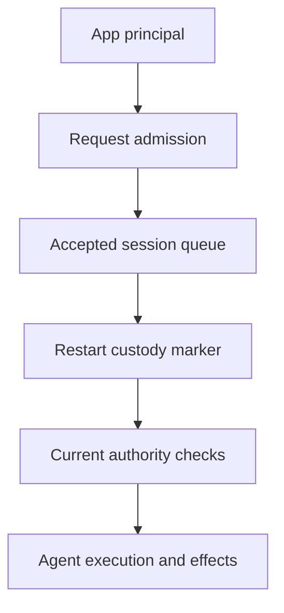

Codex review: needs maintainer review before merge.

## What this changes

This PR separates shutdown admission fencing from authority retirement so accepted ingress messages retain restart custody.

**Example:** Two accepted app messages await execution when the Gateway receives SIGTERM.
- **Before:** Shutdown cancels their authority before restart markers capture them, so neither queued write resumes.
- **After:** The replacement Gateway completes both writes in FIFO order, subject to the original limits and current permissions.

## Review scores

| Measure | Result | What it means |
|---|---|---|
| **Overall readiness** | 🦞 diamond lobster **(5/6)** | Focused owner-level repair with shipped CLI restart and forbidden-effect proof, meaningful persistence regressions, and no actionable findings. |
| **Proof confidence** | 🦞 diamond lobster **(5/6)** | Sufficient (terminal): The compiled CLI in an isolated Linux VM exercises normal shutdown and a distinct replacement process with fresh relay authentication: two queued writes complete in FIFO order, while role downgrade, People removal, and app revocation prevent late writes. The final head changes only a fixture and allocation. External services use deterministic fixtures; app revocation does not eagerly close an existing provider stream, but its late tool effect is refused. |
| **Patch quality** | 🦞 diamond lobster **(5/6)** | No actionable review findings were identified. |

## Product

**Kind:** Bug fix · **Worth it:** Yes · **Fix scope:** Complete
**User problem:** An app reports a message accepted, but restarting the Gateway silently cancels it before recovery records it.
**Reason:** The maintainer-authored change restores the documented graceful-restart contract using existing owners and preserves current authorization.

## Merge readiness

✅ **Ready for maintainer review**

Keep open: this maintainer-authored PR repairs a current shutdown-ordering bug that loses accepted queued messages. No actionable source defects remain; exact-head CI is still pending.

**Priority:** P2
**Reviewed head:** `edb5215fe19524918581f59698d96af2f9738a51`

## Before merge

None.

## Findings

None.

<strong>Agent review details</strong>

### How this fits together

Trusted plugins bind principals to Gateway ingress; accepted inputs enter the session queue, shutdown records their existing recovery metadata, and startup restores them through current authorization.

### Technical review

Best possible solution:

Keep admission fenced while existing session owners record restart custody, then retire retained authority without weakening live permission checks.

Do we have a high-confidence way to reproduce the issue?

The supplied compiled CLI receipts establish the base failure, and current-main source exposes the premature authority-abort path; this read-only review executed no target code.

Is this the best way to solve the issue?

The patch repairs shutdown ordering at the existing lifecycle, request-entry, scheduler, and ingress owners, with no competing recovery implementation or unnecessary production layer.

AGENTS.md: found and applied where relevant.

Codex review notes: model internal, reasoning medium; reviewed against [aa4ebbb626c4](https://github.com/openclaw/openclaw/commit/aa4ebbb626c4dd6f5fad85e7bfc34d10e8c103fc).

### Provenance checked

- `Principal-bound ingress authority` keeps the original intent (2444aae8f8f9e593f4801127eab4b37d3703c4c6: Trusted plugins require principal-bound access under current roles and session visibility; later merged membership repairs retain the approving source.)
- `Request-entry lifetime` keeps the original intent (3ed226a746a8efd223a35a81790014c41ff044a3: Fence new preparation and join admitted work before tearing down dependencies; the added retained lifetime preserves this entry fence.)
- `Scheduler shutdown timing` changes intended behavior with a stated reason (362cee12114d8a41b2b5eff42e96d973b6cfc327: One kernel scheduler synchronously fences timed work and joins running callbacks; the PR explains why cancellation must follow restart custody rather than coincide with fencing.)
- `Restart persistence and settlement ordering` keeps the original intent (e051130c6ae044289990bb1045773c89f0014a87: Persist restart markers before database cleanup and retain finalizer ownership; the repair extends that ordering to retained ingress authority.)

### Testing

Proof path: shipped entry point.

### Security

None.

### Evidence

What I checked:

- **Current-main failure remains:** Fetched main still calls scheduler.beginClose before marker persistence and binds ingress authority to the request-entry shutdown signal, allowing shutdown to trigger queued-run revocation prematurely. ([`src/gateway/server-lifecycle.ts:533`](https://github.com/openclaw/openclaw/blob/aa4ebbb626c4dd6f5fad85e7bfc34d10e8c103fc/src/gateway/server-lifecycle.ts#L533), [aa4ebbb626c4](https://github.com/openclaw/openclaw/commit/aa4ebbb626c4dd6f5fad85e7bfc34d10e8c103fc))
- **Ordering repair uses existing owners:** Request admission and scheduled wakeups close immediately; retained ingress authority and scheduler cancellation retire only after restart markers and session-stop classification. ([`src/gateway/server-lifecycle.ts:560`](https://github.com/openclaw/openclaw/blob/edb5215fe19524918581f59698d96af2f9738a51/src/gateway/server-lifecycle.ts#L560), [edb5215fe195](https://github.com/openclaw/openclaw/commit/edb5215fe19524918581f59698d96af2f9738a51))
- **Compiled CLI and final-effect receipts:** Josh Avant supplies compiled CLI base-failure and candidate receipts covering distinct-process restart, exact queued writes in FIFO order, role downgrade, People removal, and app revocation before late tool effects; independent owner writes remain usable. ([4646580a4953](https://github.com/openclaw/openclaw/commit/4646580a4953e6b600ca29624590ebe49f1446b5))
- **Proof remains applicable:** The subsequent commit adds admissionSignal to an integration-test fixture and changes its regression allocation from 271 to 272; production code is identical to the exercised candidate. ([`src/gateway/remote-control-ui-ingress.integration.test.ts:311`](https://github.com/openclaw/openclaw/blob/edb5215fe19524918581f59698d96af2f9738a51/src/gateway/remote-control-ui-ingress.integration.test.ts#L311), [edb5215fe195](https://github.com/openclaw/openclaw/commit/edb5215fe19524918581f59698d96af2f9738a51))
- **Persistence and revocation regression:** The Gateway/SQLite regression verifies queued message bytes, original run and source identity, immediate admission refusal, and cancellation when the actual grant is revoked. ([`src/gateway/server-close.queued-inputs.test.ts:26`](https://github.com/openclaw/openclaw/blob/edb5215fe19524918581f59698d96af2f9738a51/src/gateway/server-close.queued-inputs.test.ts#L26), [edb5215fe195](https://github.com/openclaw/openclaw/commit/edb5215fe19524918581f59698d96af2f9738a51))
- **Related merged repair has distinct scope:** https://github.com/openclaw/openclaw/pull/196540 preserves each queued input's source restrictions during replay; this PR repairs earlier shutdown cancellation that prevents those inputs from reaching replay. ([67a327fc1a32](https://github.com/openclaw/openclaw/commit/67a327fc1a3294e34ffe8281a347ff74aacd5d2f))

### PR surface

Source +33, Tests +272, Docs +7, Other +3. Total +315 across 18 files. Added test files: 1.

View PR surface stats

| Area | Files | Added | Removed | Net |
|---|---:|---:|---:|---:|
| Source | 8 | 48 | 15 | +33 |
| Tests | 8 | 301 | 29 | +272 |
| Docs | 1 | 7 | 0 | +7 |
| Config | 0 | 0 | 0 | 0 |
| Generated | 0 | 0 | 0 | 0 |
| Other | 1 | 3 | 0 | +3 |
| **Total** | **18** | **359** | **44** | **+315** |

### Preflight source

Source unknown. Source comparison at the observed PR snapshot only. Completion is self-reported; body, policy, tests, execution, and report bytes are not verified.

### Review metrics

| Metric | Value | Why it matters |
|---|---|---|
| **Production versus regression code** | Production +48/-15; tests/support +301/-29 | The production growth separates admission and retained authority within existing owners; regression growth covers persistence, real revocation, transport lifetime, and scheduler joins. |

### Labels

Label changes:

- add `rating: 🦞 diamond lobster`: Overall readiness is 🦞 diamond lobster; proof is 🦞 diamond lobster and patch quality is 🦞 diamond lobster.
- remove `rating: 🐚 platinum hermit`: Current PR rating is `rating: 🦞 diamond lobster`, so this older rating label is no longer current.

Label justifications:

- `P2`: Accepted app messages can be silently lost during graceful restart, with impact limited to queued ingress work during shutdown.
- `rating: 🦞 diamond lobster`: Overall readiness is 🦞 diamond lobster; proof is 🦞 diamond lobster and patch quality is 🦞 diamond lobster.
- `status: 👀 ready for maintainer look`: ClawSweeper has no concrete contributor-facing blocker left for this PR.
- `proof: sufficient`: Contributor real behavior proof is sufficient.

### Rating scale

6/6 🦀 challenger crab · 5/6 🦞 diamond lobster · 4/6 🐚 platinum hermit · 3/6 🦐 gold shrimp · 2/6 🦪 silver shellfish · 1/6 🧂 unranked krab. Overall follows the weaker of proof and patch quality; ✨ marks media proof (a screenshot, video, or linked artifact) that directly shows the changed behavior.

### Workflow

ClawSweeper edits this one comment on every review. Comment `@clawsweeper re-review` for a fresh review only. Repair and merge execution lanes are retired.

### History

Review history (2 earlier review cycles)

<!-- clawsweeper-review-history v=1 total=2 -->
- reviewed 2026-11-11T00:27:47.563Z sha 4646580a4953e6b600ca29624590ebe49f1446b5 :: needs real behavior proof before merge. :: none
- reviewed 2026-11-11T00:38:29.824Z sha 4646580a4953e6b600ca29624590ebe49f1446b5 :: needs maintainer review before merge. :: none

_Reviewed November 10, 2026, 7:49 PM ET / November 11, 2026, 00:49 UTC (Revision 3)._

<!-- clawsweeper-verdict:needs-human item=196923 sha=edb5215fe19524918581f59698d96af2f9738a51 confidence=high updated_at=2026-11-11T00:44:55Z reviewed_at=2026-11-11T00:49:01.902Z lease_owner=github-run-42933609739-1 lease_comment_id=6783319030 source_revision=48748eb4ba400711c0e903ec5fdae76af799d17e4506699815856793c0c92c20 hold=not_opted_in findings=0 -->
<!-- clawsweeper-review-state:ready item=196923 sha=edb5215fe19524918581f59698d96af2f9738a51 v=1 -->

<!-- clawsweeper-review-version item=196923 reviewed_at=2026-11-11T00:49:01.902Z sha=edb5215fe19524918581f59698d96af2f9738a51 source_revision=48748eb4ba400711c0e903ec5fdae76af799d17e4506699815856793c0c92c20 lease_owner=github-run-42933609739-1 lease_comment_id=6783319030 v=1 -->

<!-- clawsweeper-review item=196923 -->