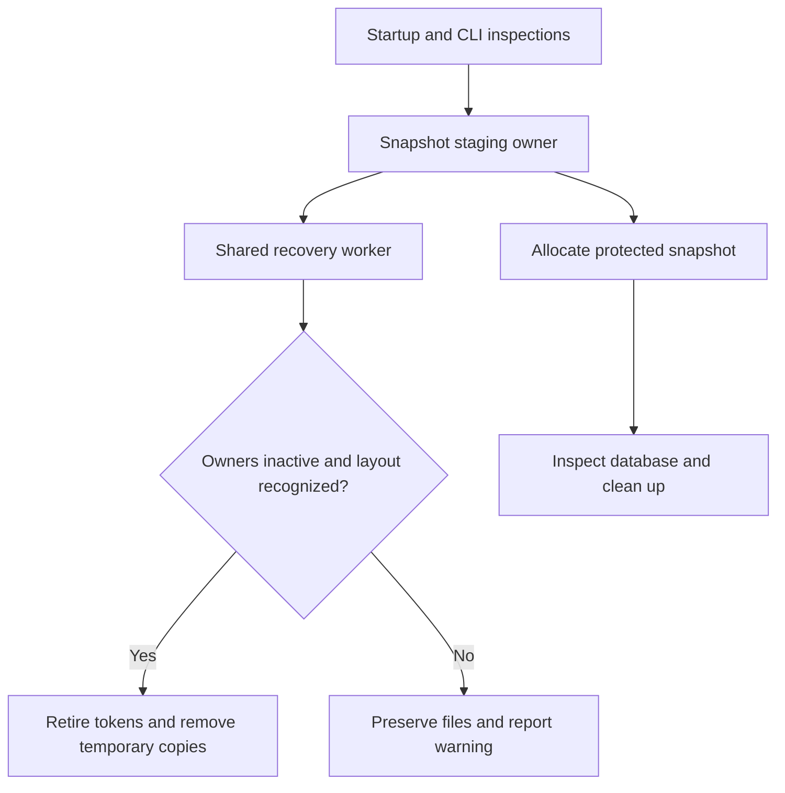

Codex review: needs maintainer review before merge. _Reviewed September 17, 2026, 3:46 PM ET / 19:46 UTC (Revision 10)._

# ClawSweeper review

## What this changes

Reclaims abandoned temporary SQLite copies, coordinates shutdown cleanup, and lets snapshot callers cancel independently while shared recovery finishes safely.

## Merge readiness

✅ **Ready for maintainer review**

This remains a useful fix: main and the latest release lack interrupted-copy reclamation. The earlier blockers are addressed, and this review found no new blocking defect.

**Priority:** P2
**Reviewed head:** `ab8037229203cc8a42735263637245f09477f2aa`

## Review scores

| Measure | Result | What it means |
|---|---|---|
| **Overall readiness** | 🐚 platinum hermit **(4/6)** | A coherent repair with strong recorded recovery evidence and no remaining actionable finding; platform coverage limits are stated accurately. |
| **Proof confidence** | 🦞 diamond lobster **(5/6)** | Sufficient (terminal): Recorded Linux execution uses the released allocator/worker and candidate recovery to preserve fresh copies and reclaim aged copies without changing source bytes. Real-worker fault injection additionally demonstrates prompt cancellation, surviving callers, and directory-boundary settlement; native Windows interruption races remain outside the explicitly accepted coverage. |
| **Patch quality** | 🐚 platinum hermit **(4/6)** | No actionable review findings were identified. |

## Verification

| Check | Result | Evidence |
|---|---|---|
| **Real behavior** | Verified | Sufficient (terminal): Recorded Linux execution uses the released allocator/worker and candidate recovery to preserve fresh copies and reclaim aged copies without changing source bytes. Real-worker fault injection additionally demonstrates prompt cancellation, surviving callers, and directory-boundary settlement; native Windows interruption races remain outside the explicitly accepted coverage. |
| **Evidence reviewed** | 10 items | Current main still needs the fix: Main's allocator directly creates a temporary directory; its cleanup owner registers retry ownership only after removal fails. It has no abandoned-copy reclamation pass. Released behavior: The v2026.9.4 source uses PID-named staging directories and registers exit cleanup after failed removal; its allocator does not reclaim abandoned copies. Reclamation and admission boundary: The staging owner checks recognized layouts, ownership, nested tokens, and legacy age before removal. It commits retirement before closing token handles, and new workers reject retired parents. Async callers share a worker pass with independently cancellable waits. |
| **Findings** | None | None. |
| **Security** | None | None. |

## How this fits together

Gateway startup, Doctor, and update checks create private SQLite copies for safe database inspection. The staging owner manages those copies and their workers, then removes temporary data without changing canonical databases.

## Before merge

None.

<strong>Agent review details</strong>

### Security

None.

### PR surface

Source +611, Tests +1086, Docs +31, Config 0, Other +5. Total +1733 across 31 files.

View PR surface stats

| Area | Files | Added | Removed | Net |
|---|---:|---:|---:|---:|
| Source | 15 | 777 | 166 | +611 |
| Tests | 12 | 1160 | 74 | +1086 |
| Docs | 1 | 31 | 0 | +31 |
| Config | 1 | 1 | 1 | 0 |
| Generated | 0 | 0 | 0 | 0 |
| Other | 2 | 5 | 0 | +5 |
| **Total** | **31** | **1974** | **241** | **+1733** |

### Review metrics

| Metric | Value | Why it matters |
|---|---|---|
| **Production versus regression coverage** | Production +777/−166; tests/support +1160/−74 | Production growth supports shared reclamation, lifetime tokens, and cancellation propagation; regression coverage exercises their process and filesystem boundaries. |

### Root-cause cluster

Relationship: `fixed_by_candidate`
Canonical: https://github.com/openclaw/openclaw/issues/149978
Summary: This PR is a candidate fix for the documented interrupted-startup staging leak; another open proposal addresses the same recovery problem.

Members:
- `canonical`: https://github.com/openclaw/openclaw/issues/149978 - Contains the concrete interrupted-startup retention report targeted by this PR.
- `same_root_cause`: https://github.com/openclaw/openclaw/pull/150091 - Proposes reclaiming copies left by terminated processes, using a different ownership mechanism.
- `adjacent_distinct`: https://github.com/openclaw/openclaw/pull/146571 - Merged asynchronous cleanup work handles normal lifecycle settlement, not recovery after owner termination.

Proposal only: this assessment does not dispatch repair, suppress jobs, mutate sibling items, close, or merge anything.

### Technical review

Best possible solution:

Keep reclamation with the snapshot owner, preserving live readers, legacy layouts, canonical database bytes, and independent caller cancellation.

Do we have a high-confidence way to reproduce the issue?

Yes, source establishes that terminating a copy owner before normal cleanup leaves staging that main does not reclaim; the linked report and submitted interruption evidence corroborate this. This review did not execute a reproduction.

Is this the best way to solve the issue?

Yes. The patch extends the existing snapshot lifecycle and worker boundary, with kernel-held ownership checks and conservative legacy handling instead of unreliable PID inference.

AGENTS.md: found and applied where relevant.

Codex review notes: model internal, reasoning medium; reviewed against [c9ab1cff77ec](https://github.com/openclaw/openclaw/commit/c9ab1cff77ecd3986b46078243a5c7c8498e9f42).

### Labels

Label justifications:

- `P2`: Interrupted inspections can retain substantial temporary disk usage, with no demonstrated canonical-data loss or immediate core outage.
- `rating: 🐚 platinum hermit`: Overall readiness is 🐚 platinum hermit; proof is 🦞 diamond lobster and patch quality is 🐚 platinum hermit.
- `status: 👀 ready for maintainer look`: ClawSweeper has no concrete contributor-facing blocker left for this PR. Sufficient (terminal): Recorded Linux execution uses the released allocator/worker and candidate recovery to preserve fresh copies and reclaim aged copies without changing source bytes. Real-worker fault injection additionally demonstrates prompt cancellation, surviving callers, and directory-boundary settlement; native Windows interruption races remain outside the explicitly accepted coverage.
- `proof: sufficient`: Contributor real behavior proof is sufficient. Recorded Linux execution uses the released allocator/worker and candidate recovery to preserve fresh copies and reclaim aged copies without changing source bytes. Real-worker fault injection additionally demonstrates prompt cancellation, surviving callers, and directory-boundary settlement; native Windows interruption races remain outside the explicitly accepted coverage.

### Evidence

What I checked:

- **Current main still needs the fix:** Main's allocator directly creates a temporary directory; its cleanup owner registers retry ownership only after removal fails. It has no abandoned-copy reclamation pass. ([`src/infra/sqlite-readonly-location.ts:392`](https://github.com/openclaw/openclaw/blob/c9ab1cff77ecd3986b46078243a5c7c8498e9f42/src/infra/sqlite-readonly-location.ts#L392), [c9ab1cff77ec](https://github.com/openclaw/openclaw/commit/c9ab1cff77ecd3986b46078243a5c7c8498e9f42))
- **Released behavior:** The v2026.9.4 source uses PID-named staging directories and registers exit cleanup after failed removal; its allocator does not reclaim abandoned copies. ([`src/infra/sqlite-readonly-location.ts:297`](https://github.com/openclaw/openclaw/blob/3a9d69db306cd7f081e06254cb89c4bcc14a7107/src/infra/sqlite-readonly-location.ts#L297), [3a9d69db306c](https://github.com/openclaw/openclaw/commit/3a9d69db306cd7f081e06254cb89c4bcc14a7107))
- **Reclamation and admission boundary:** The staging owner checks recognized layouts, ownership, nested tokens, and legacy age before removal. It commits retirement before closing token handles, and new workers reject retired parents. Async callers share a worker pass with independently cancellable waits. ([`src/infra/sqlite-snapshot-staging.ts:45`](https://github.com/openclaw/openclaw/blob/ab8037229203cc8a42735263637245f09477f2aa/src/infra/sqlite-snapshot-staging.ts#L45), [ab8037229203](https://github.com/openclaw/openclaw/commit/ab8037229203cc8a42735263637245f09477f2aa))
- **Prior findings addressed:** The cancellation regressions exercise real child processes through snapshot, header, updater, and cached-owner entrypoints. They verify prompt cancellation, surviving callers, completion of the current directory, and subsequent recovery of untouched directories. ([`src/infra/sqlite-snapshot-staging.cancellation.test.ts:201`](https://github.com/openclaw/openclaw/blob/ab8037229203cc8a42735263637245f09477f2aa/src/infra/sqlite-snapshot-staging.cancellation.test.ts#L201), [ab8037229203](https://github.com/openclaw/openclaw/commit/ab8037229203cc8a42735263637245f09477f2aa))
- **Forbidden and stale-owner coverage:** Ownership tests cover live owners invisible to PID probes, late worker admission during inspection and after retirement, mixed generations, and preservation of recent legacy copies. Signal-driven and late-admission cases explicitly skip Windows. ([`src/infra/sqlite-snapshot-staging.ownership.test.ts:155`](https://github.com/openclaw/openclaw/blob/ab8037229203cc8a42735263637245f09477f2aa/src/infra/sqlite-snapshot-staging.ownership.test.ts#L155), [ab8037229203](https://github.com/openclaw/openclaw/commit/ab8037229203cc8a42735263637245f09477f2aa))
- **Captured proof and body coverage:** The complete GitHub body matched captured SHA-256 87c910d3781c93c3af161a4220c32cc366ee93e900b2128f78b59abd24e68ea4, resolving the omitted tail. It records actual 2026.9.4 worker interruption leaving 202,375,168 bytes, preservation while fresh, and recovery to zero after aging, with unchanged source hash. It also records failing-before/passing-after cancellation measurements and real-worker recovery. The linked Testbox lease workflow is cancelled, so its status is not treated as a passing test; the specific recorded observations are the evidence.

Likely related people:

- **steipete:** Suggested for follow-up; no historical authorship or introduction is verified. (role: unverified routing candidate; confidence: low)
- **SunnyShu0925:** Suggested for follow-up; no historical authorship or introduction is verified. (role: unverified routing candidate; confidence: low)

### Rating scale

| Score | Internal tier | Crab rank | Meaning |
|---:|:---:|---|---|
| **6/6** | S | 🦀 challenger crab | Exceptional readiness |
| **5/6** | A | 🦞 diamond lobster | Very strong readiness |
| **4/6** | B | 🐚 platinum hermit | Good normal PR; ordinary maintainer review |
| **3/6** | C | 🦐 gold shrimp | Useful, but confidence is limited |
| **2/6** | D | 🦪 silver shellfish | Proof or implementation needs work |
| **1/6** | F | 🧂 unranked krab | Not merge-ready |
| N/A | NA | 🌊 off-meta tidepool | Rating does not apply |

Overall follows the weaker of proof and patch quality.
Shiny media proof means a screenshot, video, or linked artifact directly shows the changed behavior. Runtime, network, CSP, and security claims still need visible diagnostics.

### Workflow

- ClawSweeper keeps one durable marker-backed review comment per issue or PR.
- Re-runs edit this comment so the latest verdict, findings, and automation markers stay together instead of adding duplicate bot comments.
- A fresh review can be triggered by eligible `@clawsweeper re-review` comments, exact-item GitHub events, scheduled/background review runs, or manual workflow dispatch.
- PR/issue authors and users with repository write access can comment `@clawsweeper re-review` or `@clawsweeper re-run` on an open PR or issue to request a fresh review only.
- Maintainers can also comment `@clawsweeper review` to request a fresh review only.
- Fresh-review commands do not start repair, autofix, rebase, CI repair, or automerge.
- Maintainer-only repair and merge flows require explicit commands such as `@clawsweeper autofix`, `@clawsweeper automerge`, `@clawsweeper fix ci`, or `@clawsweeper address review`.
- Maintainers can comment `@clawsweeper explain` to ask for more context, or `@clawsweeper stop` to stop active automation.

### History

Review history (9 earlier review cycles; latest 8 shown)

<!-- clawsweeper-review-history v=1 total=9 -->
- reviewed 2026-09-17T11:09:32.811Z sha 2998f910a7bb297d4a70f16f0b64d8e618994bea :: blocked before merge. :: [P2] [P2] Keep backlog reclamation off the asynchronous caller's event loop
- reviewed 2026-09-17T13:34:31.981Z sha ad073b2e3b863d53d5846e1d42077ef6e8626e3c :: blocked before merge. :: [P2] [P2] Keep backlog reclamation off the asynchronous caller's event loop | [P2] [P2] Recognize the cache container created by released update workers
- reviewed 2026-09-17T13:58:26.834Z sha 4c56bc20a54d5c989c15ad23c5dadab12ec51021 :: blocked before merge. :: [P2] [P2] Keep backlog reclamation off the asynchronous caller's event loop | [P2] [P2] Recognize the cache container created by released update workers
- reviewed 2026-09-17T15:50:31.420Z sha 7ea583c003e8fa4395964498dd4408128eef92c9 :: blocked before merge. :: [P2] [P2] Propagate cancellation through the reclamation wait
- reviewed 2026-09-17T16:08:46.646Z sha eccc302fe64eceafdc9b0e76a9659de54879dcfa :: blocked before merge. :: [P2] [P2] Propagate cancellation through the reclamation wait
- reviewed 2026-09-17T17:50:49.356Z sha 2c7d1d99762880350ec076583a5eb98e9c5b20c3 :: blocked before merge. :: none
- reviewed 2026-09-17T18:21:37.344Z sha b637b28a4fefd90d569d96fc9278d4ace1eba9be :: needs changes before merge. :: none
- reviewed 2026-09-17T19:08:52.543Z sha 871ac31114550c79954a35a2893a29f8d2ce7b87 :: needs maintainer review before merge. :: none

<!-- clawsweeper-verdict:needs-human item=150816 sha=ab8037229203cc8a42735263637245f09477f2aa confidence=high updated_at=2026-09-17T19:42:30Z reviewed_at=2026-09-17T19:46:06.306Z lease_owner=github-run-35266249904-1 lease_comment_id=5720195539 source_revision=0ad5397aed48a8b657210489b80700b417915ea2978fe2326bee0dc561ad6d54 live_verification=absent -->
<!-- clawsweeper-review-state:ready item=150816 sha=ab8037229203cc8a42735263637245f09477f2aa v=1 -->

<!-- clawsweeper-review-version item=150816 reviewed_at=2026-09-17T19:46:06.306Z sha=ab8037229203cc8a42735263637245f09477f2aa source_revision=0ad5397aed48a8b657210489b80700b417915ea2978fe2326bee0dc561ad6d54 lease_owner=github-run-35266249904-1 lease_comment_id=5720195539 v=1 -->

<!-- clawsweeper-review item=150816 -->