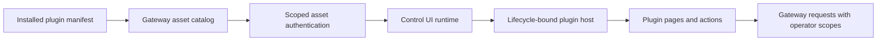

Codex review: blocked before merge. _Reviewed September 4, 2026, 12:47 PM ET / 16:47 UTC._

# ClawSweeper review

## What this changes

Adds experimental typed feature-plugin and Control UI APIs, migrates Workboard to them, and gates installed native UI behind a default-off Labs setting.

## Merge readiness

⛔ **Blocked before merge - 7 items remain**

Keep open pending recorded SDK and security-owner acceptance of the intentional full-authority native-plugin model and exact-head validation; no concrete functional defect was found in the reviewed central paths.

**Priority:** P2
**Reviewed head:** `f1186148d9302ff7054dd2258982e730ceaf2b33`
**Owner decision:** Required. See [Decision needed](#decision-needed).

## Review scores

| Measure | Result | What it means |
|---|---|---|
| **Overall readiness** | 🦐 gold shrimp **(3/6)** | Central owner, asset, lifecycle, documentation, and test paths are coherent, but the public full-authority model still needs owner acceptance and exact-head validation. |
| **Proof confidence** | 🐚 platinum hermit **(4/6)** | Not applicable: The member-authored PR body reports real Gateway and Chromium evidence, but linked media could not be independently retrieved in this environment; contributor proof action is not required for this internal reliability gate. |
| **Patch quality** | 🦐 gold shrimp **(3/6)** | Security review found an item that needs attention. |

## Verification

| Check | Result | Evidence |
|---|---|---|
| **Real behavior** | Not applicable | Not applicable: The member-authored PR body reports real Gateway and Chromium evidence, but linked media could not be independently retrieved in this environment; contributor proof action is not required for this internal reliability gate. |
| **Evidence reviewed** | 9 items | Operator-authority API: The public Control UI host documents request access using the signed-in operator's Gateway scopes, without a per-plugin RPC allowlist. Host and lifecycle enforcement: The host uses the existing Gateway client while activation ownership and retained contribution handles are retired on connection changes. Asset authorization boundary: Gateway asset serving validates plugin revision and path, then requires a matching scoped grant or read authorization. |
| **Findings** | None | None. |
| **Security** | Needs attention | Record acceptance for full operator authority: The public host lets enabled installed native UI issue Gateway requests under the operator's scopes; this is documented and default-off, but the intentional trust-boundary expansion requires SDK and security-owner approval before merge. |

## How this fits together

Plugin manifests contribute UI assets and declarations through the Gateway, which authenticates and advertises them to Control UI. The Control UI runtime loads each admitted plugin with a lifecycle-bound host that can issue Gateway requests under the signed-in operator’s authority.

## Decision needed

| Question | Recommendation |
|---|---|
| Do SDK and security owners accept the default-off experimental design in which an enabled installed native Control UI plugin receives the signed-in operator's full Gateway authority? | **Accept the documented trusted-native model:** Record SDK and security-owner acceptance, then retain the Labs gate and complete exact-head validation. |

Why: This is a new public SDK and authority boundary; code-level guards and documentation cannot determine whether the product's intended trust model is acceptable.

## Before merge

- [ ] **Resolve security concern: Record acceptance for full operator authority** - The public host lets enabled installed native UI issue Gateway requests under the operator's scopes; this is documented and default-off, but the intentional trust-boundary expansion requires SDK and security-owner approval before merge.
- [ ] **Resolve merge risk (P1)** - When enabled, installed native plugin code receives the signed-in operator's full Gateway authority, including administrative scopes; this deliberate trust expansion needs recorded SDK and security-owner acceptance.
- [ ] **Resolve merge risk (P1)** - The new default-off configuration and public SDK surface are upgrade-sensitive, while the supplied check list is truncated and does not independently establish exact-head completion.
- [ ] **Complete next step (P2)** - Obtain recorded SDK and security-owner acceptance of the native installed-plugin authority model, then verify required checks on the exact head before merge.
- [ ] **Resolve maintainer decision** - Resolve the maintainer decision shown above before merge.
- [ ] **Review config compatibility** - Confirm compatibility and upgrade impact for the changed config or default surface before merge.
- [ ] **Add data-model compatibility proof** - Confirm migration or upgrade compatibility proof before merge.

## Findings

- [medium] Record acceptance for full operator authority — `src/plugin-sdk/control-ui.ts:207`

<strong>Agent review details</strong>

### Security

Needs attention: The implementation deliberately expands installed native plugin authority to the signed-in operator's Gateway scopes, so it needs recorded security-owner acceptance rather than a presumed approval.

### PR surface

PR surface statistics unavailable: the file list is incomplete.

### Review metrics

| Metric | Value | Why it matters |
|---|---|---|
| **Configuration surface** | 1 added | The default-off custom-plugin Labs setting changes operator enablement and trust behavior. |
| **Plugin API surface** | 3 public SDK entrypoints added | These exports create a long-lived compatibility and security-maintenance boundary. |
| **Production versus test LOC** | PR-body reported production +9,281/-3,677; tests/support +12,405/-4,160 | The stated growth supports a new typed SDK, authenticated asset path, lifecycle host, and Workboard migration; figures were not independently move-normalized locally. |

### Stored data model

Persistent data-model change detected: `serialized state: config/knip.config.ts`, `serialized state: ui/src/test-helpers/control-ui-plugin-fixture.ts`, `unknown-data-model-change: ui/src/test-helpers/control-ui-plugin-fixture.ts`, `unknown-truncated-pull-files`. Confirm migration or upgrade compatibility proof before merge.

### Merge-risk options

**Maintainer options:**
1. **Record acceptance and validate exact head (recommended)**  
   Obtain SDK and security-owner acceptance of the full-authority model, then confirm all required checks on the exact PR head.
2. **Pause if authority sharing is unacceptable**  
   Do not merge the public native-plugin API if owners require installed UI to be capability-scoped.

### Technical review

Best possible solution:

Land only after SDK and security owners explicitly accept the documented default-off full-authority model and exact-head validation is confirmed, while retaining lifecycle-bound hosts, scoped asset authorization, and sandboxed alternatives.

Do we have a high-confidence way to reproduce the issue?

Not applicable: this PR adds a new experimental capability rather than repairing a reported existing-behavior bug; its supplied browser and Gateway proof concerns feature behavior.

Is this the best way to solve the issue?

Unclear pending owner acceptance: the default-off, documented trusted-native model is coherent for full Control UI replacements, while sandboxed widgets and MCP Apps remain the safer path for isolated content.

AGENTS.md: found and applied where relevant.

Codex review notes: model internal, reasoning high; reviewed against [a3e18fac7722](https://github.com/openclaw/openclaw/commit/a3e18fac7722d036e8433268b129257b63de036d).

### Labels

Label changes:

- add `rating: 🦐 gold shrimp`: Overall readiness is 🦐 gold shrimp; proof is 🐚 platinum hermit and patch quality is 🦐 gold shrimp.
- remove `rating: 🐚 platinum hermit`: Current PR rating is `rating: 🦐 gold shrimp`, so this older rating label is no longer current.

Label justifications:

- `P2`: This is a substantial experimental product capability with bounded default-off exposure, not an active outage or demonstrated regression.
- `merge-risk: 🚨 compatibility`: A new public Plugin SDK export and operator-facing configuration gate create upgrade and long-term contract obligations.
- `merge-risk: 🚨 security-boundary`: Enabled installed native code can act with the signed-in operator's Gateway scopes, so acceptance of that trust boundary is required.
- `rating: 🦐 gold shrimp`: Overall readiness is 🦐 gold shrimp; proof is 🐚 platinum hermit and patch quality is 🦐 gold shrimp.
- `status: ⏳ waiting on author`: ClawSweeper has contributor-facing work open and is waiting for author action. Not applicable: The member-authored PR body reports real Gateway and Chromium evidence, but linked media could not be independently retrieved in this environment; contributor proof action is not required for this internal reliability gate.

### Evidence

Security concerns:

- [medium] Record acceptance for full operator authority — `src/plugin-sdk/control-ui.ts:207`
  The public host lets enabled installed native UI issue Gateway requests under the operator's scopes; this is documented and default-off, but the intentional trust-boundary expansion requires SDK and security-owner approval before merge.
  Confidence: 0.94

What I checked:

- **Operator-authority API:** The public Control UI host documents request access using the signed-in operator's Gateway scopes, without a per-plugin RPC allowlist. ([`src/plugin-sdk/control-ui.ts:207`](https://github.com/openclaw/openclaw/blob/f1186148d9302ff7054dd2258982e730ceaf2b33/src/plugin-sdk/control-ui.ts#L207), [f1186148d930](https://github.com/openclaw/openclaw/commit/f1186148d9302ff7054dd2258982e730ceaf2b33))
- **Host and lifecycle enforcement:** The host uses the existing Gateway client while activation ownership and retained contribution handles are retired on connection changes. ([`ui/src/plugins/control-ui-host.ts:105`](https://github.com/openclaw/openclaw/blob/f1186148d9302ff7054dd2258982e730ceaf2b33/ui/src/plugins/control-ui-host.ts#L105), [f1186148d930](https://github.com/openclaw/openclaw/commit/f1186148d9302ff7054dd2258982e730ceaf2b33))
- **Asset authorization boundary:** Gateway asset serving validates plugin revision and path, then requires a matching scoped grant or read authorization. ([`src/gateway/control-ui-plugin-assets.ts:354`](https://github.com/openclaw/openclaw/blob/f1186148d9302ff7054dd2258982e730ceaf2b33/src/gateway/control-ui-plugin-assets.ts#L354), [f1186148d930](https://github.com/openclaw/openclaw/commit/f1186148d9302ff7054dd2258982e730ceaf2b33))
- **Boundary coverage:** Tests cover wrong plugin or generation grants, bearer-read access, and rejected source-map, hidden, and escape paths; runtime tests cover origin, secure-context, grant, and base-path admission. ([`src/gateway/control-ui-plugin-assets.test.ts:432`](https://github.com/openclaw/openclaw/blob/f1186148d9302ff7054dd2258982e730ceaf2b33/src/gateway/control-ui-plugin-assets.test.ts#L432), [f1186148d930](https://github.com/openclaw/openclaw/commit/f1186148d9302ff7054dd2258982e730ceaf2b33))
- **Documented trust model:** Documentation describes native UI as trusted same-origin code with full authority, default-off experimental enablement, HTTPS/loopback requirements, and sandboxed widgets or MCP Apps as the isolated alternative. Public docs: [`docs/plugins/feature-plugins.md`](https://docs.openclaw.ai/plugins/feature-plugins). ([`docs/plugins/feature-plugins.md:19`](https://docs.openclaw.ai/plugins/feature-plugins), [f1186148d930](https://github.com/openclaw/openclaw/commit/f1186148d9302ff7054dd2258982e730ceaf2b33))
- **Public SDK surface:** The package exports three Control UI Plugin SDK entrypoints, making this a public compatibility and trust boundary rather than an internal Workboard-only refactor. ([`package.json:1484`](https://github.com/openclaw/openclaw/blob/f1186148d9302ff7054dd2258982e730ceaf2b33/package.json#L1484), [f1186148d930](https://github.com/openclaw/openclaw/commit/f1186148d9302ff7054dd2258982e730ceaf2b33))

Likely related people:

- **steipete:** Suggested for follow-up; no historical authorship or introduction is verified. (role: unverified routing candidate; confidence: low)

### Rank-up moves

Optional improvements that raise the rating; they are not merge blockers.

- Record SDK and security-owner acceptance of the native installed-plugin authority model.
- Verify required checks on f1186148d9302ff7054dd2258982e730ceaf2b33 before merging.

### Rating scale

| Score | Internal tier | Crab rank | Meaning |
|---:|:---:|---|---|
| **6/6** | S | 🦀 challenger crab | Exceptional readiness |
| **5/6** | A | 🦞 diamond lobster | Very strong readiness |
| **4/6** | B | 🐚 platinum hermit | Good normal PR; ordinary maintainer review |
| **3/6** | C | 🦐 gold shrimp | Useful, but confidence is limited |
| **2/6** | D | 🦪 silver shellfish | Proof or implementation needs work |
| **1/6** | F | 🧂 unranked krab | Not merge-ready |
| N/A | NA | 🌊 off-meta tidepool | Rating does not apply |

Overall follows the weaker of proof and patch quality.
Shiny media proof means a screenshot, video, or linked artifact directly shows the changed behavior. Runtime, network, CSP, and security claims still need visible diagnostics.

### Workflow

- ClawSweeper keeps one durable marker-backed review comment per issue or PR.
- Re-runs edit this comment so the latest verdict, findings, and automation markers stay together instead of adding duplicate bot comments.
- A fresh review can be triggered by eligible `@clawsweeper re-review` comments, exact-item GitHub events, scheduled/background review runs, or manual workflow dispatch.
- PR/issue authors and users with repository write access can comment `@clawsweeper re-review` or `@clawsweeper re-run` on an open PR or issue to request a fresh review only.
- Maintainers can also comment `@clawsweeper review` to request a fresh review only.
- Fresh-review commands do not start repair, autofix, rebase, CI repair, or automerge.
- Maintainer-only repair and merge flows require explicit commands such as `@clawsweeper autofix`, `@clawsweeper automerge`, `@clawsweeper fix ci`, or `@clawsweeper address review`.
- Maintainers can comment `@clawsweeper explain` to ask for more context, or `@clawsweeper stop` to stop active automation.

### History

Review history (31 earlier review cycles; latest 8 shown)

<!-- clawsweeper-review-history v=1 total=31 -->
- reviewed 2026-09-04T11:16:28.290Z sha 66387d42ae5dbfdf4d3d3bada158caa5a3bd2ea8 :: needs real behavior proof before merge. :: [P2] Skip activation after an asset grant is denied
- reviewed 2026-09-04T12:03:33.967Z sha 79948eec1498e692a584a71c5bdd83c2bf27ca0d :: needs real behavior proof before merge. :: [P2] Skip activation after an asset grant is denied
- reviewed 2026-09-04T12:37:14.786Z sha 59a6c8f32b9670c15f972803ef589ffc99c5b4f2 :: needs real behavior proof before merge. :: [P2] Exclude denied asset grants from activation
- reviewed 2026-09-04T12:56:22.434Z sha f633e42a33b265c457132ef7ad3f6e4a1ee34fd5 :: needs real behavior proof before merge. :: [P2] Exclude ungranted descriptors from activation | [P2] Honor the configured Control UI base path | [P2] Handle authenticated native UI on documented HTTP deployments
- reviewed 2026-09-04T13:13:07.655Z sha c430f78a4150fbbe1d8cc050d2fc0bcc3e843c63 :: needs real behavior proof before merge. :: [P2] Gate native plugin UI on insecure HTTP
- reviewed 2026-09-04T14:47:29.007Z sha 4f9088a69d45f584c3898e913c0371db2ae57fc2 :: needs real behavior proof before merge. :: none
- reviewed 2026-09-04T15:01:31.995Z sha 4f9088a69d45f584c3898e913c0371db2ae57fc2 :: blocked before merge. :: none
- reviewed 2026-09-04T15:37:28.099Z sha f1186148d9302ff7054dd2258982e730ceaf2b33 :: blocked before merge. :: none

<!-- clawsweeper-security:security-sensitive item=134943 sha=f1186148d9302ff7054dd2258982e730ceaf2b33 confidence=high updated_at=2026-09-04T16:42:41Z reviewed_at=2026-09-04T16:47:21.691Z lease_owner=github-run-33896423367-1 lease_comment_id=5543655644 source_revision=5e4c56ea0d0b9338eeac8de8532b134635bd1b5a53e0785c4033b3298c733331 live_verification=absent -->
<!-- clawsweeper-verdict:needs-human item=134943 sha=f1186148d9302ff7054dd2258982e730ceaf2b33 confidence=high updated_at=2026-09-04T16:42:41Z reviewed_at=2026-09-04T16:47:21.691Z lease_owner=github-run-33896423367-1 lease_comment_id=5543655644 source_revision=5e4c56ea0d0b9338eeac8de8532b134635bd1b5a53e0785c4033b3298c733331 live_verification=absent -->
<!-- clawsweeper-review-state:blocked item=134943 sha=f1186148d9302ff7054dd2258982e730ceaf2b33 v=1 -->

<!-- clawsweeper-review-version item=134943 reviewed_at=2026-09-04T16:47:21.691Z sha=f1186148d9302ff7054dd2258982e730ceaf2b33 source_revision=5e4c56ea0d0b9338eeac8de8532b134635bd1b5a53e0785c4033b3298c733331 lease_owner=github-run-33896423367-1 lease_comment_id=5543655644 v=1 -->

<!-- clawsweeper-review item=134943 -->