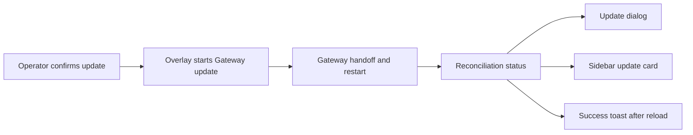

Codex review: found issues before merge. _Reviewed August 11, 2026, 8:05 AM ET / 12:05 UTC._

# ClawSweeper review

## What this changes

The PR keeps Gateway-update progress visible in the Control UI, reports recorded failures, replays success after reload, and keeps the sidebar from reverting to a stale update action.

## Merge readiness

⚠️ **Needs maintainer review before merge - 3 items remain**

Keep open: current main still lacks the full visible update lifecycle, but this branch has a P2 success-notice hole and exceeds the fixed Control UI startup-JS ceiling.

**Priority:** P1
**Reviewed head:** `8da387aa2e78c192c7b1c660cccf2e4c2801e00d`
**Owner decision:** Required. See [Decision needed](#decision-needed).

## Review scores

| Measure | Result | What it means |
|---|---|---|
| **Overall readiness** | 🦐 gold shrimp **(3/6)** | Visible-flow evidence is strong, but a P2 success-path bug and the unresolved startup-budget breach prevent a higher rating. |
| **Proof confidence** | 🦞 diamond lobster **(5/6)** ✨ media proof bonus | Sufficient (screenshot): The member-authored PR includes after-fix Control UI screenshots plus mocked-Gateway E2E coverage for the visible update lifecycle. |
| **Patch quality** | 🦐 gold shrimp **(3/6)** | 1 actionable review finding remain. |

## Verification

| Check | Result | Evidence |
|---|---|---|
| **Real behavior** | Verified | Sufficient (screenshot): The member-authored PR includes after-fix Control UI screenshots plus mocked-Gateway E2E coverage for the visible update lifecycle. |
| **Evidence reviewed** | 5 items | Current main does not contain this lifecycle repair: Current main retains an immediate confirmation flow and card state based on request-time updateRunning; the PR head is not an ancestor of main and is in no reachable release tag. Non-reload success can disappear when storage is unavailable: The new success path catches storage failures, then rereads the same unavailable storage and returns without calling showToast, contrary to its stated best-effort behavior. Storage may legitimately be unavailable: The Control UI storage helper returns null when browser storage access is unavailable, so this is a supported runtime condition rather than an imagined malformed state. |
| **Findings** | 1 actionable finding | [P2] Show success directly when session storage is unavailable |
| **Security** | None | None. |

## How this fits together

The Control UI starts an update through the overlay state owner, while Gateway reconciliation continues through a managed restart. The dialog, sidebar card, and toast host consume that lifecycle to give operators a visible outcome.

## Decision needed

| Question | Recommendation |
|---|---|
| Should maintainers require a lifecycle refactor that fits the fixed startup-JS ceiling, or explicitly approve changing that ceiling for this behavior? | **Fit the existing cap:** Retain the behavior while moving enough non-initial lifecycle work out of startup to pass the exact-head ceiling. |

Why: The current fixed cap cannot be bypassed by a routine baseline update, and the PR’s attempted code split remained over it.

## Before merge

- [ ] **Show success directly when session storage is unavailable (P2)** - If `sessionStorage` is unavailable or `setItem` throws, this catch falls through to `announceRecordedUpdateSuccess()`, which rereads the same storage and returns without a toast. A verified update that does not reload is therefore silent; call the toast path directly when no reload occurs and add a storage-denied regression test.
- [ ] **Resolve merge risk (P1)** - The reported exact-head startup bundle is 1,664 B over the fixed 326,656 B ceiling, so the PR cannot satisfy the maintained Control UI performance contract without a refactor or explicit cap decision.

## Findings

- [P2] Show success directly when session storage is unavailable — `ui/src/app/update-success-notice.ts:39-44`

<strong>Agent review details</strong>

### Security

None.

### PR surface

Source +513, Tests +450. Total +963 across 31 files.

View PR surface stats

| Area | Files | Added | Removed | Net |
|---|---:|---:|---:|---:|
| Source | 19 | 898 | 385 | +513 |
| Tests | 12 | 496 | 46 | +450 |
| Docs | 0 | 0 | 0 | 0 |
| Config | 0 | 0 | 0 | 0 |
| Generated | 0 | 0 | 0 | 0 |
| Other | 0 | 0 | 0 | 0 |
| **Total** | **31** | **1394** | **431** | **+963** |

### Review metrics

| Metric | Value | Why it matters |
|---|---|---|
| **Startup JavaScript budget** | 328,320 B measured; 326,656 B fixed ceiling; +1,664 B | The reported exact-head build exceeds the maintained Control UI startup contract. |
| **Production versus test LOC** | production +897/-384 (net +513); tests/test support +497/-47 (net +450); includes a +227/-227 pure move | This bug-fix branch has roughly +286 non-move production lines, so the added lifecycle complexity needs to earn its permanent startup cost. |

### Stored data model

Persistent data-model change detected: `serialized state: ui/src/app/update-success-notice.ts`, `vector/embedding metadata: ui/src/components/sidebar-update-card.test.ts`. Confirm migration or upgrade compatibility proof before merge.

### Merge-risk options

**Maintainer options:**
1. **Refactor under the fixed cap (recommended)**  
   Keep the update lifecycle behavior but obtain an exact-head startup-JS measurement at or below 326,656 B before merge.
2. **Accept a new startup budget**  
   Maintainers may intentionally revise the fixed ceiling after reviewing measured startup impact.
3. **Pause the implementation**  
   Leave the PR unmerged if the visible-update improvement is not worth the additional startup cost.

### Technical review

Best possible solution:

Show a non-reload success directly instead of rereading storage, add that regression proof, and keep update-only lifecycle code out of startup until the fixed bundle ceiling passes or maintainers deliberately change it.

Do we have a high-confidence way to reproduce the issue?

Yes—current-main source and the linked report define a dev-checkout managed-handoff path where the request finishes before reconciliation; the submitted E2E harness exercises its visible states.

Is this the best way to solve the issue?

No—not yet: the non-reload success path still loses its outcome when session storage is unavailable, and the branch remains over the fixed startup budget.

Full review comments:

- [P2] Show success directly when session storage is unavailable — `ui/src/app/update-success-notice.ts:39-44`
  If `sessionStorage` is unavailable or `setItem` throws, this catch falls through to `announceRecordedUpdateSuccess()`, which rereads the same storage and returns without a toast. A verified update that does not reload is therefore silent; call the toast path directly when no reload occurs and add a storage-denied regression test.
  Confidence: 0.99

Overall correctness: patch is incorrect
Overall confidence: 0.96

AGENTS.md: found and applied where relevant.

Codex review notes: model internal, reasoning high; reviewed against [1c2ca3f2fc5b](https://github.com/openclaw/openclaw/commit/1c2ca3f2fc5b3523e9435296d13aeecf0d9ae21f).

### Labels

Label changes:

- add `merge-risk: 🚨 other`: The exact-head startup bundle exceeds the repository’s fixed Control UI ceiling, requiring a maintainer-owned performance decision before landing.
- add `proof: sufficient`: Contributor real behavior proof is sufficient. The member-authored PR includes after-fix Control UI screenshots plus mocked-Gateway E2E coverage for the visible update lifecycle.
- add `proof: 📸 screenshot`: Contributor real behavior proof includes screenshot evidence. The member-authored PR includes after-fix Control UI screenshots plus mocked-Gateway E2E coverage for the visible update lifecycle.
- add `rating: 🦐 gold shrimp`: Overall readiness is 🦐 gold shrimp; proof is 🦞 diamond lobster and patch quality is 🦐 gold shrimp.
- add `status: ⏳ waiting on author`: ClawSweeper has contributor-facing work open and is waiting for author action. Sufficient (screenshot): The member-authored PR includes after-fix Control UI screenshots plus mocked-Gateway E2E coverage for the visible update lifecycle.
- remove `rating: 🐚 platinum hermit`: Current PR rating is `rating: 🦐 gold shrimp`, so this older rating label is no longer current.
- remove `status: 👀 ready for maintainer look`: Current PR status label is `status: ⏳ waiting on author`.

Label justifications:

- `P1`: The PR targets the operator-facing Gateway-update path, where silent or misleading outcomes block a high-impact recovery workflow.
- `merge-risk: 🚨 other`: The exact-head startup bundle exceeds the repository’s fixed Control UI ceiling, requiring a maintainer-owned performance decision before landing.
- `rating: 🦐 gold shrimp`: Overall readiness is 🦐 gold shrimp; proof is 🦞 diamond lobster and patch quality is 🦐 gold shrimp.
- `status: ⏳ waiting on author`: ClawSweeper has contributor-facing work open and is waiting for author action. Sufficient (screenshot): The member-authored PR includes after-fix Control UI screenshots plus mocked-Gateway E2E coverage for the visible update lifecycle.
- `proof: sufficient`: Contributor real behavior proof is sufficient. The member-authored PR includes after-fix Control UI screenshots plus mocked-Gateway E2E coverage for the visible update lifecycle.
- `proof: 📸 screenshot`: Contributor real behavior proof includes screenshot evidence. The member-authored PR includes after-fix Control UI screenshots plus mocked-Gateway E2E coverage for the visible update lifecycle.

### Evidence

What I checked:

- **Current main does not contain this lifecycle repair:** Current main retains an immediate confirmation flow and card state based on request-time updateRunning; the PR head is not an ancestor of main and is in no reachable release tag. ([`ui/src/app/update-confirmation.runtime.ts`](https://github.com/openclaw/openclaw/blob/1c2ca3f2fc5b/ui/src/app/update-confirmation.runtime.ts), [1c2ca3f2fc5b](https://github.com/openclaw/openclaw/commit/1c2ca3f2fc5b))
- **Non-reload success can disappear when storage is unavailable:** The new success path catches storage failures, then rereads the same unavailable storage and returns without calling showToast, contrary to its stated best-effort behavior. ([`ui/src/app/update-success-notice.ts:39`](https://github.com/openclaw/openclaw/blob/8da387aa2e78/ui/src/app/update-success-notice.ts#L39), [8da387aa2e78](https://github.com/openclaw/openclaw/commit/8da387aa2e78))
- **Storage may legitimately be unavailable:** The Control UI storage helper returns null when browser storage access is unavailable, so this is a supported runtime condition rather than an imagined malformed state. ([`ui/src/local-storage.ts:33`](https://github.com/openclaw/openclaw/blob/1c2ca3f2fc5b/ui/src/local-storage.ts#L33), [1c2ca3f2fc5b](https://github.com/openclaw/openclaw/commit/1c2ca3f2fc5b))
- **Startup performance has a fixed ceiling:** The checked-in performance policy enforces 319 KiB (326,656 B) startup JS independently of its baseline; the PR reports 328,320 B on its exact head. ([`scripts/check-control-ui-performance.mts:33`](https://github.com/openclaw/openclaw/blob/8da387aa2e78/scripts/check-control-ui-performance.mts#L33), [8da387aa2e78](https://github.com/openclaw/openclaw/commit/8da387aa2e78))
- **Area history:** Recent history identifies the update-card, confirmation, and reconciliation contributors used for routing. ([`ui/src/app/overlays.ts`](https://github.com/openclaw/openclaw/blob/b4cedfd40e35/ui/src/app/overlays.ts), [b4cedfd40e35](https://github.com/openclaw/openclaw/commit/b4cedfd40e35))

Likely related people:

- **steipete:** Recent merged history covers dev-checkout update status and the sidebar update-card refresh surface. (role: recent update-surface contributor; confidence: high; commits: [b4cedfd40e35](https://github.com/openclaw/openclaw/commit/b4cedfd40e35adfb698d89d00e3e55b75821fabe), [2cfacdb671f8](https://github.com/openclaw/openclaw/commit/2cfacdb671f853aecfa55eb9d28243ed2602266f); files: `ui/src/app/overlays.ts`, `ui/src/components/sidebar-update-card.ts`)
- **vyctorbrzezowski:** Merged history shows this contributor introduced the current shared Control UI update-confirmation boundary before this follow-up. (role: introduced confirmation boundary; confidence: high; commits: [95fdce704931](https://github.com/openclaw/openclaw/commit/95fdce70493196c1193e8b2939f76bfbfe336353); files: `ui/src/app/update-confirmation.runtime.ts`, `ui/src/components/sidebar-update-card.ts`)
- **Shakker:** History associates this contributor with keeping update reconciliation within size budgets. (role: reconciliation refactor contributor; confidence: medium; commits: [8d47c7d27439](https://github.com/openclaw/openclaw/commit/8d47c7d274394b581a22bf65d1305dd4f31cc89a); files: `ui/src/app/overlays.ts`)

### Rank-up moves

Optional improvements that raise the rating; they are not merge blockers.

- Show non-reload success directly when storage cannot persist it and add a regression test.
- Refactor to pass the fixed startup-JS ceiling or obtain an explicit maintainer cap decision.

### Rating scale

| Score | Internal tier | Crab rank | Meaning |
|---:|:---:|---|---|
| **6/6** | S | 🦀 challenger crab | Exceptional readiness |
| **5/6** | A | 🦞 diamond lobster | Very strong readiness |
| **4/6** | B | 🐚 platinum hermit | Good normal PR; ordinary maintainer review |
| **3/6** | C | 🦐 gold shrimp | Useful, but confidence is limited |
| **2/6** | D | 🦪 silver shellfish | Proof or implementation needs work |
| **1/6** | F | 🧂 unranked krab | Not merge-ready |
| N/A | NA | 🌊 off-meta tidepool | Rating does not apply |

Overall follows the weaker of proof and patch quality.
Shiny media proof means a screenshot, video, or linked artifact directly shows the changed behavior. Runtime, network, CSP, and security claims still need visible diagnostics.

### Workflow

- ClawSweeper keeps one durable marker-backed review comment per issue or PR.
- Re-runs edit this comment so the latest verdict, findings, and automation markers stay together instead of adding duplicate bot comments.
- A fresh review can be triggered by eligible `@clawsweeper re-review` comments, exact-item GitHub events, scheduled/background review runs, or manual workflow dispatch.
- PR/issue authors and users with repository write access can comment `@clawsweeper re-review` or `@clawsweeper re-run` on an open PR or issue to request a fresh review only.
- Maintainers can also comment `@clawsweeper review` to request a fresh review only.
- Fresh-review commands do not start repair, autofix, rebase, CI repair, or automerge.
- Maintainer-only repair and merge flows require explicit commands such as `@clawsweeper autofix`, `@clawsweeper automerge`, `@clawsweeper fix ci`, or `@clawsweeper address review`.
- Maintainers can comment `@clawsweeper explain` to ask for more context, or `@clawsweeper stop` to stop active automation.

### History

Review history (4 earlier review cycles)

<!-- clawsweeper-review-history v=1 total=4 -->
- reviewed 2026-08-10T18:59:33.978Z sha cf78e9e5a27c7ef2e1ed4161cfc37beeb0bf1e20 :: needs maintainer review before merge. :: none
- reviewed 2026-08-10T20:01:07.063Z sha 98323e97c30d2222345bb69bc07d548a3321aafa :: found issues before merge. :: [P2] Forward lifecycle progress to the floating update card
- reviewed 2026-08-10T20:51:39.988Z sha 4b30cac22ca84b2b6154e299edf5cbc094dd8267 :: found issues before merge. :: [P1] Start the update before subscribing to progress
- reviewed 2026-08-11T04:06:39.719Z sha 048c6df555f7e3d6a31579561f51e82fcdc7a9c8 :: needs maintainer review before merge. :: none

<!-- clawsweeper-verdict:needs-human item=121686 sha=8da387aa2e78c192c7b1c660cccf2e4c2801e00d confidence=high updated_at=2026-08-11T12:01:30Z reviewed_at=2026-08-11T12:05:43.375Z lease_owner=github-run-31489120600-1 lease_comment_id=5252872043 source_revision=b56aa0e1258170f2d94bce53ca931ecb12a7436aa0257668ce81a23a667b2f86 -->

<!-- clawsweeper-review-version item=121686 reviewed_at=2026-08-11T12:05:43.375Z sha=8da387aa2e78c192c7b1c660cccf2e4c2801e00d source_revision=b56aa0e1258170f2d94bce53ca931ecb12a7436aa0257668ce81a23a667b2f86 lease_owner=github-run-31489120600-1 lease_comment_id=5252872043 v=1 -->

<!-- clawsweeper-review item=121686 -->