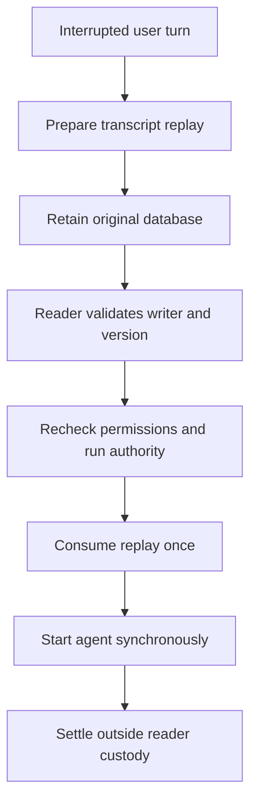

Codex review: needs maintainer review before merge. _Reviewed October 5, 2026, 2:30 AM ET / 06:30 UTC (Revision 3)._

# ClawSweeper review

## What this changes

The branch moves persisted-turn replay validation into existing transcript readers and makes internal prompt admission awaitable while preserving synchronous agent entry.

## Merge readiness

✅ **Ready for maintainer review**

This remains a useful, distinct performance improvement. The reviewed source and recorded boundary proof reveal no blocking correctness or security defect.

**Priority:** P2
**Reviewed head:** `d14e903971c4e06f45840790fb467b04efa3c7c2`

## Review scores

| Measure | Result | What it means |
|---|---|---|
| **Overall readiness** | 🐚 platinum hermit **(4/6)** | The focused implementation has strong paired measurements and boundary coverage, with no actionable introduced finding. |
| **Proof confidence** | 🦞 diamond lobster **(5/6)** | Sufficient (live_output): The recorded isolated workload exercises the changed replay owner with real SQLite workers and shows all six replay caller cohorts at zero MAIN statements on the pinned candidate. Production-worker fault cases cover rewrite, database closure, run revocation, and identical-file replacement before consumption; prompt/core cases cover permission replacement and disposal. No stored-data contract changes, so migration proof is not applicable. This review inspected source and recorded evidence without executing tests. |
| **Patch quality** | 🐚 platinum hermit **(4/6)** | No actionable review findings were identified. |

## Verification

| Check | Result | Evidence |
|---|---|---|
| **Real behavior** | Verified | Sufficient (live_output): The recorded isolated workload exercises the changed replay owner with real SQLite workers and shows all six replay caller cohorts at zero MAIN statements on the pinned candidate. Production-worker fault cases cover rewrite, database closure, run revocation, and identical-file replacement before consumption; prompt/core cases cover permission replacement and disposal. No stored-data contract changes, so migration proof is not applicable. This review inspected source and recorded evidence without executing tests. |
| **Evidence reviewed** | 8 items | Pinned introduced changes: Reviewed the merge-base-to-head production hunks separately from base-branch drift. Replay preparation retains physical source identity, validates writer and context facts through the anchor reader, and consumes once within its callback. Final-effect authority checks: The reader retains writer FIFO custody and checks physical identity, current reader ownership, and the native mutation revision before consumption. Prompt admission then checks permission generation and session preparation identity before committing prompt state and entering the agent loop. Production-worker refusal coverage: The introduced regressions delay an actual worker response, then rewrite the transcript, close the database, or revoke the run; each requires rejection before consumption. A separate case replaces the physical database with identical bytes. Permission and core-loop cases check rejection before prompt publication or model requests. |
| **Findings** | None | None. |
| **Security** | None | None. |

## How this fits together

Replay admission lets an interrupted agent resume an already-persisted user turn without appending it again. It checks session ownership and transcript state before publishing the prompt and starting model execution.

## Before merge

None.

<strong>Agent review details</strong>

### Security

None.

### PR surface

Source +139, Tests +212, Docs +10. Total +361 across 11 files.

View PR surface stats

| Area | Files | Added | Removed | Net |
|---|---:|---:|---:|---:|
| Source | 5 | 241 | 102 | +139 |
| Tests | 5 | 255 | 43 | +212 |
| Docs | 1 | 10 | 0 | +10 |
| Config | 0 | 0 | 0 | 0 |
| Generated | 0 | 0 | 0 | 0 |
| Other | 0 | 0 | 0 | 0 |
| **Total** | **11** | **506** | **145** | **+361** |

### Review metrics

| Metric | Value | Why it matters |
|---|---|---|
| **Replay SQL placement** | MAIN 18 → 0 statements/turn; total +14/turn | The recorded workload supports removing synchronous replay reads while explicitly accounting for approximately 0.61% additional total SQL. |
| **Production versus test growth** | production net +139; tests/support net +212 | Production growth has a stated custody and admission justification, with added coverage for replacement and revocation boundaries. |

### Technical review

Best possible solution:

Keep replay validation with the existing transcript-reader owners, preserving live authority checks and synchronous core entry.

Do we have a high-confidence way to reproduce the issue?

Not applicable as a bug reproduction: the performance claim has a pinned paired workload, and current-main source confirms synchronous replay checks remain.

Is this the best way to solve the issue?

Yes. Extending the existing reader snapshot and retaining its admission custody is a focused solution that preserves the established writer and prompt owners.

AGENTS.md: found and applied where relevant.

Codex review notes: model internal, reasoning medium; reviewed against [d7f9ebd8de66](https://github.com/openclaw/openclaw/commit/d7f9ebd8de66effa1fd71d4b0556497f03909b4f).

### Labels

Label changes:

No label changes.

Label justifications:

- `P2`: This is a bounded internal performance improvement with measured main-thread SQL reduction and no demonstrated urgent user-facing regression.
- `rating: 🐚 platinum hermit`: Overall readiness is 🐚 platinum hermit; proof is 🦞 diamond lobster and patch quality is 🐚 platinum hermit.
- `status: 👀 ready for maintainer look`: ClawSweeper has no concrete contributor-facing blocker left for this PR. Sufficient (live_output): The recorded isolated workload exercises the changed replay owner with real SQLite workers and shows all six replay caller cohorts at zero MAIN statements on the pinned candidate. Production-worker fault cases cover rewrite, database closure, run revocation, and identical-file replacement before consumption; prompt/core cases cover permission replacement and disposal. No stored-data contract changes, so migration proof is not applicable. This review inspected source and recorded evidence without executing tests.
- `proof: sufficient`: Contributor real behavior proof is sufficient. The recorded isolated workload exercises the changed replay owner with real SQLite workers and shows all six replay caller cohorts at zero MAIN statements on the pinned candidate. Production-worker fault cases cover rewrite, database closure, run revocation, and identical-file replacement before consumption; prompt/core cases cover permission replacement and disposal. No stored-data contract changes, so migration proof is not applicable. This review inspected source and recorded evidence without executing tests.

### Evidence

What I checked:

- **Pinned introduced changes:** Reviewed the merge-base-to-head production hunks separately from base-branch drift. Replay preparation retains physical source identity, validates writer and context facts through the anchor reader, and consumes once within its callback. ([`src/agents/embedded-agent-runner/run/pre-persisted-user-turn.ts:67`](https://github.com/openclaw/openclaw/blob/d14e903971c4e06f45840790fb467b04efa3c7c2/src/agents/embedded-agent-runner/run/pre-persisted-user-turn.ts#L67), [d14e903971c4](https://github.com/openclaw/openclaw/commit/d14e903971c4e06f45840790fb467b04efa3c7c2))
- **Final-effect authority checks:** The reader retains writer FIFO custody and checks physical identity, current reader ownership, and the native mutation revision before consumption. Prompt admission then checks permission generation and session preparation identity before committing prompt state and entering the agent loop. ([`src/agents/sessions/agent-session-prompting.ts:129`](https://github.com/openclaw/openclaw/blob/d14e903971c4e06f45840790fb467b04efa3c7c2/src/agents/sessions/agent-session-prompting.ts#L129), [d14e903971c4](https://github.com/openclaw/openclaw/commit/d14e903971c4e06f45840790fb467b04efa3c7c2))
- **Production-worker refusal coverage:** The introduced regressions delay an actual worker response, then rewrite the transcript, close the database, or revoke the run; each requires rejection before consumption. A separate case replaces the physical database with identical bytes. Permission and core-loop cases check rejection before prompt publication or model requests. ([`src/agents/embedded-agent-runner/run/attempt-session-replay.test.ts:103`](https://github.com/openclaw/openclaw/blob/d14e903971c4e06f45840790fb467b04efa3c7c2/src/agents/embedded-agent-runner/run/attempt-session-replay.test.ts#L103), [d14e903971c4](https://github.com/openclaw/openclaw/commit/d14e903971c4e06f45840790fb467b04efa3c7c2))
- **Recorded after-fix workload:** The captured PR body records three paired repetitions on one isolated host using unchanged SQL instrumentation and synthetic fixtures. Replay-attributed main-thread statements fall from 18 to zero per warmed turn in every candidate repetition; total statements increase by 14 per turn, approximately 0.61%. It explicitly makes no latency claim and records passing replay, permission, lifecycle, and import-boundary validation on the pinned candidate. ([d14e903971c4](https://github.com/openclaw/openclaw/commit/d14e903971c4e06f45840790fb467b04efa3c7c2))
- **Current-main necessity:** Fetched main still uses synchronous loadSessionEntry, loadTranscriptHeaderSync, and validateSessionTranscriptContextVersion in replay admission. The related merged native-patch PR handles lifecycle writes rather than this replay path; the supplied related open PRs do not establish a merged replacement. ([`src/agents/embedded-agent-runner/run/pre-persisted-user-turn.ts:85`](https://github.com/openclaw/openclaw/blob/d7f9ebd8de66effa1fd71d4b0556497f03909b4f/src/agents/embedded-agent-runner/run/pre-persisted-user-turn.ts#L85), [d7f9ebd8de66](https://github.com/openclaw/openclaw/commit/d7f9ebd8de66effa1fd71d4b0556497f03909b4f))
- **Internal API and storage boundary:** The changed preparation symbol is explicitly internal, and its production caller is the embedded attempt owner. The anchor additions are optional request/result facts; introduced hunks contain no schema, serialized-format, migration, dependency, or supported entrypoint changes. Documentation describes unchanged stored bytes, retention, durability, and update behavior. Public docs: [`docs/reference/database-schemas/worker-access.md`](https://docs.openclaw.ai/reference/database-schemas/worker-access). ([`docs/reference/database-schemas/worker-access.md:1757`](https://docs.openclaw.ai/reference/database-schemas/worker-access), [d14e903971c4](https://github.com/openclaw/openclaw/commit/d14e903971c4e06f45840790fb467b04efa3c7c2))

Likely related people:

- **steipete:** Suggested for follow-up; no historical authorship or introduction is verified. (role: unverified routing candidate; confidence: low)

### Rating scale

| Score | Internal tier | Crab rank | Meaning |
|---:|:---:|---|---|
| **6/6** | S | 🦀 challenger crab | Exceptional readiness |
| **5/6** | A | 🦞 diamond lobster | Very strong readiness |
| **4/6** | B | 🐚 platinum hermit | Good normal PR; ordinary maintainer review |
| **3/6** | C | 🦐 gold shrimp | Useful, but confidence is limited |
| **2/6** | D | 🦪 silver shellfish | Proof or implementation needs work |
| **1/6** | F | 🧂 unranked krab | Not merge-ready |
| N/A | NA | 🌊 off-meta tidepool | Rating does not apply |

Overall follows the weaker of proof and patch quality.
Shiny media proof means a screenshot, video, or linked artifact directly shows the changed behavior. Runtime, network, CSP, and security claims still need visible diagnostics.

### Workflow

- ClawSweeper keeps one durable marker-backed review comment per issue or PR.
- Re-runs edit this comment so the latest verdict, findings, and automation markers stay together instead of adding duplicate bot comments.
- A fresh review can be triggered by eligible `@clawsweeper re-review` comments, exact-item GitHub events, scheduled/background review runs, or manual workflow dispatch.
- PR/issue authors and users with repository write access can comment `@clawsweeper re-review` or `@clawsweeper re-run` on an open PR or issue to request a fresh review only.
- Maintainers can also comment `@clawsweeper review` to request a fresh review only.
- Fresh-review commands do not start repair, autofix, rebase, CI repair, or automerge.
- Maintainer-only repair and merge flows require explicit commands such as `@clawsweeper autofix`, `@clawsweeper automerge`, `@clawsweeper fix ci`, or `@clawsweeper address review`.
- Maintainers can comment `@clawsweeper explain` to ask for more context, or `@clawsweeper stop` to stop active automation.

### History

Review history (2 earlier review cycles)

<!-- clawsweeper-review-history v=1 total=2 -->
- reviewed 2026-10-05T06:01:37.256Z sha d14e903971c4e06f45840790fb467b04efa3c7c2 :: needs changes before merge. :: none
- reviewed 2026-10-05T06:08:09.382Z sha d14e903971c4e06f45840790fb467b04efa3c7c2 :: needs maintainer review before merge. :: none

<!-- clawsweeper-verdict:needs-human item=165367 sha=d14e903971c4e06f45840790fb467b04efa3c7c2 confidence=high updated_at=2026-10-05T06:26:46Z reviewed_at=2026-10-05T06:30:00.462Z lease_owner=github-run-37272320945-1 lease_comment_id=5989269143 source_revision=9890780b6b3cef7a83922c39112a8d6e464be610d18bd24d6e46b5e1f2611a0f live_verification=absent -->
<!-- clawsweeper-review-state:ready item=165367 sha=d14e903971c4e06f45840790fb467b04efa3c7c2 v=1 -->

<!-- clawsweeper-review-version item=165367 reviewed_at=2026-10-05T06:30:00.462Z sha=d14e903971c4e06f45840790fb467b04efa3c7c2 source_revision=9890780b6b3cef7a83922c39112a8d6e464be610d18bd24d6e46b5e1f2611a0f lease_owner=github-run-37272320945-1 lease_comment_id=5989269143 v=1 -->

<!-- clawsweeper-review item=165367 -->