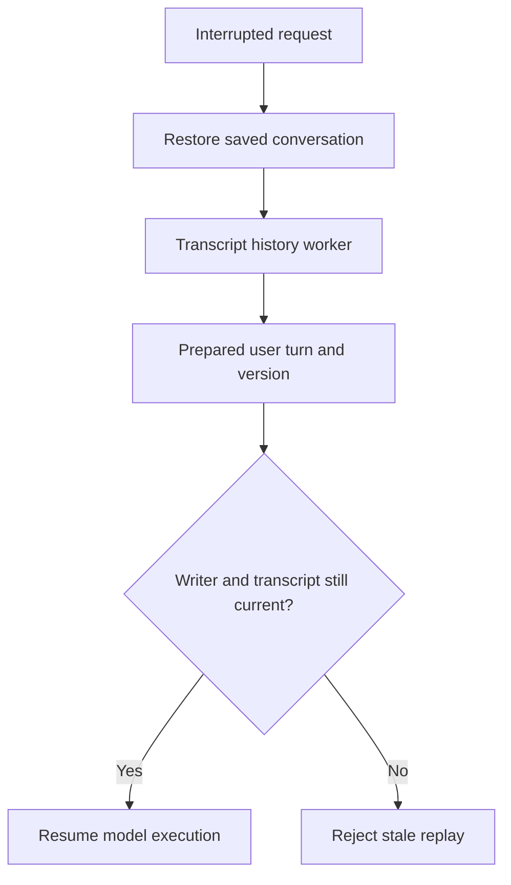

Codex review: blocked before merge. _Reviewed September 22, 2026, 10:18 AM ET / 14:18 UTC (Revision 13)._

# ClawSweeper review

## What this changes

Moves interrupted-turn replay preparation into the existing transcript worker while preserving cancellation, transcript consistency, and the synchronous SDK option.

## Merge readiness

⛔ **Blocked before merge - 1 item remains**

The replay conversion remains useful and is not covered by the merged hydration work. The previous integration blocker is resolved, shipped SDK compatibility is preserved, and this review found no actionable correctness or security defect.

**Priority:** P2
**Reviewed head:** `cb5a3b46c7bff22287e3292540544eff62ff17b0`

## Review scores

| Measure | Result | What it means |
|---|---|---|
| **Overall readiness** | 🐚 platinum hermit **(4/6)** | A coherent worker-boundary conversion with focused regression coverage and preserved compatibility; no actionable patch defect remains. |
| **Proof confidence** | 🌊 off-meta tidepool | Not applicable: The supplied MEMBER classification exempts this internal PR from external-contributor setup proof. Reported compiled-worker cases exercise current-turn reads, captured prefixes, and cancellation; inspected replay tests cover rejection before model invocation. No stored-data contract changes require migration proof. |
| **Patch quality** | 🐚 platinum hermit **(4/6)** | No actionable review findings were identified. |

## Verification

| Check | Result | Evidence |
|---|---|---|
| **Real behavior** | Not applicable | Not applicable: The supplied MEMBER classification exempts this internal PR from external-contributor setup proof. Reported compiled-worker cases exercise current-turn reads, captured prefixes, and cancellation; inspected replay tests cover rejection before model invocation. No stored-data contract changes require migration proof. |
| **Evidence reviewed** | 10 items | Current main still needs the conversion: The fetched main implementation still calls synchronous transcript reload and omitted-history traversal during replay preparation. The landed hydration infrastructure does not migrate this caller. Previous integration blocker resolved: The raw test-merge record has the pinned main parent followed by the exact PR head. Its comparison against main contains only the introduced replay files; base-only locale changes are preserved. This supersedes the previous review's unresolved hydration-integration blocker. Final replay admission remains live: After asynchronous preparation, the one-shot admission closure checks cancellation, the current session row and writer, and the exact transcript version. The existing prompt owner invokes admission synchronously before entering the model loop. |
| **Findings** | None | None. |
| **Security** | None | None. |

## How this fits together

The embedded agent runner restores saved conversations before resuming interrupted requests. Replay preparation identifies the current durable user turn, then checks current ownership before allowing model execution.

## Before merge

- [ ] **Add data-model compatibility proof** - Confirm migration or upgrade compatibility proof before merge.

<strong>Agent review details</strong>

### Security

None.

### PR surface

Source +366, Tests +251. Total +617 across 17 files.

View PR surface stats

| Area | Files | Added | Removed | Net |
|---|---:|---:|---:|---:|
| Source | 12 | 492 | 126 | +366 |
| Tests | 5 | 329 | 78 | +251 |
| Docs | 0 | 0 | 0 | 0 |
| Config | 0 | 0 | 0 | 0 |
| Generated | 0 | 0 | 0 | 0 |
| Other | 0 | 0 | 0 | 0 |
| **Total** | **17** | **821** | **204** | **+617** |

### Review metrics

| Metric | Value | Why it matters |
|---|---|---|
| **Production versus test growth** | Production net +366 lines; tests and support net +251 lines | Production growth supplies worker-backed replay preparation and version validation, with matching cancellation, stale-admission, and SDK coverage. |

### Stored data model

Persistent data-model change detected: `serialized state: src/config/sessions/session-accessor.sqlite-current-turn.ts`, `unknown-data-model-change: src/agents/embedded-agent-runner/run/attempt-session-prepare.ts`, `unknown-data-model-change: src/config/sessions/session-accessor.sqlite-current-turn.ts`. Confirm migration or upgrade compatibility proof before merge.

### Technical review

Best possible solution:

Keep replay preparation with the existing history worker and retain synchronous final admission plus the shipped SDK compatibility path.

Do we have a high-confidence way to reproduce the issue?

Not applicable as a defect reproduction: this is an internal execution-boundary refactor. Current-main source confirms synchronous replay reads; no runtime tests were executed during this read-only review.

Is this the best way to solve the issue?

Yes. Reusing the existing history worker and traversal rules avoids a competing storage owner while preserving released SDK behavior and final live-authority checks.

AGENTS.md: found and applied where relevant.

Codex review notes: model internal, reasoning medium; reviewed against [0a5b5381a26b](https://github.com/openclaw/openclaw/commit/0a5b5381a26b8480021005dc0145524ba6181cdb).

### Labels

Label changes:

No label changes.

Label justifications:

- `P2`: This is a bounded runtime storage improvement for interrupted-turn recovery, with no demonstrated urgent user-facing regression.
- `rating: 🐚 platinum hermit`: Overall readiness is 🐚 platinum hermit; proof is 🌊 off-meta tidepool and patch quality is 🐚 platinum hermit.
- `status: 👀 ready for maintainer look`: ClawSweeper has no concrete contributor-facing blocker left for this PR. Not applicable: The supplied MEMBER classification exempts this internal PR from external-contributor setup proof. Reported compiled-worker cases exercise current-turn reads, captured prefixes, and cancellation; inspected replay tests cover rejection before model invocation. No stored-data contract changes require migration proof.

### Evidence

What I checked:

- **Current main still needs the conversion:** The fetched main implementation still calls synchronous transcript reload and omitted-history traversal during replay preparation. The landed hydration infrastructure does not migrate this caller. ([`src/agents/embedded-agent-runner/run/pre-persisted-user-turn.ts:100`](https://github.com/openclaw/openclaw/blob/0a5b5381a26b8480021005dc0145524ba6181cdb/src/agents/embedded-agent-runner/run/pre-persisted-user-turn.ts#L100), [0a5b5381a26b](https://github.com/openclaw/openclaw/commit/0a5b5381a26b8480021005dc0145524ba6181cdb))
- **Previous integration blocker resolved:** The raw test-merge record has the pinned main parent followed by the exact PR head. Its comparison against main contains only the introduced replay files; base-only locale changes are preserved. This supersedes the previous review's unresolved hydration-integration blocker. ([503068e046f5](https://github.com/openclaw/openclaw/commit/503068e046f57a11fce28bb7d9c95e9c0847fd44))
- **Final replay admission remains live:** After asynchronous preparation, the one-shot admission closure checks cancellation, the current session row and writer, and the exact transcript version. The existing prompt owner invokes admission synchronously before entering the model loop. ([`src/agents/embedded-agent-runner/run/pre-persisted-user-turn.ts:125`](https://github.com/openclaw/openclaw/blob/cb5a3b46c7bff22287e3292540544eff62ff17b0/src/agents/embedded-agent-runner/run/pre-persisted-user-turn.ts#L125), [cb5a3b46c7bf](https://github.com/openclaw/openclaw/commit/cb5a3b46c7bff22287e3292540544eff62ff17b0))
- **Worker transport integration:** Current-turn requests pass cancellation as the fourth request-runner argument. Full hydration retains its separate fifth streaming callback; current-turn reads return a finite tagged result through the existing worker owner. ([`src/config/sessions/session-transcript-worker-readers.ts:146`](https://github.com/openclaw/openclaw/blob/cb5a3b46c7bff22287e3292540544eff62ff17b0/src/config/sessions/session-transcript-worker-readers.ts#L146), [cb5a3b46c7bf](https://github.com/openclaw/openclaw/commit/cb5a3b46c7bff22287e3292540544eff62ff17b0))
- **Released SDK contract preserved:** GitHub source for v2026.9.5 confirms the synchronous includeOmittedCustomMessages option and ancestor budget. The current branch preserves both through shared traversal, addressing the compatibility concern described in the supplied author response. The release tag resolves to ec9c1a13db8938e5a3eaa51fca2e981cde2395a9. ([`src/agents/sessions/session-manager-entries.ts`](https://github.com/openclaw/openclaw/blob/ec9c1a13db8938e5a3eaa51fca2e981cde2395a9/src/agents/sessions/session-manager-entries.ts), [ec9c1a13db89](https://github.com/openclaw/openclaw/commit/ec9c1a13db8938e5a3eaa51fca2e981cde2395a9))
- **Stale replay regression coverage:** Nine invalidation scenarios run during SDK hooks and after replay preparation, asserting rejection before the model client is called and unchanged transcript contents. Restart cases also assert one user turn, preserved completed tool results, and no host SQL during the asynchronous ancestry walk. These tests were inspected, not executed in this read-only review. ([`src/agents/embedded-agent-runner/run/attempt-session-replay.test.ts:841`](https://github.com/openclaw/openclaw/blob/cb5a3b46c7bff22287e3292540544eff62ff17b0/src/agents/embedded-agent-runner/run/attempt-session-replay.test.ts#L841), [cb5a3b46c7bf](https://github.com/openclaw/openclaw/commit/cb5a3b46c7bff22287e3292540544eff62ff17b0))

Likely related people:

- **steipete:** Suggested for follow-up; no historical authorship or introduction is verified. (role: unverified routing candidate; confidence: low)

### Rating scale

| Score | Internal tier | Crab rank | Meaning |
|---:|:---:|---|---|
| **6/6** | S | 🦀 challenger crab | Exceptional readiness |
| **5/6** | A | 🦞 diamond lobster | Very strong readiness |
| **4/6** | B | 🐚 platinum hermit | Good normal PR; ordinary maintainer review |
| **3/6** | C | 🦐 gold shrimp | Useful, but confidence is limited |
| **2/6** | D | 🦪 silver shellfish | Proof or implementation needs work |
| **1/6** | F | 🧂 unranked krab | Not merge-ready |
| N/A | NA | 🌊 off-meta tidepool | Rating does not apply |

Overall follows the weaker of proof and patch quality.
Shiny media proof means a screenshot, video, or linked artifact directly shows the changed behavior. Runtime, network, CSP, and security claims still need visible diagnostics.

### Workflow

- ClawSweeper keeps one durable marker-backed review comment per issue or PR.
- Re-runs edit this comment so the latest verdict, findings, and automation markers stay together instead of adding duplicate bot comments.
- A fresh review can be triggered by eligible `@clawsweeper re-review` comments, exact-item GitHub events, scheduled/background review runs, or manual workflow dispatch.
- PR/issue authors and users with repository write access can comment `@clawsweeper re-review` or `@clawsweeper re-run` on an open PR or issue to request a fresh review only.
- Maintainers can also comment `@clawsweeper review` to request a fresh review only.
- Fresh-review commands do not start repair, autofix, rebase, CI repair, or automerge.
- Maintainer-only repair and merge flows require explicit commands such as `@clawsweeper autofix`, `@clawsweeper automerge`, `@clawsweeper fix ci`, or `@clawsweeper address review`.
- Maintainers can comment `@clawsweeper explain` to ask for more context, or `@clawsweeper stop` to stop active automation.

### History

Review history (12 earlier review cycles; latest 8 shown)

<!-- clawsweeper-review-history v=1 total=12 -->
- reviewed 2026-09-20T07:01:15.196Z sha 1e3a5ea75271f92a1356d62d9373993a6349ddf7 :: blocked before merge. :: none
- reviewed 2026-09-20T10:49:37.074Z sha e7f8b2fd0e12a8148b0ab0627a920ae3449d5363 :: blocked before merge. :: none
- reviewed 2026-09-20T11:05:28.747Z sha e7f8b2fd0e12a8148b0ab0627a920ae3449d5363 :: blocked before merge. :: none
- reviewed 2026-09-20T20:27:08.822Z sha 03a4029ce89f96ffbb2d8e45bd33d025fa8566a2 :: blocked before merge. :: none
- reviewed 2026-09-20T20:57:16.703Z sha 03a4029ce89f96ffbb2d8e45bd33d025fa8566a2 :: blocked before merge. :: none
- reviewed 2026-09-22T08:55:28.187Z sha c8abb573844fac0418a10949ea1dfb86b0b86409 :: blocked before merge. :: none
- reviewed 2026-09-22T12:15:11.497Z sha 6bcf07ce83ec51288b19b6536e4a8c5a058844d1 :: blocked before merge. :: none
- reviewed 2026-09-22T14:01:20.989Z sha 6bcf07ce83ec51288b19b6536e4a8c5a058844d1 :: blocked before merge. :: none

<!-- clawsweeper-verdict:needs-human item=153432 sha=cb5a3b46c7bff22287e3292540544eff62ff17b0 confidence=high updated_at=2026-09-22T14:14:33Z reviewed_at=2026-09-22T14:18:11.023Z lease_owner=github-run-35738665576-1 lease_comment_id=5778112852 source_revision=89804a25c778ae39c807bbbc1be4187fc6ddc228742cfbd0ab6e48b28d8f0729 live_verification=absent -->
<!-- clawsweeper-review-state:blocked item=153432 sha=cb5a3b46c7bff22287e3292540544eff62ff17b0 v=1 -->

<!-- clawsweeper-review-version item=153432 reviewed_at=2026-09-22T14:18:11.023Z sha=cb5a3b46c7bff22287e3292540544eff62ff17b0 source_revision=89804a25c778ae39c807bbbc1be4187fc6ddc228742cfbd0ab6e48b28d8f0729 lease_owner=github-run-35738665576-1 lease_comment_id=5778112852 v=1 -->

<!-- clawsweeper-review item=153432 -->