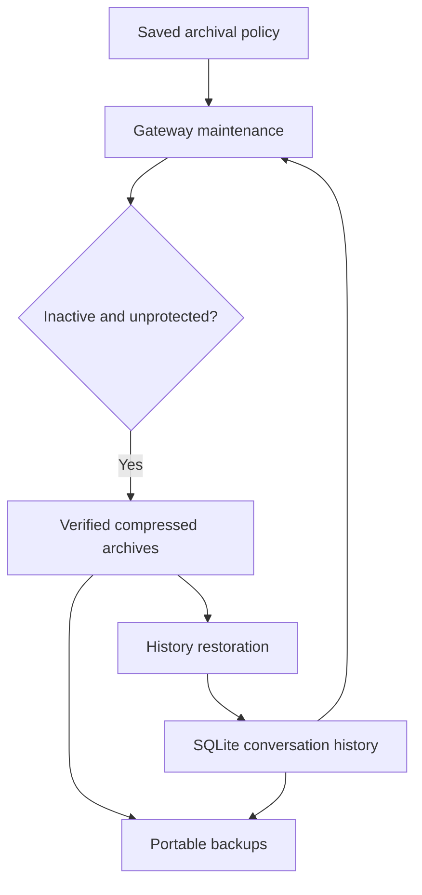

Codex review: blocked before merge. _Reviewed September 11, 2026, 7:24 PM ET / 23:24 UTC (Revision 5)._

# ClawSweeper review

## What this changes

Adds opt-in compressed transcript archival, automatic restoration, portable backups, and Settings controls, with follow-up updater and account-picker repairs.

> [!WARNING]
> **SQLite table change**
>
> This PR modifies persisted SQLite tables in `src/state/openclaw-agent-schema.sql`. Prefer a design that avoids changing persisted SQLite tables. Migration or upgrade compatibility proof is recorded, but maintainers should still confirm that the schema change is necessary.

## Merge readiness

⛔ **Blocked before merge - 4 items remain**

This remains a distinct, maintainer-owned feature absent from current main. The earlier reader findings appear addressed, and no additional blocking code defect was identified.

**Priority:** P2
**Reviewed head:** `a2dab0421d8ba4215e4bb86e8d84e0359a92c933`

## Review scores

| Measure | Result | What it means |
|---|---|---|
| **Overall readiness** | 🐚 platinum hermit **(4/6)** | Substantial runtime evidence and addressed reader regressions support a good patch assessment, with final-package upgrade validation still outstanding. |
| **Proof confidence** | 🦞 diamond lobster **(5/6)** | Sufficient (live_output): Recorded isolated Gateway and published-updater runs exercise the production archive, restoration, backup, and migration owners with preserved history and explicit failure recovery; inspected screenshots establish Settings presentation. Final-package upgrade completion remains a separate follow-up. |
| **Patch quality** | 🐚 platinum hermit **(4/6)** | No actionable review findings were identified. |

## Verification

| Check | Result | Evidence |
|---|---|---|
| **Real behavior** | Verified | Sufficient (live_output): Recorded isolated Gateway and published-updater runs exercise the production archive, restoration, backup, and migration owners with preserved history and explicit failure recovery; inspected screenshots establish Settings presentation. Final-package upgrade completion remains a separate follow-up. |
| **Evidence reviewed** | 13 items | Pinned patch and clean checkout: Reviewed the merge-base-to-head introduction rather than endpoint drift. The checkout matches the pinned original head; git diff --check passed and git status remained clean. Still necessary on main: Fetched main still declares agent schema 19 and has no session-cold-storage.ts implementation. The supplied latest release also declares schema 19. Latest release boundary: The supplied v2026.9.4 release revision uses agent schema 19; this PR's schema-20 feature is not established as shipped. |
| **Findings** | None | None. |
| **Security** | None | None. |

## How this fits together

OpenClaw stores conversation history in per-agent SQLite databases. Gateway maintenance moves inactive history into verified archive files, while history readers restore it and supported backups capture its contents.

## Before merge

- [ ] **Resolve merge risk (P1)** - Agent migration advances to schema 20 even with archival disabled; older binaries require a matching pre-upgrade backup. Final-package managed-restart and populated-database upgrade results remain pending.
- [ ] **Resolve merge risk (P1)** - Once enabled, database-only replicas are incomplete without referenced cold files; operators must use supported self-contained backups or retain those files.
- [ ] **Complete next step (P2)** - Record successful final-package managed-restart and populated SQLite upgrade results before merge.
- [ ] **Review config compatibility** - Confirm compatibility and upgrade impact for the changed config or default surface before merge.

<strong>Agent review details</strong>

### Security

None.

### PR surface

PR surface statistics unavailable: the file list is incomplete.

### Review metrics

| Metric | Value | Why it matters |
|---|---|---|
| **Configuration and protocol surface** | 2 configurable leaves, 2 administrator RPCs, agent schema 19 → 20 | Extraction defaults off, but the schema migration applies independently of that setting. |
| **Production versus test growth** | Production/tooling net +2,986 lines; tests/test support net +3,423 lines | The stated production growth supports archive ownership, restoration, backup portability, and Settings; documentation and metadata are excluded. |

### Stored data model

Persistent data-model change detected: `database schema: src/state/openclaw-agent-schema.sql`, `serialized state: ui/src/i18n/locales/en-settings.ts`, `serialized state: ui/src/pages/config/settings-targets.ts`, `unknown-data-model-change: ui/src/i18n/locales/en-settings.ts`, `unknown-truncated-pull-files`. Migration or upgrade compatibility proof is recorded; maintainers should verify it before merge.

### Merge-risk options

**Maintainer options:**
1. **Complete the existing upgrade campaign (recommended)**  
   Record final-package managed-restart and populated SQLite upgrade results while preserving the accepted backup and downgrade boundaries.

### Technical review

Best possible solution:

Retain the accepted opt-in storage design, exact restoration, and portable backups with completed final-package upgrade validation.

Do we have a high-confidence way to reproduce the issue?

Not applicable to the feature request; the recorded isolated Gateway campaign exercises archival and restoration, and this read-only review did not execute tests.

Is this the best way to solve the issue?

Yes: the patch extends the existing session and maintenance owners, preserves serialized history, and documents the accepted storage tradeoffs; final-package upgrade validation remains unfinished.

AGENTS.md: found and applied where relevant.

Codex review notes: model internal, reasoning medium; reviewed against [2efa249c405b](https://github.com/openclaw/openclaw/commit/2efa249c405b1eef4049fc348ecc71a55e1acbea).

### Labels

Label justifications:

- `P2`: This is an opt-in storage improvement with meaningful upgrade requirements, without evidence of an urgent existing-user outage.
- `merge-risk: 🚨 compatibility`: Schema 20 prevents older readers from reopening upgraded databases, and enabled archival changes what database-only backups must retain.
- `rating: 🐚 platinum hermit`: Overall readiness is 🐚 platinum hermit; proof is 🦞 diamond lobster and patch quality is 🐚 platinum hermit.
- `status: 👀 ready for maintainer look`: ClawSweeper has no concrete contributor-facing blocker left for this PR. Sufficient (live_output): Recorded isolated Gateway and published-updater runs exercise the production archive, restoration, backup, and migration owners with preserved history and explicit failure recovery; inspected screenshots establish Settings presentation. Final-package upgrade completion remains a separate follow-up.
- `proof: sufficient`: Contributor real behavior proof is sufficient. Recorded isolated Gateway and published-updater runs exercise the production archive, restoration, backup, and migration owners with preserved history and explicit failure recovery; inspected screenshots establish Settings presentation. Final-package upgrade completion remains a separate follow-up.

### Evidence

What I checked:

- **Pinned patch and clean checkout:** Reviewed the merge-base-to-head introduction rather than endpoint drift. The checkout matches the pinned original head; git diff --check passed and git status remained clean. ([a2dab0421d8b](https://github.com/openclaw/openclaw/commit/a2dab0421d8ba4215e4bb86e8d84e0359a92c933))
- **Still necessary on main:** Fetched main still declares agent schema 19 and has no session-cold-storage.ts implementation. The supplied latest release also declares schema 19. ([`package.json:7`](https://github.com/openclaw/openclaw/blob/2efa249c405b1eef4049fc348ecc71a55e1acbea/package.json#L7), [2efa249c405b](https://github.com/openclaw/openclaw/commit/2efa249c405b1eef4049fc348ecc71a55e1acbea))
- **Latest release boundary:** The supplied v2026.9.4 release revision uses agent schema 19; this PR's schema-20 feature is not established as shipped. ([`src/state/openclaw-agent-db-contract.ts:24`](https://github.com/openclaw/openclaw/blob/3a9d69db306cd7f081e06254cb89c4bcc14a7107/src/state/openclaw-agent-db-contract.ts#L24), [3a9d69db306c](https://github.com/openclaw/openclaw/commit/3a9d69db306cd7f081e06254cb89c4bcc14a7107))
- **Related work is distinct:** https://github.com/openclaw/openclaw/pull/144232 is verified merged. Its supplied discussion explicitly excludes file-only cold storage, new configuration, and schema migration, so it does not supersede this feature. ([d748e5d93d8d](https://github.com/openclaw/openclaw/commit/d748e5d93d8d63df9d90dbb4150c003f48d7e450))
- **Archive and restoration invariants:** The worker publishes and verifies compressed contents before removing hot events, rechecks protection and the prepared snapshot inside the transaction, and restores events and projections before removing the cold descriptor. ([`src/config/sessions/session-cold-storage-worker.ts`](https://github.com/openclaw/openclaw/blob/a2dab0421d8ba4215e4bb86e8d84e0359a92c933/src/config/sessions/session-cold-storage-worker.ts), [a2dab0421d8b](https://github.com/openclaw/openclaw/commit/a2dab0421d8ba4215e4bb86e8d84e0359a92c933))
- **Prior reader findings addressed:** Core recent-history and latest-assistant readers now use the restore-aware owner, as do SDK latest-text reads. The registered channel-preparation regression checks that prior conversation context survives archival. The previous reviewed SHA could not be loaded for a historical comparison; no late finding is asserted. ([`src/plugin-sdk/session-transcript-runtime.read-fence.test.ts:136`](https://github.com/openclaw/openclaw/blob/a2dab0421d8ba4215e4bb86e8d84e0359a92c933/src/plugin-sdk/session-transcript-runtime.read-fence.test.ts#L136), [a2dab0421d8b](https://github.com/openclaw/openclaw/commit/a2dab0421d8ba4215e4bb86e8d84e0359a92c933))

Likely related people:

- **steipete:** Suggested for follow-up; no historical authorship or introduction is verified. (role: unverified routing candidate; confidence: low)
- **Josh Lehman:** Suggested for follow-up; no historical authorship or introduction is verified. (role: unverified routing candidate; confidence: low)

### Rank-up moves

Optional improvements that raise the rating; they are not merge blockers.

- Record completed final-package managed-restart and populated SQLite upgrade results, preserving the existing crash/recovery and cold-file evidence.

### Rating scale

| Score | Internal tier | Crab rank | Meaning |
|---:|:---:|---|---|
| **6/6** | S | 🦀 challenger crab | Exceptional readiness |
| **5/6** | A | 🦞 diamond lobster | Very strong readiness |
| **4/6** | B | 🐚 platinum hermit | Good normal PR; ordinary maintainer review |
| **3/6** | C | 🦐 gold shrimp | Useful, but confidence is limited |
| **2/6** | D | 🦪 silver shellfish | Proof or implementation needs work |
| **1/6** | F | 🧂 unranked krab | Not merge-ready |
| N/A | NA | 🌊 off-meta tidepool | Rating does not apply |

Overall follows the weaker of proof and patch quality.
Shiny media proof means a screenshot, video, or linked artifact directly shows the changed behavior. Runtime, network, CSP, and security claims still need visible diagnostics.

### Workflow

- ClawSweeper keeps one durable marker-backed review comment per issue or PR.
- Re-runs edit this comment so the latest verdict, findings, and automation markers stay together instead of adding duplicate bot comments.
- A fresh review can be triggered by eligible `@clawsweeper re-review` comments, exact-item GitHub events, scheduled/background review runs, or manual workflow dispatch.
- PR/issue authors and users with repository write access can comment `@clawsweeper re-review` or `@clawsweeper re-run` on an open PR or issue to request a fresh review only.
- Maintainers can also comment `@clawsweeper review` to request a fresh review only.
- Fresh-review commands do not start repair, autofix, rebase, CI repair, or automerge.
- Maintainer-only repair and merge flows require explicit commands such as `@clawsweeper autofix`, `@clawsweeper automerge`, `@clawsweeper fix ci`, or `@clawsweeper address review`.
- Maintainers can comment `@clawsweeper explain` to ask for more context, or `@clawsweeper stop` to stop active automation.

### History

Review history (4 earlier review cycles)

<!-- clawsweeper-review-history v=1 total=4 -->
- reviewed 2026-09-11T19:09:42.200Z sha b2c1bcf002e69fa1641633aea5fa0745ae5443b5 :: blocked before merge. :: [P1] Restore cold transcripts before assembling channel history | [P2] Preserve cold-history support in asynchronous latest-text APIs
- reviewed 2026-09-11T21:48:52.652Z sha b10e15fcf9cb4851cd6f47c8d2c7bae062174d0a :: blocked before merge. :: none
- reviewed 2026-09-11T22:08:49.157Z sha c6d9bf6d5191ca498c98cef10941b1a607d528e8 :: blocked before merge. :: none
- reviewed 2026-09-11T23:15:47.956Z sha 07a6cbe968eac928e3d048a185576801a7cb287c :: blocked before merge. :: none

<!-- clawsweeper-verdict:needs-human item=145172 sha=a2dab0421d8ba4215e4bb86e8d84e0359a92c933 confidence=high updated_at=2026-09-11T23:20:42Z reviewed_at=2026-09-11T23:24:04.943Z lease_owner=github-run-34657578770-1 lease_comment_id=5641750357 source_revision=ccf969fcb63c92958c4ee0e983bc7afe461216428726b1a4bc39498c6c13013d live_verification=absent -->
<!-- clawsweeper-review-state:blocked item=145172 sha=a2dab0421d8ba4215e4bb86e8d84e0359a92c933 v=1 -->

<!-- clawsweeper-review-version item=145172 reviewed_at=2026-09-11T23:24:04.943Z sha=a2dab0421d8ba4215e4bb86e8d84e0359a92c933 source_revision=ccf969fcb63c92958c4ee0e983bc7afe461216428726b1a4bc39498c6c13013d lease_owner=github-run-34657578770-1 lease_comment_id=5641750357 v=1 -->

<!-- clawsweeper-review item=145172 -->