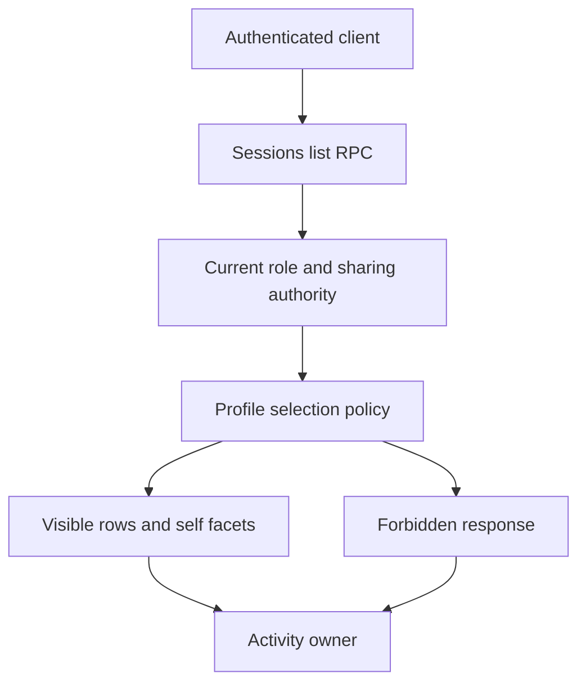

Codex review: needs maintainer review before merge.

## What this changes

This PR restricts guests to their own person activity selectors and facets and clears retained Activity data after access is denied.

**Example:** guest@example.com requests another person's timeline after being demoted on the same WebSocket.
- **Before:** The request returns the other person's visible activity and counts.
- **After:** The request returns FORBIDDEN; ordinary shared sessions remain accessible and person facets contain only the guest.

## Review scores

| Measure | Result | What it means |
|---|---|---|
| **Overall readiness** | 🦐 gold shrimp **(3/6)** | The focused patch has no actionable findings and adequate authority-boundary evidence, with confidence limited to the production-path harness and rendered UI tests. |
| **Proof confidence** | 🦐 gold shrimp **(3/6)** ✨ media proof bonus | Sufficient (linked_artifact): The accepted production-path Gateway harness exercises allowed member reads and forbidden foreign-person reads after authoritative role demotion on the same WebSocket, including warmed selections and preserved shared-session access; production blobs match the previous reviewed head, and no live guest-browser result is claimed. |
| **Patch quality** | 🐚 platinum hermit **(4/6)** | No actionable review findings were identified. |

## Product

**Kind:** Bug fix · **Worth it:** Yes · **Fix scope:** Complete
**User problem:** Guests can request another person's activity timeline and aggregate counts despite lacking general profile-directory access.
**Reason:** The maintainer-authored direction establishes the privacy boundary while preserving self activity, shared-session access, and named-role authority.

## Merge readiness

✅ **Ready for maintainer review**

Keep this maintainer-authored privacy fix open; no actionable introduced defects were found, and current-head CI remains pending.

**Priority:** P2
**Reviewed head:** `d0fb4f62ccbf5c8b1f042dda11ce2036fa415118`

## Before merge

None.

## Findings

None.

### Tests

- Missing end-to-end proof: A live guest browser showing a populated timeline becoming restricted is not demonstrated.

<strong>Agent review details</strong>

### How this fits together

Authenticated sessions.list requests enter the Gateway's shared selection and presentation owners, which apply current role and sharing authority before returning rows and facets to Activity.

### Technical review

Best possible solution:

Keep current-role authorization in the shared session-list owner and clear retained Activity data when that owner denies access.

Do we have a high-confidence way to reproduce the issue?

Current-main source permits foreign person selection within visible sessions without this role check; the PR records an expected-red reproduction, but this review ran no target code.

Is this the best way to solve the issue?

The patch addresses the owning authorization boundary with one shared policy and a focused UI cleanup, and the added regressions protect distinct failures.

AGENTS.md: found and applied where relevant.

Codex review notes: model internal, reasoning medium; reviewed against [2cf02a5d104a](https://github.com/openclaw/openclaw/commit/2cf02a5d104a4dfccd62dc90ebd33e8f417b972c).

### Provenance checked

- `Person references and profile facets` changes intended behavior with a stated reason (4c6d67f743971ee079c4b1a3b8c1e856aa6cbac9: Readable person URLs resolve exact, compact, retained, and merged identities within the caller-visible session scope.)
- `Inventory selectors and owner facets` changes intended behavior with a stated reason (98de72df52a78562a499d7ec36e291aa6df4744b: Scoped inventories expose relationship filters and complete facets before paging while preserving session visibility.)
- `Owner activity counts` changes intended behavior with a stated reason (8e57f5447edd469333772292f2fafb2f913f99a9: Gateway-owned counts summarize accessible, owned, unarchived sessions independently of sidebar pagination.)
- `Retained Activity state` changes intended behavior with a stated reason (10c95d1a60566bbd852a324aa085746e46ad02ac: The plain Activity owner retains query and refresh state across Solid presentation lifecycles; the PR narrows retention after explicit authorization denial.)

### Testing

Proof path: in-process harness.

### Security

None.

### Evidence

What I checked:

- **Shared authorization boundary:** The policy uses current named-role scopes, checks every explicit profile selector, and preserves the existing shared-session visibility boundary. ([`src/gateway/session-profile-activity-policy.ts:20`](https://github.com/openclaw/openclaw/blob/d0fb4f62ccbf5c8b1f042dda11ce2036fa415118/src/gateway/session-profile-activity-policy.ts#L20), [d0fb4f62ccbf](https://github.com/openclaw/openclaw/commit/d0fb4f62ccbf5c8b1f042dda11ce2036fa415118))
- **Final response authority:** Selection is prepared after readiness and the RPC asserts current authorization immediately before responding; retained selection keys include the current role policy. ([`src/gateway/server-methods/sessions-read.ts:372`](https://github.com/openclaw/openclaw/blob/d0fb4f62ccbf5c8b1f042dda11ce2036fa415118/src/gateway/server-methods/sessions-read.ts#L372), [d0fb4f62ccbf](https://github.com/openclaw/openclaw/commit/d0fb4f62ccbf5c8b1f042dda11ce2036fa415118))
- **Authority-transition proof:** The real-Gateway regression warms person and roster selections, changes the authoritative role on the same authenticated WebSocket, then verifies foreign denial, self-only facets, and preserved shared-session access; the linked job succeeded at 5e2f74edb088ed0ae8b498eeb63b54085a830549: https://github.com/openclaw/openclaw/actions/runs/41663087920/job/126013394317. ([`src/gateway/server.auth.presence-audience.test.ts:207`](https://github.com/openclaw/openclaw/blob/5e2f74edb088ed0ae8b498eeb63b54085a830549/src/gateway/server.auth.presence-audience.test.ts#L207), [5e2f74edb088](https://github.com/openclaw/openclaw/commit/5e2f74edb088ed0ae8b498eeb63b54085a830549))
- **Rebase preserves production:** GitHub content blob IDs at the previous reviewed head match all four current production files, independently confirming that their behavior is unchanged by the rebase. ([d0fb4f62ccbf](https://github.com/openclaw/openclaw/commit/d0fb4f62ccbf5c8b1f042dda11ce2036fa415118))
- **Denied-view cleanup:** FORBIDDEN clears the retained result, row provenance, and pending summaries; distinct owner and rendered-view regressions cover stale data removal. ([`ui/src/pages/activity/session-activity-owner.ts:545`](https://github.com/openclaw/openclaw/blob/d0fb4f62ccbf5c8b1f042dda11ce2036fa415118/ui/src/pages/activity/session-activity-owner.ts#L545), [d0fb4f62ccbf](https://github.com/openclaw/openclaw/commit/d0fb4f62ccbf5c8b1f042dda11ce2036fa415118))
- **Current main still needs the fix:** Fetched main lacks the profile-activity authorization integration and retains unrestricted person facets within the visible session scope. ([`src/gateway/session-utils-list.ts:470`](https://github.com/openclaw/openclaw/blob/2cf02a5d104a4dfccd62dc90ebd33e8f417b972c/src/gateway/session-utils-list.ts#L470), [2cf02a5d104a](https://github.com/openclaw/openclaw/commit/2cf02a5d104a4dfccd62dc90ebd33e8f417b972c))

### PR surface

Source +96, Tests +177, Docs +7, Other +2. Total +282 across 11 files. Added test files: 0.

View PR surface stats

| Area | Files | Added | Removed | Net |
|---|---:|---:|---:|---:|
| Source | 4 | 114 | 18 | +96 |
| Tests | 5 | 180 | 3 | +177 |
| Docs | 1 | 7 | 0 | +7 |
| Config | 0 | 0 | 0 | 0 |
| Generated | 0 | 0 | 0 | 0 |
| Other | 1 | 2 | 0 | +2 |
| **Total** | **11** | **303** | **21** | **+282** |

### Review metrics

| Metric | Value | Why it matters |
|---|---|---|
| **Production versus regression growth** | Production +96 net lines; tests +177 net lines | Growth supports one shared authorization policy and distinct selector, transport-demotion, and denied-view boundaries without adding persistence or caches. |

### Labels

Label changes:

No label changes.

Label justifications:

- `P2`: The fix restricts person activity aggregation for authenticated guests while preserving existing shared-session access.
- `rating: 🦐 gold shrimp`: Overall readiness is 🦐 gold shrimp; proof is 🦐 gold shrimp and patch quality is 🐚 platinum hermit.
- `status: 👀 ready for maintainer look`: ClawSweeper has no concrete contributor-facing blocker left for this PR.
- `proof: sufficient`: Contributor real behavior proof is sufficient.

### Rating scale

6/6 🦀 challenger crab · 5/6 🦞 diamond lobster · 4/6 🐚 platinum hermit · 3/6 🦐 gold shrimp · 2/6 🦪 silver shellfish · 1/6 🧂 unranked krab. Overall follows the weaker of proof and patch quality; ✨ marks media proof (a screenshot, video, or linked artifact) that directly shows the changed behavior.

### Workflow

ClawSweeper edits this one comment on every review. Comment `@clawsweeper re-review` for a fresh review only. Repair and merge execution lanes are retired.

### History

Review history (4 earlier review cycles)

<!-- clawsweeper-review-history v=1 total=4 -->
- reviewed 2026-11-03T15:00:14.276Z sha ea195928ea520380236edecd47b4b16ad204cd8c :: needs real behavior proof before merge. :: none
- reviewed 2026-11-03T15:44:27.333Z sha 5e2f74edb088ed0ae8b498eeb63b54085a830549 :: needs maintainer review before merge. :: none
- reviewed 2026-11-03T15:52:40.937Z sha 5e2f74edb088ed0ae8b498eeb63b54085a830549 :: needs maintainer review before merge. :: none
- reviewed 2026-11-03T16:12:29.163Z sha 25343998e4d7d0f871c9bc0c64eba31bf079f952 :: needs maintainer review before merge. :: none

_Reviewed November 3, 2026, 11:58 AM ET / 16:58 UTC (Revision 5)._

<!-- clawsweeper-verdict:needs-human item=191978 sha=d0fb4f62ccbf5c8b1f042dda11ce2036fa415118 confidence=high updated_at=2026-11-03T16:53:48Z reviewed_at=2026-11-03T16:58:51.485Z lease_owner=github-run-41678519708-1 lease_comment_id=6610086658 source_revision=e2899be985c2a9da8cb4081ca2f89caa5002ec08902fc2071d28ab7bd8e41f1b hold=not_opted_in findings=0 -->
<!-- clawsweeper-review-state:ready item=191978 sha=d0fb4f62ccbf5c8b1f042dda11ce2036fa415118 v=1 -->

<!-- clawsweeper-review-version item=191978 reviewed_at=2026-11-03T16:58:51.485Z sha=d0fb4f62ccbf5c8b1f042dda11ce2036fa415118 source_revision=e2899be985c2a9da8cb4081ca2f89caa5002ec08902fc2071d28ab7bd8e41f1b lease_owner=github-run-41678519708-1 lease_comment_id=6610086658 v=1 -->

<!-- clawsweeper-review item=191978 -->