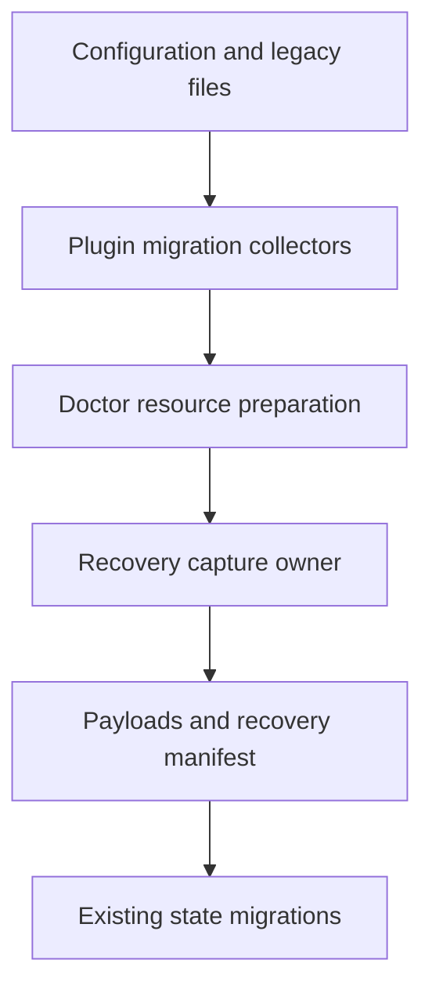

Codex review: needs maintainer review before merge.

## What this changes

This PR adds Canvas and Memory Core migration sources and destinations to newly created recovery copies.

**Example:** Doctor migrates /srv/canvas/documents/retained/index.html into core Canvas storage.
- **Before:** The recovery copy omits the original document and the initially absent destination.
- **After:** The recovery copy preserves the original document and records the destination's prior absence.

## Review scores

| Measure | Result | What it means |
|---|---|---|
| **Overall readiness** | 🦐 gold shrimp **(3/6)** | A focused, useful repair with meaningful capture-boundary coverage and no remaining code finding; shipped upgrade validation is still outstanding. |
| **Proof confidence** | 🦐 gold shrimp **(3/6)** | Ordinary contributor proof is exempt for this maintainer-authored PR; supplied tests exercise production capture and read-only collection, but the separate repository-required published-updater × candidate validation remains unverified. |
| **Patch quality** | 🐚 platinum hermit **(4/6)** | No actionable review findings were identified. |

## Product

**Kind:** Bug fix · **Worth it:** Yes · **Fix scope:** Complete
**User problem:** Doctor can move or remove legacy plugin files that its recovery copy did not preserve.
**Reason:** The maintainer-authored scope repairs newly created recovery copies and explicitly preserves the limitation of older installed updaters.

## Merge readiness

✅ **Ready for maintainer review**

Keep open: this maintainer-authored PR repairs a current recovery-inventory defect, and the prior rollback-journal finding is fixed; no new actionable code defect was found.

**Priority:** P2
**Reviewed head:** `6f74615ca1f68b4aaf348410bf1c2e2c5287c7a2`

## Before merge

None.

## Findings

None.

### Tests

- Missing end-to-end proof: The required v2026.10.1 published-updater × candidate scenario has not been supplied, including preserved settings and data, retained older captures, and the declared legacy resources.

<strong>Agent review details</strong>

### How this fits together

Plugin collectors translate configuration and legacy file locations into resource declarations consumed by Doctor's existing recovery capture owner before migrations run.

### Technical review

Best possible solution:

Complete the plugin-owned inventories through the existing capture owner while preserving older recovery copies and migration behavior.

Do we have a high-confidence way to reproduce the issue?

Source shows migrations moving or deleting files without declaring their capture resources; the PR reports matching failing-before regressions, and this read-only review ran no target code.

Is this the best way to solve the issue?

Adding read-only declarations to the existing migration owners addresses the omission directly and reuses their source, archive, and companion contracts.

AGENTS.md: found and applied where relevant.

Codex review notes: model internal, reasoning medium; reviewed against [a22eb8a59bf1](https://github.com/openclaw/openclaw/commit/a22eb8a59bf128028182918d1c67df12eefe955c).

### Provenance checked

- `Read-only migration resource declarations` keeps the original intent (https://github.com/openclaw/openclaw/pull/156326: Inspect declared plugin data before rehearsal while retaining strict path validation and undeclared-owner warnings.)
- `Canvas document migration` keeps the original intent (9710a1339e3ca63ccc51ee79d2dd0c8c00917726: Move inline-widget hosting into core while migrating custom-root documents without changing their user-facing contract.)
- `Retained Memory Core migrations` keeps the original intent (https://github.com/openclaw/openclaw/pull/113542: Split supported retained migrations into focused modules while preserving repair behavior; this establishes the refactor, not each migration's original introduction.)
- `Rehearsal capture exclusions` keeps the original intent (d417b5202305f4f796e8e62586dfd05d57e1b242: Avoid duplicate disposable core database backups while retaining distinct plugin and configuration resources.)

### Testing

Proof path: in-process harness.

### Security

None.

### Evidence

What I checked:

- **Current-main defect remains:** The three production migration modules are unchanged between the introduction base and fetched main; they lack the collectors added by this PR. ([`extensions/canvas/doctor-contract-api.ts:39`](https://github.com/openclaw/openclaw/blob/a22eb8a59bf128028182918d1c67df12eefe955c/extensions/canvas/doctor-contract-api.ts#L39), [a22eb8a59bf1](https://github.com/openclaw/openclaw/commit/a22eb8a59bf128028182918d1c67df12eefe955c))
- **Prior finding resolved:** Both retry destination families now enumerate LEGACY_MEMORY_SIDECAR_SUFFIXES, including -journal, and the inventory regression checks both journal destinations. ([`extensions/memory-core/src/migration/doctor-memory-sidecar.ts:513`](https://github.com/openclaw/openclaw/blob/6f74615ca1f68b4aaf348410bf1c2e2c5287c7a2/extensions/memory-core/src/migration/doctor-memory-sidecar.ts#L513), [6f74615ca1f6](https://github.com/openclaw/openclaw/commit/6f74615ca1f68b4aaf348410bf1c2e2c5287c7a2))
- **Capture-boundary coverage:** The extended test uses production capture and manifest owners to check original Canvas bytes and an absent destination; registry discovery is replaced with a fixture, and the PR reports failing-before and passing-after results. ([`src/commands/doctor-rehearsal-capture.test.ts:173`](https://github.com/openclaw/openclaw/blob/6f74615ca1f68b4aaf348410bf1c2e2c5287c7a2/src/commands/doctor-rehearsal-capture.test.ts#L173), [6f74615ca1f6](https://github.com/openclaw/openclaw/commit/6f74615ca1f68b4aaf348410bf1c2e2c5287c7a2))
- **Existing declaration contract preserved:** https://github.com/openclaw/openclaw/pull/156326 established read-only migration inventories and strict resource validation, crediting Peter Steinberger's original recovery work; this PR supplies inventories through that contract. ([`src/plugins/doctor-migration-resources.ts:28`](https://github.com/openclaw/openclaw/blob/4c468412dfef638a179fa1d82e5a6ea1b1d2be4d/src/plugins/doctor-migration-resources.ts#L28), [4c468412dfef](https://github.com/openclaw/openclaw/commit/4c468412dfef638a179fa1d82e5a6ea1b1d2be4d))
- **Verified no-migration case:** The introduced production hunks only add collectors; recovery manifests retain schema version 2, and admitted captures from older updaters are read and retained rather than rewritten. ([`src/infra/update-recovery-baseline-capture.ts:532`](https://github.com/openclaw/openclaw/blob/6f74615ca1f68b4aaf348410bf1c2e2c5287c7a2/src/infra/update-recovery-baseline-capture.ts#L532), [6f74615ca1f6](https://github.com/openclaw/openclaw/commit/6f74615ca1f68b4aaf348410bf1c2e2c5287c7a2))
- **Required upgrade validation:** Root policy requires a published-driver × candidate cell for Doctor/update changes; the full PR body explicitly defers that validation and supplies no completed cell for this change. ([`AGENTS.md:80`](https://github.com/openclaw/openclaw/blob/6f74615ca1f68b4aaf348410bf1c2e2c5287c7a2/AGENTS.md#L80), [6f74615ca1f6](https://github.com/openclaw/openclaw/commit/6f74615ca1f68b4aaf348410bf1c2e2c5287c7a2))

Likely related people:

- **Peter Steinberger:** Raw commit 5f482a7defc87b3c720a008efc215256af0a1fff adds extensions/memory-core/src/migration/doctor-memory-sidecar.ts:18 relative to its recorded parents. This identifies author metadata, not feature responsibility or a PR merger. (role: source-line author; confidence: high; commits: [5f482a7defc8](https://github.com/openclaw/openclaw/commit/5f482a7defc87b3c720a008efc215256af0a1fff); files: `extensions/memory-core/src/migration/doctor-memory-sidecar.ts`)

### PR surface

Source +63, Tests +118. Total +181 across 6 files. Added test files: 1.

View PR surface stats

| Area | Files | Added | Removed | Net |
|---|---:|---:|---:|---:|
| Source | 3 | 63 | 0 | +63 |
| Tests | 3 | 122 | 4 | +118 |
| Docs | 0 | 0 | 0 | 0 |
| Config | 0 | 0 | 0 | 0 |
| Generated | 0 | 0 | 0 | 0 |
| Other | 0 | 0 | 0 | 0 |
| **Total** | **6** | **185** | **4** | **+181** |

### Review metrics

| Metric | Value | Why it matters |
|---|---|---|
| **Production versus test changes** | Production +63/-0; tests +122/-4 | Production growth supplies three missing inventories; tests protect capture contents, absent destinations, companion coverage, and read-only collection. |

### Labels

Label changes:

- add `rating: 🦐 gold shrimp`: Overall readiness is 🦐 gold shrimp; proof is 🦐 gold shrimp and patch quality is 🐚 platinum hermit.
- add `status: 👀 ready for maintainer look`: ClawSweeper has no concrete contributor-facing blocker left for this PR.
- remove `rating: 🧂 unranked krab`: Current PR rating is `rating: 🦐 gold shrimp`, so this older rating label is no longer current.
- remove `status: ⏳ waiting on author`: Current PR status label is `status: 👀 ready for maintainer look`.

Label justifications:

- `P2`: This focused repair protects recovery coverage for retained legacy Canvas and Memory Core files.
- `rating: 🦐 gold shrimp`: Overall readiness is 🦐 gold shrimp; proof is 🦐 gold shrimp and patch quality is 🐚 platinum hermit.
- `status: 👀 ready for maintainer look`: ClawSweeper has no concrete contributor-facing blocker left for this PR.

### Rank-up moves

Optional improvements that raise the rating; they are not merge blockers.

- Link the scoped published-updater × candidate validation from the release campaign before landing.

### Rating scale

6/6 🦀 challenger crab · 5/6 🦞 diamond lobster · 4/6 🐚 platinum hermit · 3/6 🦐 gold shrimp · 2/6 🦪 silver shellfish · 1/6 🧂 unranked krab. Overall follows the weaker of proof and patch quality; ✨ marks media proof (a screenshot, video, or linked artifact) that directly shows the changed behavior.

### Workflow

ClawSweeper edits this one comment on every review. Comment `@clawsweeper re-review` for a fresh review only. Repair and merge execution lanes are retired.

### History

Review history (2 earlier review cycles)

<!-- clawsweeper-review-history v=1 total=2 -->
- reviewed 2026-10-11T23:21:59.277Z sha 9c1605867d39e2207a0f61ca56d8ef928fb153a8 :: blocked before merge. :: [P2] Include rollback journals in both retry destination inventories
- reviewed 2026-10-11T23:33:20.081Z sha 9c1605867d39e2207a0f61ca56d8ef928fb153a8 :: blocked before merge. :: [P2] Include rollback journals in both retry destination inventories

_Reviewed October 11, 2026, 7:58 PM ET / 23:58 UTC (Revision 3)._

<!-- clawsweeper-verdict:needs-human item=169436 sha=6f74615ca1f68b4aaf348410bf1c2e2c5287c7a2 confidence=high updated_at=2026-10-11T23:54:03Z reviewed_at=2026-10-11T23:58:31.524Z lease_owner=github-run-38185917385-1 lease_comment_id=6115302407 source_revision=ec95b58a4670fda5c97d561a745f591c755058afcdde7f81b747c857bb2e759a hold=not_opted_in findings=0 -->
<!-- clawsweeper-review-state:ready item=169436 sha=6f74615ca1f68b4aaf348410bf1c2e2c5287c7a2 v=1 -->

<!-- clawsweeper-review-version item=169436 reviewed_at=2026-10-11T23:58:31.524Z sha=6f74615ca1f68b4aaf348410bf1c2e2c5287c7a2 source_revision=ec95b58a4670fda5c97d561a745f591c755058afcdde7f81b747c857bb2e759a lease_owner=github-run-38185917385-1 lease_comment_id=6115302407 v=1 -->

<!-- clawsweeper-review item=169436 -->