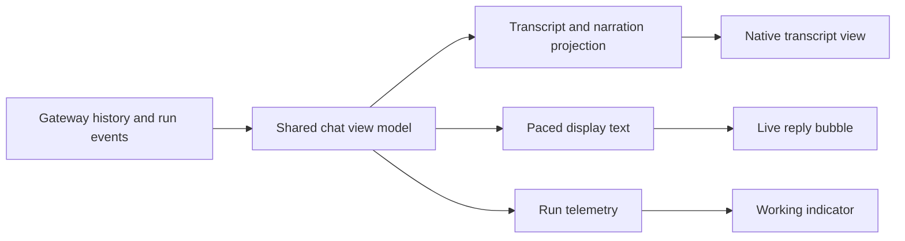

Codex review: needs maintainer review before merge.

## What this changes

This PR batches displayed streaming text and prevents token-only updates and unchanged history from rebuilding the native chat transcript.

**Example:** A native chat displays 60 history rows while receiving 128 assistant text events.
- **Before:** Each text update can invalidate the enclosing transcript and issue another scroll command.
- **After:** Growing text updates in short batches inside the live bubble, while readers can remain on rows 48–51 through completion.

## Review scores

| Measure | Result | What it means |
|---|---|---|
| **Overall readiness** | 🦞 diamond lobster **(5/6)** | Focused owner-level repair with inspected native app evidence, meaningful observation regressions, and no open correctness or security finding. |
| **Proof confidence** | 🦞 diamond lobster **(5/6)** | Sufficient (logs): The iPhone 17 simulator app exercises the production chat view and view model with a 60-row transcript, streamed text, token-only events, unchanged history, and completion; inspected screenshots and runtime logs demonstrate paced rendering and preserved reading position, and the relevant mechanisms remain unchanged from the tested revision. |
| **Patch quality** | 🦞 diamond lobster **(5/6)** | No actionable review findings were identified. |

## Product

**Kind:** Performance · **Worth it:** Yes · **Fix scope:** Complete
**User problem:** Native chat performs avoidable transcript work while replies stream, token counters advance, or unchanged history arrives.
**Reason:** The source-supported defect has clear responsiveness value, and the repair stays within the shared native presentation owner without adding settings or persistent state.

## Merge readiness

✅ **Ready for maintainer review**

Keep this PR open: it addresses a remaining native chat performance defect, resolves the earlier findings, and introduces no actionable bug found in this review.

**Priority:** P2
**Reviewed head:** `14452ca3b2b75724682e8c6dd3fc593df46142fc`

## Before merge

None.

## Findings

None.

<strong>Agent review details</strong>

### How this fits together

The shared Apple chat view model receives Gateway history and run events, reconciles transcript state, and supplies SwiftUI views used by iOS and macOS.

### Technical review

Best possible solution:

Retain this focused shared Apple observation repair with authoritative stream state, completion handling, and reader-controlled scrolling preserved.

Do we have a high-confidence way to reproduce the issue?

Current main exposes both reported observation paths, and supplied regressions cover token-only updates and identical history; this read-only review did not execute target code.

Is this the best way to solve the issue?

The change repairs the existing shared observation owner, isolates frequent display updates, and preserves sequence ordering, duplicate suppression, narration settlement, and terminal cleanup.

AGENTS.md: found and applied where relevant.

Codex review notes: model internal, reasoning medium; reviewed against [5dd456acfa35](https://github.com/openclaw/openclaw/commit/5dd456acfa35575c342b43b944a9d0dbb911b68e).

### Provenance checked

- `Run telemetry observation` keeps the original intent (df9a940872a1a6478a2bbf046fdec424a524634f: Live run telemetry keeps elapsed time and token usage visible across clients while preserving run ownership.)
- `Narration reconciliation` keeps the original intent (b5f3444b442c38b9b9018b421b1c63872bdb43ab: Transient run-owned narration remains visible until canonical history adopts it or a settled snapshot retires it.)
- `Live-text duplicate suppression` keeps the original intent (fa8fc4242707bc34d234b7ff022a2ab273e4948e: Prefer an exactly matching saved or sealed assistant row over a second streaming copy without clearing authoritative stream state.)
- `Streaming timeline notifications` changes intended behavior with a stated reason (ab2761f3a59a1281d046f6ea5aa3efb979e7f862: Timeline revisions supported reader-managed scrolling; this PR explains replacing per-word notifications with structural updates and native size-change anchoring.)

### Testing

Proof path: shipped entry point.

### Security

None.

### Evidence

What I checked:

- **Introduced change verified:** The pinned merge-base-to-head diff contains the observation isolation, stream pacing, scroll anchoring, narration publication, and associated test changes; unrelated endpoint drift is excluded. ([14452ca3b2b7](https://github.com/openclaw/openclaw/commit/14452ca3b2b75724682e8c6dd3fc593df46142fc))
- **Current main retains the reported history invalidation:** replaceMessages still mutates observed narration before checking whether reconciliation changed anything. ([`apps/shared/OpenClawKit/Sources/OpenClawChatUI/ChatViewModel+TranscriptCache.swift:17`](https://github.com/openclaw/openclaw/blob/5dd456acfa35575c342b43b944a9d0dbb911b68e/apps/shared/OpenClawKit/Sources/OpenClawChatUI/ChatViewModel%2BTranscriptCache.swift#L17), [5dd456acfa35](https://github.com/openclaw/openclaw/commit/5dd456acfa35575c342b43b944a9d0dbb911b68e))
- **Telemetry notifications preserve lifecycle semantics:** The replacement setter excludes sequence and token values from lifecycle comparison, separately publishes token changes, and retains terminal and assistant-text ownership changes. ([`apps/shared/OpenClawKit/Sources/OpenClawChatUI/ChatViewModel+SessionKeys.swift:12`](https://github.com/openclaw/openclaw/blob/14452ca3b2b75724682e8c6dd3fc593df46142fc/apps/shared/OpenClawKit/Sources/OpenClawChatUI/ChatViewModel%2BSessionKeys.swift#L12), [14452ca3b2b7](https://github.com/openclaw/openclaw/commit/14452ca3b2b75724682e8c6dd3fc593df46142fc))
- **Stream lifecycle and callback retirement:** Authoritative text remains immediate; displayed growth is paced, clearing retires pending callbacks, and session switches and terminal events retain the existing clearStreamingActivity path. ([`apps/shared/OpenClawKit/Sources/OpenClawChatUI/ChatViewModel+StreamPacing.swift:13`](https://github.com/openclaw/openclaw/blob/14452ca3b2b75724682e8c6dd3fc593df46142fc/apps/shared/OpenClawKit/Sources/OpenClawChatUI/ChatViewModel%2BStreamPacing.swift#L13), [14452ca3b2b7](https://github.com/openclaw/openclaw/commit/14452ca3b2b75724682e8c6dd3fc593df46142fc))
- **Earlier findings resolved:** The retired liveAssistantText projection is absent, its comparison tests use the retained comparison, and hosted rendering tests flush pending display text before asserting rendered output. ([`apps/shared/OpenClawKit/Tests/OpenClawKitTests/ChatStreamReplayTests.swift:496`](https://github.com/openclaw/openclaw/blob/14452ca3b2b75724682e8c6dd3fc593df46142fc/apps/shared/OpenClawKit/Tests/OpenClawKitTests/ChatStreamReplayTests.swift#L496), [14452ca3b2b7](https://github.com/openclaw/openclaw/commit/14452ca3b2b75724682e8c6dd3fc593df46142fc))
- **Native app proof inspected:** The linked EVIDENCE.md, runtime log, and diagnostic patch describe an iPhone 17 simulator app run with synthetic transport input, paced text, token-only updates, unchanged history, and completion. Downloaded screenshots directly show the paused reader remaining on rows 48–51. The diagnostic patch adds input and logging rather than replacing the production pacing logic. ([`EVIDENCE.md:3`](https://github.com/marvinthebored/openclaw/blob/318910fd42a1ab7eda3486c473e2b8312f92ee19/EVIDENCE.md#L3), [318910fd42a1](https://github.com/marvinthebored/openclaw/commit/318910fd42a1ab7eda3486c473e2b8312f92ee19))

Likely related people:

- **Peter Steinberger:** Raw commit 17803f368538253817d5ceff010854353453a34e adds apps/shared/OpenClawKit/Sources/OpenClawChatUI/ChatViewModel+SessionKeys.swift:139 relative to its recorded parents. This identifies author metadata, not feature responsibility or a PR merger. (role: source-line author; confidence: high; commits: [17803f368538](https://github.com/openclaw/openclaw/commit/17803f368538253817d5ceff010854353453a34e); files: `apps/shared/OpenClawKit/Sources/OpenClawChatUI/ChatViewModel+SessionKeys.swift`)
- **Marvinthebored:** Raw commit fa8fc4242707bc34d234b7ff022a2ab273e4948e adds apps/shared/OpenClawKit/Sources/OpenClawChatUI/ChatViewModel+TranscriptCache.swift:29 relative to its recorded parents. This identifies author metadata, not feature responsibility or a PR merger. (role: source-line author; confidence: high; commits: [fa8fc4242707](https://github.com/openclaw/openclaw/commit/fa8fc4242707bc34d234b7ff022a2ab273e4948e); files: `apps/shared/OpenClawKit/Sources/OpenClawChatUI/ChatViewModel+TranscriptCache.swift`)
- **christopheraaronhogg:** Raw commit ab2761f3a59a1281d046f6ea5aa3efb979e7f862 adds apps/shared/OpenClawKit/Sources/OpenClawChatUI/ChatViewModel.swift:356 relative to its recorded parents. This identifies author metadata, not feature responsibility or a PR merger. (role: source-line author; confidence: medium; commits: [ab2761f3a59a](https://github.com/openclaw/openclaw/commit/ab2761f3a59a1281d046f6ea5aa3efb979e7f862); files: `apps/shared/OpenClawKit/Sources/OpenClawChatUI/ChatViewModel.swift`)

### PR surface

Source +139, Tests +147. Total +286 across 7 files. Added test files: 0.

View PR surface stats

| Area | Files | Added | Removed | Net |
|---|---:|---:|---:|---:|
| Source | 5 | 163 | 24 | +139 |
| Tests | 2 | 179 | 32 | +147 |
| Docs | 0 | 0 | 0 | 0 |
| Config | 0 | 0 | 0 | 0 |
| Generated | 0 | 0 | 0 | 0 |
| Other | 0 | 0 | 0 | 0 |
| **Total** | **7** | **342** | **56** | **+286** |

### Labels

Label changes:

- add `rating: 🦞 diamond lobster`: Overall readiness is 🦞 diamond lobster; proof is 🦞 diamond lobster and patch quality is 🦞 diamond lobster.
- remove `rating: 🐚 platinum hermit`: Current PR rating is `rating: 🦞 diamond lobster`, so this older rating label is no longer current.

Label justifications:

- `P2`: Redundant native transcript rendering affects responsiveness during active chats without evidence of message loss or runtime unavailability.
- `rating: 🦞 diamond lobster`: Overall readiness is 🦞 diamond lobster; proof is 🦞 diamond lobster and patch quality is 🦞 diamond lobster.
- `status: 👀 ready for maintainer look`: ClawSweeper has no concrete contributor-facing blocker left for this PR.
- `proof: sufficient`: Contributor real behavior proof is sufficient.

### Rating scale

6/6 🦀 challenger crab · 5/6 🦞 diamond lobster · 4/6 🐚 platinum hermit · 3/6 🦐 gold shrimp · 2/6 🦪 silver shellfish · 1/6 🧂 unranked krab. Overall follows the weaker of proof and patch quality; ✨ marks media proof (a screenshot, video, or linked artifact) that directly shows the changed behavior.

### Workflow

ClawSweeper edits this one comment on every review. Comment `@clawsweeper re-review` for a fresh review only. Repair and merge execution lanes are retired.

### History

Review history (6 earlier review cycles)

<!-- clawsweeper-review-history v=1 total=6 -->
- reviewed 2026-10-11T05:53:04.221Z sha 20aa74cc3e1d8afe30072a21501d55107b1f1757 :: needs real behavior proof before merge. :: none
- reviewed 2026-10-11T09:27:09.473Z sha 20aa74cc3e1d8afe30072a21501d55107b1f1757 :: needs real behavior proof before merge. :: none
- reviewed 2026-10-11T15:03:19.859Z sha 20aa74cc3e1d8afe30072a21501d55107b1f1757 :: needs real behavior proof before merge. :: none
- reviewed 2026-10-11T15:42:14.908Z sha 14c43c56462d70ca1802480173aa9a9019f4bfab :: needs real behavior proof before merge. :: none
- reviewed 2026-10-12T04:05:04.845Z sha 14c43c56462d70ca1802480173aa9a9019f4bfab :: needs changes before merge. :: [P2] Remove the retired liveAssistantText projection | [P2] Settle paced display before hosted rendering assertions
- reviewed 2026-10-12T04:25:29.235Z sha 0976e152041d3ca19803d8ef4138b09725010795 :: needs maintainer review before merge. :: none

_Reviewed October 13, 2026, 10:12 PM ET / October 14, 2026, 02:12 UTC (Revision 7)._

<!-- clawsweeper-verdict:needs-human item=168919 sha=14452ca3b2b75724682e8c6dd3fc593df46142fc confidence=high updated_at=2026-10-14T02:07:10Z reviewed_at=2026-10-14T02:12:18.952Z lease_owner=github-run-38499254966-1 lease_comment_id=6159286820 source_revision=daa4cbbc250671f609dd7a0ec11bb8a89b92d34b760f2980d9969fcd472dcb58 hold=not_opted_in findings=0 -->
<!-- clawsweeper-review-state:ready item=168919 sha=14452ca3b2b75724682e8c6dd3fc593df46142fc v=1 -->

<!-- clawsweeper-review-version item=168919 reviewed_at=2026-10-14T02:12:18.952Z sha=14452ca3b2b75724682e8c6dd3fc593df46142fc source_revision=daa4cbbc250671f609dd7a0ec11bb8a89b92d34b760f2980d9969fcd472dcb58 lease_owner=github-run-38499254966-1 lease_comment_id=6159286820 v=1 -->

<!-- clawsweeper-review item=168919 -->