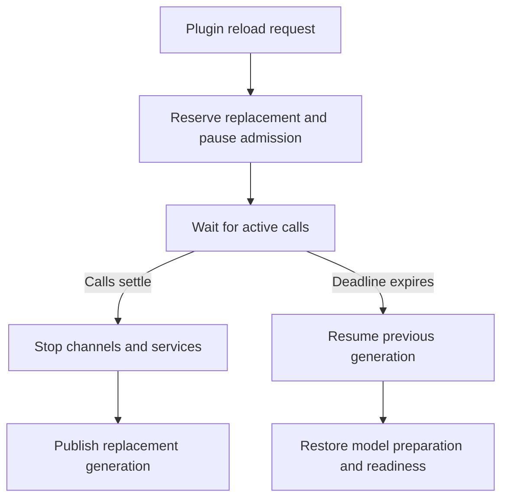

Codex review: blocked before merge. _Reviewed September 18, 2026, 2:40 PM ET / 18:40 UTC (Revision 3)._

# ClawSweeper review

## What this changes

The Gateway waits for active plugin calls before stopping services and channels, restores serving on timeout, and republishes model preparation after unsuccessful replacement.

## Merge readiness

⛔ **Blocked before merge - 2 items remain**

This remains a useful, distinct repair beyond the merged retained-consumer fixes. No blocking introduced code defect was found; the repository-required upgrade qualification remains outstanding.

**Priority:** P1
**Reviewed head:** `9f9de44a54e678d62f291712db0aa049c2ebd94f`

## Review scores

| Measure | Result | What it means |
|---|---|---|
| **Overall readiness** | 🐚 platinum hermit **(4/6)** | A focused repair with meaningful regression coverage and no identified blocking code defect, pending upgrade qualification. |
| **Proof confidence** | 🌊 off-meta tidepool | Not applicable: The ordinary external-contributor proof gate does not apply to this maintainer-authored PR. Its reported candidate tests exercise call-drain rollback, monitor replacement, and model-request recovery; the separate repository upgrade qualification remains required. |
| **Patch quality** | 🐚 platinum hermit **(4/6)** | No actionable review findings were identified. |

## Verification

| Check | Result | Evidence |
|---|---|---|
| **Real behavior** | Not applicable | Not applicable: The ordinary external-contributor proof gate does not apply to this maintainer-authored PR. Its reported candidate tests exercise call-drain rollback, monitor replacement, and model-request recovery; the separate repository upgrade qualification remains required. |
| **Evidence reviewed** | 9 items | Introduced change ownership: Reviewed the pinned merge-base-to-head delta. The supplied verified test merge has the pinned base followed by the exact PR head as parents; unrelated endpoint drift was excluded. Reversible pre-stop wait: The added call-only drain precedes previousStopStarted, rechecks current ownership before stopping anything, and routes timeout through the existing reversible rollback. The cleanup helper prevents an expired observation from quiescing later instances after rollback. Channel monitor custody: The single channel startup site retains a custody consumer until the monitor settles. Existing channel account capability revocation, stop ownership, and post-stop consumer drainage remain in place; no public plugin API or persisted setting is added. |
| **Findings** | None | None. |
| **Security** | None | None. |

## How this fits together

The Gateway’s plugin lifecycle receives reload requests and coordinates running calls, channel monitors, services, and model preparation. It publishes a replacement generation only after the previous owners safely release their resources.

## Before merge

- [ ] **Resolve merge risk (P1)** - Configured-channel startup and shutdown after an upgrade remain unqualified for the changed monitor lifetime; candidate tests do not establish survival through the published updater and managed-service restart.
- [ ] **Complete next step (P2)** - Attach sanitized published-updater-to-candidate evidence showing existing configured channels and their settings survive managed-service restart and return to readiness.

<strong>Agent review details</strong>

### Security

None.

### PR surface

Source +101, Tests +214, Docs +10. Total +325 across 17 files.

View PR surface stats

| Area | Files | Added | Removed | Net |
|---|---:|---:|---:|---:|
| Source | 4 | 177 | 76 | +101 |
| Tests | 10 | 331 | 117 | +214 |
| Docs | 3 | 15 | 5 | +10 |
| Config | 0 | 0 | 0 | 0 |
| Generated | 0 | 0 | 0 | 0 |
| Other | 0 | 0 | 0 | 0 |
| **Total** | **17** | **523** | **198** | **+325** |

### Review metrics

| Metric | Value | Why it matters |
|---|---|---|
| **Production versus regression growth** | Production net +101 lines; tests and test support net +214 lines | Production growth is justified by the shared bounded-drain logic and monitor custody; most added coverage protects rollback and resource settlement. |

### Merge-risk options

**Maintainer options:**
1. **Qualify configured-channel upgrades (recommended)**  
   Attach published-updater-to-candidate evidence showing existing channel configuration, managed-service startup, and readiness survive the changed monitor lifetime.

### Technical review

Best possible solution:

Keep replacement atomic and reversible until calls settle, preserving existing configured channels across both hot replacement and validated upgrades.

Do we have a high-confidence way to reproduce the issue?

Yes, from source: an ordinary call that outlives drainage reaches service shutdown first on fetched main and can prevent safe recovery. The PR supplies a concrete incident and focused failing-before regressions; this review did not execute them.

Is this the best way to solve the issue?

Yes. Moving call settlement before irreversible shutdown uses the existing rollback owner and preserves the single-generation publication contract without new configuration.

AGENTS.md: found and applied where relevant.

Codex review notes: model internal, reasoning medium; reviewed against [513f94878dd1](https://github.com/openclaw/openclaw/commit/513f94878dd1106e1b74db8877738afcbc66f7a2).

### Labels

Label justifications:

- `P1`: The reported production failure strands plugin channels and model requests after a routine plugin replacement.
- `merge-risk: 🚨 compatibility`: The changed channel monitor lifetime still needs the repository-required published-updater compatibility evidence.
- `rating: 🐚 platinum hermit`: Overall readiness is 🐚 platinum hermit; proof is 🌊 off-meta tidepool and patch quality is 🐚 platinum hermit.
- `status: 👀 ready for maintainer look`: ClawSweeper has no concrete contributor-facing blocker left for this PR. Not applicable: The ordinary external-contributor proof gate does not apply to this maintainer-authored PR. Its reported candidate tests exercise call-drain rollback, monitor replacement, and model-request recovery; the separate repository upgrade qualification remains required.

### Evidence

What I checked:

- **Introduced change ownership:** Reviewed the pinned merge-base-to-head delta. The supplied verified test merge has the pinned base followed by the exact PR head as parents; unrelated endpoint drift was excluded. ([9f9de44a54e6](https://github.com/openclaw/openclaw/commit/9f9de44a54e678d62f291712db0aa049c2ebd94f))
- **Reversible pre-stop wait:** The added call-only drain precedes previousStopStarted, rechecks current ownership before stopping anything, and routes timeout through the existing reversible rollback. The cleanup helper prevents an expired observation from quiescing later instances after rollback. ([`src/gateway/server-plugin-reload.ts:298`](https://github.com/openclaw/openclaw/blob/9f9de44a54e678d62f291712db0aa049c2ebd94f/src/gateway/server-plugin-reload.ts#L298), [9f9de44a54e6](https://github.com/openclaw/openclaw/commit/9f9de44a54e678d62f291712db0aa049c2ebd94f))
- **Channel monitor custody:** The single channel startup site retains a custody consumer until the monitor settles. Existing channel account capability revocation, stop ownership, and post-stop consumer drainage remain in place; no public plugin API or persisted setting is added. ([`src/gateway/server-channel-startup.ts:23`](https://github.com/openclaw/openclaw/blob/9f9de44a54e678d62f291712db0aa049c2ebd94f/src/gateway/server-channel-startup.ts#L23), [9f9de44a54e6](https://github.com/openclaw/openclaw/commit/9f9de44a54e678d62f291712db0aa049c2ebd94f))
- **Failure publication and regression coverage:** Model-runtime rollback now runs after uncommitted failures even when plugin recovery fails. Regression coverage checks 5/15/70-second held calls, preservation of the original write, restored readiness, later replacement, late observers, and waiting model-runtime requests. ([`src/gateway/server-plugin-reload.ts:673`](https://github.com/openclaw/openclaw/blob/9f9de44a54e678d62f291712db0aa049c2ebd94f/src/gateway/server-plugin-reload.ts#L673), [9f9de44a54e6](https://github.com/openclaw/openclaw/commit/9f9de44a54e678d62f291712db0aa049c2ebd94f))
- **Still necessary on fetched main:** Fetched main still stops channels and services before draining ordinary calls. The merged https://github.com/openclaw/openclaw/pull/151738 protects retained work, while https://github.com/openclaw/openclaw/pull/151588 releases idle publication custody; neither supplies this pre-stop ordinary-call wait. No merged replacement for this PR was established. ([`src/gateway/server-plugin-reload.ts`](https://github.com/openclaw/openclaw/blob/513f94878dd1106e1b74db8877738afcbc66f7a2/src/gateway/server-plugin-reload.ts), [513f94878dd1](https://github.com/openclaw/openclaw/commit/513f94878dd1106e1b74db8877738afcbc66f7a2))
- **Upgrade qualification and review continuity:** Root policy explicitly requires a published-driver × candidate cell for plugin-loading and service-lifecycle changes. The captured current body reports candidate tests, but no such upgrade cell. The configured-channel upgrade evidence in https://github.com/openclaw/openclaw/pull/150953 targets a different candidate. This independently supports retaining the prior review’s specific qualification request. ([`AGENTS.md:69`](https://github.com/openclaw/openclaw/blob/9f9de44a54e678d62f291712db0aa049c2ebd94f/AGENTS.md#L69), [9f9de44a54e6](https://github.com/openclaw/openclaw/commit/9f9de44a54e678d62f291712db0aa049c2ebd94f))

Likely related people:

- **steipete:** Suggested for follow-up; no historical authorship or introduction is verified. (role: unverified routing candidate; confidence: low)
- **jalehman:** Suggested for follow-up; no historical authorship or introduction is verified. (role: unverified routing candidate; confidence: low)

### Rank-up moves

Optional improvements that raise the rating; they are not merge blockers.

- Add sanitized published-updater-to-candidate evidence for configured-channel settings, managed-service startup, and readiness.

### Rating scale

| Score | Internal tier | Crab rank | Meaning |
|---:|:---:|---|---|
| **6/6** | S | 🦀 challenger crab | Exceptional readiness |
| **5/6** | A | 🦞 diamond lobster | Very strong readiness |
| **4/6** | B | 🐚 platinum hermit | Good normal PR; ordinary maintainer review |
| **3/6** | C | 🦐 gold shrimp | Useful, but confidence is limited |
| **2/6** | D | 🦪 silver shellfish | Proof or implementation needs work |
| **1/6** | F | 🧂 unranked krab | Not merge-ready |
| N/A | NA | 🌊 off-meta tidepool | Rating does not apply |

Overall follows the weaker of proof and patch quality.
Shiny media proof means a screenshot, video, or linked artifact directly shows the changed behavior. Runtime, network, CSP, and security claims still need visible diagnostics.

### Workflow

- ClawSweeper keeps one durable marker-backed review comment per issue or PR.
- Re-runs edit this comment so the latest verdict, findings, and automation markers stay together instead of adding duplicate bot comments.
- A fresh review can be triggered by eligible `@clawsweeper re-review` comments, exact-item GitHub events, scheduled/background review runs, or manual workflow dispatch.
- PR/issue authors and users with repository write access can comment `@clawsweeper re-review` or `@clawsweeper re-run` on an open PR or issue to request a fresh review only.
- Maintainers can also comment `@clawsweeper review` to request a fresh review only.
- Fresh-review commands do not start repair, autofix, rebase, CI repair, or automerge.
- Maintainer-only repair and merge flows require explicit commands such as `@clawsweeper autofix`, `@clawsweeper automerge`, `@clawsweeper fix ci`, or `@clawsweeper address review`.
- Maintainers can comment `@clawsweeper explain` to ask for more context, or `@clawsweeper stop` to stop active automation.

### History

Review history (2 earlier review cycles)

<!-- clawsweeper-review-history v=1 total=2 -->
- reviewed 2026-09-18T00:34:19.290Z sha 52a4ea942a93bf1be46e3e422d62540d89dda8ec :: blocked before merge. :: none
- reviewed 2026-09-18T17:18:50.954Z sha b1ebdaf042f83748d33b526c0bbcb68cf8b9eb75 :: blocked before merge. :: none

<!-- clawsweeper-verdict:needs-human item=151273 sha=9f9de44a54e678d62f291712db0aa049c2ebd94f confidence=high updated_at=2026-09-18T18:36:24Z reviewed_at=2026-09-18T18:40:01.217Z lease_owner=github-run-35381007744-1 lease_comment_id=5734530203 source_revision=b8a95496ef4054d3f54f2a9a01c10ec57b41b747cc2426b59fb9439ce38a6add live_verification=absent -->
<!-- clawsweeper-review-state:blocked item=151273 sha=9f9de44a54e678d62f291712db0aa049c2ebd94f v=1 -->

<!-- clawsweeper-review-version item=151273 reviewed_at=2026-09-18T18:40:01.217Z sha=9f9de44a54e678d62f291712db0aa049c2ebd94f source_revision=b8a95496ef4054d3f54f2a9a01c10ec57b41b747cc2426b59fb9439ce38a6add lease_owner=github-run-35381007744-1 lease_comment_id=5734530203 v=1 -->

<!-- clawsweeper-review item=151273 -->