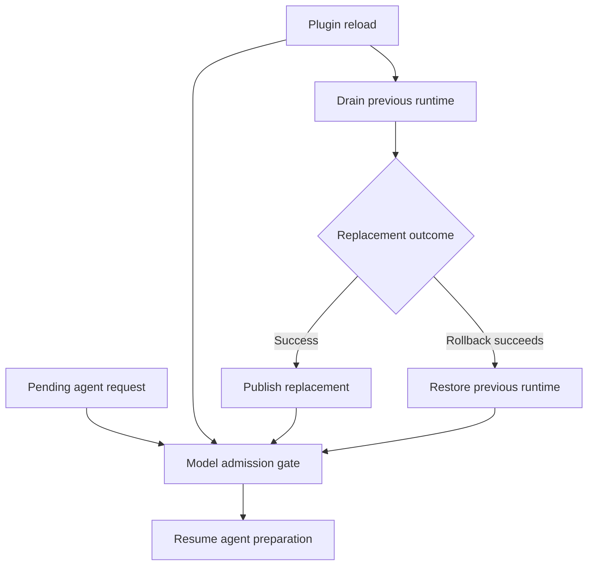

Codex review: blocked before merge. _Reviewed September 13, 2026, 6:50 PM ET / 22:50 UTC (Revision 3)._

# ClawSweeper review

## What this changes

The PR makes pending agent requests wait through plugin replacement or successful rollback, preserves unrelated failures, and adds regression coverage and documentation.

## Merge readiness

⛔ **Blocked before merge - 2 items remain**

Keep open: the fix remains useful on current main, and no actionable introduced defect was found. The previously requested upgrade validation has not finished.

**Priority:** P2
**Reviewed head:** `e0ebcce9749f51580ba6c6a5624b37d53e369305`

## Review scores

| Measure | Result | What it means |
|---|---|---|
| **Overall readiness** | 🐚 platinum hermit **(4/6)** | A focused owner-level repair with meaningful regression coverage and no actionable introduced defect. |
| **Proof confidence** | 🌊 off-meta tidepool | Not applicable: The supplied maintainer classification exempts this PR from ordinary external-contributor proof; the Gateway/model-owner regressions are supplemental, while the separately required published-driver upgrade remains pending. |
| **Patch quality** | 🐚 platinum hermit **(4/6)** | No actionable review findings were identified. |

## Verification

| Check | Result | Evidence |
|---|---|---|
| **Real behavior** | Not applicable | Not applicable: The supplied maintainer classification exempts this PR from ordinary external-contributor proof; the Gateway/model-owner regressions are supplemental, while the separately required published-driver upgrade remains pending. |
| **Evidence reviewed** | 10 items | Gate established before drainage: The reload handler invalidates model snapshots with replacement waiting enabled before plugin drainage, and returns a guarded restoration callback. Rollback ordering and failure settlement: Plugin recovery invokes the model restoration callback only after recoveryErrors remains empty. The outer reload handler rejects waiting readers on unsuccessful exits; model-runtime shutdown also rejects its pending gate. Narrow lifecycle retry: Only PluginInstanceUnavailableError from a superseded publication becomes a retryable publication error; unrelated preparation and cleanup failures remain failures. |
| **Findings** | None | None. |
| **Security** | None | None. |

## How this fits together

The Gateway replaces plugin runtimes while continuing to accept chat work. Its prepared model runtime supplies the configuration and plugin generation an agent needs before execution.

## Before merge

- [ ] **Resolve merge risk (P1)** - Compatibility with an existing installation remains unverified until the required published-driver-to-candidate upgrade finishes successfully.
- [ ] **Complete next step (P2)** - Verify and record a successful published 2026.9.3 driver-to-candidate upgrade result before landing.

<strong>Agent review details</strong>

### Security

None.

### PR surface

Source +32, Tests +261, Docs +5. Total +298 across 12 files.

View PR surface stats

| Area | Files | Added | Removed | Net |
|---|---:|---:|---:|---:|
| Source | 4 | 36 | 4 | +32 |
| Tests | 7 | 356 | 95 | +261 |
| Docs | 1 | 5 | 0 | +5 |
| Config | 0 | 0 | 0 | 0 |
| Generated | 0 | 0 | 0 | 0 |
| Other | 0 | 0 | 0 | 0 |
| **Total** | **12** | **397** | **99** | **+298** |

### Review metrics

| Metric | Value | Why it matters |
|---|---|---|
| **Production versus regression coverage** | Production +32 net lines; tests and test support +261 net lines | Production growth connects existing lifecycle owners; most growth covers admission races and rollback ordering. |

### Merge-risk options

**Maintainer options:**
1. **Decide the mitigation before merge**  
   Keep replacement waiting and rollback publication with their existing lifecycle owners, preserving cancellation and failure semantics, with published-driver upgrade compatibility verified before landing.
2. **Pause or close**  
   Do not merge this PR until maintainers decide whether the risk is worth taking.

### Technical review

Best possible solution:

Keep replacement waiting and rollback publication with their existing lifecycle owners, preserving cancellation and failure semantics, with published-driver upgrade compatibility verified before landing.

Do we have a high-confidence way to reproduce the issue?

Yes, source establishes the race between plugin drainage and model preparation, and the PR supplies focused before/during-drain regressions; this read-only review did not execute them.

Is this the best way to solve the issue?

Yes, the patch reuses the existing replacement gate and admission loop, with a narrowly typed retry and restoration owned by plugin recovery.

AGENTS.md: found and applied where relevant.

Codex review notes: model internal, reasoning medium; reviewed against [610f6dcfef32](https://github.com/openclaw/openclaw/commit/610f6dcfef322b85af25f0df495715e426adaee5).

### Labels

Label justifications:

- `P2`: This repairs pending request interruption during plugin hot reload, a bounded runtime reliability problem.
- `rating: 🐚 platinum hermit`: Overall readiness is 🐚 platinum hermit; proof is 🌊 off-meta tidepool and patch quality is 🐚 platinum hermit.
- `status: 👀 ready for maintainer look`: ClawSweeper has no concrete contributor-facing blocker left for this PR. Not applicable: The supplied maintainer classification exempts this PR from ordinary external-contributor proof; the Gateway/model-owner regressions are supplemental, while the separately required published-driver upgrade remains pending.

### Evidence

What I checked:

- **Gate established before drainage:** The reload handler invalidates model snapshots with replacement waiting enabled before plugin drainage, and returns a guarded restoration callback. ([`src/gateway/server-reload-hot.ts:197`](https://github.com/openclaw/openclaw/blob/e0ebcce9749f51580ba6c6a5624b37d53e369305/src/gateway/server-reload-hot.ts#L197), [e0ebcce9749f](https://github.com/openclaw/openclaw/commit/e0ebcce9749f51580ba6c6a5624b37d53e369305))
- **Rollback ordering and failure settlement:** Plugin recovery invokes the model restoration callback only after recoveryErrors remains empty. The outer reload handler rejects waiting readers on unsuccessful exits; model-runtime shutdown also rejects its pending gate. ([`src/gateway/server-plugin-reload.ts:652`](https://github.com/openclaw/openclaw/blob/e0ebcce9749f51580ba6c6a5624b37d53e369305/src/gateway/server-plugin-reload.ts#L652), [e0ebcce9749f](https://github.com/openclaw/openclaw/commit/e0ebcce9749f51580ba6c6a5624b37d53e369305))
- **Narrow lifecycle retry:** Only PluginInstanceUnavailableError from a superseded publication becomes a retryable publication error; unrelated preparation and cleanup failures remain failures. ([`src/agents/prepared-model-runtime.owner.ts:654`](https://github.com/openclaw/openclaw/blob/e0ebcce9749f51580ba6c6a5624b37d53e369305/src/agents/prepared-model-runtime.owner.ts#L654), [e0ebcce9749f](https://github.com/openclaw/openclaw/commit/e0ebcce9749f51580ba6c6a5624b37d53e369305))
- **Focused regression coverage:** Four cases exercise arrival before/during drainage through commit/rollback using the actual reload handler and model owner with injected plugin/catalog behavior. Two additional cases preserve unrelated errors. These are supplemental tests, not a claimed live chat reproduction. ([`src/agents/prepared-model-runtime.hot-reload-dispatch.test.ts:113`](https://github.com/openclaw/openclaw/blob/e0ebcce9749f51580ba6c6a5624b37d53e369305/src/agents/prepared-model-runtime.hot-reload-dispatch.test.ts#L113), [e0ebcce9749f](https://github.com/openclaw/openclaw/commit/e0ebcce9749f51580ba6c6a5624b37d53e369305))
- **Still necessary on main:** Fetched main still ends prepareConfigEffects without establishing the pre-drain replacement gate. Its model owner also lacks the typed supersession conversion. No supplied merged fixing PR supersedes this work. ([`src/gateway/server-reload-hot.ts:196`](https://github.com/openclaw/openclaw/blob/610f6dcfef322b85af25f0df495715e426adaee5/src/gateway/server-reload-hot.ts#L196), [610f6dcfef32](https://github.com/openclaw/openclaw/commit/610f6dcfef322b85af25f0df495715e426adaee5))
- **Release check:** No available tag contains the branch's initial fix commit; no shipped fix is established. ([58a5aeae1f67](https://github.com/openclaw/openclaw/commit/58a5aeae1f67984eb906741da5d9ece7c9fb861d))

Likely related people:

- **unknown:** The claimed source-line change could not be verified from bounded local history. (role: source history unknown; confidence: low)

### Rank-up moves

Optional improvements that raise the rating; they are not merge blockers.

- Record the successful published 2026.9.3 driver-to-candidate upgrade result in the PR evidence.

### Rating scale

| Score | Internal tier | Crab rank | Meaning |
|---:|:---:|---|---|
| **6/6** | S | 🦀 challenger crab | Exceptional readiness |
| **5/6** | A | 🦞 diamond lobster | Very strong readiness |
| **4/6** | B | 🐚 platinum hermit | Good normal PR; ordinary maintainer review |
| **3/6** | C | 🦐 gold shrimp | Useful, but confidence is limited |
| **2/6** | D | 🦪 silver shellfish | Proof or implementation needs work |
| **1/6** | F | 🧂 unranked krab | Not merge-ready |
| N/A | NA | 🌊 off-meta tidepool | Rating does not apply |

Overall follows the weaker of proof and patch quality.
Shiny media proof means a screenshot, video, or linked artifact directly shows the changed behavior. Runtime, network, CSP, and security claims still need visible diagnostics.

### Workflow

- ClawSweeper keeps one durable marker-backed review comment per issue or PR.
- Re-runs edit this comment so the latest verdict, findings, and automation markers stay together instead of adding duplicate bot comments.
- A fresh review can be triggered by eligible `@clawsweeper re-review` comments, exact-item GitHub events, scheduled/background review runs, or manual workflow dispatch.
- PR/issue authors and users with repository write access can comment `@clawsweeper re-review` or `@clawsweeper re-run` on an open PR or issue to request a fresh review only.
- Maintainers can also comment `@clawsweeper review` to request a fresh review only.
- Fresh-review commands do not start repair, autofix, rebase, CI repair, or automerge.
- Maintainer-only repair and merge flows require explicit commands such as `@clawsweeper autofix`, `@clawsweeper automerge`, `@clawsweeper fix ci`, or `@clawsweeper address review`.
- Maintainers can comment `@clawsweeper explain` to ask for more context, or `@clawsweeper stop` to stop active automation.

### History

Review history (2 earlier review cycles)

<!-- clawsweeper-review-history v=1 total=2 -->
- reviewed 2026-09-13T22:19:24.844Z sha 58a5aeae1f67984eb906741da5d9ece7c9fb861d :: blocked before merge. :: none
- reviewed 2026-09-13T22:33:06.021Z sha 4e306b6f27871e7c7d63cbc731be4845e92cbae6 :: blocked before merge. :: none

<!-- clawsweeper-verdict:needs-human item=147472 sha=e0ebcce9749f51580ba6c6a5624b37d53e369305 confidence=high updated_at=2026-09-13T22:47:28Z reviewed_at=2026-09-13T22:50:18.525Z lease_owner=github-run-34787709217-1 lease_comment_id=5656703852 source_revision=5ce9c4989412d31c6868e38625b28a1f8759ec1698175667c38a7e9cc91ab9d4 live_verification=absent -->
<!-- clawsweeper-review-state:blocked item=147472 sha=e0ebcce9749f51580ba6c6a5624b37d53e369305 v=1 -->

<!-- clawsweeper-review-version item=147472 reviewed_at=2026-09-13T22:50:18.525Z sha=e0ebcce9749f51580ba6c6a5624b37d53e369305 source_revision=5ce9c4989412d31c6868e38625b28a1f8759ec1698175667c38a7e9cc91ab9d4 lease_owner=github-run-34787709217-1 lease_comment_id=5656703852 v=1 -->

<!-- clawsweeper-review item=147472 -->