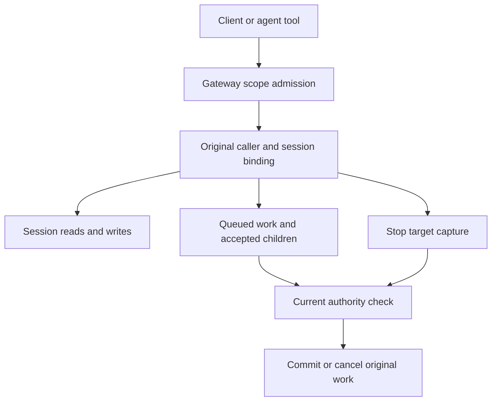

Codex review: needs maintainer review before merge. _Reviewed September 21, 2026, 8:46 PM ET / September 22, 2026, 00:46 UTC (Revision 10)._

# ClawSweeper review

## What this changes

The PR preserves the original caller’s permissions and session identity through session access, child creation, queued work, and Stop cancellation.

## Merge readiness

✅ **Ready for maintainer review**

The PR remains necessary and has no actionable findings in the pinned diff. The earlier Stop-adapter finding is fixed, and the supplied boundary proof covers original, foreign, replaced, and revoked authority. Maintainer authorship also excludes automatic closure.

**Priority:** P2
**Reviewed head:** `1da6fe2c4cdc373e1a1158b5c5189492f369870e`

## Review scores

| Measure | Result | What it means |
|---|---|---|
| **Overall readiness** | 🦞 diamond lobster **(5/6)** | Strong authority-boundary coverage and focused ownership repairs support the patch, with no remaining actionable finding. |
| **Proof confidence** | 🦞 diamond lobster **(5/6)** ✨ media proof bonus | Sufficient (linked_artifact): The supplied native-run evidence maps to inspected production Gateway, queue, cancellation, and child-input persistence harnesses, covering allowed effects and rejection after foreign ownership, replacement, or revocation. Provider callbacks are doubles; deployment is not claimed. The blocked raw-log redirect is a reviewer limitation, not missing contributor proof. |
| **Patch quality** | 🦞 diamond lobster **(5/6)** | No actionable review findings were identified. |

## Verification

| Check | Result | Evidence |
|---|---|---|
| **Real behavior** | Verified | Sufficient (linked_artifact): The supplied native-run evidence maps to inspected production Gateway, queue, cancellation, and child-input persistence harnesses, covering allowed effects and rejection after foreign ownership, replacement, or revocation. Provider callbacks are doubles; deployment is not claimed. The blocked raw-log redirect is a reviewer limitation, not missing contributor proof. |
| **Evidence reviewed** | 9 items | Pinned review identity: The checkout matches the requested head and records the previous reviewed head followed by frozen main as its raw parents. Review ownership uses the supplied merge-base-to-head delta; the stale GitHub test merge was not used to infer removals. Central repair remains absent from main: Fetched main still authorizes these methods through their broad required scopes without the PR’s session-scope alternative. No merged replacement fixing the complete requested behavior was established. Established restricted-role contract: Visitor Access already specifies session-only scopes and explicitly separates invitation policy from Gateway session/tool qualification. The merged related contribution https://github.com/openclaw/openclaw/pull/153987 supplies adjacent invitation behavior, not a replacement for this Gateway repair. |
| **Findings** | None | None. |
| **Security** | None | None. |

## How this fits together

The Gateway authorizes requests from connected clients and hosted agent tools before passing them to session, queue, and worker owners. These changes keep delayed reads, writes, and cancellation tied to the caller and session originally authorized.

## Before merge

None.

<strong>Agent review details</strong>

### Security

None.

### PR surface

Source +1070, Tests +4103, Other -1. Total +5172 across 70 files.

View PR surface stats

| Area | Files | Added | Removed | Net |
|---|---:|---:|---:|---:|
| Source | 39 | 2220 | 1150 | +1070 |
| Tests | 30 | 4260 | 157 | +4103 |
| Docs | 0 | 0 | 0 | 0 |
| Config | 0 | 0 | 0 | 0 |
| Generated | 0 | 0 | 0 | 0 |
| Other | 1 | 0 | 1 | -1 |
| **Total** | **70** | **6480** | **1308** | **+5172** |

### Review metrics

| Metric | Value | Why it matters |
|---|---|---|
| **Production versus regression coverage** | Production net +1070 lines; tests/helpers net +4103 lines | The stated growth supports authority and exact-target checks across existing owners, with substantial boundary regression coverage. |

### Technical review

Best possible solution:

Keep authorization and cancellation with the existing Gateway and lifecycle owners, preserving broad grants while binding narrow operations to the original person and session.

Do we have a high-confidence way to reproduce the issue?

Yes, from source: current main rejects session-only grants where these methods require broad read/write scopes. The cancellation regressions have concrete production-boundary fixtures, but this read-only review did not execute them.

Is this the best way to solve the issue?

Yes. The patch extends existing admission, persistence, and cancellation owners rather than introducing competing authority state, and preserves independently granted broad access.

AGENTS.md: found and applied where relevant.

Codex review notes: model internal, reasoning medium; reviewed against [000a635e3423](https://github.com/openclaw/openclaw/commit/000a635e342398f96f67b4b0fbd6ad19bf166b04).

### Labels

Label justifications:

- `P2`: This repairs restricted-session access and cancellation races without evidence of a widespread active outage.
- `rating: 🦞 diamond lobster`: Overall readiness is 🦞 diamond lobster; proof is 🦞 diamond lobster and patch quality is 🦞 diamond lobster.
- `status: 👀 ready for maintainer look`: ClawSweeper has no concrete contributor-facing blocker left for this PR. Sufficient (linked_artifact): The supplied native-run evidence maps to inspected production Gateway, queue, cancellation, and child-input persistence harnesses, covering allowed effects and rejection after foreign ownership, replacement, or revocation. Provider callbacks are doubles; deployment is not claimed. The blocked raw-log redirect is a reviewer limitation, not missing contributor proof.
- `proof: sufficient`: Contributor real behavior proof is sufficient. The supplied native-run evidence maps to inspected production Gateway, queue, cancellation, and child-input persistence harnesses, covering allowed effects and rejection after foreign ownership, replacement, or revocation. Provider callbacks are doubles; deployment is not claimed. The blocked raw-log redirect is a reviewer limitation, not missing contributor proof.

### Evidence

What I checked:

- **Pinned review identity:** The checkout matches the requested head and records the previous reviewed head followed by frozen main as its raw parents. Review ownership uses the supplied merge-base-to-head delta; the stale GitHub test merge was not used to infer removals. ([1da6fe2c4cdc](https://github.com/openclaw/openclaw/commit/1da6fe2c4cdc373e1a1158b5c5189492f369870e))
- **Central repair remains absent from main:** Fetched main still authorizes these methods through their broad required scopes without the PR’s session-scope alternative. No merged replacement fixing the complete requested behavior was established. ([`src/gateway/method-scopes.ts:277`](https://github.com/openclaw/openclaw/blob/000a635e342398f96f67b4b0fbd6ad19bf166b04/src/gateway/method-scopes.ts#L277), [000a635e3423](https://github.com/openclaw/openclaw/commit/000a635e342398f96f67b4b0fbd6ad19bf166b04))
- **Established restricted-role contract:** Visitor Access already specifies session-only scopes and explicitly separates invitation policy from Gateway session/tool qualification. The merged related contribution https://github.com/openclaw/openclaw/pull/153987 supplies adjacent invitation behavior, not a replacement for this Gateway repair. ([`extensions/visitor-access/README.md:70`](https://github.com/openclaw/openclaw/blob/1da6fe2c4cdc373e1a1158b5c5189492f369870e/extensions/visitor-access/README.md#L70), [1da6fe2c4cdc](https://github.com/openclaw/openclaw/commit/1da6fe2c4cdc373e1a1158b5c5189492f369870e))
- **Prior Stop finding resolved:** The sessions.abort adapter forwards the original handler authority into chat cancellation. Supplemental timeout publication also compares the captured receipt entry before replacing an outcome. ([`src/gateway/server-methods/sessions-abort.ts:593`](https://github.com/openclaw/openclaw/blob/1da6fe2c4cdc373e1a1158b5c5189492f369870e/src/gateway/server-methods/sessions-abort.ts#L593), [1da6fe2c4cdc](https://github.com/openclaw/openclaw/commit/1da6fe2c4cdc373e1a1158b5c5189492f369870e))
- **Continuation integration retained:** The continuation path passes the canonical three resolver arguments, retains the captured operator source, and releases it in finally. Targeted comparison with the previous reviewed head showed no changes to this file or the inference manager. ([`src/gateway/server-plugin-in-process-dispatch.ts:165`](https://github.com/openclaw/openclaw/blob/1da6fe2c4cdc373e1a1158b5c5189492f369870e/src/gateway/server-plugin-in-process-dispatch.ts#L165), [1da6fe2c4cdc](https://github.com/openclaw/openclaw/commit/1da6fe2c4cdc373e1a1158b5c5189492f369870e))
- **Stop final-effect coverage:** The inspected harness enters the real Gateway router and cancellation/queue owners with stored session entries and AbortControllers. Assertions cover successful original-target cancellation, preservation of foreign work and successors, revocation before later effects, and settlement of already-detached work. ([`src/gateway/server-methods/sessions.abort-queue-authority.test.ts:107`](https://github.com/openclaw/openclaw/blob/1da6fe2c4cdc373e1a1158b5c5189492f369870e/src/gateway/server-methods/sessions.abort-queue-authority.test.ts#L107), [1da6fe2c4cdc](https://github.com/openclaw/openclaw/commit/1da6fe2c4cdc373e1a1158b5c5189492f369870e))

Likely related people:

- **shakkernerd:** Suggested for follow-up; no historical authorship or introduction is verified. (role: unverified routing candidate; confidence: low)
- **steipete:** Suggested for follow-up; no historical authorship or introduction is verified. (role: unverified routing candidate; confidence: low)

### Rating scale

| Score | Internal tier | Crab rank | Meaning |
|---:|:---:|---|---|
| **6/6** | S | 🦀 challenger crab | Exceptional readiness |
| **5/6** | A | 🦞 diamond lobster | Very strong readiness |
| **4/6** | B | 🐚 platinum hermit | Good normal PR; ordinary maintainer review |
| **3/6** | C | 🦐 gold shrimp | Useful, but confidence is limited |
| **2/6** | D | 🦪 silver shellfish | Proof or implementation needs work |
| **1/6** | F | 🧂 unranked krab | Not merge-ready |
| N/A | NA | 🌊 off-meta tidepool | Rating does not apply |

Overall follows the weaker of proof and patch quality.
Shiny media proof means a screenshot, video, or linked artifact directly shows the changed behavior. Runtime, network, CSP, and security claims still need visible diagnostics.

### Workflow

- ClawSweeper keeps one durable marker-backed review comment per issue or PR.
- Re-runs edit this comment so the latest verdict, findings, and automation markers stay together instead of adding duplicate bot comments.
- A fresh review can be triggered by eligible `@clawsweeper re-review` comments, exact-item GitHub events, scheduled/background review runs, or manual workflow dispatch.
- PR/issue authors and users with repository write access can comment `@clawsweeper re-review` or `@clawsweeper re-run` on an open PR or issue to request a fresh review only.
- Maintainers can also comment `@clawsweeper review` to request a fresh review only.
- Fresh-review commands do not start repair, autofix, rebase, CI repair, or automerge.
- Maintainer-only repair and merge flows require explicit commands such as `@clawsweeper autofix`, `@clawsweeper automerge`, `@clawsweeper fix ci`, or `@clawsweeper address review`.
- Maintainers can comment `@clawsweeper explain` to ask for more context, or `@clawsweeper stop` to stop active automation.

### History

Review history (9 earlier review cycles; latest 8 shown)

<!-- clawsweeper-review-history v=1 total=9 -->
- reviewed 2026-09-21T19:00:20.754Z sha 2fa2098c3ee00a87249d3f157897c9b6c72e5132 :: needs changes before merge. :: none
- reviewed 2026-09-21T19:18:30.170Z sha 2fa2098c3ee00a87249d3f157897c9b6c72e5132 :: needs changes before merge. :: none
- reviewed 2026-09-21T21:14:35.594Z sha 93486343090a1dfdcb028ccac59ecc1c9980f55c :: needs changes before merge. :: none
- reviewed 2026-09-21T22:26:47.469Z sha 43af373b1f5f0002a3cb8510126da6efcf83de98 :: needs maintainer review before merge. :: none
- reviewed 2026-09-21T22:41:23.455Z sha 43af373b1f5f0002a3cb8510126da6efcf83de98 :: needs changes before merge. :: none
- reviewed 2026-09-21T23:30:16.441Z sha b7b208bd14f54cbc90f621bffeec834b56ce0ca4 :: needs changes before merge. :: none
- reviewed 2026-09-21T23:41:29.777Z sha b7b208bd14f54cbc90f621bffeec834b56ce0ca4 :: needs maintainer review before merge. :: none
- reviewed 2026-09-22T00:10:19.027Z sha bc594d0b34e2dea8052a4fa763253c387ce6cc53 :: blocked before merge. :: none

<!-- clawsweeper-verdict:needs-human item=154991 sha=1da6fe2c4cdc373e1a1158b5c5189492f369870e confidence=high updated_at=2026-09-22T00:42:23Z reviewed_at=2026-09-22T00:46:45.686Z lease_owner=github-run-35672871466-1 lease_comment_id=5769628992 source_revision=a82dba1d69457330a4253eb11845f66d9c2e58af577e0bfdd418ed9ecacd8a48 live_verification=absent -->
<!-- clawsweeper-review-state:ready item=154991 sha=1da6fe2c4cdc373e1a1158b5c5189492f369870e v=1 -->

<!-- clawsweeper-review-version item=154991 reviewed_at=2026-09-22T00:46:45.686Z sha=1da6fe2c4cdc373e1a1158b5c5189492f369870e source_revision=a82dba1d69457330a4253eb11845f66d9c2e58af577e0bfdd418ed9ecacd8a48 lease_owner=github-run-35672871466-1 lease_comment_id=5769628992 v=1 -->

<!-- clawsweeper-review item=154991 -->