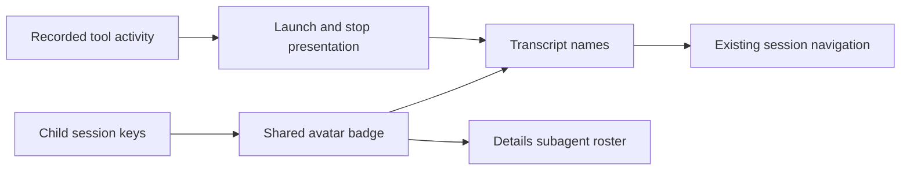

Codex review: needs changes before merge.

## What this changes

This PR adds matching subagent avatars beside transcript names using shared avatar rendering.

**Example:** A conversation launches 12 subagents, including map personal and map agents.
- **Before:** The transcript shows names and “10 more,” while colored avatars appear only in Details.
- **After:** The first two transcript names have avatars matching their Details colors.

## Review scores

| Measure | Result | What it means |
|---|---|---|
| **Overall readiness** | 🦐 gold shrimp **(3/6)** | The visual behavior is directly demonstrated and the implementation is focused, but the attributable CSS budget failure blocks readiness. |
| **Proof confidence** | 🦞 diamond lobster **(5/6)** ✨ media proof bonus | Sufficient (screenshot): Inspected the published clean and annotated browser comparisons from the fixture-backed Gateway: the changed transcript renderer displays matching avatars beside the first two names in a 12-subagent summary; this proves the visual change, without claiming a live model run. |
| **Patch quality** | 🦐 gold shrimp **(3/6)** | 1 actionable review finding remain. |

## Product

**Kind:** Feature · **Worth it:** Yes · **Fix scope:** Complete
**User problem:** Users tracking several subagents must match transcript names to colored avatars elsewhere in the UI.
**Reason:** The maintainer-authored direction adds a clear visual cue using existing identities and preserves the compact summary and interactions.

## Merge readiness

⛔ **Needs changes before merge - 1 item remains**

Keep this PR open: the maintainer-authored visual improvement is useful and demonstrated, but its CSS growth causes a required CI failure.

**Priority:** P3
**Reviewed head:** `d6a44148c2561702b2fa7a67e3cb5399a68cd801`

## Before merge

- [ ] **\[P2\] Keep the avatar styling within the enforced CSS budget (P2)** - The added styling makes the paired `control-ui-performance` check fail: total raw CSS grows from 1,748,937 to 1,749,182 bytes (+245), while an already-over-budget base permits only 64 bytes of build variance. The existing ceiling overrun is inherited, but this additional growth causes the failure and consequently blocks `openclaw/ci-gate`. Consolidate or reuse the avatar/name styles to meet the existing allowance, then rerun the paired comparison.

## Findings

- [P2] [P2] Keep the avatar styling within the enforced CSS budget — `ui/src/pages/chat/components/chat-subagent-badge.css:18-23`

<strong>Agent review details</strong>

### How this fits together

The Control UI turns recorded tool activity and child-session identities into transcript summaries, disclosures, and session-navigation buttons.

### Technical review

Best possible solution:

Retain the shared avatar presentation and consolidate its styling until the paired CSS budget check passes.

Do we have a high-confidence way to reproduce the issue?

This is an enhancement; the inspected before/after browser captures directly establish the visual difference without executing target code.

Is this the best way to solve the issue?

The shared badge is justified by its Details and transcript consumers, preserves the existing identity hash, and removes the replaced avatar styling; only the demonstrated CSS budget failure needs repair.

Full review comments:

- [P2] [P2] Keep the avatar styling within the enforced CSS budget — `ui/src/pages/chat/components/chat-subagent-badge.css:18-23`
  The added styling makes the paired `control-ui-performance` check fail: total raw CSS grows from 1,748,937 to 1,749,182 bytes (+245), while an already-over-budget base permits only 64 bytes of build variance. The existing ceiling overrun is inherited, but this additional growth causes the failure and consequently blocks `openclaw/ci-gate`. Consolidate or reuse the avatar/name styles to meet the existing allowance, then rerun the paired comparison.
  Confidence: 0.99

Overall correctness: patch is incorrect
Overall confidence: 0.96

AGENTS.md: found and applied where relevant.

Codex review notes: model internal, reasoning medium; reviewed against [6447b3e8c29e](https://github.com/openclaw/openclaw/commit/6447b3e8c29e90f2c43878ef6492ca905c9e1a93).

### Provenance checked

- `Details avatar colors and status badges` keeps the original intent (4a65c3a4d6b018cb4d3487436eb30448a9a4455b: Provide compact subagent summaries with separate child navigation; later palette and radius changes established the existing appearance.)
- `Shared UTF-16 identity hash` keeps the original intent (2c67718f1967bcfa79ff8aac7a4806d2b133190d: Remove the duplicate UI hash while preserving existing identity hues and hash values.)
- `Compact lifecycle summaries and launch links` keeps the original intent (18136c960eaf70cac7ee083959c55d13d159afc2: Present chronological launch and stop facts with stable disclosures and recorded child identities.)
- `Deferred detailed tool rendering` keeps the original intent (2c5b726de0e978c4c05ec5fc06dcce422f3ef21b: Keep detailed tool parsing and rendering outside the eager chat boot path.)

### Testing

Proof path: shipped entry point.

### Security

None.

### Evidence

Acceptance criteria:

- pnpm ui:check-performance:base ee37dd3b03358775b84d5ce2f04e6de8335dd082
- pnpm --dir ui test run src/pages/chat/components/chat-details-subagents.test.tsx src/pages/chat/components/chat-activity-disclosure.test.ts src/pages/chat/chat-spawned-subagent.test.ts
- pnpm lint:ui:styles
- git diff --check

What I checked:

- **Pinned change and current-main context:** The introduced diff shares the existing Details avatar rendering with transcript summaries and expanded launch rows; the existing affected files are unchanged between the merge base and fetched main. ([`ui/src/pages/chat/components/chat-subagent-badge.tsx:7`](https://github.com/openclaw/openclaw/blob/d6a44148c2561702b2fa7a67e3cb5399a68cd801/ui/src/pages/chat/components/chat-subagent-badge.tsx#L7), [d6a44148c256](https://github.com/openclaw/openclaw/commit/d6a44148c2561702b2fa7a67e3cb5399a68cd801))
- **Inspected visual evidence:** The clean and annotated before/after images show map personal and map agents gaining avatars whose colors match Details, while the remaining count stays at 10: https://github.com/user-attachments/assets/29628584-fc4c-449c-a57b-f816e2ea0917 and https://github.com/user-attachments/assets/511face3-7b6f-4038-805c-e2b076582d7b. ([d6a44148c256](https://github.com/openclaw/openclaw/commit/d6a44148c2561702b2fa7a67e3cb5399a68cd801))
- **Diff-caused performance gate failure:** The paired CI comparison reports total raw CSS increasing from 1,748,937 to 1,749,182 bytes, a 245-byte increase; because the base exceeds the fixed ceiling, only 64 bytes of build variance are allowed. The aggregate ci-gate reports this job as its failing dependency: https://github.com/openclaw/openclaw/actions/runs/44381396430/job/135075266444. ([`ui/src/pages/chat/components/chat-subagent-badge.css:18`](https://github.com/openclaw/openclaw/blob/d6a44148c2561702b2fa7a67e3cb5399a68cd801/ui/src/pages/chat/components/chat-subagent-badge.css#L18), [d6a44148c256](https://github.com/openclaw/openclaw/commit/d6a44148c2561702b2fa7a67e3cb5399a68cd801))
- **Feature history and preserved intent:** The history connects Details summaries to https://github.com/openclaw/openclaw/pull/176463 and compact lifecycle narration to https://github.com/openclaw/openclaw/pull/198133; this PR retains their grouping, recorded identities, status badges, and navigation callbacks. ([`ui/src/pages/chat/components/chat-message-activity-operation.tsx:113`](https://github.com/openclaw/openclaw/blob/6447b3e8c29e90f2c43878ef6492ca905c9e1a93/ui/src/pages/chat/components/chat-message-activity-operation.tsx#L113), [6447b3e8c29e](https://github.com/openclaw/openclaw/commit/6447b3e8c29e90f2c43878ef6492ca905c9e1a93))
- **Repository policy applied:** Read the complete root and UI instructions and applied the Solid and simplification guidance; no maintainer-notes directory exists in this checkout, and the checkout remains clean. ([`ui/AGENTS.md:1`](https://github.com/openclaw/openclaw/blob/d6a44148c2561702b2fa7a67e3cb5399a68cd801/ui/AGENTS.md#L1), [d6a44148c256](https://github.com/openclaw/openclaw/commit/d6a44148c2561702b2fa7a67e3cb5399a68cd801))

Likely related people:

- **Vyctor H. Brzezowski:** Raw commit 18136c960eaf70cac7ee083959c55d13d159afc2 adds ui/src/pages/chat/components/chat-message-activity-operation.tsx:111 relative to its recorded parents. This identifies author metadata, not feature responsibility or a PR merger. (role: source-line author; confidence: high; commits: [18136c960eaf](https://github.com/openclaw/openclaw/commit/18136c960eaf70cac7ee083959c55d13d159afc2); files: `ui/src/pages/chat/components/chat-message-activity-operation.tsx`)

### PR surface

Source +57. Total +57 across 6 files. Added test files: 0.

View PR surface stats

| Area | Files | Added | Removed | Net |
|---|---:|---:|---:|---:|
| Source | 6 | 93 | 36 | +57 |
| Tests | 0 | 0 | 0 | 0 |
| Docs | 0 | 0 | 0 | 0 |
| Config | 0 | 0 | 0 | 0 |
| Generated | 0 | 0 | 0 | 0 |
| Other | 0 | 0 | 0 | 0 |
| **Total** | **6** | **93** | **36** | **+57** |

### Preflight source

Source unknown. Source comparison at the observed PR snapshot only. Completion is self-reported; body, policy, tests, execution, and report bytes are not verified.

### Labels

Label changes:

- add `P3`: This is a low-risk visual improvement that helps users match transcript names to subagents.
- add `proof: sufficient`: Contributor real behavior proof is sufficient.
- add `proof: 📸 screenshot`: Contributor real behavior proof includes screenshot evidence.
- add `rating: 🦐 gold shrimp`: Overall readiness is 🦐 gold shrimp; proof is 🦞 diamond lobster and patch quality is 🦐 gold shrimp.
- add `status: ⏳ waiting on author`: ClawSweeper has contributor-facing work open and is waiting for author action.

Label justifications:

- `P3`: This is a low-risk visual improvement that helps users match transcript names to subagents.
- `rating: 🦐 gold shrimp`: Overall readiness is 🦐 gold shrimp; proof is 🦞 diamond lobster and patch quality is 🦐 gold shrimp.
- `status: ⏳ waiting on author`: ClawSweeper has contributor-facing work open and is waiting for author action.
- `proof: sufficient`: Contributor real behavior proof is sufficient.
- `proof: 📸 screenshot`: Contributor real behavior proof includes screenshot evidence.

### Rating scale

6/6 🦀 challenger crab · 5/6 🦞 diamond lobster · 4/6 🐚 platinum hermit · 3/6 🦐 gold shrimp · 2/6 🦪 silver shellfish · 1/6 🧂 unranked krab. Overall follows the weaker of proof and patch quality; ✨ marks media proof (a screenshot, video, or linked artifact) that directly shows the changed behavior.

### Workflow

ClawSweeper edits this one comment on every review. Comment `@clawsweeper re-review` for a fresh review only. Repair and merge execution lanes are retired.

_Reviewed November 18, 2026, 2:45 PM ET / 19:45 UTC._

<!-- clawsweeper-verdict:needs-changes item=201407 sha=d6a44148c2561702b2fa7a67e3cb5399a68cd801 confidence=high updated_at=2026-11-18T19:42:34Z reviewed_at=2026-11-18T19:45:57.741Z lease_owner=github-run-44382878020-1 lease_comment_id=6989536049 source_revision=27507d92bfe3861c985dbd13476d1382e68b2f08e785018da857f6dbdc5026d5 -->
<!-- clawsweeper-review-state:needs-changes item=201407 sha=d6a44148c2561702b2fa7a67e3cb5399a68cd801 v=1 -->

<!-- clawsweeper-review-version item=201407 reviewed_at=2026-11-18T19:45:57.741Z sha=d6a44148c2561702b2fa7a67e3cb5399a68cd801 source_revision=27507d92bfe3861c985dbd13476d1382e68b2f08e785018da857f6dbdc5026d5 lease_owner=github-run-44382878020-1 lease_comment_id=6989536049 v=1 -->

<!-- clawsweeper-review item=201407 -->