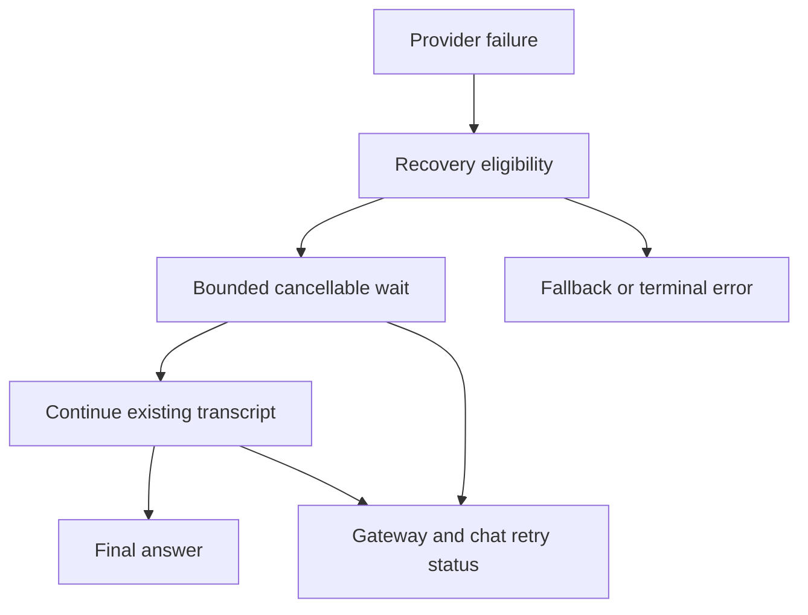

Codex review: blocked before merge. _Reviewed September 5, 2026, 6:46 PM ET / 22:46 UTC._

# ClawSweeper review

## What this changes

The PR continues interrupted agent tasks from their existing transcript with bounded retries, preserves final-answer ownership, and displays retry progress through chat reconnects.

## Merge readiness

⛔ **Blocked before merge - 1 item remains**

This remains a useful fix against current main, with no concrete introduced correctness defect found. The earlier generic migration blocker is not supported by the inspected storage and reader boundaries.

**Priority:** P2
**Reviewed head:** `65c9f5d0e822347481b71a0bb073675ef6d1c1fa`

## Review scores

| Measure | Result | What it means |
|---|---|---|
| **Overall readiness** | 🐚 platinum hermit **(4/6)** | A coherent recovery fix with relevant real-flow evidence and focused regression coverage; no actionable introduced defect was identified. |
| **Proof confidence** | 🦞 diamond lobster **(5/6)** | Sufficient (live_output): Supplied live observations exercise the recovery owner through real Codex/OpenAI and Gateway/browser paths: injected 429 after completed work recovers with one tool effect and final answer, reload preserves ownership, and Stop prevents another request. Attachment retrieval failed here, without contradicting that evidence. |
| **Patch quality** | 🐚 platinum hermit **(4/6)** | No actionable review findings were identified. |

## Verification

| Check | Result | Evidence |
|---|---|---|
| **Real behavior** | Verified | Sufficient (live_output): Supplied live observations exercise the recovery owner through real Codex/OpenAI and Gateway/browser paths: injected 429 after completed work recovers with one tool effect and final answer, reload preserves ownership, and Stop prevents another request. Attachment retrieval failed here, without contradicting that evidence. |
| **Evidence reviewed** | 10 items | Pinned introduction boundary: Reviewed the merge-base-to-head changes at 65c9f5d0e822347481b71a0bb073675ef6d1c1fa. Base-only changes were excluded; the supplied stale test merge was not used to claim removal of current-main behavior. Current-main necessity: Fetched main still limits continuation after completed tools to silent transport failures with settled-tool evidence, and retains a default of three transient retries. The merged cleanup at https://github.com/openclaw/openclaw/pull/139362 explicitly preserves behavior and does not supersede this recovery change. Inspection of the corresponding latest-release source failed because its blob was unavailable locally and could not be retrieved; no release implementation claim is made. Recovery and cancellation boundary: The shared recovery owner excludes external cancellation, signal-owned interruption, run/tool/compaction timeouts, yields, client-tool handoff, native recovery failures, terminal CLI stops, and provider refusals. After waiting it checks cancellation and activates a transcript continuation; original-prompt replay and profile rotation retain replay-safety gating. |
| **Findings** | None | None. |
| **Security** | None | None. |

## How this fits together

The agent runner turns provider failures into recovery, fallback, or final errors. Codex supplies native turn results, while the Gateway and chat UI preserve transcript content and display run progress.

## Before merge

- [ ] **Add data-model compatibility proof** - Confirm migration or upgrade compatibility proof before merge.

<strong>Agent review details</strong>

### Security

None.

### PR surface

Source -10, Tests +311, Docs +11. Total +312 across 44 files.

View PR surface stats

| Area | Files | Added | Removed | Net |
|---|---:|---:|---:|---:|
| Source | 20 | 245 | 255 | -10 |
| Tests | 22 | 490 | 179 | +311 |
| Docs | 2 | 22 | 11 | +11 |
| Config | 0 | 0 | 0 | 0 |
| Generated | 0 | 0 | 0 | 0 |
| Other | 0 | 0 | 0 | 0 |
| **Total** | **44** | **757** | **445** | **+312** |

### Review metrics

| Metric | Value | Why it matters |
|---|---|---|
| **Recovery default** | 3 → 8 continuations; 90-second window retained | Unconfigured runs gain more recovery opportunities while explicit saved budgets remain authoritative. |

### Stored data model

Persistent data-model change detected: `serialized state: ui/src/pages/chat/tool-stream-preamble.ts`. Confirm migration or upgrade compatibility proof before merge.

### Root-cause cluster

Relationship: `fixed_by_candidate`
Canonical: https://github.com/openclaw/openclaw/issues/139312
Summary: This PR is the explicit implementation candidate for the open task-continuation report; the related merged refactor preserves the older behavior.

Members:
- `canonical`: https://github.com/openclaw/openclaw/issues/139312 - The linked issue defines the same completed-work 429 failure and expected transcript continuation.
- `adjacent_distinct`: https://github.com/openclaw/openclaw/pull/139362 - Merged bookkeeping cleanup explicitly retained retry budgets and recovery behavior.

Proposal only: this assessment does not dispatch repair, suppress jobs, mutate sibling items, close, or merge anything.

### Technical review

Best possible solution:

Keep one bounded continuation owner that preserves completed work, existing retry preferences, cancellation, and terminal-error handling.

Do we have a high-confidence way to reproduce the issue?

Yes: current-main source excludes a terminal 429 after completed tools from transcript continuation, matching the supplied baseline reproduction; this read-only review did not execute it.

Is this the best way to solve the issue?

Yes: consolidating recovery before existing failure escalation avoids competing retry loops, while preserving transcript identity and existing saved settings.

AGENTS.md: found and applied where relevant.

Codex review notes: model internal, reasoning medium; reviewed against [a0ea2b71e335](https://github.com/openclaw/openclaw/commit/a0ea2b71e335c97b6ca4a0965ae24216313d2c33).

### Labels

Label justifications:

- `P2`: This repairs bounded provider-failure recovery after partial work without evidence of an emergency or widespread outage.
- `rating: 🐚 platinum hermit`: Overall readiness is 🐚 platinum hermit; proof is 🦞 diamond lobster and patch quality is 🐚 platinum hermit.
- `status: 👀 ready for maintainer look`: ClawSweeper has no concrete contributor-facing blocker left for this PR. Sufficient (live_output): Supplied live observations exercise the recovery owner through real Codex/OpenAI and Gateway/browser paths: injected 429 after completed work recovers with one tool effect and final answer, reload preserves ownership, and Stop prevents another request. Attachment retrieval failed here, without contradicting that evidence.
- `proof: sufficient`: Contributor real behavior proof is sufficient. Supplied live observations exercise the recovery owner through real Codex/OpenAI and Gateway/browser paths: injected 429 after completed work recovers with one tool effect and final answer, reload preserves ownership, and Stop prevents another request. Attachment retrieval failed here, without contradicting that evidence.

### Evidence

What I checked:

- **Pinned introduction boundary:** Reviewed the merge-base-to-head changes at 65c9f5d0e822347481b71a0bb073675ef6d1c1fa. Base-only changes were excluded; the supplied stale test merge was not used to claim removal of current-main behavior. ([65c9f5d0e822](https://github.com/openclaw/openclaw/commit/65c9f5d0e822347481b71a0bb073675ef6d1c1fa))
- **Current-main necessity:** Fetched main still limits continuation after completed tools to silent transport failures with settled-tool evidence, and retains a default of three transient retries. The merged cleanup at https://github.com/openclaw/openclaw/pull/139362 explicitly preserves behavior and does not supersede this recovery change. Inspection of the corresponding latest-release source failed because its blob was unavailable locally and could not be retrieved; no release implementation claim is made. ([`src/agents/embedded-agent-runner/run/attempt-recovery.ts:152`](https://github.com/openclaw/openclaw/blob/a0ea2b71e335c97b6ca4a0965ae24216313d2c33/src/agents/embedded-agent-runner/run/attempt-recovery.ts#L152), [a0ea2b71e335](https://github.com/openclaw/openclaw/commit/a0ea2b71e335c97b6ca4a0965ae24216313d2c33))
- **Recovery and cancellation boundary:** The shared recovery owner excludes external cancellation, signal-owned interruption, run/tool/compaction timeouts, yields, client-tool handoff, native recovery failures, terminal CLI stops, and provider refusals. After waiting it checks cancellation and activates a transcript continuation; original-prompt replay and profile rotation retain replay-safety gating. ([`src/agents/embedded-agent-runner/run/attempt-recovery.ts:295`](https://github.com/openclaw/openclaw/blob/65c9f5d0e822347481b71a0bb073675ef6d1c1fa/src/agents/embedded-agent-runner/run/attempt-recovery.ts#L295), [65c9f5d0e822](https://github.com/openclaw/openclaw/commit/65c9f5d0e822347481b71a0bb073675ef6d1c1fa))
- **Default and saved-setting compatibility:** The default increases to eight continuations, but setTransientRetryBudget still honors an existing saved value, including zero. The controller retains the 90-second window and rejects long quota windows; focused tests cover saved budgets, provider pacing, exhaustion, and excluded failure classes. ([`src/agents/embedded-agent-runner/run/failover-retry-controller.ts:160`](https://github.com/openclaw/openclaw/blob/65c9f5d0e822347481b71a0bb073675ef6d1c1fa/src/agents/embedded-agent-runner/run/failover-retry-controller.ts#L160), [65c9f5d0e822](https://github.com/openclaw/openclaw/commit/65c9f5d0e822347481b71a0bb073675ef6d1c1fa))
- **Prior migration concern reassessed:** The changed mirror call suppresses terminal ownership only for failed deferred attempts. Existing mirror identity, source fingerprint, run ID, partial text, and diagnostics remain; the existing optional runTerminal representation is reused. The added SQLite-backed test covers failed and successful attempts with deferred ownership both enabled and disabled. Existing chat grouping already excludes errored and nonterminal Codex rows from completed-answer ownership. No schema or historical-row rewrite is introduced. ([`extensions/codex/src/app-server/transcript-mirror.ts:153`](https://github.com/openclaw/openclaw/blob/65c9f5d0e822347481b71a0bb073675ef6d1c1fa/extensions/codex/src/app-server/transcript-mirror.ts#L153), [65c9f5d0e822](https://github.com/openclaw/openclaw/commit/65c9f5d0e822347481b71a0bb073675ef6d1c1fa))
- **Reconnect state is in memory:** Gateway progress snapshots reside in the run map, and the UI startup reducer tracks existing agent event sequences. Retry status survives history hydration and clears on newer activity; the changed preamble helper does not alter a persisted format. The history regression exercises fresh hydration and delayed replay after live progress. ([`src/gateway/server-chat-state.ts:135`](https://github.com/openclaw/openclaw/blob/65c9f5d0e822347481b71a0bb073675ef6d1c1fa/src/gateway/server-chat-state.ts#L135), [65c9f5d0e822](https://github.com/openclaw/openclaw/commit/65c9f5d0e822347481b71a0bb073675ef6d1c1fa))

Likely related people:

- **steipete:** Suggested for follow-up; no historical authorship or introduction is verified. (role: unverified routing candidate; confidence: low)

### Rating scale

| Score | Internal tier | Crab rank | Meaning |
|---:|:---:|---|---|
| **6/6** | S | 🦀 challenger crab | Exceptional readiness |
| **5/6** | A | 🦞 diamond lobster | Very strong readiness |
| **4/6** | B | 🐚 platinum hermit | Good normal PR; ordinary maintainer review |
| **3/6** | C | 🦐 gold shrimp | Useful, but confidence is limited |
| **2/6** | D | 🦪 silver shellfish | Proof or implementation needs work |
| **1/6** | F | 🧂 unranked krab | Not merge-ready |
| N/A | NA | 🌊 off-meta tidepool | Rating does not apply |

Overall follows the weaker of proof and patch quality.
Shiny media proof means a screenshot, video, or linked artifact directly shows the changed behavior. Runtime, network, CSP, and security claims still need visible diagnostics.

### Workflow

- ClawSweeper keeps one durable marker-backed review comment per issue or PR.
- Re-runs edit this comment so the latest verdict, findings, and automation markers stay together instead of adding duplicate bot comments.
- A fresh review can be triggered by eligible `@clawsweeper re-review` comments, exact-item GitHub events, scheduled/background review runs, or manual workflow dispatch.
- PR/issue authors and users with repository write access can comment `@clawsweeper re-review` or `@clawsweeper re-run` on an open PR or issue to request a fresh review only.
- Maintainers can also comment `@clawsweeper review` to request a fresh review only.
- Fresh-review commands do not start repair, autofix, rebase, CI repair, or automerge.
- Maintainer-only repair and merge flows require explicit commands such as `@clawsweeper autofix`, `@clawsweeper automerge`, `@clawsweeper fix ci`, or `@clawsweeper address review`.
- Maintainers can comment `@clawsweeper explain` to ask for more context, or `@clawsweeper stop` to stop active automation.

### History

Review history (5 earlier review cycles)

<!-- clawsweeper-review-history v=1 total=5 -->
- reviewed 2026-09-05T21:15:25.787Z sha 6a9fcf5e011dc2cfeb561fde2cdef5604f1d28c6 :: blocked before merge. :: none
- reviewed 2026-09-05T21:49:47.036Z sha 7c297ce97d7a341f7aaddd996d452c06e91e4671 :: blocked before merge. :: none
- reviewed 2026-09-05T22:01:33.095Z sha 19dd553c88942235351107fc626f37ce60f843c5 :: blocked before merge. :: none
- reviewed 2026-09-05T22:11:43.632Z sha f55517cb188ad8e3e6b459cc6a48097946895c3f :: blocked before merge. :: none
- reviewed 2026-09-05T22:38:55.890Z sha 65c9f5d0e822347481b71a0bb073675ef6d1c1fa :: blocked before merge. :: none

<!-- clawsweeper-verdict:needs-human item=139397 sha=65c9f5d0e822347481b71a0bb073675ef6d1c1fa confidence=high updated_at=2026-09-05T22:43:10Z reviewed_at=2026-09-05T22:46:24.652Z lease_owner=github-run-33996643899-1 lease_comment_id=5555285731 source_revision=f2c4e8ede4365d71b89b868c1780f533211f567422e5e0871418477a0f48b76a live_verification=absent -->
<!-- clawsweeper-review-state:blocked item=139397 sha=65c9f5d0e822347481b71a0bb073675ef6d1c1fa v=1 -->

<!-- clawsweeper-review-version item=139397 reviewed_at=2026-09-05T22:46:24.652Z sha=65c9f5d0e822347481b71a0bb073675ef6d1c1fa source_revision=f2c4e8ede4365d71b89b868c1780f533211f567422e5e0871418477a0f48b76a lease_owner=github-run-33996643899-1 lease_comment_id=5555285731 v=1 -->

<!-- clawsweeper-review item=139397 -->