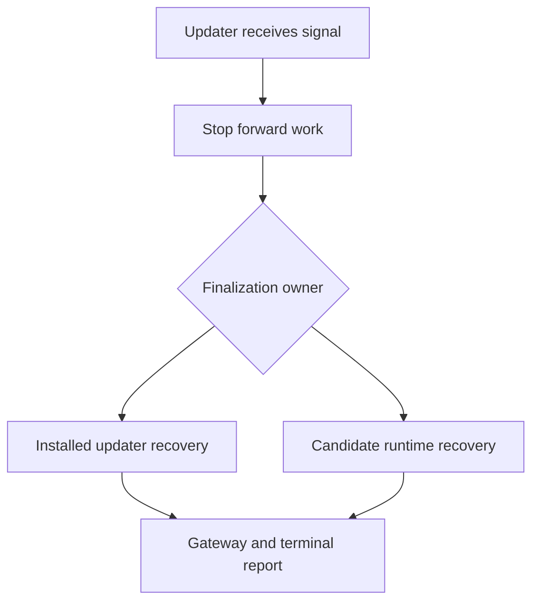

Codex review: needs changes before merge. _Reviewed October 5, 2026, 8:12 PM ET / October 6, 2026, 00:12 UTC._

# ClawSweeper review

## What this changes

The PR delays updater exit after catchable signals so existing recovery can restart the Gateway and report the interruption.

## Merge readiness

⛔ **Needs changes before merge - 2 items remain**

This remains useful work that current main does not provide, but delegated finalization leaves a blocking correctness gap.

**Priority:** P1
**Reviewed head:** `dbb23cc63f2daff6039a2758957265fabd03e492`

## Review scores

| Measure | Result | What it means |
|---|---|---|
| **Overall readiness** | 🦐 gold shrimp **(3/6)** | Meaningful process proof supports the local recovery fix, but a source-proven delegated-finalization gap blocks correctness. |
| **Proof confidence** | 🐚 platinum hermit **(4/6)** | Sufficient (terminal): The captured macOS process observations and inspected harness exercise production publication, rollback, delegated restart, and report owners under actual SIGTERM and late SIGHUP, observing restored Gateway reachability and saved interruption facts after exit. This is sufficient scoped local-recovery proof; it does not cover the separate migrated-finalization finding. No stored-data format changes are introduced. |
| **Patch quality** | 🦐 gold shrimp **(3/6)** | 1 actionable review finding remain. |

## Verification

| Check | Result | Evidence |
|---|---|---|
| **Real behavior** | Verified | Sufficient (terminal): The captured macOS process observations and inspected harness exercise production publication, rollback, delegated restart, and report owners under actual SIGTERM and late SIGHUP, observing restored Gateway reachability and saved interruption facts after exit. This is sufficient scoped local-recovery proof; it does not cover the separate migrated-finalization finding. No stored-data format changes are introduced. |
| **Evidence reviewed** | 9 items | Pinned introduction: Reviewed the merge-base-to-head introduced patch, keeping base drift separate. The checkout remained clean. Current main still needs signal recovery: The current-main comparison shows the original handler sealing compensation and exiting through signal barriers, without the new terminal-retention and interruption-reporting path. No merged fixing PR for this behavior is established. Interruption remains local to the parent: The introduced handler stores interruption in a process-local admission and stops only registered forward scopes. Migrated finalization is not registered in those scopes. |
| **Findings** | 1 actionable finding | [P2] Propagate interruption into migrated candidate finalization |
| **Security** | None | None. |

## How this fits together

The updater stages and activates a new installation, then delegates recovery and verification to the appropriate runtime owner. Its terminal publisher records the outcome and tells the operator how to recover unresolved work.

## Before merge

- [ ] **Propagate interruption into migrated candidate finalization (P2)** - When a signal reaches the parent after `continueMigratedUpdateInFreshProcess` has launched, this handler now retains execution but only stops `admission.forward`. That continuation is outside the new forward scopes, and its child received the run through one-time JSON serialization. The parent-only interruption therefore never reaches the candidate's `finishUpdate`; the child can continue plugin/restart work and publish a successful terminal row, which the parent accepts directly without adding the signal fact. Carry interruption into the candidate owner while retaining its recovery authority, and cover a signal delivered after delegated finalization starts.
- [ ] **Complete next step (P2)** - Propagate catchable-signal interruption into migrated candidate finalization and add a process regression proving cancellation, safe recovery, and truthful terminal reporting.

## Findings

- [P2] Propagate interruption into migrated candidate finalization — `src/cli/update-cli/update-command-mutable-signals.ts:309-312`

<strong>Agent review details</strong>

### Security

None.

### PR surface

Source +220, Tests +287, Docs +9. Total +516 across 11 files.

View PR surface stats

| Area | Files | Added | Removed | Net |
|---|---:|---:|---:|---:|
| Source | 7 | 250 | 30 | +220 |
| Tests | 3 | 305 | 18 | +287 |
| Docs | 1 | 10 | 1 | +9 |
| Config | 0 | 0 | 0 | 0 |
| Generated | 0 | 0 | 0 | 0 |
| Other | 0 | 0 | 0 | 0 |
| **Total** | **11** | **565** | **49** | **+516** |

### Review metrics

| Metric | Value | Why it matters |
|---|---|---|
| **Production versus regression growth** | Production net +220 lines; tests/support net +287 lines | The body explains lifecycle retention and process-boundary proof as the growth justification, but delegated finalization remains uncovered. |

### Technical review

Best possible solution:

Carry interruption to whichever runtime owns finalization, stopping its forward work while preserving fenced recovery and truthful terminal reporting.

Do we have a high-confidence way to reproduce the issue?

Yes, from source: signal the parent updater after migrated candidate finalization starts; its local interruption cannot reach the already serialized child run. This review did not execute that scenario.

Is this the best way to solve the issue?

The existing recovery-owner approach is appropriate, but incomplete until the delegated candidate path consumes interruption and records it before terminal publication.

Full review comments:

- [P2] Propagate interruption into migrated candidate finalization — `src/cli/update-cli/update-command-mutable-signals.ts:309-312`
  When a signal reaches the parent after `continueMigratedUpdateInFreshProcess` has launched, this handler now retains execution but only stops `admission.forward`. That continuation is outside the new forward scopes, and its child received the run through one-time JSON serialization. The parent-only interruption therefore never reaches the candidate's `finishUpdate`; the child can continue plugin/restart work and publish a successful terminal row, which the parent accepts directly without adding the signal fact. Carry interruption into the candidate owner while retaining its recovery authority, and cover a signal delivered after delegated finalization starts.
  Confidence: 0.94

Overall correctness: patch is incorrect
Overall confidence: 0.94

AGENTS.md: found and applied where relevant.

Codex review notes: model internal, reasoning medium; reviewed against [ab561129c2dc](https://github.com/openclaw/openclaw/commit/ab561129c2dcf0dcbea60037ed9f6d30d78eff90).

### Labels

Label changes:

- add `P1`: Interrupted updates can leave a previously running Gateway stopped, as reported in the linked operational discussion.
- add `proof: sufficient`: Contributor real behavior proof is sufficient. The captured macOS process observations and inspected harness exercise production publication, rollback, delegated restart, and report owners under actual SIGTERM and late SIGHUP, observing restored Gateway reachability and saved interruption facts after exit. This is sufficient scoped local-recovery proof; it does not cover the separate migrated-finalization finding. No stored-data format changes are introduced.
- add `rating: 🦐 gold shrimp`: Overall readiness is 🦐 gold shrimp; proof is 🐚 platinum hermit and patch quality is 🦐 gold shrimp.
- add `status: ⏳ waiting on author`: ClawSweeper has contributor-facing work open and is waiting for author action. Sufficient (terminal): The captured macOS process observations and inspected harness exercise production publication, rollback, delegated restart, and report owners under actual SIGTERM and late SIGHUP, observing restored Gateway reachability and saved interruption facts after exit. This is sufficient scoped local-recovery proof; it does not cover the separate migrated-finalization finding. No stored-data format changes are introduced.

Label justifications:

- `P1`: Interrupted updates can leave a previously running Gateway stopped, as reported in the linked operational discussion.
- `rating: 🦐 gold shrimp`: Overall readiness is 🦐 gold shrimp; proof is 🐚 platinum hermit and patch quality is 🦐 gold shrimp.
- `status: ⏳ waiting on author`: ClawSweeper has contributor-facing work open and is waiting for author action. Sufficient (terminal): The captured macOS process observations and inspected harness exercise production publication, rollback, delegated restart, and report owners under actual SIGTERM and late SIGHUP, observing restored Gateway reachability and saved interruption facts after exit. This is sufficient scoped local-recovery proof; it does not cover the separate migrated-finalization finding. No stored-data format changes are introduced.
- `proof: sufficient`: Contributor real behavior proof is sufficient. The captured macOS process observations and inspected harness exercise production publication, rollback, delegated restart, and report owners under actual SIGTERM and late SIGHUP, observing restored Gateway reachability and saved interruption facts after exit. This is sufficient scoped local-recovery proof; it does not cover the separate migrated-finalization finding. No stored-data format changes are introduced.

### Evidence

Acceptance criteria:

- [P1] node scripts/run-vitest.mjs src/cli/update-cli/update-command-mutable-signals.test.ts --maxWorkers=1.
- [P1] node scripts/check-changed.mjs.
- [P1] git diff --check.

What I checked:

- **Pinned introduction:** Reviewed the merge-base-to-head introduced patch, keeping base drift separate. The checkout remained clean. ([dbb23cc63f2d](https://github.com/openclaw/openclaw/commit/dbb23cc63f2daff6039a2758957265fabd03e492))
- **Current main still needs signal recovery:** The current-main comparison shows the original handler sealing compensation and exiting through signal barriers, without the new terminal-retention and interruption-reporting path. No merged fixing PR for this behavior is established. ([`src/cli/update-cli/update-command-mutable-signals.ts:178`](https://github.com/openclaw/openclaw/blob/ab561129c2dcf0dcbea60037ed9f6d30d78eff90/src/cli/update-cli/update-command-mutable-signals.ts#L178), [ab561129c2dc](https://github.com/openclaw/openclaw/commit/ab561129c2dcf0dcbea60037ed9f6d30d78eff90))
- **Interruption remains local to the parent:** The introduced handler stores interruption in a process-local admission and stops only registered forward scopes. Migrated finalization is not registered in those scopes. ([`src/cli/update-cli/update-command-mutable-signals.ts:309`](https://github.com/openclaw/openclaw/blob/dbb23cc63f2daff6039a2758957265fabd03e492/src/cli/update-cli/update-command-mutable-signals.ts#L309), [dbb23cc63f2d](https://github.com/openclaw/openclaw/commit/dbb23cc63f2daff6039a2758957265fabd03e492))
- **Delegated completion bypasses local interruption reporting:** After state migration, the driver awaits candidate finalization and directly accepts its result. The child receives a serialized run snapshot; later parent signals do not update that snapshot or the child's local admission. A successful child result therefore bypasses both new interruption-injection points in the parent's local finalizer. ([`src/cli/update-cli/update-command.ts:613`](https://github.com/openclaw/openclaw/blob/dbb23cc63f2daff6039a2758957265fabd03e492/src/cli/update-cli/update-command.ts#L613), [dbb23cc63f2d](https://github.com/openclaw/openclaw/commit/dbb23cc63f2daff6039a2758957265fabd03e492))
- **Scoped process proof:** The captured PR body reports actual SIGTERM during publication and SIGHUP during rollback, with Gateway reachability, restored version, rolled-back ledger state, and saved interruption reports after driver exit. Inspected fixtures use production package publication, executor delegation, recovery, and reporting with a synthetic service adapter and real HTTP/WebSocket observations. Both regressions reportedly failed before the fix. This proves the local recovery scenarios, not migrated candidate finalization or a live systemd deployment. ([`src/cli/update-cli/update-command-mutable-signals.test.ts:420`](https://github.com/openclaw/openclaw/blob/dbb23cc63f2daff6039a2758957265fabd03e492/src/cli/update-cli/update-command-mutable-signals.test.ts#L420), [dbb23cc63f2d](https://github.com/openclaw/openclaw/commit/dbb23cc63f2daff6039a2758957265fabd03e492))
- **Existing safety owners remain authoritative:** Compensation still requires the exact active admission, and finalization and executor owners revalidate current native custody. The patch does not change dependencies, permissions, journal schemas, or configuration contracts. ([`src/cli/update-cli/update-command-recovery.ts:94`](https://github.com/openclaw/openclaw/blob/dbb23cc63f2daff6039a2758957265fabd03e492/src/cli/update-cli/update-command-recovery.ts#L94), [dbb23cc63f2d](https://github.com/openclaw/openclaw/commit/dbb23cc63f2daff6039a2758957265fabd03e492))

Likely related people:

- **steipete:** Suggested for follow-up; no historical authorship or introduction is verified. (role: unverified routing candidate; confidence: low)

### Rank-up moves

Optional improvements that raise the rating; they are not merge blockers.

- Repair delegated interruption handling and demonstrate a parent signal during migrated candidate finalization, including stopped forward work, safe recovery, and an interruption-bearing terminal result.

### Rating scale

| Score | Internal tier | Crab rank | Meaning |
|---:|:---:|---|---|
| **6/6** | S | 🦀 challenger crab | Exceptional readiness |
| **5/6** | A | 🦞 diamond lobster | Very strong readiness |
| **4/6** | B | 🐚 platinum hermit | Good normal PR; ordinary maintainer review |
| **3/6** | C | 🦐 gold shrimp | Useful, but confidence is limited |
| **2/6** | D | 🦪 silver shellfish | Proof or implementation needs work |
| **1/6** | F | 🧂 unranked krab | Not merge-ready |
| N/A | NA | 🌊 off-meta tidepool | Rating does not apply |

Overall follows the weaker of proof and patch quality.
Shiny media proof means a screenshot, video, or linked artifact directly shows the changed behavior. Runtime, network, CSP, and security claims still need visible diagnostics.

### Workflow

- ClawSweeper keeps one durable marker-backed review comment per issue or PR.
- Re-runs edit this comment so the latest verdict, findings, and automation markers stay together instead of adding duplicate bot comments.
- A fresh review can be triggered by eligible `@clawsweeper re-review` comments, exact-item GitHub events, scheduled/background review runs, or manual workflow dispatch.
- PR/issue authors and users with repository write access can comment `@clawsweeper re-review` or `@clawsweeper re-run` on an open PR or issue to request a fresh review only.
- Maintainers can also comment `@clawsweeper review` to request a fresh review only.
- Fresh-review commands do not start repair, autofix, rebase, CI repair, or automerge.
- Maintainer-only repair and merge flows require explicit commands such as `@clawsweeper autofix`, `@clawsweeper automerge`, `@clawsweeper fix ci`, or `@clawsweeper address review`.
- Maintainers can comment `@clawsweeper explain` to ask for more context, or `@clawsweeper stop` to stop active automation.

<!-- clawsweeper-verdict:needs-changes item=165863 sha=dbb23cc63f2daff6039a2758957265fabd03e492 confidence=high updated_at=2026-10-06T00:09:22Z reviewed_at=2026-10-06T00:12:46.850Z lease_owner=github-run-37392403778-1 lease_comment_id=6006126829 source_revision=7328757b4af2d194d3965ab9ae411a7ab3df32fbef81e77b9167c97d471e9245 live_verification=absent -->
<!-- clawsweeper-action:fix-required item=165863 sha=dbb23cc63f2daff6039a2758957265fabd03e492 confidence=high updated_at=2026-10-06T00:09:22Z reviewed_at=2026-10-06T00:12:46.850Z lease_owner=github-run-37392403778-1 lease_comment_id=6006126829 source_revision=7328757b4af2d194d3965ab9ae411a7ab3df32fbef81e77b9167c97d471e9245 live_verification=absent finding=review-feedback -->
<!-- clawsweeper-review-state:needs-changes item=165863 sha=dbb23cc63f2daff6039a2758957265fabd03e492 v=1 -->

<!-- clawsweeper-review-version item=165863 reviewed_at=2026-10-06T00:12:46.850Z sha=dbb23cc63f2daff6039a2758957265fabd03e492 source_revision=7328757b4af2d194d3965ab9ae411a7ab3df32fbef81e77b9167c97d471e9245 lease_owner=github-run-37392403778-1 lease_comment_id=6006126829 v=1 -->

<!-- clawsweeper-review item=165863 -->