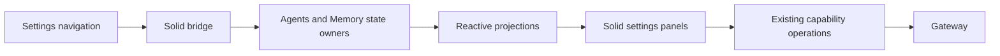

Codex review: needs changes before merge.

## What this changes

This PR ports Agents and Memory settings rendering from Lit to Solid while retaining synchronous state and Gateway mutation owners.

**Example:** Edit AGENTS.md under Settings > Agents > main > Files.
- **Before:** Lit renders the editor, preview, and save controls.
- **After:** Solid renders those controls using the existing file-editing owner.

## Review scores

| Measure | Result | What it means |
|---|---|---|
| **Overall readiness** | 🦐 gold shrimp **(3/6)** | Strong visual evidence supports the migration, but the repeated locale defect and removed reset assertion prevent approval. |
| **Proof confidence** | 🦞 diamond lobster **(5/6)** ✨ media proof bonus | Sufficient (screenshot): Prepared before/after screenshots exercise the built Control UI's migrated Channels, Automations, and Files rendering with synthetic fixtures across desktop/mobile light/dark profiles; inspected layouts are consistent, and the later fixture and adapter changes do not invalidate that visual evidence. |
| **Patch quality** | 🦐 gold shrimp **(3/6)** | 2 actionable review findings remain. |

## Product

**Kind:** Refactor · **Worth it:** Yes · **Fix scope:** Complete
**User problem:** Agents settings remain on the older renderer during the Control UI's directed Solid migration.
**Reason:** The recorded migration direction supports this focused surface conversion, and retaining the existing domain owners limits behavioral churn.

## Merge readiness

⛔ **Needs changes before merge - 4 items remain**

Keep open: this useful, maintainer-directed migration still has the previously reported locale regression and lost model-picker reset assertion.

**Priority:** P2
**Reviewed head:** `f6a8b50105a4b9a2711838e3669dd96dc9e3b20c`

## Before merge

- [ ] **Subscribe the Agents header to locale changes (P2)** - Changing locale while Agents remains mounted leaves its title and subtitle in the previous language. Both route helpers use imperative t from i18n/index.ts, so these JSX expressions acquire no locale dependency; replacing OpenClawLightDomElement also removes its I18nController refresh. Use the existing reactive translation projection for both labels and cover a locale change without remounting. This repeats the unresolved prior finding.
- [ ] **Retain the model-picker reset assertion on agent switches (P2)** - The migrated test removes the assertion that switching from alpha to beta replaces the primary model picker. Its remaining selected-label assertion can pass while a reused picker retains open/search state from the previous agent, the distinct lifecycle contract repaired in https://github.com/openclaw/openclaw/pull/72328. The production keyed boundary remains present, but losing it would now escape this regression test. Restore the reset assertion, consistent with the Solid migration policy to preserve assertions when replacing a harness. This repeats the unresolved prior finding.
- [ ] **Complete next step** - Resolve the GitHub-reported merge conflicts while preserving the Solid cutover and current main's changes.
- [ ] **Explain or restore the original intent of Live locale refresh** - deb7faf7b0668d3bc01161aff4fba0a85a65829c: Shared Lit bases subscribe to locale changes so mounted pages refresh without remounting.

## Findings

- [P2] Subscribe the Agents header to locale changes — `ui/src/pages/agents/view.tsx:101-103`
- [P2] Retain the model-picker reset assertion on agent switches — `ui/src/pages/agents/view.test.tsx:343-347`

### Provenance

- `Live locale refresh` changes intended behavior without addressing why it exists (deb7faf7b0668d3bc01161aff4fba0a85a65829c: Shared Lit bases subscribe to locale changes so mounted pages refresh without remounting.)

### Tests

- Missing end-to-end proof: Retain the agent-switch reset assertion and cover a locale change while the Agents header remains mounted; neither scenario is established by the inspected screenshots.

<strong>Agent review details</strong>

### How this fits together

The Control UI receives agent selections, configuration, and Gateway snapshots, renders settings panels, and dispatches edits through existing capability owners.

### Technical review

Best possible solution:

Complete the Solid cutover while preserving live locale updates, agent-switch control resets, and existing mutation ownership.

Do we have a high-confidence way to reproduce the issue?

Source establishes that changing locale while Agents stays mounted cannot invalidate its imperative header translations; no runtime reproduction was run under the read-only review.

Is this the best way to solve the issue?

The migration appropriately retains synchronous domain owners and canonical interop adapters, but must preserve the locale subscription and reset coverage it replaces.

Full review comments:

- [P2] Subscribe the Agents header to locale changes — `ui/src/pages/agents/view.tsx:101-103`
  Changing locale while Agents remains mounted leaves its title and subtitle in the previous language. Both route helpers use imperative t from i18n/index.ts, so these JSX expressions acquire no locale dependency; replacing OpenClawLightDomElement also removes its I18nController refresh. Use the existing reactive translation projection for both labels and cover a locale change without remounting. This repeats the unresolved prior finding.
  Confidence: 0.99
- [P2] Retain the model-picker reset assertion on agent switches — `ui/src/pages/agents/view.test.tsx:343-347`
  The migrated test removes the assertion that switching from alpha to beta replaces the primary model picker. Its remaining selected-label assertion can pass while a reused picker retains open/search state from the previous agent, the distinct lifecycle contract repaired in https://github.com/openclaw/openclaw/pull/72328. The production keyed boundary remains present, but losing it would now escape this regression test. Restore the reset assertion, consistent with the Solid migration policy to preserve assertions when replacing a harness. This repeats the unresolved prior finding.
  Confidence: 0.96

Overall correctness: patch is incorrect
Overall confidence: 0.97

AGENTS.md: found and applied where relevant.

Codex review notes: model internal, reasoning medium; reviewed against [dd053f96aa30](https://github.com/openclaw/openclaw/commit/dd053f96aa300a82443d5ab9725f206214e9c36e).

### Provenance checked

- `Synchronous Agents and Memory state ownership` keeps the original intent (926afb66e9c4782d644194f9704610d2540a7024: Unify authoritative request lifecycles and preserve selected-agent scope, stale-response rejection, privacy, and capability gating.)
- `Model-picker reset on agent changes` keeps the original intent (3cb460873dc7f2be94b075f0f3a0ed7a04a0f0c0: Remount Overview controls to clear stale dropdown state when switching agents.)

### Testing

Proof path: shipped entry point.

### Security

None.

### Evidence

Acceptance criteria:

- pnpm test ui/src/pages/agents/view.test.tsx --maxWorkers=1
- pnpm test ui/src/pages/agents/agents-page.selection.test.ts --maxWorkers=1
- pnpm ui:i18n:verify
- git diff --check

What I checked:

- **Pinned introduction and prior-head comparison:** The introduced diff contains the renderer migration and assertion removal; the latest commit changes only the MCP browser fixture, leaving both previously reported findings unresolved. ([`ui/src/pages/agents/view.test.tsx:343`](https://github.com/openclaw/openclaw/blob/f6a8b50105a4b9a2711838e3669dd96dc9e3b20c/ui/src/pages/agents/view.test.tsx#L343), [f6a8b50105a4](https://github.com/openclaw/openclaw/commit/f6a8b50105a4b9a2711838e3669dd96dc9e3b20c))
- **Locale dependency is missing:** AgentsPageHeader calls route-label helpers that import imperative translation, while the replaced Lit base supplied I18nController subscriptions; the existing reactive translation projection supplies the needed replacement. ([`ui/src/pages/agents/view.tsx:101`](https://github.com/openclaw/openclaw/blob/f6a8b50105a4b9a2711838e3669dd96dc9e3b20c/ui/src/pages/agents/view.tsx#L101), [f6a8b50105a4](https://github.com/openclaw/openclaw/commit/f6a8b50105a4b9a2711838e3669dd96dc9e3b20c))
- **Original locale-refresh contract:** https://github.com/openclaw/openclaw/pull/102745 explicitly established language changes propagating without remounting; its shared base and controller remain inspectable in current source. ([`ui/src/lit/openclaw-element.ts:6`](https://github.com/openclaw/openclaw/blob/deb7faf7b0668d3bc01161aff4fba0a85a65829c/ui/src/lit/openclaw-element.ts#L6), [deb7faf7b066](https://github.com/openclaw/openclaw/commit/deb7faf7b0668d3bc01161aff4fba0a85a65829c))
- **Agent-switch reset contract:** https://github.com/openclaw/openclaw/pull/72328 repaired stale dropdown state by remounting Overview controls, crediting SergioChan's original work; the port retains a keyed production boundary but removes the assertion detecting its loss. ([`ui/src/pages/agents/view.test.tsx:343`](https://github.com/openclaw/openclaw/blob/3cb460873dc7f2be94b075f0f3a0ed7a04a0f0c0/ui/src/pages/agents/view.test.tsx#L343), [3cb460873dc7](https://github.com/openclaw/openclaw/commit/3cb460873dc7f2be94b075f0f3a0ed7a04a0f0c0))
- **Migration remains necessary:** Fetched main still implements AgentsPage as a Lit element; https://github.com/openclaw/openclaw/issues/168114 tracks the broader Solid migration and preserving plain TypeScript domain owners. ([`ui/src/pages/agents/agents-page.ts:91`](https://github.com/openclaw/openclaw/blob/dd053f96aa300a82443d5ab9725f206214e9c36e/ui/src/pages/agents/agents-page.ts#L91), [dd053f96aa30](https://github.com/openclaw/openclaw/commit/dd053f96aa300a82443d5ab9725f206214e9c36e))
- **Inspected visual proof:** Inspected all four prepared screenshot sheets showing Channels, Automations, Files editing, and Files errors before and after across desktop/mobile light/dark profiles; their displayed layout is consistent, with the historical capture revisions explicitly identified. ([f6a0f0b3c4a5](https://github.com/openclaw/openclaw/commit/f6a0f0b3c4a5ca8d36722340454a60d260aedd7f))

### PR surface

Source +686, Tests +347, Other +6. Total +1039 across 78 files. Added test files: 2.

View PR surface stats

| Area | Files | Added | Removed | Net |
|---|---:|---:|---:|---:|
| Source | 46 | 5802 | 5116 | +686 |
| Tests | 29 | 1140 | 793 | +347 |
| Docs | 0 | 0 | 0 | 0 |
| Config | 0 | 0 | 0 | 0 |
| Generated | 0 | 0 | 0 | 0 |
| Other | 3 | 11 | 5 | +6 |
| **Total** | **78** | **6953** | **5914** | **+1039** |

### Labels

Label changes:

- add `rating: 🦐 gold shrimp`: Overall readiness is 🦐 gold shrimp; proof is 🦞 diamond lobster and patch quality is 🦐 gold shrimp.
- remove `rating: 🦪 silver shellfish`: Current PR rating is `rating: 🦐 gold shrimp`, so this older rating label is no longer current.

Label justifications:

- `P2`: This planned UI migration has a limited locale-refresh regression and a focused regression-coverage repair, without evidence of urgent widespread breakage.
- `rating: 🦐 gold shrimp`: Overall readiness is 🦐 gold shrimp; proof is 🦞 diamond lobster and patch quality is 🦐 gold shrimp.
- `status: ⏳ waiting on author`: ClawSweeper has contributor-facing work open and is waiting for author action.
- `proof: sufficient`: Contributor real behavior proof is sufficient.
- `proof: 📸 screenshot`: Contributor real behavior proof includes screenshot evidence.

### Rating scale

6/6 🦀 challenger crab · 5/6 🦞 diamond lobster · 4/6 🐚 platinum hermit · 3/6 🦐 gold shrimp · 2/6 🦪 silver shellfish · 1/6 🧂 unranked krab. Overall follows the weaker of proof and patch quality; ✨ marks media proof (a screenshot, video, or linked artifact) that directly shows the changed behavior.

### Workflow

ClawSweeper edits this one comment on every review. Comment `@clawsweeper re-review` for a fresh review only; repair and merge need explicit maintainer commands such as `@clawsweeper autofix` or `@clawsweeper automerge`.

### History

Review history (10 earlier review cycles; latest 8 shown)

<!-- clawsweeper-review-history v=1 total=10 -->
- reviewed 2026-10-11T02:45:27.323Z sha e6a845baaa65cbd988451c654c487a8b07087cc1 :: needs changes before merge. :: [P2] Subscribe the Agents header to locale changes | [P2] Restore coverage for model-picker reset on agent switches
- reviewed 2026-10-11T03:10:01.970Z sha a1e05c706747088e50b84a65bc86db2739bde1aa :: needs changes before merge. :: [P2] Subscribe the Agents header to locale changes | [P2] Retain coverage for model-picker reset on agent switches
- reviewed 2026-10-11T03:55:18.081Z sha d0953726b5b44859cda6a5375c342b325578fb6c :: needs changes before merge. :: [P2] Subscribe the Agents header to locale changes | [P2] Retain the model-picker reset assertion on agent switches | [P2] Make the new adapters comply with the Lit migration gate | [P2] Create the dirty draft before exercising read-only permissions
- reviewed 2026-10-11T04:36:08.765Z sha f3d95ef6e110013e45e1444211209b2729c4864b :: needs changes before merge. :: [P2] Subscribe the Agents header to locale changes | [P2] Retain the model-picker reset assertion on agent switches
- reviewed 2026-10-11T05:31:30.223Z sha f6a0f0b3c4a5ca8d36722340454a60d260aedd7f :: needs changes before merge. :: [P2] Subscribe the Agents header to locale changes | [P2] Retain the model-picker reset assertion on agent switches
- reviewed 2026-10-11T08:28:35.016Z sha 9a8c25798c8a37b7e168b8541a3b40cba326e855 :: needs changes before merge. :: [P2] Subscribe the Agents header to locale changes | [P2] Retain the model-picker reset assertion on agent switches
- reviewed 2026-10-11T09:17:28.576Z sha 9a8c25798c8a37b7e168b8541a3b40cba326e855 :: needs changes before merge. :: [P2] Subscribe the Agents header to locale changes | [P2] Retain the model-picker reset assertion on agent switches
- reviewed 2026-10-11T09:42:42.661Z sha 565efdbea23c897d39713f7c7441d53530192fed :: needs changes before merge. :: [P2] Subscribe the Agents header to locale changes | [P2] Retain the model-picker reset assertion on agent switches

_Reviewed October 11, 2026, 6:10 AM ET / 10:10 UTC (Revision 11)._

<!-- clawsweeper-verdict:needs-changes item=168759 sha=f6a8b50105a4b9a2711838e3669dd96dc9e3b20c confidence=high updated_at=2026-10-11T10:04:57Z reviewed_at=2026-10-11T10:10:05.812Z lease_owner=github-run-38130608776-1 lease_comment_id=6107868523 source_revision=4393e72a2590d6d9a7d60581b33c4c56c36c7060861bf8fefdabf9d42222bb8b live_verification=absent -->
<!-- clawsweeper-action:fix-required item=168759 sha=f6a8b50105a4b9a2711838e3669dd96dc9e3b20c confidence=high updated_at=2026-10-11T10:04:57Z reviewed_at=2026-10-11T10:10:05.812Z lease_owner=github-run-38130608776-1 lease_comment_id=6107868523 source_revision=4393e72a2590d6d9a7d60581b33c4c56c36c7060861bf8fefdabf9d42222bb8b live_verification=absent finding=review-feedback -->
<!-- clawsweeper-review-state:needs-changes item=168759 sha=f6a8b50105a4b9a2711838e3669dd96dc9e3b20c v=1 -->

<!-- clawsweeper-review-version item=168759 reviewed_at=2026-10-11T10:10:05.812Z sha=f6a8b50105a4b9a2711838e3669dd96dc9e3b20c source_revision=4393e72a2590d6d9a7d60581b33c4c56c36c7060861bf8fefdabf9d42222bb8b lease_owner=github-run-38130608776-1 lease_comment_id=6107868523 v=1 -->

<!-- clawsweeper-review item=168759 -->