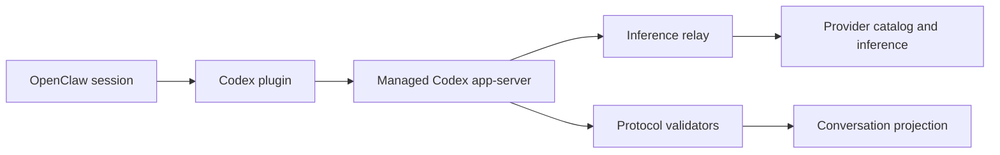

Codex review: blocked before merge.

## What this changes

This PR upgrades bundled Codex from 0.164.0 to 0.169.0, refreshes protocol validators, and recognizes its native launch diagnostics.

**Example:** A completed failed turn contains audio input {"type":"audio","fileId":"file-audio-1"}.
- **Before:** The old schema requires an audio URL and rejects the terminal snapshot.
- **After:** The regenerated validator accepts the uploaded-file reference and preserves the terminal snapshot.

## Review scores

| Measure | Result | What it means |
|---|---|---|
| **Overall readiness** | 🧂 unranked krab **(1/6)** | The patch is focused and source-consistent, but its supplied evidence does not meet the required product-behavior proof standard. |
| **Proof confidence** | 🧂 unranked krab **(1/6)** | Real behavior proof is not required for maintainer- or bot-authored pull requests. |
| **Patch quality** | 🐚 platinum hermit **(4/6)** | No actionable review findings were identified. |

## Product

**Kind:** Bug fix · **Worth it:** Yes · **Fix scope:** Complete
**User problem:** The bundled native runtime can lag models available to an account and reject newer terminal snapshot shapes.
**Reason:** The maintainer-authored direction addresses a concrete compatibility problem and remains distinct from the merged picker and relay repairs.

## Merge readiness

⛔ **Blocked before merge - 1 item remains**

Keep this PR open: the bundled-runtime upgrade remains useful, the earlier relay blocker is resolved, and no introduced code defect was found.

**Priority:** P2
**Reviewed head:** `d2496ff4de05b0365d010783eea25b06affaaf3e`

## Before merge

- [ ] **Await maintainer action** - A repository admin or active SecOps member must approve this revision’s dependency changes, and a maintainer must approve the current revision for the enforced CI gate.

## Findings

None.

### Tests

- Missing end-to-end proof: Provide redacted installed-Gateway evidence of native discovery and turn completion with Codex 0.169.0, including a latest-stable upgrade retaining settings and conversation history; the audio fileId regression also lacks an explicitly reported base-fail/head-pass result.

<strong>Agent review details</strong>

### How this fits together

The Codex plugin launches the managed native app-server, relays provider requests, and validates native responses before projecting them into OpenClaw conversation state.

### Technical review

Best possible solution:

Keep the synchronized runtime and protocol refresh in the existing Codex owners while preserving the landed picker, relay, and authentication contracts.

Do we have a high-confidence way to reproduce the issue?

Source confirms that native discovery sends the runtime version and the old validator rejects audio fileId snapshots; account-specific backend availability was not independently reproduced.

Is this the best way to solve the issue?

The synchronized dependency and generated-schema refresh addresses the compatibility boundary without introducing another discovery owner or changing authentication policy.

AGENTS.md: found and applied where relevant.

Codex review notes: model internal, reasoning medium; reviewed against [ec9a77fa3c04](https://github.com/openclaw/openclaw/commit/ec9a77fa3c04031211749b61a5814fa563e315af).

### Provenance checked

- `Managed runtime, discovery fallback, and ACP version parity` keeps the original intent (70f8ce638c3961f196ed8e4dc8d1f1202f39c0f0: The previous runtime refresh aligned the managed package, native platforms, discovery hint, and ACP selection.)
- `Generated protocol validation` keeps the original intent (f52fb07f74b17abed92bf644e1aabcfc204a2e46: Generate fixed-schema validators during development while retaining one runtime validation owner and matching diagnostics.)
- `Permanent native launch failure recognition` keeps the original intent (6ae2babeb4c3a4c3d52dfaf394f84984f32da5d7: Retain permanent executable launch failures and stop repeated catalog launch attempts.)
- `Catalog relay coverage` keeps the original intent (ed3230dd29d1e162d814e38eff00f64dc77af64e: Forward bounded catalog GET requests through the existing destination and credential boundaries.)

### Testing

Proof path: in-process harness.

### Security

None.

### Evidence

What I checked:

- **Pinned change and current-main behavior:** The introduced diff synchronizes the managed dependency, ACP override, runtime constant, discovery fallback, and generated protocol; fetched main still ships Codex 0.164.0. ([`extensions/codex/src/app-server/version.ts:2`](https://github.com/openclaw/openclaw/blob/d2496ff4de05b0365d010783eea25b06affaaf3e/extensions/codex/src/app-server/version.ts#L2), [d2496ff4de05](https://github.com/openclaw/openclaw/commit/d2496ff4de05b0365d010783eea25b06affaaf3e))
- **Authoritative dependency contract:** The patch executes @openai/codex and derives validators from its protocol, making this dependency authoritative; personally inspected rust-v0.169.0 source confirms audio fileId support, versioned catalog requests, and the execve launcher. ([`codex-rs/app-server-protocol/src/protocol/v2/turn.rs:466`](https://github.com/openai/codex/blob/d32063f96c2dff1dc96af839b3952abb6acfeda4/codex-rs/app-server-protocol/src/protocol/v2/turn.rs#L466), [d32063f96c2d](https://github.com/openai/codex/commit/d32063f96c2dff1dc96af839b3952abb6acfeda4))
- **Earlier relay blocker resolved:** Ben Badejo’s https://github.com/openclaw/openclaw/pull/197768 merged the catalog relay repair; this PR retains additional native-discovery and cleanup tests without duplicating its production implementation. ([`extensions/codex/src/app-server/inference-proxy.native.test.ts:241`](https://github.com/openclaw/openclaw/blob/ed3230dd29d1e162d814e38eff00f64dc77af64e/extensions/codex/src/app-server/inference-proxy.native.test.ts#L241), [ed3230dd29d1](https://github.com/openclaw/openclaw/commit/ed3230dd29d1e162d814e38eff00f64dc77af64e))
- **Complementary picker repair:** https://github.com/openclaw/openclaw/pull/200811 independently broadens subscription-picker discovery to client_version=99.0.0 and records a same-account live catalog comparison; native discovery still uses the binary version. ([`extensions/openai/base-url.ts:16`](https://github.com/openclaw/openclaw/blob/0a27bd7f85fa6af2964182a8c54a709b143fdefe/extensions/openai/base-url.ts#L16), [0a27bd7f85fa](https://github.com/openclaw/openclaw/commit/0a27bd7f85fa6af2964182a8c54a709b143fdefe))
- **Supplied validation boundary:** The body explicitly identifies the external native-catalog fetch as mocked, reports focused passing tests and codex-cli 0.169.0, and does not claim a live GPT-6.2 turn. ([`extensions/codex/src/app-server/inference-proxy.native.test.ts:258`](https://github.com/openclaw/openclaw/blob/d2496ff4de05b0365d010783eea25b06affaaf3e/extensions/codex/src/app-server/inference-proxy.native.test.ts#L258), [d2496ff4de05](https://github.com/openclaw/openclaw/commit/d2496ff4de05b0365d010783eea25b06affaaf3e))
- **Current-head approval gates:** The current revision remains mergeable but blocked: ci-gate requires maintainer approval and dependency-review requires admin or SecOps approval; these are approval gates rather than attributed code failures. ([d2496ff4de05](https://github.com/openclaw/openclaw/commit/d2496ff4de05b0365d010783eea25b06affaaf3e))

Likely related people:

- **Peter Steinberger:** Raw commit 6ae2babeb4c3a4c3d52dfaf394f84984f32da5d7 adds extensions/codex/src/app-server/managed-launcher-failure.ts:7 relative to its recorded parents. This identifies author metadata, not feature responsibility or a PR merger. (role: source-line author; confidence: high; commits: [6ae2babeb4c3](https://github.com/openclaw/openclaw/commit/6ae2babeb4c3a4c3d52dfaf394f84984f32da5d7); files: `extensions/codex/src/app-server/managed-launcher-failure.ts`)
- **Vincent Koc:** Raw commit 43247c9b207673c7d6eb9db44cbdb6208096a763 adds extensions/codex/src/app-server/inference-proxy.native.test.ts:111 relative to its recorded parents. This identifies author metadata, not feature responsibility or a PR merger. (role: source-line author; confidence: high; commits: [43247c9b2076](https://github.com/openclaw/openclaw/commit/43247c9b207673c7d6eb9db44cbdb6208096a763); files: `extensions/codex/src/app-server/inference-proxy.native.test.ts`)

### PR surface

Source +9, Tests +206, Docs 0, Config 0, Generated +424, Other 0. Total +639 across 19 files. Added test files: 0.

View PR surface stats

| Area | Files | Added | Removed | Net |
|---|---:|---:|---:|---:|
| Source | 5 | 18 | 9 | +9 |
| Tests | 8 | 209 | 3 | +206 |
| Docs | 1 | 1 | 1 | 0 |
| Config | 2 | 2 | 2 | 0 |
| Generated | 2 | 741 | 317 | +424 |
| Other | 1 | 31 | 31 | 0 |
| **Total** | **19** | **1002** | **363** | **+639** |

### Preflight source

Source unknown. Source comparison at the observed PR snapshot only. Completion is self-reported; body, policy, tests, execution, and report bytes are not verified.

### Labels

Label changes:

- add `status: ⏳ waiting on maintainer`: Only explicit maintainer approvals or decisions remain; merge is still blocked.
- remove `merge-risk: 🚨 auth-provider`: Current PR review selected no merge-risk labels.
- remove `status: ⏳ waiting on author`: Current PR status label is `status: ⏳ waiting on maintainer`.

Label justifications:

- `P2`: This is a focused managed-runtime compatibility repair affecting native model discovery and terminal protocol handling.
- `rating: 🧂 unranked krab`: Overall readiness is 🧂 unranked krab; proof is 🧂 unranked krab and patch quality is 🐚 platinum hermit.
- `status: ⏳ waiting on maintainer`: Only explicit maintainer approvals or decisions remain; merge is still blocked.

### Rating scale

6/6 🦀 challenger crab · 5/6 🦞 diamond lobster · 4/6 🐚 platinum hermit · 3/6 🦐 gold shrimp · 2/6 🦪 silver shellfish · 1/6 🧂 unranked krab. Overall follows the weaker of proof and patch quality; ✨ marks media proof (a screenshot, video, or linked artifact) that directly shows the changed behavior.

### Workflow

ClawSweeper edits this one comment on every review. Comment `@clawsweeper re-review` for a fresh review only. Repair and merge execution lanes are retired.

### History

Review history (2 earlier review cycles)

<!-- clawsweeper-review-history v=1 total=2 -->
- reviewed 2026-11-17T20:36:59.677Z sha 317b42a10f40896f78ac4bb42ae5b779284a5d44 :: blocked before merge. :: [P2] Land catalog-relay compatibility before bundling Codex 0.169.0
- reviewed 2026-11-17T21:50:08.699Z sha 9fe8974589c5657ee79660a5e48de9c6ab84f368 :: blocked before merge. :: none

_Reviewed November 17, 2026, 5:29 PM ET / 22:29 UTC (Revision 3)._

<!-- clawsweeper-verdict:needs-human item=200784 sha=d2496ff4de05b0365d010783eea25b06affaaf3e confidence=high updated_at=2026-11-17T22:24:35Z reviewed_at=2026-11-17T22:29:20.346Z lease_owner=github-run-44189674290-1 lease_comment_id=6962753877 source_revision=6db68d52aee4a4ff7d8325236025458321a5eefd90e48f2e2ec930c721a96b3a hold=blocked findings=0 -->
<!-- clawsweeper-review-state:blocked item=200784 sha=d2496ff4de05b0365d010783eea25b06affaaf3e v=1 -->

<!-- clawsweeper-review-version item=200784 reviewed_at=2026-11-17T22:29:20.346Z sha=d2496ff4de05b0365d010783eea25b06affaaf3e source_revision=6db68d52aee4a4ff7d8325236025458321a5eefd90e48f2e2ec930c721a96b3a lease_owner=github-run-44189674290-1 lease_comment_id=6962753877 v=1 -->

<!-- clawsweeper-review item=200784 -->