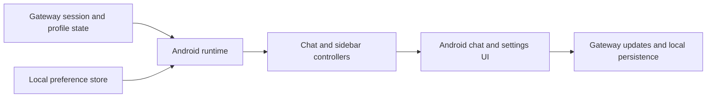

Codex review: needs maintainer review before merge. _Reviewed September 1, 2026, 9:28 PM ET / September 2, 2026, 01:28 UTC._

# ClawSweeper review

## What this changes

This PR expands the Android companion app’s chat, session navigation, sidebar, appearance controls, and related tests to align with the web UI.

## Merge readiness

⚠️ **Ready for maintainer review - 3 items remain**

Keep open for assigned maintainer review: no concrete introduced correctness defect was found, but this member-authored, maintainer-labelled Android feature still needs its exact-head Android and aggregate CI completion.

**Priority:** P2
**Reviewed head:** `beb9db2d5e2617dd08883e8284cab88fcde6f9f2`
**Owner decision:** Required. See [Decision needed](#decision-needed).

## Review scores

| Measure | Result | What it means |
|---|---|---|
| **Overall readiness** | 🐚 platinum hermit **(4/6)** | No introduced blocking defect was identified, with exact-head CI and current-main source comparison remaining review limits. |
| **Proof confidence** | 🌊 off-meta tidepool | Not applicable: Repository state identifies this as a member-authored PR, so the external-contributor proof gate does not apply; the PR body nevertheless describes API-36 app and isolated-Gateway after-fix runs, while final attached captures are not supplied here. |
| **Patch quality** | 🐚 platinum hermit **(4/6)** | No actionable review findings were identified. |

## Verification

| Check | Result | Evidence |
|---|---|---|
| **Real behavior** | Not applicable | Not applicable: Repository state identifies this as a member-authored PR, so the external-contributor proof gate does not apply; the PR body nevertheless describes API-36 app and isolated-Gateway after-fix runs, while final attached captures are not supplied here. |
| **Evidence reviewed** | 7 items | Native-session creation owner: Plain New omits parent lineage for a model-selection-locked native session, while explicit worktree creation retains the guarded parent path. Persisted appearance owner: Queued appearance edits are keyed by Gateway stable ID, profile ID, and preference key, preventing a reconnect under another profile from consuming the pending edit. Gateway contract alignment: The Android dashboard route follows the existing exact-session Control UI path contract, including reserved and encoded path segments. |
| **Findings** | None | None. |
| **Security** | None | None. |

## How this fits together

The Android companion app renders Gateway-backed chat, sessions, and settings on a device. The change maps Gateway session/profile state into Android UI and persists device-local preferences while sending supported updates back to the Gateway.

## Decision needed

| Question | Recommendation |
|---|---|
| Does the Android owner approve this broad UI and persisted-preference expansion once the exact-head Android and aggregate checks complete? | **Land after exact-head checks:** Confirm the pending Android and aggregate checks on this exact head, then accept the reviewed owner-boundary implementation. |

Why: The repository state identifies a member-authored PR with a protected maintainer label and an assigned maintainer; this requires explicit human handling rather than automated cleanup.

## Before merge

- [ ] **Resolve merge risk (P1)** - The new local preference synchronization and migration affect existing appearance choices; the PR describes upgrade coverage, but the supplied exact-head check set is still incomplete.
- [ ] **Complete next step (P2)** - Await explicit assigned-maintainer handling and completion of the prior exact-head CI rank-up move; no narrow automated repair is identified.

<strong>Agent review details</strong>

### Security

None.

### PR surface

PR surface statistics unavailable: the file list is incomplete.

### Review metrics

| Metric | Value | Why it matters |
|---|---|---|
| **Android implementation mix** | runtime +6,265/-1,622; tests/support +7,460/-372; assets/docs/licenses +166/-62 | This is a feature-sized Android change with substantial new persisted UI behavior, so upgrade validation matters alongside normal test coverage. |

### Stored data model

Persistent data-model change detected: `unknown-truncated-pull-files`. Confirm migration or upgrade compatibility proof before merge.

### Merge-risk options

**Maintainer options:**
1. **Finish upgrade verification before merge (recommended)**  
   Complete exact-head Android and aggregate CI, retaining the profile-switch and persisted-preference upgrade coverage before landing.
2. **Pause for a narrower scope decision**  
   Keep the PR open if the Android owner wants the new persisted appearance and sidebar settings separated from the chat parity work.

### Technical review

Best possible solution:

Retain the owner-scoped session and appearance flows, then land only after the assigned Android maintainer accepts the feature scope and the exact-head Android plus aggregate checks finish green.

Do we have a high-confidence way to reproduce the issue?

Not applicable: this is a feature/UI-parity PR rather than a single reported current-production bug; its body describes targeted app runs and upgrade scenarios.

Is this the best way to solve the issue?

Unclear: the inspected owner paths and regression tests are coherent, but unavailable current-main blobs prevent an independent full comparison against the fetched main revision.

AGENTS.md: found and applied where relevant.

Codex review notes: model internal, reasoning high; reviewed against [f0bc8ad2d279](https://github.com/openclaw/openclaw/commit/f0bc8ad2d2791d2330a063283216e22b1be42264).

### Labels

Label changes:

- remove `merge-risk: 🚨 automation`: Current PR review merge-risk labels are `merge-risk: 🚨 compatibility`.

Label justifications:

- `P2`: The PR changes broad companion-app behavior but does not establish an emergency regression.
- `merge-risk: 🚨 compatibility`: New persisted appearance synchronization and migration logic can affect existing device-local and profile-specific preferences during upgrade.
- `rating: 🐚 platinum hermit`: Overall readiness is 🐚 platinum hermit; proof is 🌊 off-meta tidepool and patch quality is 🐚 platinum hermit.
- `status: 👀 ready for maintainer look`: ClawSweeper has no concrete contributor-facing blocker left for this PR. Not applicable: Repository state identifies this as a member-authored PR, so the external-contributor proof gate does not apply; the PR body nevertheless describes API-36 app and isolated-Gateway after-fix runs, while final attached captures are not supplied here.

### Evidence

What I checked:

- **Native-session creation owner:** Plain New omits parent lineage for a model-selection-locked native session, while explicit worktree creation retains the guarded parent path. ([`apps/android/app/src/main/java/ai/openclaw/app/chat/ChatController.kt:2362`](https://github.com/openclaw/openclaw/blob/beb9db2d5e2617dd08883e8284cab88fcde6f9f2/apps/android/app/src/main/java/ai/openclaw/app/chat/ChatController.kt#L2362), [beb9db2d5e26](https://github.com/openclaw/openclaw/commit/beb9db2d5e2617dd08883e8284cab88fcde6f9f2))
- **Persisted appearance owner:** Queued appearance edits are keyed by Gateway stable ID, profile ID, and preference key, preventing a reconnect under another profile from consuming the pending edit. ([`apps/android/app/src/main/java/ai/openclaw/app/SecurePrefs.kt:981`](https://github.com/openclaw/openclaw/blob/beb9db2d5e2617dd08883e8284cab88fcde6f9f2/apps/android/app/src/main/java/ai/openclaw/app/SecurePrefs.kt#L981), [beb9db2d5e26](https://github.com/openclaw/openclaw/commit/beb9db2d5e2617dd08883e8284cab88fcde6f9f2))
- **Gateway contract alignment:** The Android dashboard route follows the existing exact-session Control UI path contract, including reserved and encoded path segments. ([`packages/session-url-contract/src/index.ts:75`](https://github.com/openclaw/openclaw/blob/beb9db2d5e2617dd08883e8284cab88fcde6f9f2/packages/session-url-contract/src/index.ts#L75), [beb9db2d5e26](https://github.com/openclaw/openclaw/commit/beb9db2d5e2617dd08883e8284cab88fcde6f9f2))
- **Regression coverage:** The added controller test verifies that locked native parents cannot enqueue generic fork or worktree child creation, including a lock change while transport is waiting. ([`apps/android/app/src/test/java/ai/openclaw/app/chat/ChatControllerCommandControlsTest.kt:200`](https://github.com/openclaw/openclaw/blob/beb9db2d5e2617dd08883e8284cab88fcde6f9f2/apps/android/app/src/test/java/ai/openclaw/app/chat/ChatControllerCommandControlsTest.kt#L200), [beb9db2d5e26](https://github.com/openclaw/openclaw/commit/beb9db2d5e2617dd08883e8284cab88fcde6f9f2))
- **Feature history:** The current head’s New-session behavior is the latest Android-area commit by Peter Steinberger; the branch also contains the preceding ownership and appearance integration work. ([`apps/android/app/src/main/java/ai/openclaw/app/chat/ChatController.kt:2362`](https://github.com/openclaw/openclaw/blob/beb9db2d5e2617dd08883e8284cab88fcde6f9f2/apps/android/app/src/main/java/ai/openclaw/app/chat/ChatController.kt#L2362), [beb9db2d5e26](https://github.com/openclaw/openclaw/commit/beb9db2d5e2617dd08883e8284cab88fcde6f9f2))
- **Codex implementation boundary:** Direct sibling inspection confirms Codex app-server owns thread start/fork semantics; this Android code instead calls the OpenClaw Gateway session contract. The sibling checkout’s remote is a local cache, so its repository ownership was not independently verified. (`codex-rs/app-server/README.md:164`, `78c290807ce710180111df227df3b7a4fe845452`)

Likely related people:

- **steipete:** Suggested for follow-up; no historical authorship or introduction is verified. (role: unverified routing candidate; confidence: low)
- **Ayaan Zaidi:** Suggested for follow-up; no historical authorship or introduction is verified. (role: unverified routing candidate; confidence: low)

### Rank-up moves

Optional improvements that raise the rating; they are not merge blockers.

- Complete the exact-head hosted Android and aggregate CI checks.

### Rating scale

| Score | Internal tier | Crab rank | Meaning |
|---:|:---:|---|---|
| **6/6** | S | 🦀 challenger crab | Exceptional readiness |
| **5/6** | A | 🦞 diamond lobster | Very strong readiness |
| **4/6** | B | 🐚 platinum hermit | Good normal PR; ordinary maintainer review |
| **3/6** | C | 🦐 gold shrimp | Useful, but confidence is limited |
| **2/6** | D | 🦪 silver shellfish | Proof or implementation needs work |
| **1/6** | F | 🧂 unranked krab | Not merge-ready |
| N/A | NA | 🌊 off-meta tidepool | Rating does not apply |

Overall follows the weaker of proof and patch quality.
Shiny media proof means a screenshot, video, or linked artifact directly shows the changed behavior. Runtime, network, CSP, and security claims still need visible diagnostics.

### Workflow

- ClawSweeper keeps one durable marker-backed review comment per issue or PR.
- Re-runs edit this comment so the latest verdict, findings, and automation markers stay together instead of adding duplicate bot comments.
- A fresh review can be triggered by eligible `@clawsweeper re-review` comments, exact-item GitHub events, scheduled/background review runs, or manual workflow dispatch.
- PR/issue authors and users with repository write access can comment `@clawsweeper re-review` or `@clawsweeper re-run` on an open PR or issue to request a fresh review only.
- Maintainers can also comment `@clawsweeper review` to request a fresh review only.
- Fresh-review commands do not start repair, autofix, rebase, CI repair, or automerge.
- Maintainer-only repair and merge flows require explicit commands such as `@clawsweeper autofix`, `@clawsweeper automerge`, `@clawsweeper fix ci`, or `@clawsweeper address review`.
- Maintainers can comment `@clawsweeper explain` to ask for more context, or `@clawsweeper stop` to stop active automation.

### History

Review history (8 earlier review cycles)

<!-- clawsweeper-review-history v=1 total=8 -->
- reviewed 2026-09-01T07:25:09.855Z sha cde3504426217340340416e9785cf82536c4a997 :: needs maintainer review before merge. :: none
- reviewed 2026-09-01T07:35:26.674Z sha cde3504426217340340416e9785cf82536c4a997 :: found issues before merge. :: [P2] Reject malformed agent-scoped dashboard keys
- reviewed 2026-09-01T16:38:58.806Z sha b0e28bbbf4a9bd5ad93f88b16d70cf530f95bcc0 :: needs maintainer review before merge. :: none
- reviewed 2026-09-01T16:48:43.569Z sha b0e28bbbf4a9bd5ad93f88b16d70cf530f95bcc0 :: needs maintainer review before merge. :: none
- reviewed 2026-09-01T17:04:03.517Z sha b0e28bbbf4a9bd5ad93f88b16d70cf530f95bcc0 :: needs maintainer review before merge. :: none
- reviewed 2026-09-01T19:55:20.819Z sha 9786e26a511a9bcbddf4ecc741ff5e3b0e8b2183 :: needs maintainer review before merge. :: none
- reviewed 2026-09-02T01:02:11.029Z sha 4205232132f0288881c804ec41cfe798e3878870 :: needs maintainer review before merge. :: none
- reviewed 2026-09-02T01:14:43.605Z sha beb9db2d5e2617dd08883e8284cab88fcde6f9f2 :: needs maintainer review before merge. :: none

<!-- clawsweeper-verdict:needs-human item=134939 sha=beb9db2d5e2617dd08883e8284cab88fcde6f9f2 confidence=medium updated_at=2026-09-02T01:24:26Z reviewed_at=2026-09-02T01:28:38.991Z lease_owner=github-run-33579102506-1 lease_comment_id=5502932054 source_revision=35df5d78739440c5de01f115685e689d97f4a88a4f424802553a6411190b874e live_verification=absent -->

<!-- clawsweeper-review-version item=134939 reviewed_at=2026-09-02T01:28:38.991Z sha=beb9db2d5e2617dd08883e8284cab88fcde6f9f2 source_revision=35df5d78739440c5de01f115685e689d97f4a88a4f424802553a6411190b874e lease_owner=github-run-33579102506-1 lease_comment_id=5502932054 v=1 -->

<!-- clawsweeper-review item=134939 -->