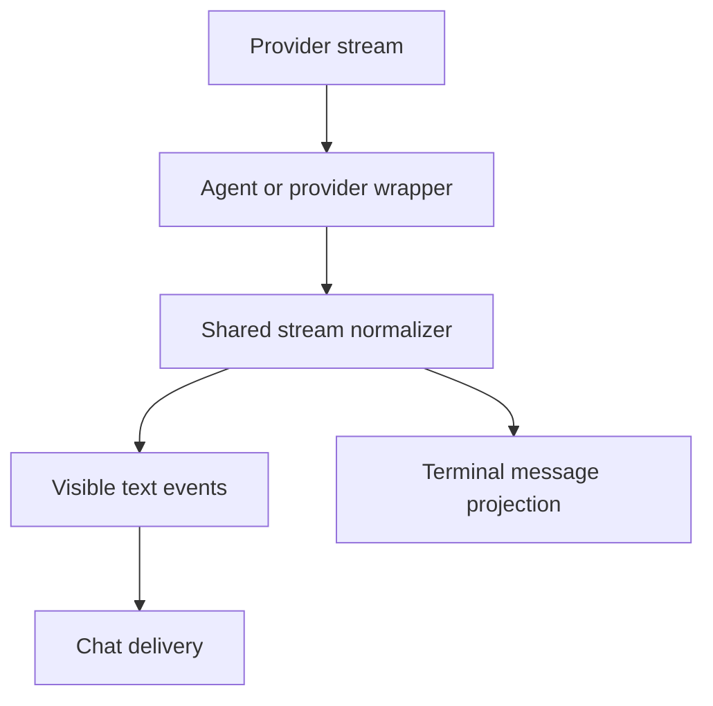

Codex review: needs real behavior proof before merge.

## What this changes

The PR hides later serialized tool calls after prose and releases decided text while retaining unfinished call tails.

**Example:** A provider streams [tool:read] with {"path":"a"}, then Done., then another [tool:read] with {"path":"b"}.
- **Before:** The streamed reply can expose Done. followed by the second call and its arguments, although the final transcript contains only Done.
- **After:** The streamed reply and final transcript retain only Done.; calls mixed with prose remain non-executing.

## Review scores

| Measure | Result | What it means |
|---|---|---|
| **Overall readiness** | 🧂 unranked krab **(1/6)** | The focused patch is source-supported and exact-head CI is green, but the mandatory real-behavior evidence remains unresolved. |
| **Proof confidence** | 🧂 unranked krab **(1/6)** | Real behavior proof is necessary before merge. See [Before merge](#before-merge). |
| **Patch quality** | 🐚 platinum hermit **(4/6)** | No actionable review findings were identified. |

## Product

**Kind:** Bug fix · **Worth it:** Yes · **Fix scope:** Complete
**User problem:** Users can briefly see raw tool names and arguments that disappear from the final reply.
**Reason:** The linked maintainer discussion approves the narrow disclosure fix and explicitly retains standalone-only execution.

## Merge readiness

⛔ **Blocked before merge - 1 item remains**

Keep this PR open: it repairs a current-main streaming defect with a focused, maintainer-approved change, and inspection found no actionable code defects.

**Priority:** P2
**Reviewed head:** `ba14a1307d5dc566c6b51fc7e2c61ed83e459f3c`

## Before merge

- [ ] **Add real behavior proof** - The supplied Windows evidence exercises the production agent wrapper with fabricated provider events on an earlier temporary patched-main branch; current-head CI supports the revised normalizer but no shipped CLI, Gateway, or channel run demonstrates it. The recorded maintainer preference for CI-only validation does not waive this external-PR review gate. Provide terminal output, redacted logs, or a recording showing complete, mid-marker, and mid-payload delivery, preserved prose at EOF/error, and unchanged non-execution; redact IPs, API keys, phone numbers, and non-public endpoints. After adding proof, update the PR body, then request a new review with `@clawsweeper re-review`. The PR author or someone with repository write access can request it.

## Findings

None.

### Tests

- Missing end-to-end proof: Supply current-head shipped CLI or Gateway evidence for complete and split call–prose–call delivery, including unfinished-tail termination; base-failure evidence for the revised regression cases is also absent.

<strong>Agent review details</strong>

### How this fits together

The shared tool-call repair package receives provider stream events through agent and provider wrappers and emits scrubbed text events and normalized terminal messages.

### Technical review

Best possible solution:

Use the existing shared normalizer to scrub every recognized call while replaying prose and retaining only unfinished tails.

Do we have a high-confidence way to reproduce the issue?

Yes: current-main classification removes only the leading call from call–prose–call input, while terminal projection removes both; this review executed no target code.

Is this the best way to solve the issue?

The patch repairs the shared replay owner and reuses its bounded trimming mechanism without expanding execution policy or adding another parser.

AGENTS.md: found and applied where relevant.

Codex review notes: model internal, reasoning medium; reviewed against [4542896b10d1](https://github.com/openclaw/openclaw/commit/4542896b10d1644c3f1e5e373f904f8a8d42d2f3).

### Provenance checked

- `Leading-call replay` changes intended behavior with a stated reason (05ebaf41f6ee71729149ff83bf8c3ff8a37261a8: The merged bounded-normalization repair consolidated recognition and projection while preserving visible text, native blocks, and fail-closed handling.)
- `Unfinished marker retention and trim replay` keeps the original intent (c0852fbf868b83daab465eea006d336d19063cd7: The merged split-marker repair buffered undecided tails and preserved replay ordering and content offsets.)

### Testing

Proof path: in-process harness.

### Security

None.

### Evidence

What I checked:

- **Pinned introduced change:** The introduced diff removes every recognized sequence instead of only the leading one and reuses existing trim replay to retain only the undecided suffix. ([`packages/tool-call-repair/src/stream-normalizer.ts:799`](https://github.com/openclaw/openclaw/blob/ba14a1307d5dc566c6b51fc7e2c61ed83e459f3c/packages/tool-call-repair/src/stream-normalizer.ts#L799), [ba14a1307d5d](https://github.com/openclaw/openclaw/commit/ba14a1307d5dc566c6b51fc7e2c61ed83e459f3c))
- **Current-main failure and provenance:** Current main still removes only [leading] in the mixed-message replay branch, whereas terminal scrubbing selects all recognized sequences. Scoped history identifies 05ebaf41f6ee71729149ff83bf8c3ff8a37261a8 as introducing that leading-only operation; the later split-marker repair retained it. ([`packages/tool-call-repair/src/stream-normalizer.ts:816`](https://github.com/openclaw/openclaw/blob/4542896b10d1644c3f1e5e373f904f8a8d42d2f3/packages/tool-call-repair/src/stream-normalizer.ts#L816), [4542896b10d1](https://github.com/openclaw/openclaw/commit/4542896b10d1644c3f1e5e373f904f8a8d42d2f3))
- **Production boundary:** The agent wrapper scrubs mixed text before attempting standalone promotion, and attempt-stream installs it using liveAllowedToolNames; the provider SDK wrapper consumes the same normalizer. ([`src/agents/embedded-agent-runner/run/attempt-tool-call-text-promotion.ts:38`](https://github.com/openclaw/openclaw/blob/ba14a1307d5dc566c6b51fc7e2c61ed83e459f3c/src/agents/embedded-agent-runner/run/attempt-tool-call-text-promotion.ts#L38), [ba14a1307d5d](https://github.com/openclaw/openclaw/commit/ba14a1307d5dc566c6b51fc7e2c61ed83e459f3c))
- **Maintainer-approved scope:** steipete's discussion on https://github.com/openclaw/openclaw/issues/172387 explicitly approves hiding raw calls while preserving deliberate standalone-only execution and explains the suffix-trimming cleanup.
- **Exact-head CI:** https://github.com/openclaw/openclaw/actions/runs/38683380980 completed successfully for the reviewed head; this supports validation but does not demonstrate the changed behavior through a shipped entry point. ([ba14a1307d5d](https://github.com/openclaw/openclaw/commit/ba14a1307d5dc566c6b51fc7e2c61ed83e459f3c))
- **Supplied behavior evidence:** The contributor's https://github.com/openclaw/openclaw/pull/172440#issuecomment-6184295238 describes fabricated provider events through the production wrapper on a temporary patched main branch and explicitly excludes CLI, Gateway, and Telegram execution. The updated body intentionally skips live proof; no proof override label is present.

### PR surface

Source -3, Tests +62. Total +59 across 2 files. Added test files: 0.

View PR surface stats

| Area | Files | Added | Removed | Net |
|---|---:|---:|---:|---:|
| Source | 1 | 27 | 30 | -3 |
| Tests | 1 | 62 | 0 | +62 |
| Docs | 0 | 0 | 0 | 0 |
| Config | 0 | 0 | 0 | 0 |
| Generated | 0 | 0 | 0 | 0 |
| Other | 0 | 0 | 0 | 0 |
| **Total** | **2** | **89** | **30** | **+59** |

### Review metrics

| Metric | Value | Why it matters |
|---|---|---|
| **Production versus test LOC** | Production +27/-30; tests +62/-0 | Production shrinks while regression coverage adds distinct chunk, terminal, protection, and bounded-buffer scenarios. |

### Root-cause cluster

Relationship: `fixed_by_candidate`
Canonical: https://github.com/openclaw/openclaw/issues/172387
Summary: This PR owns the linked issue's raw-call disclosure repair; earlier marker-split work and the trace-filter performance PR address distinct paths.

Members:
- `canonical`: https://github.com/openclaw/openclaw/issues/172387 - The issue identifies the same leading-only replay defect and has maintainer confirmation of the intended repair.
- `partial_overlap`: https://github.com/openclaw/openclaw/pull/169172 - The merged marker-split repair retained the leading-only remover responsible for this intervening-prose case.
- `adjacent_distinct`: https://github.com/openclaw/openclaw/pull/172631 - Its trace-filter performance change explicitly excludes the sibling plain-tool-call filter.
- `adjacent_distinct`: https://github.com/openclaw/openclaw/issues/165787 - It reports fenced PowerShell call syntax failing to execute, rather than the recognized mixed-message replay mismatch.

Proposal only: this assessment does not dispatch repair, suppress jobs, mutate sibling items, close, or merge anything.

### Labels

Label changes:

No label changes.

Label justifications:

- `P2`: This is a bounded reply-streaming defect affecting providers that serialize tool calls, without evidence of a core outage.
- `rating: 🧂 unranked krab`: Overall readiness is 🧂 unranked krab; proof is 🧂 unranked krab and patch quality is 🐚 platinum hermit.
- `status: 📣 needs proof`: The PR needs real behavior proof before ClawSweeper can clear the contributor ask.
- `proof: telegram-e2e`: This PR needs Telegram Test Server proof with the repository E2E skill. The change affects reply text visible in Telegram; Test Server proof can show prose retained and recognized raw call syntax absent.

### Rank-up moves

Optional improvements that raise the rating; they are not merge blockers.

- Provide redacted current-head evidence through the shipped CLI or Gateway for the changed replay and incomplete-tail behavior.

### Rating scale

6/6 🦀 challenger crab · 5/6 🦞 diamond lobster · 4/6 🐚 platinum hermit · 3/6 🦐 gold shrimp · 2/6 🦪 silver shellfish · 1/6 🧂 unranked krab. Overall follows the weaker of proof and patch quality; ✨ marks media proof (a screenshot, video, or linked artifact) that directly shows the changed behavior.

### Workflow

ClawSweeper edits this one comment on every review. Comment `@clawsweeper re-review` for a fresh review only. Repair and merge execution lanes are retired.

### History

Review history (2 earlier review cycles)

<!-- clawsweeper-review-history v=1 total=2 -->
- reviewed 2026-10-14T18:42:33.787Z sha d348401eb50c5524d72b7626bf2012b5ffd8d1b8 :: needs real behavior proof before merge. :: none
- reviewed 2026-10-15T04:24:04.675Z sha d348401eb50c5524d72b7626bf2012b5ffd8d1b8 :: needs real behavior proof before merge. :: none

_Reviewed October 15, 2026, 1:08 AM ET / 05:08 UTC (Revision 3)._

<!-- clawsweeper-verdict:needs-human item=172440 sha=ba14a1307d5dc566c6b51fc7e2c61ed83e459f3c confidence=high updated_at=2026-10-15T05:04:14Z reviewed_at=2026-10-15T05:08:16.428Z lease_owner=github-run-38684718959-1 lease_comment_id=6184829367 source_revision=fd394de52397ab646b198193e894dd4999d01afcf5a5b207f12aa8771b3faa40 hold=proof findings=0 -->
<!-- clawsweeper-review-state:blocked item=172440 sha=ba14a1307d5dc566c6b51fc7e2c61ed83e459f3c v=1 -->

<!-- clawsweeper-review-version item=172440 reviewed_at=2026-10-15T05:08:16.428Z sha=ba14a1307d5dc566c6b51fc7e2c61ed83e459f3c source_revision=fd394de52397ab646b198193e894dd4999d01afcf5a5b207f12aa8771b3faa40 lease_owner=github-run-38684718959-1 lease_comment_id=6184829367 v=1 -->

<!-- clawsweeper-review item=172440 -->