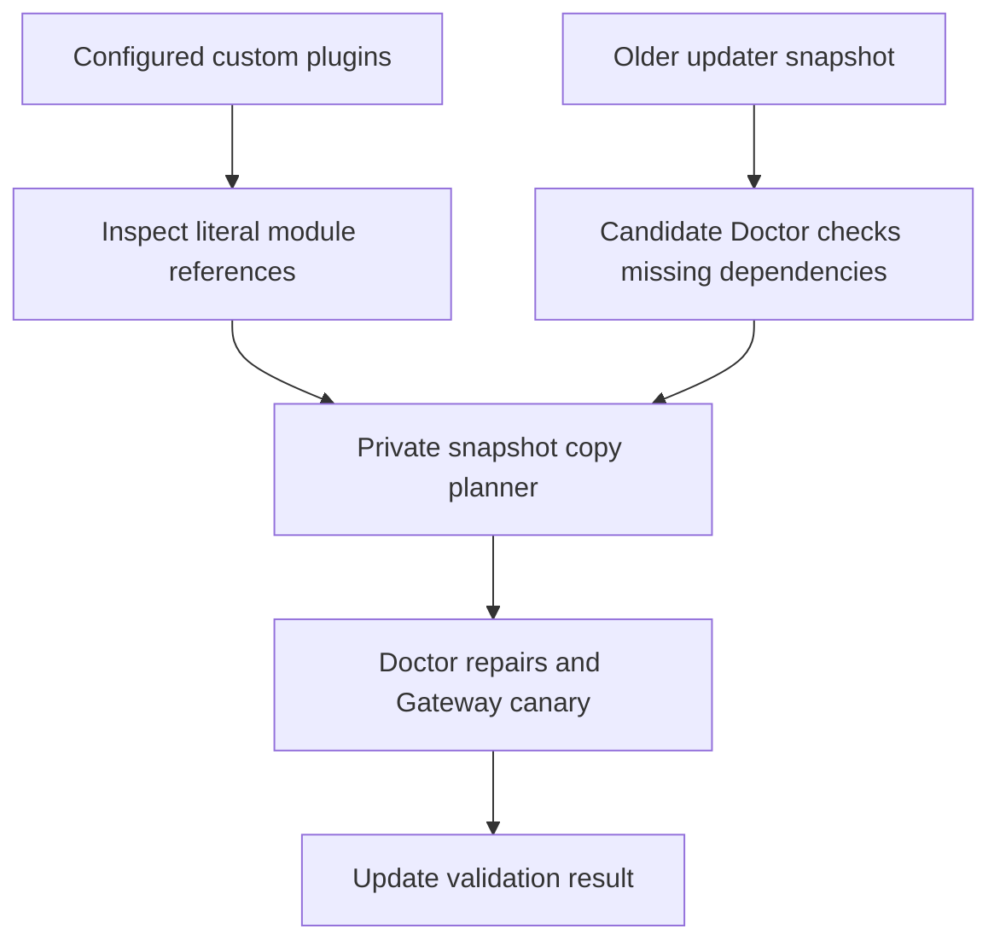

Codex review: blocked before merge. _Reviewed September 12, 2026, 9:23 PM ET / September 13, 2026, 01:23 UTC._

# ClawSweeper review

## What this changes

Preserves custom plugins’ imported sibling modules in private update snapshots and lets candidate Doctor complete recoverable copies made by older updaters.

## Merge readiness

⛔ **Blocked before merge - 3 items remain**

This remains a useful fix for an owned update failure that current main still contains. No concrete introduced correctness defect was found; the maintainer-authored PR and its paired issue should remain open.

**Priority:** P2
**Reviewed head:** `5a5d6149901d3d2c99480816f74af4cd88e9b3b8`

## Review scores

| Measure | Result | What it means |
|---|---|---|
| **Overall readiness** | 🐚 platinum hermit **(4/6)** | A coherent repair with meaningful regression coverage and no identified blocking code defect; final upgrade validation remains outstanding. |
| **Proof confidence** | 🌊 off-meta tidepool | Not applicable: The external-contributor proof gate does not apply to this maintainer-authored PR; its body reports real Docker Doctor/canary results, while the stronger update-validation requirement still awaits the declared final package rerun. |
| **Patch quality** | 🐚 platinum hermit **(4/6)** | No actionable review findings were identified. |

## Verification

| Check | Result | Evidence |
|---|---|---|
| **Real behavior** | Not applicable | Not applicable: The external-contributor proof gate does not apply to this maintainer-authored PR; its body reports real Docker Doctor/canary results, while the stronger update-validation requirement still awaits the declared final package rerun. |
| **Evidence reviewed** | 8 items | Introduced scope: Reviewed the pinned merge-base-to-head changes, separating them from unrelated base-branch drift; the checkout remained clean. Current main still lacks sibling discovery: Current main selects plugin/package roots and immediately prepares their trees without the new literal-source dependency inspection. The central repair remains absent. Published updater boundary: The v2026.9.4 source copies selected package roots without discovering sibling source imports, supporting the need for candidate-side recovery on the first upgrade. |
| **Findings** | None | None. |
| **Security** | None | None. |

## How this fits together

OpenClaw rehearses updates with private copies of configuration, state, and installed plugins before activating the candidate. This change supplies missing plugin dependencies before Doctor repairs and Gateway canary startup.

## Before merge

- [ ] **Resolve merge risk (P1)** - The final optional-import correction has not yet completed the declared packaged upgrade rerun, leaving its compatibility with the published first-hop updater unverified.
- [ ] **Complete next step (P2)** - Complete and record the final published-2026.9.4-to-candidate package rerun, including the optional-import correction, before merge.
- [ ] **Add data-model compatibility proof** - Confirm migration or upgrade compatibility proof before merge.

<strong>Agent review details</strong>

### Security

None.

### PR surface

Source +554, Tests +454, Docs +13. Total +1021 across 14 files.

View PR surface stats

| Area | Files | Added | Removed | Net |
|---|---:|---:|---:|---:|
| Source | 10 | 604 | 50 | +554 |
| Tests | 3 | 458 | 4 | +454 |
| Docs | 1 | 15 | 2 | +13 |
| Config | 0 | 0 | 0 | 0 |
| Generated | 0 | 0 | 0 | 0 |
| Other | 0 | 0 | 0 | 0 |
| **Total** | **14** | **1077** | **56** | **+1021** |

### Review metrics

| Metric | Value | Why it matters |
|---|---|---|
| **Production versus regression coverage** | production +554 net lines; tests +454 net lines | Production growth supports both new snapshot creation and published-driver recovery while reusing source capture and private-copy ownership. |

### Stored data model

Persistent data-model change detected: `migration/backfill/repair: src/commands/doctor-config-flow.ts`, `migration/backfill/repair: src/commands/doctor-config-preflight-plugin-index.ts`, `migration/backfill/repair: src/commands/doctor-config-preflight.ts`, `migration/backfill/repair: src/infra/update-candidate-plugin-repair.ts`, `migration/backfill/repair: src/infra/update-candidate-plugin-sources.ts`, `serialized state: src/infra/update-candidate-plugin-repair.ts`, and 3 more. Confirm migration or upgrade compatibility proof before merge.

### Root-cause cluster

Relationship: `fixed_by_candidate`
Canonical: https://github.com/openclaw/openclaw/issues/146609
Summary: This PR is the explicit candidate fix for the paired sibling-module omission report.

Members:
- `canonical`: https://github.com/openclaw/openclaw/issues/146609 - The report identifies the same copy omission and both required upgrade paths.

Proposal only: this assessment does not dispatch repair, suppress jobs, mutate sibling items, close, or merge anything.

### Merge-risk options

**Maintainer options:**
1. **Complete the declared package validation (recommended)**  
   Record the final published-2026.9.4-to-candidate result before landing so the optional-import correction is covered by upgrade evidence.

### Technical review

Best possible solution:

Keep dependency discovery and recovery on the shared copy owner, with published-driver upgrade proof confirming private execution and preserved plugin settings.

Do we have a high-confidence way to reproduce the issue?

Yes: current main’s copy planner omits unlinked sibling source modules, and the paired report supplies a published-updater reproduction with a self-contained control. This review inspected source and tests without executing them.

Is this the best way to solve the issue?

Yes: extending existing source-capture and copy owners, plus candidate-side completion for already-published drivers, addresses both upgrade paths without adding configuration or a parallel plugin API.

AGENTS.md: found and applied where relevant.

Codex review notes: model internal, reasoning medium; reviewed against [f1c1f274ef4f](https://github.com/openclaw/openclaw/commit/f1c1f274ef4f0bca1aa512f7404e7162fc1dcd54).

### Labels

Label changes:

- add `P2`: The fix addresses update rehearsal failures for custom plugins that import sibling source modules.
- add `merge-risk: 🚨 compatibility`: Candidate Doctor now inspects and completes older snapshots, and the final packaged first-hop compatibility result remains pending.
- add `rating: 🐚 platinum hermit`: Overall readiness is 🐚 platinum hermit; proof is 🌊 off-meta tidepool and patch quality is 🐚 platinum hermit.
- add `status: 👀 ready for maintainer look`: ClawSweeper has no concrete contributor-facing blocker left for this PR. Not applicable: The external-contributor proof gate does not apply to this maintainer-authored PR; its body reports real Docker Doctor/canary results, while the stronger update-validation requirement still awaits the declared final package rerun.

Label justifications:

- `P2`: The fix addresses update rehearsal failures for custom plugins that import sibling source modules.
- `merge-risk: 🚨 compatibility`: Candidate Doctor now inspects and completes older snapshots, and the final packaged first-hop compatibility result remains pending.
- `rating: 🐚 platinum hermit`: Overall readiness is 🐚 platinum hermit; proof is 🌊 off-meta tidepool and patch quality is 🐚 platinum hermit.
- `status: 👀 ready for maintainer look`: ClawSweeper has no concrete contributor-facing blocker left for this PR. Not applicable: The external-contributor proof gate does not apply to this maintainer-authored PR; its body reports real Docker Doctor/canary results, while the stronger update-validation requirement still awaits the declared final package rerun.

### Evidence

What I checked:

- **Introduced scope:** Reviewed the pinned merge-base-to-head changes, separating them from unrelated base-branch drift; the checkout remained clean. ([5a5d6149901d](https://github.com/openclaw/openclaw/commit/5a5d6149901d3d2c99480816f74af4cd88e9b3b8))
- **Current main still lacks sibling discovery:** Current main selects plugin/package roots and immediately prepares their trees without the new literal-source dependency inspection. The central repair remains absent. ([`src/infra/update-candidate-plugins.ts:339`](https://github.com/openclaw/openclaw/blob/f1c1f274ef4f0bca1aa512f7404e7162fc1dcd54/src/infra/update-candidate-plugins.ts#L339), [f1c1f274ef4f](https://github.com/openclaw/openclaw/commit/f1c1f274ef4f0bca1aa512f7404e7162fc1dcd54))
- **Published updater boundary:** The v2026.9.4 source copies selected package roots without discovering sibling source imports, supporting the need for candidate-side recovery on the first upgrade. ([`src/infra/update-candidate-plugins.ts:268`](https://github.com/openclaw/openclaw/blob/3a9d69db306cd7f081e06254cb89c4bcc14a7107/src/infra/update-candidate-plugins.ts#L268), [3a9d69db306c](https://github.com/openclaw/openclaw/commit/3a9d69db306cd7f081e06254cb89c4bcc14a7107))
- **Recovery preserves snapshot ownership:** Recovery checks private-path containment, original entry and manifest bytes, source freshness, and existing destination types; only missing entries reach the copy owner, whose file publication refuses overwrite. ([`src/infra/update-candidate-plugin-repair.ts:178`](https://github.com/openclaw/openclaw/blob/5a5d6149901d3d2c99480816f74af4cd88e9b3b8/src/infra/update-candidate-plugin-repair.ts#L178), [5a5d6149901d](https://github.com/openclaw/openclaw/commit/5a5d6149901d3d2c99480816f74af4cd88e9b3b8))
- **Meaningful regression coverage:** The source-copy tests invoke copied modules after removing the original tree. Repair tests cover missing sibling failures, Doctor entries, optional imports, source changes, existing-file preservation, and private symlink escapes. These tests were inspected, not executed in this read-only review. ([`src/infra/update-candidate-plugin-sources.test.ts:104`](https://github.com/openclaw/openclaw/blob/5a5d6149901d3d2c99480816f74af4cd88e9b3b8/src/infra/update-candidate-plugin-sources.test.ts#L104), [5a5d6149901d](https://github.com/openclaw/openclaw/commit/5a5d6149901d3d2c99480816f74af4cd88e9b3b8))
- **Proof and pending package validation:** The complete supplied body reports Linux Docker proof using the published 2026.9.4 updater, actual Doctor callbacks, Gateway canary registration, private dependency URLs, unchanged source hashes, and preserved enablement. It explicitly leaves the final package rerun after the optional-import correction pending. A REST reread returned the same body and pinned head. ([5a5d6149901d](https://github.com/openclaw/openclaw/commit/5a5d6149901d3d2c99480816f74af4cd88e9b3b8))

Likely related people:

- **steipete:** Suggested for follow-up; no historical authorship or introduction is verified. (role: unverified routing candidate; confidence: low)

### Rank-up moves

Optional improvements that raise the rating; they are not merge blockers.

- Add the completed final package rerun result covering the optional-import correction to the PR evidence.

### Rating scale

| Score | Internal tier | Crab rank | Meaning |
|---:|:---:|---|---|
| **6/6** | S | 🦀 challenger crab | Exceptional readiness |
| **5/6** | A | 🦞 diamond lobster | Very strong readiness |
| **4/6** | B | 🐚 platinum hermit | Good normal PR; ordinary maintainer review |
| **3/6** | C | 🦐 gold shrimp | Useful, but confidence is limited |
| **2/6** | D | 🦪 silver shellfish | Proof or implementation needs work |
| **1/6** | F | 🧂 unranked krab | Not merge-ready |
| N/A | NA | 🌊 off-meta tidepool | Rating does not apply |

Overall follows the weaker of proof and patch quality.
Shiny media proof means a screenshot, video, or linked artifact directly shows the changed behavior. Runtime, network, CSP, and security claims still need visible diagnostics.

### Workflow

- ClawSweeper keeps one durable marker-backed review comment per issue or PR.
- Re-runs edit this comment so the latest verdict, findings, and automation markers stay together instead of adding duplicate bot comments.
- A fresh review can be triggered by eligible `@clawsweeper re-review` comments, exact-item GitHub events, scheduled/background review runs, or manual workflow dispatch.
- PR/issue authors and users with repository write access can comment `@clawsweeper re-review` or `@clawsweeper re-run` on an open PR or issue to request a fresh review only.
- Maintainers can also comment `@clawsweeper review` to request a fresh review only.
- Fresh-review commands do not start repair, autofix, rebase, CI repair, or automerge.
- Maintainer-only repair and merge flows require explicit commands such as `@clawsweeper autofix`, `@clawsweeper automerge`, `@clawsweeper fix ci`, or `@clawsweeper address review`.
- Maintainers can comment `@clawsweeper explain` to ask for more context, or `@clawsweeper stop` to stop active automation.

<!-- clawsweeper-verdict:needs-human item=146616 sha=5a5d6149901d3d2c99480816f74af4cd88e9b3b8 confidence=high updated_at=2026-09-13T01:20:20Z reviewed_at=2026-09-13T01:23:11.334Z lease_owner=github-run-34730164345-1 lease_comment_id=5649913529 source_revision=3ff48fd94196d459f727f9710ddb305f1e2e072bcda13d20355951093dbe430b live_verification=absent -->
<!-- clawsweeper-review-state:blocked item=146616 sha=5a5d6149901d3d2c99480816f74af4cd88e9b3b8 v=1 -->

<!-- clawsweeper-review-version item=146616 reviewed_at=2026-09-13T01:23:11.334Z sha=5a5d6149901d3d2c99480816f74af4cd88e9b3b8 source_revision=3ff48fd94196d459f727f9710ddb305f1e2e072bcda13d20355951093dbe430b lease_owner=github-run-34730164345-1 lease_comment_id=5649913529 v=1 -->

<!-- clawsweeper-review item=146616 -->