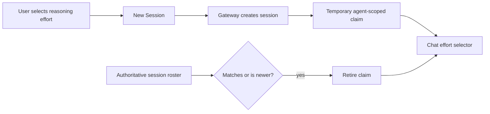

Codex review: needs maintainer review before merge. _Reviewed August 27, 2026, 4:33 AM ET / 08:33 UTC._

# ClawSweeper review

## What this changes

The PR preserves a newly created session’s selected reasoning effort in Chat until authoritative roster state arrives.

## Merge readiness

⚠️ **Ready for maintainer review - 2 items remain**

Keep this maintainer-owned PR open. The current main branch still drops the Gateway creation entry before Chat renders, while the PR adds a scoped transient claim and covers its create/list/event/reconnect lifecycle; no blocking patch defect was found.

**Priority:** P1
**Reviewed head:** `f4e1d965352d9d9be904ed9b027e07e2177c8237`

## Review scores

| Measure | Result | What it means |
|---|---|---|
| **Overall readiness** | 🐚 platinum hermit **(4/6)** | Focused source changes and ordering coverage address the prior scope blocker without a concrete remaining correctness finding. |
| **Proof confidence** | 🌊 off-meta tidepool | Not applicable: The PR is maintainer-authored, so the external-contributor real-behavior-proof gate does not apply; its included browser regression remains useful supplemental evidence. |
| **Patch quality** | 🐚 platinum hermit **(4/6)** | No actionable review findings were identified. |

## Verification

| Check | Result | Evidence |
|---|---|---|
| **Real behavior** | Not applicable | Not applicable: The PR is maintainer-authored, so the external-contributor real-behavior-proof gate does not apply; its included browser regression remains useful supplemental evidence. |
| **Evidence reviewed** | 5 items | Current-main gap: Current main’s session capability only settles prepared placement on canonical lists; it has no creation-effort claim or Chat override, so the reported handoff remains unimplemented there.<br>Claim ownership and retirement: The PR keys a claim by normalized session key plus agent, retires it from authoritative roster rows, and clears it on successful effort patches and connection replacement.<br>Gateway contract: The protocol already permits sessions.create to return an optional record entry, so forwarding the existing entry does not add a protocol surface. |
| **Findings** | None | None. |
| **Security** | None | None. |


### Live Verification

**Command:** `node scripts/run-vitest.mjs ui/src/e2e/new-session-page.transition.e2e.test.ts -- -t 'keeps the selected effort'`

**Result:** FAIL (failed) — step 1 `expect_output` `keeps the selected effort until the focused chat is ready`: `expected terminal output was not visible within 30 seconds: "keeps the selected effort until the focused chat is ready"`

```text
[test] starting test/vitest/vitest.ui-e2e.config.ts
[test] preflight test/vitest/vitest.ui-e2e.config.ts
[ui-e2e] Using system Chromium at /usr/bin/chromium-browser.
Downloading FFmpeg (playwright ffmpeg v1011) from https://cdn.playwright.dev/dbazure/download/playwright/builds/ffmpeg/1011/ffmpeg-linux.zip
|                                                                                |   0% of 2.3 MiB
|■■■■■■■■                                                                        |  10% of 2.3 MiB
|■■■■■■■■■■■■■■■■                                                                |  20% of 2.3 MiB
|■■■■■■■■■■■■■■■■■■■■■■■■                                                        |  30% of 2.3 MiB
|■■■■■■■■■■■■■■■■■■■■■■■■■■■■■■■■                                                |  40% of 2.3 MiB
|■■■■■■■■■■■■■■■■■■■■■■■■■■■■■■■■■■■■■■■■                                        |  50% of 2.3 MiB
|■■■■■■■■■■■■■■■■■■■■■■■■■■■■■■■■■■■■■■■■■■■■■■■■                                |  60% of 2.3 MiB
|■■■■■■■■■■■■■■■■■■■■■■■■■■■■■■■■■■■■■■■■■■■■■■■■■■■■■■■■                        |  70% of 2.3 MiB
|■■■■■■■■■■■■■■■■■■■■■■■■■■■■■■■■■■■■■■■■■■■■■■■■■■■■■■■■■■■■■■■■                |  80% of 2.3 MiB
|■■■■■■■■■■■■■■■■■■■■■■■■■■■■■■■■■■■■■■■■■■■■■■■■■■■■■■■■■■■■■■■■■■■■■■■■        |  90% of 2.3 MiB
|■■■■■■■■■■■■■■■■■■■■■■■■■■■■■■■■■■■■■■■■■■■■■■■■■■■■■■■■■■■■■■■■■■■■■■■■■■■■■■■■| 100% of 2.3 MiB
FFmpeg (playwright ffmpeg v1011) downloaded to /tmp/clawsweeper-live-proof-125822-WIOoFW/profile/cache/ms-playwright/ffmpeg-1011

 RUN  v4.1.11 /tmp/clawsweeper-live-proof-125822-WIOoFW/target
```

**Assertions:**

- FAIL `expect_output`: keeps the selected effort until the focused chat is ready

## How this fits together

The Control UI creates sessions through the Gateway, then moves to Chat while the session roster refreshes independently. This change bridges that handoff so the reasoning selector reflects the persisted creation choice until the roster becomes authoritative.



## Before merge

- [ ] **Resolve merge risk (P1)** - The fix adds a net 96 production lines of transient session-state lifecycle logic; it should retain its focused ordering and reconnect coverage through exact-head CI before merge.
- [ ] **Complete next step (P2)** - The maintainer label and remaining exact-head CI gate make this normal PR validation rather than a separate repair-lane candidate.


<details>
<summary><strong>Agent review details</strong></summary>

### Security

None.

### PR surface

Source +96, Tests +308. Total +404 across 11 files.

<details>
<summary>View PR surface stats</summary>

| Area | Files | Added | Removed | Net |
|---|---:|---:|---:|---:|
| Source | 7 | 191 | 95 | +96 |
| Tests | 4 | 374 | 66 | +308 |
| Docs | 0 | 0 | 0 | 0 |
| Config | 0 | 0 | 0 | 0 |
| Generated | 0 | 0 | 0 | 0 |
| Other | 0 | 0 | 0 | 0 |
| **Total** | **11** | **565** | **161** | **+404** |

</details>

### Review metrics

| Metric | Value | Why it matters |
|---|---|---|
| **Production versus test delta** | production +191/-95 (net +96); tests +374/-66 (net +308) | The added production state is confined to the temporary claim lifecycle, with substantially larger coverage for its ordering boundaries. |

### Stored data model

Persistent data-model change detected: `serialized state: ui/src/lib/sessions/create.ts`, `serialized state: ui/src/lib/sessions/index.ts`, `serialized state: ui/src/lib/sessions/reconcile.ts`, `serialized state: ui/src/lib/sessions/session-capability.ts`, `serialized state: ui/src/lib/sessions/session-mutations.ts`, `serialized state: ui/src/lib/sessions/session-roster-refresh.ts`, and 4 more. Confirm migration or upgrade compatibility proof before merge.

### Merge-risk options

**Maintainer options:**
1. **Complete exact-head session checks (recommended)**  
   Merge after the pending exact-head checks confirm the transient claim does not regress roster, event, or reconnect ordering.

<details>
<summary>Copy recommended automerge instruction</summary>

```text
@clawsweeper automerge

Special instructions:
Require exact-head CI completion and preserve the focused create/list/event/reconnect regression coverage.
```

</details>

### Technical review

Best possible solution:

Keep the agent-scoped creation claim as a short-lived UI overlay and retire it only from authoritative roster, event, patch, or connection state.

Do we have a high-confidence way to reproduce the issue?

Yes, source reproducibly identifies the gap: current main receives a creation result but has no effort handoff into Chat; the included browser scenario models the delayed roster response.

Is this the best way to solve the issue?

Yes. Reusing the Gateway-confirmed entry as an agent-scoped, short-lived overlay is narrower than changing Gateway protocol, persistence, or roster ownership.

AGENTS.md: found and applied where relevant.

Codex review notes: model internal, reasoning high; reviewed against [53c0ca975404](https://github.com/openclaw/openclaw/commit/53c0ca97540410486d5f213a5fd3a8e41f3280e3).

### Labels

Label changes:

- add `rating: 🐚 platinum hermit`: Overall readiness is 🐚 platinum hermit; proof is 🌊 off-meta tidepool and patch quality is 🐚 platinum hermit.
- add `status: 👀 ready for maintainer look`: ClawSweeper has no concrete contributor-facing blocker left for this PR. Not applicable: The PR is maintainer-authored, so the external-contributor real-behavior-proof gate does not apply; its included browser regression remains useful supplemental evidence.
- remove `rating: 🧂 unranked krab`: Current PR rating is `rating: 🐚 platinum hermit`, so this older rating label is no longer current.
- remove `status: ⏳ waiting on author`: Current PR status label is `status: 👀 ready for maintainer look`.

Label justifications:

- `P1`: A selected reasoning level can visibly regress during normal new-session navigation.
- `merge-risk: 🚨 session-state`: The patch overlays and retires session-scoped UI state across create, roster, event, patch, and reconnect paths.
- `rating: 🐚 platinum hermit`: Overall readiness is 🐚 platinum hermit; proof is 🌊 off-meta tidepool and patch quality is 🐚 platinum hermit.
- `status: 👀 ready for maintainer look`: ClawSweeper has no concrete contributor-facing blocker left for this PR. Not applicable: The PR is maintainer-authored, so the external-contributor real-behavior-proof gate does not apply; its included browser regression remains useful supplemental evidence.

### Evidence

What I checked:

- **Current-main gap:** Current main’s session capability only settles prepared placement on canonical lists; it has no creation-effort claim or Chat override, so the reported handoff remains unimplemented there. ([`ui/src/lib/sessions/index.ts:167`](https://github.com/openclaw/openclaw/blob/53c0ca975404/ui/src/lib/sessions/index.ts#L167), [53c0ca975404](https://github.com/openclaw/openclaw/commit/53c0ca975404))
- **Claim ownership and retirement:** The PR keys a claim by normalized session key plus agent, retires it from authoritative roster rows, and clears it on successful effort patches and connection replacement. ([`ui/src/lib/sessions/index.ts:120`](https://github.com/openclaw/openclaw/blob/f4e1d965352d/ui/src/lib/sessions/index.ts#L120), [f4e1d965352d](https://github.com/openclaw/openclaw/commit/f4e1d965352d))
- **Gateway contract:** The protocol already permits sessions.create to return an optional record entry, so forwarding the existing entry does not add a protocol surface. ([`packages/gateway-protocol/src/schema/sessions.ts:492`](https://github.com/openclaw/openclaw/blob/53c0ca975404/packages/gateway-protocol/src/schema/sessions.ts#L492), [53c0ca975404](https://github.com/openclaw/openclaw/commit/53c0ca975404))
- **Regression coverage:** Focused tests cover versioned and unversioned event ordering, stale/retained archive rows, reconnect clearing, and two-agent raw-global isolation; the browser test holds sessions.list while asserting XHigh in Chat. ([`ui/src/lib/sessions/index.create-background.test.ts:101`](https://github.com/openclaw/openclaw/blob/f4e1d965352d/ui/src/lib/sessions/index.create-background.test.ts#L101), [f4e1d965352d](https://github.com/openclaw/openclaw/commit/f4e1d965352d))
- **Area provenance:** Recent main history shows sustained session-roster ownership by Peter Steinberger and a recent owner-session roster change by RoboClaw; the proposed claim itself dates to the PR head. ([`ui/src/lib/sessions/index.ts:120`](https://github.com/openclaw/openclaw/blob/a482a50cda88/ui/src/lib/sessions/index.ts#L120), [a482a50cda88](https://github.com/openclaw/openclaw/commit/a482a50cda88))

Likely related people:

- **Peter Steinberger:** Recent main commits refactor and optimize the session-roster owner boundary that this change extends. (role: recent area contributor; confidence: high; commits: [a482a50cda88](https://github.com/openclaw/openclaw/commit/a482a50cda8850e9479d28a1ae29785a509841b2), [91dc6e102a2c](https://github.com/openclaw/openclaw/commit/91dc6e102a2c2326398e10001e6fe90396df5e96); files: `ui/src/lib/sessions/index.ts`, `ui/src/lib/sessions/session-roster-refresh.ts`)
- **RoboClaw:** Recent main work added owner-first session roster loading adjacent to this agent-scoped state path. (role: recent area contributor; confidence: medium; commits: [b0e8a985ee11](https://github.com/openclaw/openclaw/commit/b0e8a985ee11ac94aa76513f4da6b5693334c409), [51825130d807](https://github.com/openclaw/openclaw/commit/51825130d807012c8113845597e7a6eb13345be5); files: `ui/src/lib/sessions/index.ts`, `ui/src/lib/sessions/session-mutations.ts`)

### Rank-up moves

Optional improvements that raise the rating; they are not merge blockers.

- Wait for exact-head CI to finish before merge.

### Rating scale

| Score | Internal tier | Crab rank | Meaning |
|---:|:---:|---|---|
| **6/6** | S | 🦀 challenger crab | Exceptional readiness |
| **5/6** | A | 🦞 diamond lobster | Very strong readiness |
| **4/6** | B | 🐚 platinum hermit | Good normal PR; ordinary maintainer review |
| **3/6** | C | 🦐 gold shrimp | Useful, but confidence is limited |
| **2/6** | D | 🦪 silver shellfish | Proof or implementation needs work |
| **1/6** | F | 🧂 unranked krab | Not merge-ready |
| N/A | NA | 🌊 off-meta tidepool | Rating does not apply |

Overall follows the weaker of proof and patch quality.
Shiny media proof means a screenshot, video, or linked artifact directly shows the changed behavior. Runtime, network, CSP, and security claims still need visible diagnostics.

### Workflow

- ClawSweeper keeps one durable marker-backed review comment per issue or PR.
- Re-runs edit this comment so the latest verdict, findings, and automation markers stay together instead of adding duplicate bot comments.
- A fresh review can be triggered by eligible `@clawsweeper re-review` comments, exact-item GitHub events, scheduled/background review runs, or manual workflow dispatch.
- PR/issue authors and users with repository write access can comment `@clawsweeper re-review` or `@clawsweeper re-run` on an open PR or issue to request a fresh review only.
- Maintainers can also comment `@clawsweeper review` to request a fresh review only.
- Fresh-review commands do not start repair, autofix, rebase, CI repair, or automerge.
- Maintainer-only repair and merge flows require explicit commands such as `@clawsweeper autofix`, `@clawsweeper automerge`, `@clawsweeper fix ci`, or `@clawsweeper address review`.
- Maintainers can comment `@clawsweeper explain` to ask for more context, or `@clawsweeper stop` to stop active automation.

### History

<details>
<summary>Review history (27 earlier review cycles; latest 8 shown)</summary>

<!-- clawsweeper-review-history v=1 total=27 -->
- reviewed 2026-08-22T18:59:28.701Z sha a180b314365455bc6fb1ac3665be533b90e1ec0e :: found issues before merge. :: [P1] Avoid sending incompatible preparedOnly and refresh flags
- reviewed 2026-08-24T04:36:43.931Z sha 6a85a6be54ef0dc82522e57a337207b409a4cf25 :: needs maintainer review before merge. :: none
- reviewed 2026-08-24T11:17:55.396Z sha cbf1c91fdda831fa0602109bc079522be97757a5 :: needs maintainer review before merge. :: none
- reviewed 2026-08-26T15:48:39.131Z sha 8f4d152644ca1df32cffa7f424ba1173ab462b36 :: found issues before merge. :: [P2] Honor the picker refresh cooldown
- reviewed 2026-08-27T05:38:47.906Z sha f49bee6309d879d1ee2aa9247efab4a79b7367d7 :: needs maintainer review before merge. :: none
- reviewed 2026-08-27T06:24:52.586Z sha 388a8f38c71fa80d82cd0f304937f90876d4885a :: found issues before merge. :: [P2] Retire claims on accepted newer session events
- reviewed 2026-08-27T06:58:38.344Z sha 451ee4cfebc2ef833c55f75478ed3e030bd7b656 :: needs changes before merge. :: [P1] Scope temporary thinking claims to their agent
- reviewed 2026-08-27T07:55:51.457Z sha 9ac445b7b3addcbacea761d6bee2c3d9e1f9438d :: found issues before merge. :: [P1] Scope temporary thinking claims to their agent

</details>

</details>

<!-- clawsweeper-verdict:needs-human item=125822 sha=f4e1d965352d9d9be904ed9b027e07e2177c8237 confidence=high updated_at=2026-08-27T08:30:01Z reviewed_at=2026-08-27T08:33:07.352Z lease_owner=github-run-33054142596-1 lease_comment_id=5436445890 source_revision=ff44bf6eae0dd775105d047c17fe476e5d46e2081c0af23959fd7875fd14dde0 -->

<!-- clawsweeper-review-version item=125822 reviewed_at=2026-08-27T08:33:07.352Z sha=f4e1d965352d9d9be904ed9b027e07e2177c8237 source_revision=ff44bf6eae0dd775105d047c17fe476e5d46e2081c0af23959fd7875fd14dde0 lease_owner=github-run-33054142596-1 lease_comment_id=5436445890 v=1 -->

<!-- clawsweeper-review item=125822 -->