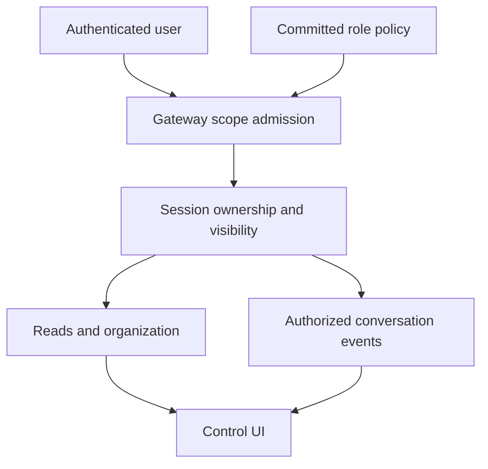

Codex review: blocked before merge. _Reviewed September 23, 2026, 9:51 AM ET / 13:51 UTC (Revision 8)._

# ClawSweeper review

## What this changes

Extends Gateway and Control UI access so session readers can browse conversations and session owners can rename, pin, archive, and restore them without broad Gateway permissions.

## Merge readiness

⛔ **Blocked before merge - 2 items remain**

This remains useful, distinct work with no blocking findings. The complete diff does not support the previous generic configuration or migration warning, and the retained evidence supports the scoped behavior.

**Priority:** P2
**Reviewed head:** `89d506be94a3e48c5a3e5f94246cbd5e79a4735b`

## Review scores

| Measure | Result | What it means |
|---|---|---|
| **Overall readiness** | 🐚 platinum hermit **(4/6)** | A coherent implementation with strong retained visual and boundary evidence and no actionable review findings. |
| **Proof confidence** | 🦞 diamond lobster **(5/6)** ✨ media proof bonus | Sufficient (linked_artifact): Inspected session-control before/after screenshots and the source-bound production UI scenario at 57b2ec6, whose core scenario and permission owners remain unchanged. Its mocked Gateway proves browser controls; separate reported registered-Gateway runs and reviewed assertions cover foreign access, revocation, replacement, and denied subscription effects. No stored-data contract changes require migration. |
| **Patch quality** | 🐚 platinum hermit **(4/6)** | No actionable review findings were identified. |

## Verification

| Check | Result | Evidence |
|---|---|---|
| **Real behavior** | Verified | Sufficient (linked_artifact): Inspected session-control before/after screenshots and the source-bound production UI scenario at 57b2ec6, whose core scenario and permission owners remain unchanged. Its mocked Gateway proves browser controls; separate reported registered-Gateway runs and reviewed assertions cover foreign access, revocation, replacement, and denied subscription effects. No stored-data contract changes require migration. |
| **Evidence reviewed** | 9 items | Complete introduced contribution: Inspected all 86 introduced file diffs, including the six paths omitted from the prompt inventory. Changes remain in session authorization, projections, UI controls, documentation, and supporting tests; no configuration schema, wire schema, dependency, plugin API, or persistent-format change was found. Current main still needs the contribution: Fetched main retains the smaller session-read method set and the separate discovery scope table. The merged authorization and model-discovery prerequisites do not supply this PR's complete reading and organization behavior. Admission and retained authority: Admission rechecks scopes after asynchronous preparation and rejects a changed broad/narrow admission mode. The retained operator guard checks identity, scope loss, canonical profile, and committed role policy; request handling composes it with existing response and mutation guards. |
| **Findings** | None | None. |
| **Security** | None | None. |

## How this fits together

The Gateway authorizes requests and conversation updates using authenticated identity, scopes, and session visibility. The Control UI consumes those permissions and ownership facts to expose appropriate reading and organization controls.

## Before merge

- [ ] **Review config compatibility** - Confirm compatibility and upgrade impact for the changed config or default surface before merge.
- [ ] **Add data-model compatibility proof** - Confirm migration or upgrade compatibility proof before merge.

<strong>Agent review details</strong>

### Security

None.

### PR surface

PR surface statistics unavailable: the file list is incomplete.

### Review metrics

| Metric | Value | Why it matters |
|---|---|---|
| **Production versus test growth** | Production net +464 lines; tests/support net +1341 lines | Production growth supplies scoped authorization and UI integration through existing owners; test growth exercises ownership and asynchronous authority boundaries. |
| **Configuration and storage surface** | 0 new configuration options; 0 wire or stored-format changes | The complete contribution does not support the previous generic migration blocker. |

### Stored data model

Persistent data-model change detected: `unknown-truncated-pull-files`. Confirm migration or upgrade compatibility proof before merge.

### Technical review

Best possible solution:

Keep scoped admission, current-authority checks, and session ownership in their existing Gateway owners, with the UI consuming the shared policy.

Do we have a high-confidence way to reproduce the issue?

Not applicable as a feature review; the supplied before/after browser cases and current-main source establish the scoped-access limitations being addressed.

Is this the best way to solve the issue?

Yes. Extending canonical admission alternatives and existing ownership guards avoids a competing permission system, and the UI uses the same shared method policy.

AGENTS.md: found and applied where relevant.

Codex review notes: model internal, reasoning medium; reviewed against [6f558f8ed70e](https://github.com/openclaw/openclaw/commit/6f558f8ed70e1d47366a17638d1bec2e36424594).

### Labels

Label changes:

No label changes.

Label justifications:

- `P2`: This is a bounded improvement to session-only reading and organization with preserved broader permission boundaries.
- `rating: 🐚 platinum hermit`: Overall readiness is 🐚 platinum hermit; proof is 🦞 diamond lobster and patch quality is 🐚 platinum hermit.
- `status: 👀 ready for maintainer look`: ClawSweeper has no concrete contributor-facing blocker left for this PR. Sufficient (linked_artifact): Inspected session-control before/after screenshots and the source-bound production UI scenario at 57b2ec6, whose core scenario and permission owners remain unchanged. Its mocked Gateway proves browser controls; separate reported registered-Gateway runs and reviewed assertions cover foreign access, revocation, replacement, and denied subscription effects. No stored-data contract changes require migration.
- `proof: sufficient`: Contributor real behavior proof is sufficient. Inspected session-control before/after screenshots and the source-bound production UI scenario at 57b2ec6, whose core scenario and permission owners remain unchanged. Its mocked Gateway proves browser controls; separate reported registered-Gateway runs and reviewed assertions cover foreign access, revocation, replacement, and denied subscription effects. No stored-data contract changes require migration.

### Evidence

What I checked:

- **Complete introduced contribution:** Inspected all 86 introduced file diffs, including the six paths omitted from the prompt inventory. Changes remain in session authorization, projections, UI controls, documentation, and supporting tests; no configuration schema, wire schema, dependency, plugin API, or persistent-format change was found. ([89d506be94a3](https://github.com/openclaw/openclaw/commit/89d506be94a3e48c5a3e5f94246cbd5e79a4735b))
- **Current main still needs the contribution:** Fetched main retains the smaller session-read method set and the separate discovery scope table. The merged authorization and model-discovery prerequisites do not supply this PR's complete reading and organization behavior. ([`src/shared/session-method-scopes-base.ts:8`](https://github.com/openclaw/openclaw/blob/6f558f8ed70e1d47366a17638d1bec2e36424594/src/shared/session-method-scopes-base.ts#L8), [6f558f8ed70e](https://github.com/openclaw/openclaw/commit/6f558f8ed70e1d47366a17638d1bec2e36424594))
- **Admission and retained authority:** Admission rechecks scopes after asynchronous preparation and rejects a changed broad/narrow admission mode. The retained operator guard checks identity, scope loss, canonical profile, and committed role policy; request handling composes it with existing response and mutation guards. ([`src/gateway/server-methods/session-mutation-guards.ts:288`](https://github.com/openclaw/openclaw/blob/89d506be94a3e48c5a3e5f94246cbd5e79a4735b/src/gateway/server-methods/session-mutation-guards.ts#L288), [89d506be94a3](https://github.com/openclaw/openclaw/commit/89d506be94a3e48c5a3e5f94246cbd5e79a4735b))
- **Ownership and forbidden-case coverage:** Reviewed registered-request coverage for foreign drafts, incognito rows, missing rows, revoked request sources, replaced session generations, and subscription registration. Narrow metadata patches reject unused keys, while the existing mutation owner rechecks ownership and exact session identity before committing. ([`src/gateway/server-methods.session-scoped-reads.test.ts:53`](https://github.com/openclaw/openclaw/blob/89d506be94a3e48c5a3e5f94246cbd5e79a4735b/src/gateway/server-methods.session-scoped-reads.test.ts#L53), [89d506be94a3](https://github.com/openclaw/openclaw/commit/89d506be94a3e48c5a3e5f94246cbd5e79a4735b))
- **Compatibility warning resolved:** The previous completed review examined the same head and reported no findings. Its generic compatibility next step has no schema or configuration trigger in the complete diff. The maintainer-authored body explicitly retains broader deletion authority; v2026.9.5 already requires operator.write for supported archived-only deletion and operator.admin otherwise. Existing credential storage is read without changing its format. ([`src/shared/session-method-scopes-base.ts`](https://github.com/openclaw/openclaw/blob/ec9c1a13db8938e5a3eaa51fca2e981cde2395a9/src/shared/session-method-scopes-base.ts), [ec9c1a13db89](https://github.com/openclaw/openclaw/commit/ec9c1a13db8938e5a3eaa51fca2e981cde2395a9))
- **Captured body and visual proof:** Verified the complete body against captured SHA-256 dd90424353542e0dfa9d2c13f7336e4456f0bc8a99ea37d40d4d665b04f0460a and read the omitted test-cost section. The prepared manifest contained prerequisite images, so the four session-control attachments were separately fetched into memory and inspected: shared history remains visible, the reader receives a sending restriction, and owner pin/rename/archive controls become enabled. The reported production-browser run uses the maintained mocked Gateway and retains capture identity 57b2ec666662a807e703cfa82c9b81c3f57b7ca6; it is not live Gateway security proof. ([`ui/src/e2e/session-management.operator-scopes.e2e.test.ts:58`](https://github.com/openclaw/openclaw/blob/57b2ec666662a807e703cfa82c9b81c3f57b7ca6/ui/src/e2e/session-management.operator-scopes.e2e.test.ts#L58), [57b2ec666662](https://github.com/openclaw/openclaw/commit/57b2ec666662a807e703cfa82c9b81c3f57b7ca6))

Likely related people:

- **shakkernerd:** Suggested for follow-up; no historical authorship or introduction is verified. (role: unverified routing candidate; confidence: low)
- **vincentkoc:** Suggested for follow-up; no historical authorship or introduction is verified. (role: unverified routing candidate; confidence: low)

### Rating scale

| Score | Internal tier | Crab rank | Meaning |
|---:|:---:|---|---|
| **6/6** | S | 🦀 challenger crab | Exceptional readiness |
| **5/6** | A | 🦞 diamond lobster | Very strong readiness |
| **4/6** | B | 🐚 platinum hermit | Good normal PR; ordinary maintainer review |
| **3/6** | C | 🦐 gold shrimp | Useful, but confidence is limited |
| **2/6** | D | 🦪 silver shellfish | Proof or implementation needs work |
| **1/6** | F | 🧂 unranked krab | Not merge-ready |
| N/A | NA | 🌊 off-meta tidepool | Rating does not apply |

Overall follows the weaker of proof and patch quality.
Shiny media proof means a screenshot, video, or linked artifact directly shows the changed behavior. Runtime, network, CSP, and security claims still need visible diagnostics.

### Workflow

- ClawSweeper keeps one durable marker-backed review comment per issue or PR.
- Re-runs edit this comment so the latest verdict, findings, and automation markers stay together instead of adding duplicate bot comments.
- A fresh review can be triggered by eligible `@clawsweeper re-review` comments, exact-item GitHub events, scheduled/background review runs, or manual workflow dispatch.
- PR/issue authors and users with repository write access can comment `@clawsweeper re-review` or `@clawsweeper re-run` on an open PR or issue to request a fresh review only.
- Maintainers can also comment `@clawsweeper review` to request a fresh review only.
- Fresh-review commands do not start repair, autofix, rebase, CI repair, or automerge.
- Maintainer-only repair and merge flows require explicit commands such as `@clawsweeper autofix`, `@clawsweeper automerge`, `@clawsweeper fix ci`, or `@clawsweeper address review`.
- Maintainers can comment `@clawsweeper explain` to ask for more context, or `@clawsweeper stop` to stop active automation.

### History

Review history (7 earlier review cycles)

<!-- clawsweeper-review-history v=1 total=7 -->
- reviewed 2026-09-21T20:48:50.849Z sha 441e78c4b012f9030ad5af2318ee198fa8891e3f :: needs changes before merge. :: none
- reviewed 2026-09-21T22:44:57.574Z sha c30739a7c0544f67304cd63f7249ad4a3517acce :: blocked before merge. :: none
- reviewed 2026-09-22T04:46:49.698Z sha bbf25a8e5b6d2eaa51d9d54a687b5483a598c6b4 :: needs changes before merge. :: none
- reviewed 2026-09-22T05:13:57.176Z sha feaebbcb6f9f781314c81f3372de49430898a500 :: blocked before merge. :: none
- reviewed 2026-09-22T06:02:35.189Z sha feaebbcb6f9f781314c81f3372de49430898a500 :: blocked before merge. :: none
- reviewed 2026-09-23T10:53:45.201Z sha 4f3f2d89605eae36d0fe40d0a5c15eeb925fd252 :: blocked before merge. :: none
- reviewed 2026-09-23T13:21:37.734Z sha 89d506be94a3e48c5a3e5f94246cbd5e79a4735b :: blocked before merge. :: none

<!-- clawsweeper-verdict:needs-human item=155184 sha=89d506be94a3e48c5a3e5f94246cbd5e79a4735b confidence=high updated_at=2026-09-23T13:46:29Z reviewed_at=2026-09-23T13:51:23.691Z lease_owner=github-run-35869108883-1 lease_comment_id=5795999152 source_revision=7b4f236647550af94dbcdbe9d0bef489932ae2d1f4fc4743c4fb6521aab9e322 live_verification=absent -->
<!-- clawsweeper-review-state:blocked item=155184 sha=89d506be94a3e48c5a3e5f94246cbd5e79a4735b v=1 -->

<!-- clawsweeper-review-version item=155184 reviewed_at=2026-09-23T13:51:23.691Z sha=89d506be94a3e48c5a3e5f94246cbd5e79a4735b source_revision=7b4f236647550af94dbcdbe9d0bef489932ae2d1f4fc4743c4fb6521aab9e322 lease_owner=github-run-35869108883-1 lease_comment_id=5795999152 v=1 -->

<!-- clawsweeper-review item=155184 -->