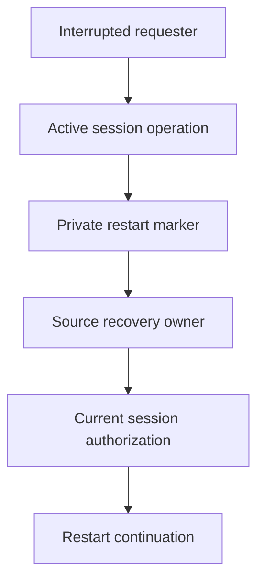

Codex review: blocked before merge.

## What this changes

This PR preserves the interrupted requester's bounded authentication source across Gateway restarts and retains service-installation context in connection callbacks.

**Example:** Alice starts work with operator.sessions.write in her conversation, then Bob participates before a Gateway restart.
- **Before:** Recovery selects the session principal instead of retaining Alice's original authenticated source.
- **After:** Recovery revalidates Alice's captured source and session access without borrowing Bob's permissions.

## Review scores

| Measure | Result | What it means |
|---|---|---|
| **Overall readiness** | 🦪 silver shellfish **(2/6)** | The runtime approach is focused and useful, but affected CI contracts fail and the central requester-specific runtime and upgrade evidence remains incomplete. |
| **Proof confidence** | 🦪 silver shellfish **(2/6)** | Real behavior proof is not required for maintainer- or bot-authored pull requests. |
| **Patch quality** | 🦪 silver shellfish **(2/6)** | 3 actionable review findings remain. |

## Product

**Kind:** Bug fix · **Worth it:** Yes · **Fix scope:** Complete
**User problem:** Interrupted work in a shared conversation resumes without its requester or under another person's permissions, causing follow-up tools to refuse or use the wrong identity.
**Reason:** The maintainer-authored direction restores the existing caller-preserving continuation contract within the stated interrupted-root scope.

## Merge readiness

⛔ **Blocked before merge - 3 items remain**

Keep open: this maintainer-authored PR addresses a current requester-authority defect, but two affected CI contracts need repair.

**Priority:** P2
**Reviewed head:** `d416ba9e61cfae522c933ce17b8f597822c7f775`

## Before merge

- [ ] **\[P2\] Register the new regression in the source-owner expectation (P2)** - The new suite imports operator-authority.test-support.ts, so changing that support file now selects this suite outside the src/channels owner area. The expected consumer list in test/scripts/ci-changed-node-test-plan.source-owners.test.ts omits it, and exact-head checks-node-compact-small-5 fails with this file as the unexpected selection. Add this legitimate consumer to that expectation while retaining the planner guard.
- [ ] **\[P2\] Update the restart refusal test to revoke the actual requester (P2)** - Passing marker.operatorSource changes the existing process test's admission contract: its interrupted turn belongs to the original administrator, but the test only assigns a different reader as session owner and expects recovery to fail. The original administrator remains authorized, so that mutation no longer exercises requester revocation; exact-head checks-node-changed fails at test/gateway-restart-resume.e2e.test.ts:678. Update the scenario to revoke or remove the captured requester's actual source, preserving its visible-failure and healthy-sibling assertions.
- [ ] **Add data-model compatibility proof** - The review found that existing stored data may not work after upgrade. Show that existing data still loads and works with this change.

## Findings

- [P2] [P2] Register the new regression in the source-owner expectation — `src/gateway/session-restart-resume.authority.test.ts:7`
- [P2] [P2] Update the restart refusal test to revoke the actual requester — `src/gateway/session-restart-resume.ts:610`
- [P3] [P3] Align the detailed recovery documentation with the new policy — `docs/gateway/restart-recovery.md:19-25`

### Tests

- Missing end-to-end proof: Provide sanitized Gateway output showing a requester distinct from the session owner completing a requester-scoped action after restart under the original limits, plus latest-stable upgrade survival; redact credentials, IPs, phone numbers, and non-public endpoints.

<strong>Agent review details</strong>

### How this fits together

The Gateway restart owner records interrupted sessions at shutdown and submits ordinary continuation inputs at startup through the existing authentication and session-access owners.

### Technical review

Best possible solution:

Retain the existing marker and authorization owners, repair their affected test consumers, and document requester-based recovery consistently.

Do we have a high-confidence way to reproduce the issue?

Current main records no interrupted-requester source in its restart marker and resolves recovery from the session owner or creator; this review executed no target code.

Is this the best way to solve the issue?

Capturing the original source and restoring it through the existing recovery and session-access owners is a focused fix that preserves current authorization checks without introducing another authority manager.

Full review comments:

- [P2] [P2] Register the new regression in the source-owner expectation — `src/gateway/session-restart-resume.authority.test.ts:7`
  The new suite imports operator-authority.test-support.ts, so changing that support file now selects this suite outside the src/channels owner area. The expected consumer list in test/scripts/ci-changed-node-test-plan.source-owners.test.ts omits it, and exact-head checks-node-compact-small-5 fails with this file as the unexpected selection. Add this legitimate consumer to that expectation while retaining the planner guard.
  Confidence: 0.99
- [P2] [P2] Update the restart refusal test to revoke the actual requester — `src/gateway/session-restart-resume.ts:610`
  Passing marker.operatorSource changes the existing process test's admission contract: its interrupted turn belongs to the original administrator, but the test only assigns a different reader as session owner and expects recovery to fail. The original administrator remains authorized, so that mutation no longer exercises requester revocation; exact-head checks-node-changed fails at test/gateway-restart-resume.e2e.test.ts:678. Update the scenario to revoke or remove the captured requester's actual source, preserving its visible-failure and healthy-sibling assertions.
  Confidence: 0.97
- [P3] [P3] Align the detailed recovery documentation with the new policy — `docs/gateway/restart-recovery.md:19-25`
  The new introduction says captured turns retain their original requester, but Automatic resume still states that recovery always uses the session owner or creator and later says it inherits no requester authority snapshot. Those statements now describe only the legacy path. Update that section to distinguish captured-source recovery from markers without a source.
  Confidence: 0.99

Overall correctness: patch is incorrect
Overall confidence: 0.92

AGENTS.md: found and applied where relevant.

Codex review notes: model internal, reasoning medium; reviewed against [8c089d588fec](https://github.com/openclaw/openclaw/commit/8c089d588fecb575184fe3e96b84410673522f19).

### Provenance checked

- `Restart continuation ownership` keeps the original intent (https://github.com/openclaw/openclaw/pull/185730: Replace competing execution-recovery paths with ordinary restart inputs through existing admission owners; older local restart blobs are unavailable.)
- `Caller versus session-principal authority` keeps the original intent (https://github.com/openclaw/openclaw/pull/187346: Continuations retain their initiating caller, and only unattributed host work uses the session principal.)
- `Signed-in-person and membership recovery` keeps the original intent (https://github.com/openclaw/openclaw/pull/192444: Profiles without named roles need their recorded authenticated connection to recover without gaining broader permissions.)
- `Original grant and policy ceilings` keeps the original intent (https://github.com/openclaw/openclaw/pull/193098: Restart admission preserves accepted custody while intersecting original and current restrictions instead of manufacturing another human authorization.)
- `Connection callback context` keeps the original intent (https://github.com/openclaw/openclaw/pull/155779: The connection-work owner restores Gateway-owned resources for detached callbacks without borrowing startup admission.)

### Testing

Proof path: in-process harness.

### Security

None.

### Evidence

What I checked:

- **Verified introduced change:** The pinned introduced diff adds requester-source capture, marker persistence, recovery admission, connection context retention, and focused regressions. ([`src/gateway/session-restart-resume.ts:610`](https://github.com/openclaw/openclaw/blob/d416ba9e61cfae522c933ce17b8f597822c7f775/src/gateway/session-restart-resume.ts#L610), [d416ba9e61cf](https://github.com/openclaw/openclaw/commit/d416ba9e61cfae522c933ce17b8f597822c7f775))
- **Current main still has the affected behavior:** The four affected runtime modules are unchanged between the merge base and fetched main; main still selects the session principal without this interrupted-requester marker. ([`src/gateway/session-system-turn-authority.ts:73`](https://github.com/openclaw/openclaw/blob/8c089d588fecb575184fe3e96b84410673522f19/src/gateway/session-system-turn-authority.ts#L73), [8c089d588fec](https://github.com/openclaw/openclaw/commit/8c089d588fecb575184fe3e96b84410673522f19))
- **Affected restart regression fails:** Exact-head checks-node-changed reports the missing refusal notice at test/gateway-restart-resume.e2e.test.ts:678; that scenario reassigns the session owner while leaving the original administrator requester authorized. ([`test/gateway-restart-resume.e2e.test.ts:678`](https://github.com/openclaw/openclaw/blob/d416ba9e61cfae522c933ce17b8f597822c7f775/test/gateway-restart-resume.e2e.test.ts#L678), [d416ba9e61cf](https://github.com/openclaw/openclaw/commit/d416ba9e61cfae522c933ce17b8f597822c7f775))
- **New test breaks the owner-selection contract:** Exact-head checks-node-compact-small-5 reports the new authority test as an unexpected consumer of operator-authority.test-support.ts; the source-owner expectation omits it. ([`test/scripts/ci-changed-node-test-plan.source-owners.test.ts:294`](https://github.com/openclaw/openclaw/blob/d416ba9e61cfae522c933ce17b8f597822c7f775/test/scripts/ci-changed-node-test-plan.source-owners.test.ts#L294), [d416ba9e61cf](https://github.com/openclaw/openclaw/commit/d416ba9e61cfae522c933ce17b8f597822c7f775))
- **Other CI failures remain unattributed:** Annotations also report a hosted planner exceeding its job cap and an unrelated browser-test inventory mismatch; neither was established as inherited or PR-caused, and full job logs redirected to a host blocked by the review environment. ([d416ba9e61cf](https://github.com/openclaw/openclaw/commit/d416ba9e61cfae522c933ce17b8f597822c7f775))
- **Proof scope:** The body reports synthetic Gateway integration and live general restart smoke, credits @vincentkoc, and explicitly excludes retained-child live GitHub operations; comments provide no additional runtime captures or stable-upgrade receipt. ([d416ba9e61cf](https://github.com/openclaw/openclaw/commit/d416ba9e61cfae522c933ce17b8f597822c7f775))

Likely related people:

- **Peter Steinberger:** Raw commit 52bc4b51ab785d1ce7c5a127410794c7336ba3bd adds src/gateway/session-system-turn-authority.ts:26 relative to its recorded parents. This identifies author metadata, not feature responsibility or a PR merger. (role: source-line author; confidence: high; commits: [52bc4b51ab78](https://github.com/openclaw/openclaw/commit/52bc4b51ab785d1ce7c5a127410794c7336ba3bd); files: `src/gateway/session-system-turn-authority.ts`)
- **Josh Lehman:** Raw commit d777e01d7e12bd0f69fdfb41925adb24f51b0de2 adds src/gateway/session-sharing-authorization-async.ts:94 relative to its recorded parents. This identifies author metadata, not feature responsibility or a PR merger. (role: source-line author; confidence: high; commits: [d777e01d7e12](https://github.com/openclaw/openclaw/commit/d777e01d7e12bd0f69fdfb41925adb24f51b0de2); files: `src/gateway/session-sharing-authorization-async.ts`)
- **RoboClaw:** Raw commit 56753f7762a72df6d982f2158febc7c7db9a46bd adds src/gateway/session-sharing-authorization-async.ts:96 relative to its recorded parents. This identifies author metadata, not feature responsibility or a PR merger. (role: source-line author; confidence: high; commits: [56753f7762a7](https://github.com/openclaw/openclaw/commit/56753f7762a72df6d982f2158febc7c7db9a46bd); files: `src/gateway/session-sharing-authorization-async.ts`)

### PR surface

Source +107, Tests +301, Docs +5, Other 0. Total +413 across 11 files. Added test files: 1.

View PR surface stats

| Area | Files | Added | Removed | Net |
|---|---:|---:|---:|---:|
| Source | 5 | 140 | 33 | +107 |
| Tests | 3 | 301 | 0 | +301 |
| Docs | 1 | 6 | 1 | +5 |
| Config | 0 | 0 | 0 | 0 |
| Generated | 0 | 0 | 0 | 0 |
| Other | 2 | 2 | 2 | 0 |
| **Total** | **11** | **449** | **36** | **+413** |

### Preflight source

Source unknown. Source comparison at the observed PR snapshot only. Completion is self-reported; body, policy, tests, execution, and report bytes are not verified.

### Review metrics

| Metric | Value | Why it matters |
|---|---|---|
| **Production versus test growth** | Production +140/-33; tests, QA scenarios, and test routing +303/-2 | The runtime growth retains bounded requester evidence within existing owners; the tests cover distinct identity, scope, access-grant, revocation, and callback-context boundaries. |

### Labels

Label changes:

- add `P2`: Requester identity can be lost or replaced during restart recovery, with impact limited to affected interrupted sessions.
- add `rating: 🦪 silver shellfish`: Overall readiness is 🦪 silver shellfish; proof is 🦪 silver shellfish and patch quality is 🦪 silver shellfish.
- add `status: ⏳ waiting on author`: ClawSweeper has contributor-facing work open and is waiting for author action.

Label justifications:

- `P2`: Requester identity can be lost or replaced during restart recovery, with impact limited to affected interrupted sessions.
- `rating: 🦪 silver shellfish`: Overall readiness is 🦪 silver shellfish; proof is 🦪 silver shellfish and patch quality is 🦪 silver shellfish.
- `status: ⏳ waiting on author`: ClawSweeper has contributor-facing work open and is waiting for author action.

### Rating scale

6/6 🦀 challenger crab · 5/6 🦞 diamond lobster · 4/6 🐚 platinum hermit · 3/6 🦐 gold shrimp · 2/6 🦪 silver shellfish · 1/6 🧂 unranked krab. Overall follows the weaker of proof and patch quality; ✨ marks media proof (a screenshot, video, or linked artifact) that directly shows the changed behavior.

### Workflow

ClawSweeper edits this one comment on every review. Comment `@clawsweeper re-review` for a fresh review only. Repair and merge execution lanes are retired.

_Reviewed November 16, 2026, 10:58 PM ET / November 17, 2026, 03:58 UTC._

<!-- clawsweeper-verdict:needs-human item=200394 sha=d416ba9e61cfae522c933ce17b8f597822c7f775 confidence=high updated_at=2026-11-17T03:52:55Z reviewed_at=2026-11-17T03:58:39.241Z lease_owner=github-run-44013112187-1 lease_comment_id=6937706091 source_revision=0bec12b5901fb969c66b6d44dfb1764bc666f648b0b728eb12ac67295c6b80c8 hold=blocked findings=3 -->
<!-- clawsweeper-review-state:blocked item=200394 sha=d416ba9e61cfae522c933ce17b8f597822c7f775 v=1 -->

<!-- clawsweeper-review-version item=200394 reviewed_at=2026-11-17T03:58:39.241Z sha=d416ba9e61cfae522c933ce17b8f597822c7f775 source_revision=0bec12b5901fb969c66b6d44dfb1764bc666f648b0b728eb12ac67295c6b80c8 lease_owner=github-run-44013112187-1 lease_comment_id=6937706091 v=1 -->

<!-- clawsweeper-review item=200394 -->