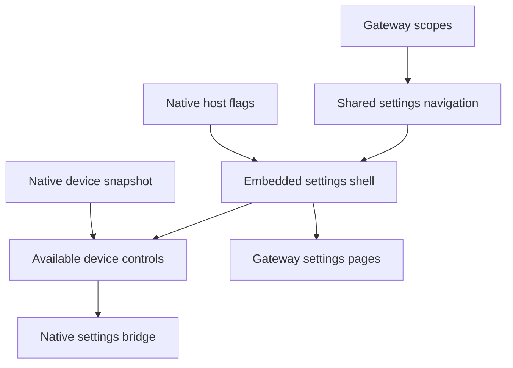

Codex review: blocked before merge. _Reviewed September 7, 2026, 6:03 AM ET / 10:03 UTC._

# ClawSweeper review

## What this changes

Adds embedded, phone-friendly Dashboard settings navigation and capability-driven iPhone and iPad device controls while retaining Mac support.

## Merge readiness

⛔ **Blocked before merge - 1 item remains**

This remains useful, distinct work absent from fetched main. The earlier Back-navigation blocker is resolved, and no actionable introduced defect was found. Maintainer authorship and the protected label also preclude cleanup closure.

**Priority:** P2
**Reviewed head:** `6cb7f2f9858254ee4f72951c6486fbc0acf17993`

## Review scores

| Measure | Result | What it means |
|---|---|---|
| **Overall readiness** | 🐚 platinum hermit **(4/6)** | A coherent implementation with focused compatibility and navigation coverage and no remaining actionable finding. |
| **Proof confidence** | 🌊 off-meta tidepool | Not applicable: The maintainer-authored PR is exempt from the external-contributor proof gate. Supplied browser evidence targets the actual settings shell and device renderer with synthetic Gateway/native fixtures; it does not establish native OS execution. Linked captures were unavailable for independent inspection. |
| **Patch quality** | 🐚 platinum hermit **(4/6)** | No actionable review findings were identified. |

## Verification

| Check | Result | Evidence |
|---|---|---|
| **Real behavior** | Not applicable | Not applicable: The maintainer-authored PR is exempt from the external-contributor proof gate. Supplied browser evidence targets the actual settings shell and device renderer with synthetic Gateway/native fixtures; it does not establish native OS execution. Linked captures were unavailable for independent inspection. |
| **Evidence reviewed** | 9 items | Pinned introduction and review continuity: Reviewed merge-base 66381fba99d081329c86e2e9ed2c9bd27d98799d through the pinned head. The supplied previous completed review used this same head and contained no findings; comparison against that revision is empty. Work remains absent from main: Fetched main still exposes only the previous native chrome flag, and its device snapshot accepts macOS only. These existing capabilities do not implement embedded settings or iOS snapshots. Latest release comparison: The supplied latest release revision also lacks the native embed capability; no released replacement for this work was established. |
| **Findings** | None | None. |
| **Security** | None | None. |

## How this fits together

The Control UI renders Gateway settings and native device settings in a shared interface. Native hosts provide presentation flags and device snapshots; edits continue through the existing Gateway or native bridge owners.

## Before merge

- [ ] **Resolve merge risk (P1)** - Linked visual captures could not be independently inspected in this environment.

<strong>Agent review details</strong>

### Security

None.

### PR surface

Source +1009, Tests +1093, Docs +21. Total +2123 across 50 files.

View PR surface stats

| Area | Files | Added | Removed | Net |
|---|---:|---:|---:|---:|
| Source | 34 | 1656 | 647 | +1009 |
| Tests | 14 | 1117 | 24 | +1093 |
| Docs | 2 | 23 | 2 | +21 |
| Config | 0 | 0 | 0 | 0 |
| Generated | 0 | 0 | 0 | 0 |
| Other | 0 | 0 | 0 | 0 |
| **Total** | **50** | **2796** | **673** | **+2123** |

### Review metrics

| Metric | Value | Why it matters |
|---|---|---|
| **Native bridge extension** | 8 setting keys, 4 permission IDs, and 4 panel IDs added; wire version remains 1 | The additions are capability-driven and preserve existing Mac messages without introducing a parallel bridge. |

### Merge-risk options

**Maintainer options:**
1. **Decide the mitigation before merge**  
   Keep one shared settings interface with capability-driven device controls and native-owned authorization, then integrate the companion hosts in the documented order.
2. **Pause or close**  
   Do not merge this PR until maintainers decide whether the risk is worth taking.

### Technical review

Best possible solution:

Keep one shared settings interface with capability-driven device controls and native-owned authorization, then integrate the companion hosts in the documented order.

Do we have a high-confidence way to reproduce the issue?

Not applicable as a feature proposal; source comparison establishes the missing embed and iOS capabilities, and the branch contains focused behavioral coverage.

Is this the best way to solve the issue?

Yes. Reusing the existing navigation and native bridge avoids competing settings implementations while preserving the existing Mac contract.

AGENTS.md: found and applied where relevant.

Codex review notes: model internal, reasoning medium; reviewed against [46c1576f82bb](https://github.com/openclaw/openclaw/commit/46c1576f82bbd629e28fc0b5c34631d53becb0ea).

### Labels

Label justifications:

- `P2`: This is a bounded settings usability and native integration improvement without an established urgent regression.
- `rating: 🐚 platinum hermit`: Overall readiness is 🐚 platinum hermit; proof is 🌊 off-meta tidepool and patch quality is 🐚 platinum hermit.
- `status: 👀 ready for maintainer look`: ClawSweeper has no concrete contributor-facing blocker left for this PR. Not applicable: The maintainer-authored PR is exempt from the external-contributor proof gate. Supplied browser evidence targets the actual settings shell and device renderer with synthetic Gateway/native fixtures; it does not establish native OS execution. Linked captures were unavailable for independent inspection.

### Evidence

What I checked:

- **Pinned introduction and review continuity:** Reviewed merge-base 66381fba99d081329c86e2e9ed2c9bd27d98799d through the pinned head. The supplied previous completed review used this same head and contained no findings; comparison against that revision is empty. ([`ui/src/app/app-shell-view.ts:169`](https://github.com/openclaw/openclaw/blob/6cb7f2f9858254ee4f72951c6486fbc0acf17993/ui/src/app/app-shell-view.ts#L169), [6cb7f2f98582](https://github.com/openclaw/openclaw/commit/6cb7f2f9858254ee4f72951c6486fbc0acf17993))
- **Work remains absent from main:** Fetched main still exposes only the previous native chrome flag, and its device snapshot accepts macOS only. These existing capabilities do not implement embedded settings or iOS snapshots. ([`ui/src/app/native-web-chrome.ts:8`](https://github.com/openclaw/openclaw/blob/46c1576f82bbd629e28fc0b5c34631d53becb0ea/ui/src/app/native-web-chrome.ts#L8), [46c1576f82bb](https://github.com/openclaw/openclaw/commit/46c1576f82bbd629e28fc0b5c34631d53becb0ea))
- **Latest release comparison:** The supplied latest release revision also lacks the native embed capability; no released replacement for this work was established. ([`ui/src/app/native-web-chrome.ts:8`](https://github.com/openclaw/openclaw/blob/3928bad9badfcb6c7d140530435e806fb8092190/ui/src/app/native-web-chrome.ts#L8), [3928bad9badf](https://github.com/openclaw/openclaw/commit/3928bad9badfcb6c7d140530435e806fb8092190))
- **Navigation repair and offline boundary:** Every embedded destination receives navigation content. Back uses app-owned history, with a replacement fallback for Memory import. Offline page actions remain inert at the router outlet while navigation stays usable. ([`ui/src/app/app-shell-view.ts:589`](https://github.com/openclaw/openclaw/blob/6cb7f2f9858254ee4f72951c6486fbc0acf17993/ui/src/app/app-shell-view.ts#L589), [6cb7f2f98582](https://github.com/openclaw/openclaw/commit/6cb7f2f9858254ee4f72951c6486fbc0acf17993))
- **Native contract and security boundary:** The snapshot validator accepts optional device families while checking supplied values. Existing Mac fields and message dispatch remain supported; the embed flag does not create a native bridge, grant Gateway scopes, or implement persistence. ([`ui/src/app/native-device-settings.ts:362`](https://github.com/openclaw/openclaw/blob/6cb7f2f9858254ee4f72951c6486fbc0acf17993/ui/src/app/native-device-settings.ts#L362), [6cb7f2f98582](https://github.com/openclaw/openclaw/commit/6cb7f2f9858254ee4f72951c6486fbc0acf17993))
- **Behavioral coverage and captured proof:** Inspected browser tests exercise linked and direct-entry Back navigation, offline navigation, normal-browser opt-in boundaries, iOS appearance request settlement, and Mac compatibility. The supplied body reports 192 focused unit tests and 16 browser tests at the pinned head, plus historical before/after images using synthetic fixtures. These are contributor-reported results, not locally executed verification. ([`ui/src/e2e/native-embed-settings.e2e.test.ts:59`](https://github.com/openclaw/openclaw/blob/6cb7f2f9858254ee4f72951c6486fbc0acf17993/ui/src/e2e/native-embed-settings.e2e.test.ts#L59), [6cb7f2f98582](https://github.com/openclaw/openclaw/commit/6cb7f2f9858254ee4f72951c6486fbc0acf17993))

Likely related people:

- **steipete:** Suggested for follow-up; no historical authorship or introduction is verified. (role: unverified routing candidate; confidence: low)

### Rating scale

| Score | Internal tier | Crab rank | Meaning |
|---:|:---:|---|---|
| **6/6** | S | 🦀 challenger crab | Exceptional readiness |
| **5/6** | A | 🦞 diamond lobster | Very strong readiness |
| **4/6** | B | 🐚 platinum hermit | Good normal PR; ordinary maintainer review |
| **3/6** | C | 🦐 gold shrimp | Useful, but confidence is limited |
| **2/6** | D | 🦪 silver shellfish | Proof or implementation needs work |
| **1/6** | F | 🧂 unranked krab | Not merge-ready |
| N/A | NA | 🌊 off-meta tidepool | Rating does not apply |

Overall follows the weaker of proof and patch quality.
Shiny media proof means a screenshot, video, or linked artifact directly shows the changed behavior. Runtime, network, CSP, and security claims still need visible diagnostics.

### Workflow

- ClawSweeper keeps one durable marker-backed review comment per issue or PR.
- Re-runs edit this comment so the latest verdict, findings, and automation markers stay together instead of adding duplicate bot comments.
- A fresh review can be triggered by eligible `@clawsweeper re-review` comments, exact-item GitHub events, scheduled/background review runs, or manual workflow dispatch.
- PR/issue authors and users with repository write access can comment `@clawsweeper re-review` or `@clawsweeper re-run` on an open PR or issue to request a fresh review only.
- Maintainers can also comment `@clawsweeper review` to request a fresh review only.
- Fresh-review commands do not start repair, autofix, rebase, CI repair, or automerge.
- Maintainer-only repair and merge flows require explicit commands such as `@clawsweeper autofix`, `@clawsweeper automerge`, `@clawsweeper fix ci`, or `@clawsweeper address review`.
- Maintainers can comment `@clawsweeper explain` to ask for more context, or `@clawsweeper stop` to stop active automation.

### History

Review history (6 earlier review cycles)

<!-- clawsweeper-review-history v=1 total=6 -->
- reviewed 2026-09-05T23:12:08.852Z sha 456e7a36cbc3ebfb629c9e0531e15118bd7370a7 :: blocked before merge. :: [P2] Preserve embedded Back navigation on linked destinations
- reviewed 2026-09-05T23:57:28.438Z sha ad2c9e511fba34503fa1fc160a82a343a6d5e9ec :: blocked before merge. :: [P2] Preserve embedded Back navigation on linked destinations
- reviewed 2026-09-06T01:14:25.606Z sha 56a4ebf9ea2d8105a17760f12c8f0f8203dcc4af :: blocked before merge. :: [P2] Preserve embedded Back navigation on linked destinations
- reviewed 2026-09-06T01:58:47.274Z sha fab313c51171581320927c7331bfd751e13c7117 :: blocked before merge. :: none
- reviewed 2026-09-06T02:05:40.046Z sha fab313c51171581320927c7331bfd751e13c7117 :: needs maintainer review before merge. :: none
- reviewed 2026-09-07T09:46:29.322Z sha 6cb7f2f9858254ee4f72951c6486fbc0acf17993 :: needs maintainer review before merge. :: none

<!-- clawsweeper-verdict:needs-human item=139492 sha=6cb7f2f9858254ee4f72951c6486fbc0acf17993 confidence=high updated_at=2026-09-07T10:00:50Z reviewed_at=2026-09-07T10:03:23.500Z lease_owner=github-run-34108825626-1 lease_comment_id=5568916381 source_revision=020a3f21d6794eb42be6f407cf0196ba7878e8231ad1b2bbddf9f26aa2a95845 live_verification=absent -->
<!-- clawsweeper-review-state:blocked item=139492 sha=6cb7f2f9858254ee4f72951c6486fbc0acf17993 v=1 -->

<!-- clawsweeper-review-version item=139492 reviewed_at=2026-09-07T10:03:23.500Z sha=6cb7f2f9858254ee4f72951c6486fbc0acf17993 source_revision=020a3f21d6794eb42be6f407cf0196ba7878e8231ad1b2bbddf9f26aa2a95845 lease_owner=github-run-34108825626-1 lease_comment_id=5568916381 v=1 -->

<!-- clawsweeper-review item=139492 -->