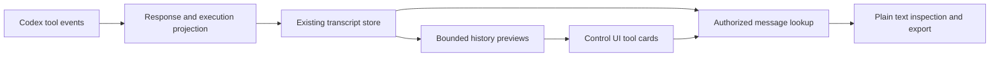

Codex review: needs maintainer review before merge. _Reviewed September 20, 2026, 8:34 AM ET / 12:34 UTC (Revision 5)._

# ClawSweeper review

## What this changes

Preserves complete available Codex tool responses in saved history and adds plain-text inspection, copying, downloading, and notices for incomplete captures.

## Merge readiness

✅ **Ready for maintainer review**

This repair remains necessary: current main and v2026.9.5 still truncate saved tool results. No blocking introduced defect was found, and the subsequent test changes preserve the previously reviewed production behavior.

**Priority:** P0
**Reviewed head:** `519428bdd7f1efd8561b9448b918b55f47db23f3`

## Review scores

| Measure | Result | What it means |
|---|---|---|
| **Overall readiness** | 🐚 platinum hermit **(4/6)** | A coherent producer-to-UI repair with relevant native, persistence, and browser evidence and no blocking finding. |
| **Proof confidence** | 🦞 diamond lobster **(5/6)** ✨ media proof bonus | Sufficient (linked_artifact): The captured body reports pinned Codex runs at full and truncated output budgets plus SQLite checkpoint/reopen verification; inspected before/after browser captures show the real inspector. Reported browser checks cover exact clipboard/download text and reload. Screenshots alone are not treated as persistence proof, and these runs were not repeated during this review. |
| **Patch quality** | 🐚 platinum hermit **(4/6)** | No actionable review findings were identified. |

## Verification

| Check | Result | Evidence |
|---|---|---|
| **Real behavior** | Verified | Sufficient (linked_artifact): The captured body reports pinned Codex runs at full and truncated output budgets plus SQLite checkpoint/reopen verification; inspected before/after browser captures show the real inspector. Reported browser checks cover exact clipboard/download text and reload. Screenshots alone are not treated as persistence proof, and these runs were not repeated during this review. |
| **Evidence reviewed** | 9 items | Current main still loses saved output: Current main calls truncateToolTranscriptText while creating the persisted tool-result message; increasing the upstream output budget cannot recover the discarded suffix. Latest release retains the same cap: The v2026.9.5 source also calls truncateToolTranscriptText in createToolResultMessage at line 701. This review establishes no released fix. Producer repair and dependency signal: The projector consumes Codex rawResponseItem/completed outputs, associates them by call ID, and waits for the response before checkpointing eligible results. The native fidelity test directly exercises pinned Codex 0.154.0, establishing that Codex’s protocol contract is relevant. |
| **Findings** | None | None. |
| **Security** | None | None. |

## How this fits together

The Codex plugin converts app-server tool events into OpenClaw’s saved conversation transcript. The Gateway supplies bounded history previews and authorized full-message reads, which the Control UI uses to inspect and export tool output.

## Before merge

None.

<strong>Agent review details</strong>

### Security

None.

### PR surface

Source +390, Tests +1499, Docs +29, Other -1. Total +1917 across 43 files.

View PR surface stats

| Area | Files | Added | Removed | Net |
|---|---:|---:|---:|---:|
| Source | 21 | 655 | 265 | +390 |
| Tests | 20 | 1586 | 87 | +1499 |
| Docs | 1 | 29 | 0 | +29 |
| Config | 0 | 0 | 0 | 0 |
| Generated | 0 | 0 | 0 | 0 |
| Other | 1 | 0 | 1 | -1 |
| **Total** | **43** | **2270** | **353** | **+1917** |

### Review metrics

| Metric | Value | Why it matters |
|---|---|---|
| **Production versus test growth** | Production net +390 lines; tests and test support net +1,499 lines | Production growth supplies the inspector and response-provenance handling; coverage spans native events, persistence, retrieval, and browser exports. |
| **Inspection budgets** | 8,000-character previews; 2,000,000-character tool inspection; ordinary detail default remains 500,000 | Large tool inspection uses the existing endpoint maximum without increasing ordinary detail requests. |

### Root-cause cluster

Relationship: `fixed_by_candidate`
Canonical: https://github.com/openclaw/openclaw/issues/153295
Summary: This PR is the explicit candidate repair for the paired open report of destructive saved-output truncation.

Members:
- `canonical`: https://github.com/openclaw/openclaw/issues/153295 - The report defines the same persistence loss and inspection requirements addressed by the branch.

Proposal only: this assessment does not dispatch repair, suppress jobs, mutate sibling items, close, or merge anything.

### Technical review

Best possible solution:

Keep complete available responses in the existing transcript store, with bounded previews and scoped plain-text retrieval that clearly identifies irrecoverable capture loss.

Do we have a high-confidence way to reproduce the issue?

Yes: current main applies the 10,000-character cap before persistence, and the supplied native reproduction uses a 34,766-character response. This review verified the source path without executing it.

Is this the best way to solve the issue?

Yes: repairing the transcript producer and reusing the existing authorized message lookup avoids a competing output store while preserving preview and transport limits.

AGENTS.md: found and applied where relevant.

Codex review notes: model internal, reasoning medium; reviewed against [8cd38b03ceb8](https://github.com/openclaw/openclaw/commit/8cd38b03ceb822718ab2e5e1693340f15df22b14).

### Labels

Label changes:

- remove `proof: 📸 screenshot`: Current real behavior proof evidence kind is linked_artifact.

Label justifications:

- `P0`: The existing producer irreversibly discards saved tool-output tails, making this a source-proven transcript data-loss repair.
- `rating: 🐚 platinum hermit`: Overall readiness is 🐚 platinum hermit; proof is 🦞 diamond lobster and patch quality is 🐚 platinum hermit.
- `status: 👀 ready for maintainer look`: ClawSweeper has no concrete contributor-facing blocker left for this PR. Sufficient (linked_artifact): The captured body reports pinned Codex runs at full and truncated output budgets plus SQLite checkpoint/reopen verification; inspected before/after browser captures show the real inspector. Reported browser checks cover exact clipboard/download text and reload. Screenshots alone are not treated as persistence proof, and these runs were not repeated during this review.
- `proof: sufficient`: Contributor real behavior proof is sufficient. The captured body reports pinned Codex runs at full and truncated output budgets plus SQLite checkpoint/reopen verification; inspected before/after browser captures show the real inspector. Reported browser checks cover exact clipboard/download text and reload. Screenshots alone are not treated as persistence proof, and these runs were not repeated during this review.

### Evidence

What I checked:

- **Current main still loses saved output:** Current main calls truncateToolTranscriptText while creating the persisted tool-result message; increasing the upstream output budget cannot recover the discarded suffix. ([`extensions/codex/src/app-server/event-projector-tool-transcript.ts:698`](https://github.com/openclaw/openclaw/blob/8cd38b03ceb822718ab2e5e1693340f15df22b14/extensions/codex/src/app-server/event-projector-tool-transcript.ts#L698), [8cd38b03ceb8](https://github.com/openclaw/openclaw/commit/8cd38b03ceb822718ab2e5e1693340f15df22b14))
- **Latest release retains the same cap:** The v2026.9.5 source also calls truncateToolTranscriptText in createToolResultMessage at line 701. This review establishes no released fix. ([`extensions/codex/src/app-server/event-projector-tool-transcript.ts:701`](https://github.com/openclaw/openclaw/blob/ec9c1a13db8938e5a3eaa51fca2e981cde2395a9/extensions/codex/src/app-server/event-projector-tool-transcript.ts#L701), [ec9c1a13db89](https://github.com/openclaw/openclaw/commit/ec9c1a13db8938e5a3eaa51fca2e981cde2395a9))
- **Producer repair and dependency signal:** The projector consumes Codex rawResponseItem/completed outputs, associates them by call ID, and waits for the response before checkpointing eligible results. The native fidelity test directly exercises pinned Codex 0.154.0, establishing that Codex’s protocol contract is relevant. ([`extensions/codex/src/app-server/event-projector-tool-transcript.ts:227`](https://github.com/openclaw/openclaw/blob/519428bdd7f1efd8561b9448b918b55f47db23f3/extensions/codex/src/app-server/event-projector-tool-transcript.ts#L227), [519428bdd7f1](https://github.com/openclaw/openclaw/commit/519428bdd7f1efd8561b9448b918b55f47db23f3))
- **Pinned dependency contract inspected:** The sibling checkout is tagged rust-v0.154.0; its backing repository remote identifies openai/codex. History processing clones response items and can truncate function/custom-tool output separately, supporting the PR’s explicit refusal to claim universal final-model-input fidelity. ([`codex-rs/core/src/context_manager/history.rs:359`](https://github.com/openai/codex/blob/6b9826e3aa83b1a5947db50f4332cb9c65f1b340/codex-rs/core/src/context_manager/history.rs#L359), [6b9826e3aa83](https://github.com/openai/codex/commit/6b9826e3aa83b1a5947db50f4332cb9c65f1b340))
- **Inspection preserves existing access controls:** Full-output inspection reuses chat.message.get, including its post-await session identity and sharing checks, display redaction, and the introduced serialized-payload bound. The UI matches the requested tool-call ID and rejects stale selection or connection responses. ([`src/gateway/server-methods/chat-message-get-handler.ts:214`](https://github.com/openclaw/openclaw/blob/519428bdd7f1efd8561b9448b918b55f47db23f3/src/gateway/server-methods/chat-message-get-handler.ts#L214), [519428bdd7f1](https://github.com/openclaw/openclaw/commit/519428bdd7f1efd8561b9448b918b55f47db23f3))
- **Persistence and compatibility coverage:** The inspected tests exercise real SQLite close/reopen, exact text retrieval, bounded previews, legacy records without new metadata, private-field removal, and oversized responses. The PR reports successful native and SQLite runs; no tests were executed during this read-only review. ([`src/gateway/server-methods/chat-message-get-handler.test.ts:108`](https://github.com/openclaw/openclaw/blob/519428bdd7f1efd8561b9448b918b55f47db23f3/src/gateway/server-methods/chat-message-get-handler.test.ts#L108), [519428bdd7f1](https://github.com/openclaw/openclaw/commit/519428bdd7f1efd8561b9448b918b55f47db23f3))

Likely related people:

- **steipete:** Suggested for follow-up; no historical authorship or introduction is verified. (role: unverified routing candidate; confidence: low)
- **fuller-stack-dev:** Suggested for follow-up; no historical authorship or introduction is verified. (role: unverified routing candidate; confidence: low)

### Rating scale

| Score | Internal tier | Crab rank | Meaning |
|---:|:---:|---|---|
| **6/6** | S | 🦀 challenger crab | Exceptional readiness |
| **5/6** | A | 🦞 diamond lobster | Very strong readiness |
| **4/6** | B | 🐚 platinum hermit | Good normal PR; ordinary maintainer review |
| **3/6** | C | 🦐 gold shrimp | Useful, but confidence is limited |
| **2/6** | D | 🦪 silver shellfish | Proof or implementation needs work |
| **1/6** | F | 🧂 unranked krab | Not merge-ready |
| N/A | NA | 🌊 off-meta tidepool | Rating does not apply |

Overall follows the weaker of proof and patch quality.
Shiny media proof means a screenshot, video, or linked artifact directly shows the changed behavior. Runtime, network, CSP, and security claims still need visible diagnostics.

### Workflow

- ClawSweeper keeps one durable marker-backed review comment per issue or PR.
- Re-runs edit this comment so the latest verdict, findings, and automation markers stay together instead of adding duplicate bot comments.
- A fresh review can be triggered by eligible `@clawsweeper re-review` comments, exact-item GitHub events, scheduled/background review runs, or manual workflow dispatch.
- PR/issue authors and users with repository write access can comment `@clawsweeper re-review` or `@clawsweeper re-run` on an open PR or issue to request a fresh review only.
- Maintainers can also comment `@clawsweeper review` to request a fresh review only.
- Fresh-review commands do not start repair, autofix, rebase, CI repair, or automerge.
- Maintainer-only repair and merge flows require explicit commands such as `@clawsweeper autofix`, `@clawsweeper automerge`, `@clawsweeper fix ci`, or `@clawsweeper address review`.
- Maintainers can comment `@clawsweeper explain` to ask for more context, or `@clawsweeper stop` to stop active automation.

### History

Review history (4 earlier review cycles)

<!-- clawsweeper-review-history v=1 total=4 -->
- reviewed 2026-09-20T07:43:11.367Z sha 1fc393555e2d2a7319eebce5a284a6789a3e7bda :: blocked before merge. :: none
- reviewed 2026-09-20T11:32:03.645Z sha 1fc393555e2d2a7319eebce5a284a6789a3e7bda :: blocked before merge. :: none
- reviewed 2026-09-20T11:52:42.112Z sha d54734514ef41420f3dd4c6008494dfc08a6c9d1 :: needs maintainer review before merge. :: none
- reviewed 2026-09-20T12:08:36.729Z sha c7d8f7f3669e74086c7976ca29b77ad5dfd38bc7 :: needs maintainer review before merge. :: none

<!-- clawsweeper-verdict:needs-human item=153542 sha=519428bdd7f1efd8561b9448b918b55f47db23f3 confidence=high updated_at=2026-09-20T12:30:53Z reviewed_at=2026-09-20T12:34:40.003Z lease_owner=github-run-35510742095-1 lease_comment_id=5749809599 source_revision=d2b964a6270b9d207113f56d61cd6bd8801ce601578bb0ebe6bec39248dcb317 live_verification=absent -->
<!-- clawsweeper-review-state:ready item=153542 sha=519428bdd7f1efd8561b9448b918b55f47db23f3 v=1 -->

<!-- clawsweeper-review-version item=153542 reviewed_at=2026-09-20T12:34:40.003Z sha=519428bdd7f1efd8561b9448b918b55f47db23f3 source_revision=d2b964a6270b9d207113f56d61cd6bd8801ce601578bb0ebe6bec39248dcb317 lease_owner=github-run-35510742095-1 lease_comment_id=5749809599 v=1 -->

<!-- clawsweeper-review item=153542 -->