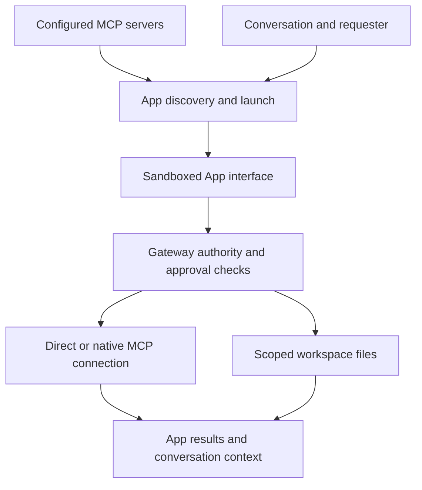

Codex review: blocked before merge. _Reviewed October 2, 2026, 7:45 AM ET / 11:45 UTC (Revision 10)._

# ClawSweeper review

## What this changes

Extends the opt-in MCP Apps host with direct launch, server settings, conversation attachments, workspace file editing, rich forms, and existing native Codex connections.

## Merge readiness

⛔ **Blocked before merge - 6 items remain**

Keep open: this is maintainer-sponsored work that current main does not replace. One resource-metadata forwarding defect remains; earlier authority and installed-client findings are repaired.

**Priority:** P2
**Reviewed head:** `cead410702da6ed8bb6da7fea191ad8f349c34f3`

## Review scores

| Measure | Result | What it means |
|---|---|---|
| **Overall readiness** | 🦐 gold shrimp **(3/6)** | Strong real MCP evidence supports the feature, while a definite metadata-forwarding defect and remaining client compatibility confirmation prevent a merge-ready rating. |
| **Proof confidence** | 🦞 diamond lobster **(5/6)** | Sufficient (live_output): Recorded real Gateway/Control UI runs exercise the changed direct and native App owners with Bits & Bolts 0.1.11, observing settings readback, conflict-aware file saves, view survival, and rich-form results. Production-adapter/client traces also cover revoked-owner and revoked-grant rejection before retry I/O. Preserve that sufficient evidence; Apple and Telegram confirmation remain separate scoped compatibility gates. Prepared media contained unrelated icon images, and this PR’s attachment fetches failed reviewer-side. No new durable Gateway data model was identified. |
| **Patch quality** | 🦐 gold shrimp **(3/6)** | 1 actionable review finding remain. |

## Verification

| Check | Result | Evidence |
|---|---|---|
| **Real behavior** | Verified | Sufficient (live_output): Recorded real Gateway/Control UI runs exercise the changed direct and native App owners with Bits & Bolts 0.1.11, observing settings readback, conflict-aware file saves, view survival, and rich-form results. Production-adapter/client traces also cover revoked-owner and revoked-grant rejection before retry I/O. Preserve that sufficient evidence; Apple and Telegram confirmation remain separate scoped compatibility gates. Prepared media contained unrelated icon images, and this PR’s attachment fetches failed reviewer-side. No new durable Gateway data model was identified. |
| **Evidence reviewed** | 11 items | Pinned introduction and review continuity: Inspected introduced hunks from ee578bc73257aa228561c350417b96010dec87fa to cead410702da6ed8bb6da7fea191ad8f349c34f3. The targeted comparison against the previous reviewed head is empty for the resource RPC and operation owner, establishing that the newly identified forwarding defect was equally visible then. Resource metadata is dropped: The new RPC accepts resource _meta and the browser bridge forwards it, but executeMcpAppOperation calls runtime.readResource with only server and URI. The direct adapter forwards metadata when supplied; the native adapter explicitly rejects unsupported metadata. Neither behavior is reached through this RPC. Documented representation contract: The added SDK documentation explicitly promises forwarding resource metadata for managed clients and a visible unsupported-representation error for native remote reads. |
| **Findings** | 1 actionable finding | [P2] [P2] Forward resource metadata to the selected MCP runtime |
| **Security** | None | None. |

## How this fits together

MCP Apps display interactive interfaces supplied by configured tool servers. The Gateway binds their requests to conversation, requester, approval, and workspace authority before forwarding them to direct MCP transports or the conversation’s native Codex connection.

## Before merge

- [ ] **\[P2\] Forward resource metadata to the selected MCP runtime (P2)** - The new bridge and RPC accept resource `_meta`, but `executeMcpAppOperation` still calls `runtime.readResource(server, uri)` without its options. An App requesting a metadata-selected representation therefore gets the server’s default representation on direct MCP connections; native requests also bypass the adapter’s explicit unsupported-metadata error. Forward the metadata through the common operation owner and cover both outcomes at the RPC boundary. This was equally visible at the previous reviewed head; this finding is a late discovery.
- [ ] **Resolve merge risk (P1)** - Apple question-control compatibility remains unverified at runtime for canonical choices, defaults, optional clearing, and multiline submission.
- [ ] **Resolve merge risk (P1)** - Telegram’s changed canonical-choice resolution and label-based terminal feedback still lack the required Test Server userbot confirmation.
- [ ] **Complete next step (P2)** - Repair resource-metadata forwarding and record the outstanding Apple-client and Telegram Test Server compatibility results.
- [ ] **Review config compatibility** - Confirm compatibility and upgrade impact for the changed config or default surface before merge.
- [ ] **Add data-model compatibility proof** - Confirm migration or upgrade compatibility proof before merge.

## Findings

- [P2] [P2] Forward resource metadata to the selected MCP runtime — `src/gateway/server-methods/mcp-app.ts:424-428`

<strong>Agent review details</strong>

### Security

None.

### PR surface

PR surface statistics unavailable: the file list is incomplete.

### Review metrics

| Metric | Value | Why it matters |
|---|---|---|
| **Production versus regression coverage growth** | production/tooling +9,477 lines; tests/support +6,421 lines | The substantial production growth is justified in the PR by the expanded interactive App workflows and reuse of existing owners. |

### Stored data model

Persistent data-model change detected: `unknown-truncated-pull-files`. Confirm migration or upgrade compatibility proof before merge.

### Merge-risk options

**Maintainer options:**
1. **Complete client compatibility confirmation (recommended)**  
   Record the Apple question-control run and Telegram Test Server answer round trip before landing the changed shared question contract.

### Technical review

Best possible solution:

Preserve the existing transport and authority owners while carrying resource metadata end to end and confirming consistent question answers across native and channel clients.

Do we have a high-confidence way to reproduce the issue?

Yes, for the identified patch defect: an App resource read with nonempty _meta reaches the RPC but loses that metadata before runtime dispatch. This is source-proven on the pinned PR head; no code was executed.

Is this the best way to solve the issue?

The existing-owner approach fits the sponsored feature, but the implementation is incomplete: forwarding resource metadata through the common operation owner is the narrow repair.

Full review comments:

- [P2] [P2] Forward resource metadata to the selected MCP runtime — `src/gateway/server-methods/mcp-app.ts:424-428`
  The new bridge and RPC accept resource `_meta`, but `executeMcpAppOperation` still calls `runtime.readResource(server, uri)` without its options. An App requesting a metadata-selected representation therefore gets the server’s default representation on direct MCP connections; native requests also bypass the adapter’s explicit unsupported-metadata error. Forward the metadata through the common operation owner and cover both outcomes at the RPC boundary. This was equally visible at the previous reviewed head; this finding is a late discovery.
  Confidence: 0.99
  Late finding: first raised on code an earlier review cycle already covered.

Overall correctness: patch is incorrect
Overall confidence: 0.94

AGENTS.md: found and applied where relevant.

Codex review notes: model internal, reasoning medium; reviewed against [ca7b5d41b338](https://github.com/openclaw/openclaw/commit/ca7b5d41b3389beb6fb860a1dcdd7351e72028cc).

### Labels

Label changes:

- add `rating: 🦐 gold shrimp`: Overall readiness is 🦐 gold shrimp; proof is 🦞 diamond lobster and patch quality is 🦐 gold shrimp.
- add `status: ⏳ waiting on author`: ClawSweeper has contributor-facing work open and is waiting for author action. Sufficient (live_output): Recorded real Gateway/Control UI runs exercise the changed direct and native App owners with Bits & Bolts 0.1.11, observing settings readback, conflict-aware file saves, view survival, and rich-form results. Production-adapter/client traces also cover revoked-owner and revoked-grant rejection before retry I/O. Preserve that sufficient evidence; Apple and Telegram confirmation remain separate scoped compatibility gates. Prepared media contained unrelated icon images, and this PR’s attachment fetches failed reviewer-side. No new durable Gateway data model was identified.
- remove `rating: 🐚 platinum hermit`: Current PR rating is `rating: 🦐 gold shrimp`, so this older rating label is no longer current.
- remove `status: 👀 ready for maintainer look`: Current PR status label is `status: ⏳ waiting on author`.
- remove `merge-risk: 🚨 other`: Current PR review merge-risk labels are `merge-risk: 🚨 compatibility`.

Label justifications:

- `P2`: This is an opt-in capability expansion with a bounded resource-forwarding defect rather than an urgent default-workflow regression.
- `merge-risk: 🚨 compatibility`: The shared question contract changes canonical answers across native and channel clients whose runtime compatibility confirmation remains incomplete.
- `rating: 🦐 gold shrimp`: Overall readiness is 🦐 gold shrimp; proof is 🦞 diamond lobster and patch quality is 🦐 gold shrimp.
- `status: ⏳ waiting on author`: ClawSweeper has contributor-facing work open and is waiting for author action. Sufficient (live_output): Recorded real Gateway/Control UI runs exercise the changed direct and native App owners with Bits & Bolts 0.1.11, observing settings readback, conflict-aware file saves, view survival, and rich-form results. Production-adapter/client traces also cover revoked-owner and revoked-grant rejection before retry I/O. Preserve that sufficient evidence; Apple and Telegram confirmation remain separate scoped compatibility gates. Prepared media contained unrelated icon images, and this PR’s attachment fetches failed reviewer-side. No new durable Gateway data model was identified.
- `proof: sufficient`: Contributor real behavior proof is sufficient. Recorded real Gateway/Control UI runs exercise the changed direct and native App owners with Bits & Bolts 0.1.11, observing settings readback, conflict-aware file saves, view survival, and rich-form results. Production-adapter/client traces also cover revoked-owner and revoked-grant rejection before retry I/O. Preserve that sufficient evidence; Apple and Telegram confirmation remain separate scoped compatibility gates. Prepared media contained unrelated icon images, and this PR’s attachment fetches failed reviewer-side. No new durable Gateway data model was identified.
- `proof: telegram-e2e`: This PR needs Telegram Test Server proof with the repository E2E skill. Shared question changes affect Telegram button answer values and visible terminal labels, which require Test Server userbot confirmation.

### Evidence

Acceptance criteria:

- [P1] pnpm test src/gateway/server-methods/mcp-app.test.ts extensions/codex/src/app-server/native-mcp-app.test.ts --maxWorkers=1.
- [P1] pnpm test src/agents/agent-bundle-mcp-runtime.test.ts --maxWorkers=1.
- [P1] git diff --check.

What I checked:

- **Pinned introduction and review continuity:** Inspected introduced hunks from ee578bc73257aa228561c350417b96010dec87fa to cead410702da6ed8bb6da7fea191ad8f349c34f3. The targeted comparison against the previous reviewed head is empty for the resource RPC and operation owner, establishing that the newly identified forwarding defect was equally visible then. ([`src/gateway/server-methods/mcp-app.ts:428`](https://github.com/openclaw/openclaw/blob/cead410702da6ed8bb6da7fea191ad8f349c34f3/src/gateway/server-methods/mcp-app.ts#L428), [cead410702da](https://github.com/openclaw/openclaw/commit/cead410702da6ed8bb6da7fea191ad8f349c34f3))
- **Resource metadata is dropped:** The new RPC accepts resource _meta and the browser bridge forwards it, but executeMcpAppOperation calls runtime.readResource with only server and URI. The direct adapter forwards metadata when supplied; the native adapter explicitly rejects unsupported metadata. Neither behavior is reached through this RPC. ([`src/gateway/mcp-app-operations.ts:526`](https://github.com/openclaw/openclaw/blob/cead410702da6ed8bb6da7fea191ad8f349c34f3/src/gateway/mcp-app-operations.ts#L526), [cead410702da](https://github.com/openclaw/openclaw/commit/cead410702da6ed8bb6da7fea191ad8f349c34f3))
- **Documented representation contract:** The added SDK documentation explicitly promises forwarding resource metadata for managed clients and a visible unsupported-representation error for native remote reads. Public docs: [`docs/plugins/sdk-entrypoints.md`](https://docs.openclaw.ai/plugins/sdk-entrypoints). ([`docs/plugins/sdk-entrypoints.md:99`](https://docs.openclaw.ai/plugins/sdk-entrypoints), [cead410702da](https://github.com/openclaw/openclaw/commit/cead410702da6ed8bb6da7fea191ad8f349c34f3))
- **Applicable native dependency contract:** The patch calls Codex mcpServer/resource/read and claims compatibility with its protocol. Personally inspected McpResourceReadParams, which has thread, origin, server, URI, connector, and target fields but no _meta. Repository ownership was verified through the backing cache’s canonical https://github.com/openai/codex.git remote. ([`codex-rs/app-server-protocol/src/protocol/v2/mcp.rs:112`](https://github.com/openai/codex/blob/8e68a98ef03cdde76d2e6800791ebdf1b3b95b24/codex-rs/app-server-protocol/src/protocol/v2/mcp.rs#L112), [8e68a98ef03c](https://github.com/openai/codex/commit/8e68a98ef03cdde76d2e6800791ebdf1b3b95b24))
- **Prior native authority finding repaired:** Native tool calls compose owner and per-call assertions into the production client’s final pre-write guard, including retries. The seven-case boundary regression records rejection before retry writes after owner or grant revocation, alongside authorized controls. ([`extensions/codex/src/app-server/native-mcp-app.ts:239`](https://github.com/openclaw/openclaw/blob/cead410702da6ed8bb6da7fea191ad8f349c34f3/extensions/codex/src/app-server/native-mcp-app.ts#L239), [cead410702da](https://github.com/openclaw/openclaw/commit/cead410702da6ed8bb6da7fea191ad8f349c34f3))
- **Recorded real MCP proof and captured body:** The captured body, SHA-256 f2590fc3daa6ac03553c0820dd39a07954721ddda564526a7ff9a64338d68e07, and disposition comment describe credential-free real Gateway/Control UI acceptance with Bits & Bolts 0.1.11 through direct and native transports, including settings readback, file conflicts, mounted-view survival, and canonical rich-form answers. The full REST body fills the supplied omitted ending without introducing Apple or Telegram runtime proof. ([cead410702da](https://github.com/openclaw/openclaw/commit/cead410702da6ed8bb6da7fea191ad8f349c34f3))

Likely related people:

- **steipete:** Suggested for follow-up; no historical authorship or introduction is verified. (role: unverified routing candidate; confidence: low)
- **Josh Avant:** Suggested for follow-up; no historical authorship or introduction is verified. (role: unverified routing candidate; confidence: low)

### Rank-up moves

Optional improvements that raise the rating; they are not merge blockers.

- Forward resource _meta through the common operation owner and verify direct forwarding plus native rejection.
- Record Apple-client question behavior and Telegram Test Server canonical-choice and terminal-label confirmation.

### Rating scale

| Score | Internal tier | Crab rank | Meaning |
|---:|:---:|---|---|
| **6/6** | S | 🦀 challenger crab | Exceptional readiness |
| **5/6** | A | 🦞 diamond lobster | Very strong readiness |
| **4/6** | B | 🐚 platinum hermit | Good normal PR; ordinary maintainer review |
| **3/6** | C | 🦐 gold shrimp | Useful, but confidence is limited |
| **2/6** | D | 🦪 silver shellfish | Proof or implementation needs work |
| **1/6** | F | 🧂 unranked krab | Not merge-ready |
| N/A | NA | 🌊 off-meta tidepool | Rating does not apply |

Overall follows the weaker of proof and patch quality.
Shiny media proof means a screenshot, video, or linked artifact directly shows the changed behavior. Runtime, network, CSP, and security claims still need visible diagnostics.

### Workflow

- ClawSweeper keeps one durable marker-backed review comment per issue or PR.
- Re-runs edit this comment so the latest verdict, findings, and automation markers stay together instead of adding duplicate bot comments.
- A fresh review can be triggered by eligible `@clawsweeper re-review` comments, exact-item GitHub events, scheduled/background review runs, or manual workflow dispatch.
- PR/issue authors and users with repository write access can comment `@clawsweeper re-review` or `@clawsweeper re-run` on an open PR or issue to request a fresh review only.
- Maintainers can also comment `@clawsweeper review` to request a fresh review only.
- Fresh-review commands do not start repair, autofix, rebase, CI repair, or automerge.
- Maintainer-only repair and merge flows require explicit commands such as `@clawsweeper autofix`, `@clawsweeper automerge`, `@clawsweeper fix ci`, or `@clawsweeper address review`.
- Maintainers can comment `@clawsweeper explain` to ask for more context, or `@clawsweeper stop` to stop active automation.

### History

Review history (9 earlier review cycles; latest 8 shown)

<!-- clawsweeper-review-history v=1 total=9 -->
- reviewed 2026-09-30T08:28:17.318Z sha ad3361f3207fca391129e8b5a6f2f7b4236d7230 :: needs real behavior proof before merge. :: [P1] Recheck App authority before every native tool-call write
- reviewed 2026-09-30T10:51:34.091Z sha 3b39f64aeb77b0d90f3074d0d07bf94c45120d3b :: needs real behavior proof before merge. :: [P1] Recheck App authority before every native tool-call write
- reviewed 2026-09-30T11:36:25.186Z sha 0761176c94d98a53c78d02e1a1ca7c059cbd8522 :: needs real behavior proof before merge. :: [P1] Recheck App authority before every native tool-call write
- reviewed 2026-09-30T11:50:40.247Z sha b5327cb954b2c5f1ff0a841713c597dbf7ffc98e :: blocked before merge. :: none
- reviewed 2026-09-30T12:45:32.073Z sha b5327cb954b2c5f1ff0a841713c597dbf7ffc98e :: blocked before merge. :: none
- reviewed 2026-09-30T13:37:03.591Z sha b5327cb954b2c5f1ff0a841713c597dbf7ffc98e :: blocked before merge. :: [P1] Preserve answers from installed mobile clients for rich forms
- reviewed 2026-10-02T09:25:25.776Z sha ea579b54c6fff718d7a3a7f4a458fc56ca2283c0 :: blocked before merge. :: none
- reviewed 2026-10-02T10:36:45.577Z sha 83a6c94514a1c7c950dadedd144d50aced8767c8 :: blocked before merge. :: none

<!-- clawsweeper-verdict:needs-human item=161747 sha=cead410702da6ed8bb6da7fea191ad8f349c34f3 confidence=high updated_at=2026-10-02T11:41:15Z reviewed_at=2026-10-02T11:45:46.044Z lease_owner=github-run-37002263835-1 lease_comment_id=5951598182 source_revision=baf2dde6efea20dfdd7ce30e6456031cd85ff51a0eba58dbe373ea7a4f04aea6 live_verification=absent -->
<!-- clawsweeper-review-state:blocked item=161747 sha=cead410702da6ed8bb6da7fea191ad8f349c34f3 v=1 -->

<!-- clawsweeper-review-version item=161747 reviewed_at=2026-10-02T11:45:46.044Z sha=cead410702da6ed8bb6da7fea191ad8f349c34f3 source_revision=baf2dde6efea20dfdd7ce30e6456031cd85ff51a0eba58dbe373ea7a4f04aea6 lease_owner=github-run-37002263835-1 lease_comment_id=5951598182 v=1 -->

<!-- clawsweeper-review item=161747 -->