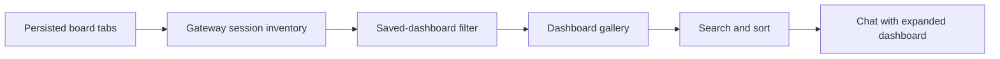

Codex review: blocked before merge. _Reviewed September 3, 2026, 5:44 AM ET / 09:44 UTC._

# ClawSweeper review

## What this changes

The PR turns Dashboards into a searchable task gallery backed by saved board inventory and routes each gallery card to its chat with the dashboard panel expanded.

## Merge readiness

⛔ **Blocked before merge - 4 items remain**

Keep open for explicit maintainer product direction: the patch is coherent and no introduced correctness defect was found, but it deliberately changes the default dashboard navigation model.

**Priority:** P2
**Reviewed head:** `2dd176dd1a908ad4891619b0d1b81f96d45490cf`
**Owner decision:** Required. See [Decision needed](#decision-needed).

## Review scores

| Measure | Result | What it means |
|---|---|---|
| **Overall readiness** | 🐚 platinum hermit **(4/6)** | The focused implementation and visible gallery proof are solid, with final landing dependent on maintainer direction for the default UI change. |
| **Proof confidence** | 🐚 platinum hermit **(4/6)** | Not applicable: Prepared real-browser screenshots visibly demonstrate the gallery layout; the repository-member contributor proof gate does not require further contributor action, while the maintainer product decision remains separate. |
| **Patch quality** | 🐚 platinum hermit **(4/6)** | No actionable review findings were identified. |

## Verification

| Check | Result | Evidence |
|---|---|---|
| **Real behavior** | Not applicable | Not applicable: Prepared real-browser screenshots visibly demonstrate the gallery layout; the repository-member contributor proof gate does not require further contributor action, while the maintainer product decision remains separate. |
| **Evidence reviewed** | 6 items | Additive session-list contract: The protocol adds an optional boolean saved-board filter, preserving existing requests that omit it. Board inventory owner boundary: The Gateway derives inventory from persisted board tabs, keeps durable and incognito stores distinct, and applies visibility plus board filtering before session rows are listed. Complete gallery enumeration: The dashboard page requests saved-board sessions and completes paginated results behind a generation fence before client-side filtering and sorting. |
| **Findings** | None | None. |
| **Security** | None | None. |

## How this fits together

The Gateway exposes sessions that have persisted board content, and the Control UI collects that inventory into a gallery. Selecting a card opens the corresponding chat session and its dashboard panel.

## Decision needed

| Question | Recommendation |
|---|---|
| Should Dashboards become a default sidebar gallery that opens the owning chat with its dashboard panel expanded? | **Approve gallery direction:** Adopt the gallery and chat-panel navigation as the new default dashboard workflow. |

Why: This PR deliberately changes the default Control UI navigation model rather than repairing a defined broken contract.

## Before merge

- [ ] **Resolve merge risk (P1)** - Current-main blobs needed for a full post-base comparison could not be hydrated from the partial checkout, so the review cannot independently rule out intervening main-branch interaction changes.
- [ ] **Complete next step (P2)** - Obtain maintainer confirmation for the default sidebar/gallery direction.
- [ ] **Resolve review confidence** - ClawSweeper must reach high confidence before merge readiness is known.
- [ ] **Resolve maintainer decision** - Resolve the maintainer decision shown above before merge.

<strong>Agent review details</strong>

### Security

None.

### PR surface

Source +840, Tests +398, Docs -7, Other +38. Total +1269 across 39 files.

View PR surface stats

| Area | Files | Added | Removed | Net |
|---|---:|---:|---:|---:|
| Source | 16 | 913 | 73 | +840 |
| Tests | 19 | 446 | 48 | +398 |
| Docs | 2 | 62 | 69 | -7 |
| Config | 0 | 0 | 0 | 0 |
| Generated | 0 | 0 | 0 | 0 |
| Other | 2 | 38 | 0 | +38 |
| **Total** | **39** | **1459** | **190** | **+1269** |

### Review metrics

| Metric | Value | Why it matters |
|---|---|---|
| **Production and test delta** | production +912/-72; tests +445/-47 | The new gallery and Gateway inventory are feature-scope growth rather than a bug-fix addition. |

### Merge-risk options

**Maintainer options:**
1. **Decide the mitigation before merge**  
   Land the stacked gallery only after a maintainer confirms the default dashboard-navigation direction.
2. **Pause or close**  
   Do not merge this PR until maintainers decide whether the risk is worth taking.

### Technical review

Best possible solution:

Land the stacked gallery only after a maintainer confirms the default dashboard-navigation direction.

Do we have a high-confidence way to reproduce the issue?

Not applicable: this is a feature PR, and its focused browser evidence demonstrates the new gallery layout rather than a reported failing behavior.

Is this the best way to solve the issue?

Yes, subject to maintainer product confirmation: the implementation uses persisted board state at the Gateway owner boundary and opens the existing chat route rather than creating a second dashboard state.

AGENTS.md: found and applied where relevant.

Codex review notes: model internal, reasoning high; reviewed against [88dc7fe56220](https://github.com/openclaw/openclaw/commit/88dc7fe56220ce97116d9cfcb817eaea1f324926).

### Labels

Label changes:

- add `rating: 🐚 platinum hermit`: Overall readiness is 🐚 platinum hermit; proof is 🐚 platinum hermit and patch quality is 🐚 platinum hermit.
- add `status: 👀 ready for maintainer look`: ClawSweeper has no concrete contributor-facing blocker left for this PR. Not applicable: Prepared real-browser screenshots visibly demonstrate the gallery layout; the repository-member contributor proof gate does not require further contributor action, while the maintainer product decision remains separate.
- remove `rating: 🦐 gold shrimp`: Current PR rating is `rating: 🐚 platinum hermit`, so this older rating label is no longer current.
- remove `status: ⏳ waiting on author`: Current PR status label is `status: 👀 ready for maintainer look`.

Label justifications:

- `P2`: This is a bounded Control UI feature change with normal, non-emergency user impact.
- `rating: 🐚 platinum hermit`: Overall readiness is 🐚 platinum hermit; proof is 🐚 platinum hermit and patch quality is 🐚 platinum hermit.
- `status: 👀 ready for maintainer look`: ClawSweeper has no concrete contributor-facing blocker left for this PR. Not applicable: Prepared real-browser screenshots visibly demonstrate the gallery layout; the repository-member contributor proof gate does not require further contributor action, while the maintainer product decision remains separate.
- `proof: 📸 screenshot`: Contributor real behavior proof includes screenshot evidence. Prepared real-browser screenshots visibly demonstrate the gallery layout; the repository-member contributor proof gate does not require further contributor action, while the maintainer product decision remains separate.

### Evidence

Acceptance criteria:

- [P1] pnpm ui:i18n:baseline.
- [P1] pnpm exec vitest run ui/src/app-navigation.test.ts ui/src/pages/dashboards/view.test.ts.

What I checked:

- **Additive session-list contract:** The protocol adds an optional boolean saved-board filter, preserving existing requests that omit it. ([`packages/gateway-protocol/src/schema/sessions-list.ts:30`](https://github.com/openclaw/openclaw/blob/2dd176dd1a908ad4891619b0d1b81f96d45490cf/packages/gateway-protocol/src/schema/sessions-list.ts#L30), [2dd176dd1a90](https://github.com/openclaw/openclaw/commit/2dd176dd1a908ad4891619b0d1b81f96d45490cf))
- **Board inventory owner boundary:** The Gateway derives inventory from persisted board tabs, keeps durable and incognito stores distinct, and applies visibility plus board filtering before session rows are listed. ([`src/gateway/server-methods/sessions-board-inventory.ts:62`](https://github.com/openclaw/openclaw/blob/2dd176dd1a908ad4891619b0d1b81f96d45490cf/src/gateway/server-methods/sessions-board-inventory.ts#L62), [2dd176dd1a90](https://github.com/openclaw/openclaw/commit/2dd176dd1a908ad4891619b0d1b81f96d45490cf))
- **Complete gallery enumeration:** The dashboard page requests saved-board sessions and completes paginated results behind a generation fence before client-side filtering and sorting. ([`ui/src/pages/dashboards/dashboards-page.ts:101`](https://github.com/openclaw/openclaw/blob/2dd176dd1a908ad4891619b0d1b81f96d45490cf/ui/src/pages/dashboards/dashboards-page.ts#L101), [2dd176dd1a90](https://github.com/openclaw/openclaw/commit/2dd176dd1a908ad4891619b0d1b81f96d45490cf))
- **Qualified-session navigation contract:** The shared URL contract extracts an agent from qualified session keys before falling back to the selected agent, so gallery navigation preserves the owning agent. ([`packages/session-url-contract/src/index.ts:73`](https://github.com/openclaw/openclaw/blob/2dd176dd1a908ad4891619b0d1b81f96d45490cf/packages/session-url-contract/src/index.ts#L73), [2dd176dd1a90](https://github.com/openclaw/openclaw/commit/2dd176dd1a908ad4891619b0d1b81f96d45490cf))
- **Re-review wording correction:** The latest head contains the requested subtitle, and the focused navigation assertion uses the same wording. ([`ui/src/i18n/locales/en.ts:2363`](https://github.com/openclaw/openclaw/blob/2dd176dd1a908ad4891619b0d1b81f96d45490cf/ui/src/i18n/locales/en.ts#L2363), [2dd176dd1a90](https://github.com/openclaw/openclaw/commit/2dd176dd1a908ad4891619b0d1b81f96d45490cf))
- **Prepared browser proof:** The supplied media manifest's four inspected images visibly show the gallery layout, search and filter controls, sidebar entry, and narrow layout; the prepared images predate the subtitle wording correction.

Likely related people:

- **Peter Steinberger:** Suggested for follow-up; no historical authorship or introduction is verified. (role: unverified routing candidate; confidence: low)

### Rank-up moves

Optional improvements that raise the rating; they are not merge blockers.

- Obtain maintainer confirmation for the default sidebar and gallery navigation direction.

### Rating scale

| Score | Internal tier | Crab rank | Meaning |
|---:|:---:|---|---|
| **6/6** | S | 🦀 challenger crab | Exceptional readiness |
| **5/6** | A | 🦞 diamond lobster | Very strong readiness |
| **4/6** | B | 🐚 platinum hermit | Good normal PR; ordinary maintainer review |
| **3/6** | C | 🦐 gold shrimp | Useful, but confidence is limited |
| **2/6** | D | 🦪 silver shellfish | Proof or implementation needs work |
| **1/6** | F | 🧂 unranked krab | Not merge-ready |
| N/A | NA | 🌊 off-meta tidepool | Rating does not apply |

Overall follows the weaker of proof and patch quality.
Shiny media proof means a screenshot, video, or linked artifact directly shows the changed behavior. Runtime, network, CSP, and security claims still need visible diagnostics.

### Workflow

- ClawSweeper keeps one durable marker-backed review comment per issue or PR.
- Re-runs edit this comment so the latest verdict, findings, and automation markers stay together instead of adding duplicate bot comments.
- A fresh review can be triggered by eligible `@clawsweeper re-review` comments, exact-item GitHub events, scheduled/background review runs, or manual workflow dispatch.
- PR/issue authors and users with repository write access can comment `@clawsweeper re-review` or `@clawsweeper re-run` on an open PR or issue to request a fresh review only.
- Maintainers can also comment `@clawsweeper review` to request a fresh review only.
- Fresh-review commands do not start repair, autofix, rebase, CI repair, or automerge.
- Maintainer-only repair and merge flows require explicit commands such as `@clawsweeper autofix`, `@clawsweeper automerge`, `@clawsweeper fix ci`, or `@clawsweeper address review`.
- Maintainers can comment `@clawsweeper explain` to ask for more context, or `@clawsweeper stop` to stop active automation.

### History

Review history (4 earlier review cycles)

<!-- clawsweeper-review-history v=1 total=4 -->
- reviewed 2026-09-03T06:16:45.876Z sha d1c7865f1fb343c3bd3585aeef337b2177210a16 :: needs real behavior proof before merge. :: [P1] Retain the dashboard focus-mode entry point
- reviewed 2026-09-03T06:45:52.910Z sha 23fb9159504fb7836fd2439b8fba2abc92b45e5a :: blocked before merge. :: [P2] Allocate a fresh directory for each recorded gallery run
- reviewed 2026-09-03T07:44:22.440Z sha c7f11e550424e04cd9b7e984f9793d664016cde2 :: needs changes before merge. :: [P2] Update the dashboard guide for gallery navigation
- reviewed 2026-09-03T09:13:28.867Z sha a31323972153b1fcba4fd3e2c1e2d09033c1026b :: blocked before merge. :: [P2] Describe board-enabled sessions in the gallery subtitle

<!-- clawsweeper-verdict:needs-human item=137069 sha=2dd176dd1a908ad4891619b0d1b81f96d45490cf confidence=medium updated_at=2026-09-03T09:39:44Z reviewed_at=2026-09-03T09:44:34.822Z lease_owner=github-run-33739892918-1 lease_comment_id=5523738575 source_revision=e39c624f39349e8700d07cc5aecda904ccbc35b08da8d53de981f9e3d39cb256 live_verification=absent -->
<!-- clawsweeper-review-state:blocked item=137069 sha=2dd176dd1a908ad4891619b0d1b81f96d45490cf v=1 -->

<!-- clawsweeper-review-version item=137069 reviewed_at=2026-09-03T09:44:34.822Z sha=2dd176dd1a908ad4891619b0d1b81f96d45490cf source_revision=e39c624f39349e8700d07cc5aecda904ccbc35b08da8d53de981f9e3d39cb256 lease_owner=github-run-33739892918-1 lease_comment_id=5523738575 v=1 -->

<!-- clawsweeper-review item=137069 -->