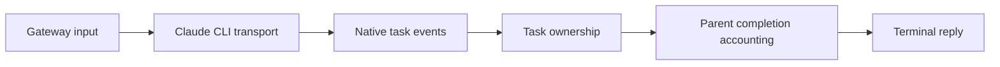

Codex review: needs maintainer review before merge.

## What this changes

Exclude subagent-launched tasks from parent-input completion accounting and add nested Agent and workflow regressions.

**Example:** Background Agent parent launches child with parent_task_id="parent", then the parent finishes with "parent final".
- **Before:** The child remains pending on the parent input, so the final answer is marked interim and the turn stalls.
- **After:** The child belongs to its launching subagent, allowing the parent's final answer to complete the turn.

## Review scores

| Measure | Result | What it means |
|---|---|---|
| **Overall readiness** | 🦐 gold shrimp **(3/6)** | The repair is focused and source-supported with meaningful transport regressions and passing gates; independent runtime confidence remains bounded by synthetic producer coverage. |
| **Proof confidence** | 🦐 gold shrimp **(3/6)** | This collaborator/bot PR is outside the ordinary contributor proof gate; its body reports a built-Gateway chat.send → Claude stdio → agent.wait success with retained history using a synthetic executable, while inspectable committed coverage exercises the real adapter with synthetic protocol events rather than native Claude inference. |
| **Patch quality** | 🐚 platinum hermit **(4/6)** | No actionable review findings were identified. |

## Product

**Kind:** Bug fix · **Worth it:** Yes · **Fix scope:** Complete
**User problem:** A completed Claude CLI answer remains in progress because a nested background task is incorrectly charged to the parent turn.
**Reason:** The collaborator-authored direction addresses an evidenced current bug with a smaller ownership rule and no new configuration, public API, or persisted-state contract.

## Merge readiness

✅ **Ready for maintainer review**

Keep this PR open: current main still misattributes nested background tasks, and this focused repair addresses the resulting reply-completion failure without changing watchdog policy.

**Priority:** P1
**Reviewed head:** `6fee39c5794cabb926e86461d73098875d3dc93b`

## Before merge

None.

## Findings

None.

### Tests

- Missing end-to-end proof: No inspectable after-fix native-Claude trace demonstrates nested task production, terminal parent settlement, and a successful warm follow-up.

<strong>Agent review details</strong>

### How this fits together

The Anthropic CLI adapter consumes native task events, records session-wide ownership, and emits interim or terminal results to the host runner.

### Technical review

Best possible solution:

Keep nested-task classification in the existing ownership helper while preserving top-level holds, notification settlement, and warm-session reuse.

Do we have a high-confidence way to reproduce the issue?

The supplied event order deterministically leaves the nested task pending on current main; source and regression inspection establish the path, but this read-only review executed no target code.

Is this the best way to solve the issue?

The patch repairs classification at the existing producer of ownership facts, preserves legitimate continuation accounting, and avoids timers or watchdog changes that could hide the cause.

AGENTS.md: found and applied where relevant.

Codex review notes: model internal, reasoning medium; reviewed against [70ad789846f2](https://github.com/openclaw/openclaw/commit/70ad789846f2602b356d08cc63d84ade9ce58ffb).

### Provenance checked

- `Nested task ownership` changes intended behavior with a stated reason (a9479eb77d0e5cfb0686862b96720ea9e858cbe9: https://github.com/openclaw/openclaw/pull/170322 preserved task ownership across inputs and resumed work to prevent unrelated tasks holding current replies.)
- `CLI completion documentation` keeps the original intent (a9479eb77d0e5cfb0686862b96720ea9e858cbe9: The existing documentation separates legitimate current-input continuations from stopped or earlier-input work; the addition clarifies the same boundary for nested tasks.)

### Testing

Proof path: in-process harness.

### Security

None.

### Evidence

What I checked:

- **Pinned introduced change:** The introduced diff updates the existing ownership predicate, removes parent-input inheritance, documents the invariant, and adds protocol regressions without adding production state or another completion path. ([`extensions/anthropic/cli-runtime-tasks.ts:49`](https://github.com/openclaw/openclaw/blob/6fee39c5794cabb926e86461d73098875d3dc93b/extensions/anthropic/cli-runtime-tasks.ts#L49), [6fee39c5794c](https://github.com/openclaw/openclaw/commit/6fee39c5794cabb926e86461d73098875d3dc93b))
- **Current-main defect remains:** Current main still inherits the parent's input owner for tasks carrying parent_task_id; those tasks can enter the add-only pending set and prevent a successful result from completing the turn. ([`extensions/anthropic/cli-runtime-tasks.ts:50`](https://github.com/openclaw/openclaw/blob/70ad789846f2602b356d08cc63d84ade9ce58ffb/extensions/anthropic/cli-runtime-tasks.ts#L50), [70ad789846f2](https://github.com/openclaw/openclaw/commit/70ad789846f2602b356d08cc63d84ade9ce58ffb))
- **Concrete linked incident:** The reporter in https://github.com/openclaw/openclaw/issues/182175 supplies an affected official release, nested-task event order, and transcript evidence of a completed native answer followed by watchdog termination; the report explicitly lacks captured stream-json stdout.
- **Focused behavioral regressions:** The added external stdio fixtures exercise nested local_agent and local_workflow events through executeClaudeCli, assert terminal delivery directly, preserve the top-level hold, and verify reuse of the same subprocess. ([`extensions/anthropic/cli-runtime.task-ownership.test.ts:95`](https://github.com/openclaw/openclaw/blob/6fee39c5794cabb926e86461d73098875d3dc93b/extensions/anthropic/cli-runtime.task-ownership.test.ts#L95), [6fee39c5794c](https://github.com/openclaw/openclaw/commit/6fee39c5794cabb926e86461d73098875d3dc93b))
- **Prior ownership intent:** https://github.com/openclaw/openclaw/pull/170322 established input-scoped ownership to prevent stopped and earlier-input tasks holding current replies; https://github.com/openclaw/openclaw/pull/165596 established exclusion of subagent-owned Bash notifications. This PR extends that exclusion to nested Agents and workflows. ([`extensions/anthropic/cli-runtime-tasks.ts:46`](https://github.com/openclaw/openclaw/blob/a9479eb77d0e5cfb0686862b96720ea9e858cbe9/extensions/anthropic/cli-runtime-tasks.ts#L46), [a9479eb77d0e](https://github.com/openclaw/openclaw/commit/a9479eb77d0e5cfb0686862b96720ea9e858cbe9))
- **Reviewed-head gates:** GitHub reports the reviewed head as mergeable and clean, with successful CI, dependency-review, and security-sensitive-review gates; the cancelled dispatch check does not establish a patch failure. ([6fee39c5794c](https://github.com/openclaw/openclaw/commit/6fee39c5794cabb926e86461d73098875d3dc93b))

### PR surface

Source -2, Tests +75, Docs +1. Total +74 across 3 files. Added test files: 0.

View PR surface stats

| Area | Files | Added | Removed | Net |
|---|---:|---:|---:|---:|
| Source | 1 | 4 | 6 | -2 |
| Tests | 1 | 75 | 0 | +75 |
| Docs | 1 | 2 | 1 | +1 |
| Config | 0 | 0 | 0 | 0 |
| Generated | 0 | 0 | 0 | 0 |
| Other | 0 | 0 | 0 | 0 |
| **Total** | **3** | **81** | **7** | **+74** |

### Labels

Label changes:

- add `P1`: The linked official-release incident loses normal reply completion and stalls an active agent workflow until watchdog termination.
- add `rating: 🦐 gold shrimp`: Overall readiness is 🦐 gold shrimp; proof is 🦐 gold shrimp and patch quality is 🐚 platinum hermit.
- add `status: 👀 ready for maintainer look`: ClawSweeper has no concrete contributor-facing blocker left for this PR.

Label justifications:

- `P1`: The linked official-release incident loses normal reply completion and stalls an active agent workflow until watchdog termination.
- `rating: 🦐 gold shrimp`: Overall readiness is 🦐 gold shrimp; proof is 🦐 gold shrimp and patch quality is 🐚 platinum hermit.
- `status: 👀 ready for maintainer look`: ClawSweeper has no concrete contributor-facing blocker left for this PR.

### Rank-up moves

Optional improvements that raise the rating; they are not merge blockers.

- Attach redacted native-Claude output showing a nested Agent, terminal parent completion, and successful reuse of the same session.

### Rating scale

6/6 🦀 challenger crab · 5/6 🦞 diamond lobster · 4/6 🐚 platinum hermit · 3/6 🦐 gold shrimp · 2/6 🦪 silver shellfish · 1/6 🧂 unranked krab. Overall follows the weaker of proof and patch quality; ✨ marks media proof (a screenshot, video, or linked artifact) that directly shows the changed behavior.

### Workflow

ClawSweeper edits this one comment on every review. Comment `@clawsweeper re-review` for a fresh review only. Repair and merge execution lanes are retired.

_Reviewed October 24, 2026, 1:39 AM ET / 05:39 UTC._

<!-- clawsweeper-verdict:needs-human item=182267 sha=6fee39c5794cabb926e86461d73098875d3dc93b confidence=high updated_at=2026-10-24T05:35:39Z reviewed_at=2026-10-24T05:39:12.114Z lease_owner=github-run-40066762848-1 lease_comment_id=6380438434 source_revision=27fd11d605245b534b6792a7b7f1784aee9a1939545063a4e331bc493af14574 hold=not_opted_in findings=0 -->
<!-- clawsweeper-review-state:ready item=182267 sha=6fee39c5794cabb926e86461d73098875d3dc93b v=1 -->

<!-- clawsweeper-review-version item=182267 reviewed_at=2026-10-24T05:39:12.114Z sha=6fee39c5794cabb926e86461d73098875d3dc93b source_revision=27fd11d605245b534b6792a7b7f1784aee9a1939545063a4e331bc493af14574 lease_owner=github-run-40066762848-1 lease_comment_id=6380438434 v=1 -->

<!-- clawsweeper-review item=182267 -->