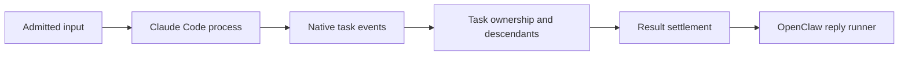

Codex review: needs maintainer review before merge.

## What this changes

The PR distinguishes nested task completions consumed by a running subagent from completions forwarded after that subagent finishes.

**Example:** Background agent outer-2 finishes before its nested agent inner-2.
- **Before:** The outer reported result can finish the turn before inner-2 returns its final answer.
- **After:** The outer reported result remains interim until inner-2 produces the final answer.

## Review scores

| Measure | Result | What it means |
|---|---|---|
| **Overall readiness** | 🐚 platinum hermit **(4/6)** | Focused, useful repair with native transport evidence and both routing orders covered; the previous integration blocker is resolved. |
| **Proof confidence** | 🐚 platinum hermit **(4/6)** | Sufficient (live_output): Retained contributor evidence exercises executeClaudeCli with real Claude Code 2.1.310 and a scripted local Messages API, covering both notification routes, terminal delivery and warm reuse; the integrated regression covers both orders and foreground retirement without claiming live Gateway or Anthropic-service validation. |
| **Patch quality** | 🐚 platinum hermit **(4/6)** | No actionable review findings were identified. |

## Product

**Kind:** Bug fix · **Worth it:** Yes · **Fix scope:** Complete
**User problem:** A nested background agent’s answer can be omitted when its launching subagent finishes first.
**Reason:** The native routing distinction establishes a concrete delivery defect beyond the merged hang repair, with no new configuration or public contract.

## Merge readiness

✅ **Ready for maintainer review**

Keep this PR open: it preserves forwarded nested-agent answers that current main can settle too early, and resolves the previous integration concern without an actionable correctness finding; exact-head CI remains pending.

**Priority:** P1
**Reviewed head:** `7cc32e2454f848dac9b365e58281e2241d91c2f3`

## Before merge

None.

## Findings

None.

<strong>Agent review details</strong>

### How this fits together

The Anthropic CLI adapter consumes Claude Code task events and uses task ownership and completion receipts to emit interim or terminal results to OpenClaw’s reply runner.

### Technical review

Best possible solution:

Retain this lifetime-aware repair so forwarded child answers complete before settlement while surviving foreground descendants still retire with their process.

Do we have a high-confidence way to reproduce the issue?

Current-main ownership and settlement code establish the premature-final path, supported by the reported failing base regressions and retained native traces; this read-only review ran no reproduction.

Is this the best way to solve the issue?

The patch is the smallest complete repair found: reuse the descendant tracker for launcher identity and distinguish consumed completions from forwarded continuations without changing watchdogs or permission policy.

AGENTS.md: found and applied where relevant.

Codex review notes: model internal, reasoning medium; reviewed against [2499f2be3e88](https://github.com/openclaw/openclaw/commit/2499f2be3e88e025735268fb622e569d69fcd369).

### Provenance checked

- `Nested task ownership` changes intended behavior with a stated reason (f36f0cc6fca969f191f2e9ce2d01ebb5efab7308: Exclude nested tasks because their completions can be consumed by the launching subagent.)
- `Stopped-task and admitted-input settlement` keeps the original intent (a9479eb77d0e5cfb0686862b96720ea9e858cbe9: Release stopped work while preserving genuine current-input continuations and isolating earlier-input results.)
- `Descendant tracking and process retirement` keeps the original intent (3eeb12bea80b482a8068d1cf27870a5e12be5bda: Retire processes with surviving descendants so they cannot inherit a later turn’s authority.)

### Testing

Proof path: in-process harness.

### Security

None.

### Evidence

What I checked:

- **Current main still excludes forwarded nested work:** Current main assigns false ownership to every task carrying parent_task_id, so the launcher-finishes-first case cannot retain its child continuation. ([`extensions/anthropic/cli-runtime-tasks.ts:49`](https://github.com/openclaw/openclaw/blob/2499f2be3e88e025735268fb622e569d69fcd369/extensions/anthropic/cli-runtime-tasks.ts#L49), [2499f2be3e88](https://github.com/openclaw/openclaw/commit/2499f2be3e88e025735268fb622e569d69fcd369))
- **Previous integration concern resolved:** The introduced diff retains nested Agent and Workflow input ownership, records launcher identities in the existing descendant tracker, and releases a nested hold when its launcher remains running. ([`extensions/anthropic/cli-runtime-tasks.ts:48`](https://github.com/openclaw/openclaw/blob/7cc32e2454f848dac9b365e58281e2241d91c2f3/extensions/anthropic/cli-runtime-tasks.ts#L48), [7cc32e2454f8](https://github.com/openclaw/openclaw/commit/7cc32e2454f848dac9b365e58281e2241d91c2f3))
- **Both completion orders covered:** The revised Agent and Workflow regression checks final delivery when the launcher consumes its child’s result, interim delivery when the launcher finishes first, and subsequent reuse of the same process; the body reports base failures and candidate passes. ([`extensions/anthropic/cli-runtime.task-ownership.test.ts:158`](https://github.com/openclaw/openclaw/blob/7cc32e2454f848dac9b365e58281e2241d91c2f3/extensions/anthropic/cli-runtime.task-ownership.test.ts#L158), [7cc32e2454f8](https://github.com/openclaw/openclaw/commit/7cc32e2454f848dac9b365e58281e2241d91c2f3))
- **Foreground descendant isolation preserved:** The existing retirement rule still closes a process with surviving descendants, while the new pending-task predicate excludes children of unheld foreground work. ([`extensions/anthropic/cli.runtime.ts:383`](https://github.com/openclaw/openclaw/blob/7cc32e2454f848dac9b365e58281e2241d91c2f3/extensions/anthropic/cli.runtime.ts#L383), [7cc32e2454f8](https://github.com/openclaw/openclaw/commit/7cc32e2454f848dac9b365e58281e2241d91c2f3))
- **Merged repair does not supersede this PR:** https://github.com/openclaw/openclaw/pull/182267 merged the unconditional nested-task exclusion and closed https://github.com/openclaw/openclaw/issues/182175; its stated scenario addresses child-first completion rather than the forwarded-answer case retained here. ([`extensions/anthropic/cli-runtime-tasks.ts:49`](https://github.com/openclaw/openclaw/blob/f36f0cc6fca969f191f2e9ce2d01ebb5efab7308/extensions/anthropic/cli-runtime-tasks.ts#L49), [f36f0cc6fca9](https://github.com/openclaw/openclaw/commit/f36f0cc6fca969f191f2e9ce2d01ebb5efab7308))
- **Retained native behavior evidence:** The current body records real Claude Code 2.1.310 through executeClaudeCli with a local Messages API, both notification routes, terminal delivery and warm reuse; the earlier review at https://github.com/openclaw/openclaw/pull/182516#issuecomment-6383209952 records inspection of those captures. This review reused that evidence and ran no target code. ([c427f9afac9c](https://github.com/openclaw/openclaw/commit/c427f9afac9ccc98e46ff4545d96db786477977e))

Likely related people:

- **cassthebandit:** Raw commit a9479eb77d0e5cfb0686862b96720ea9e858cbe9 adds extensions/anthropic/cli-runtime-tasks.ts:45 relative to its recorded parents. This identifies author metadata, not feature responsibility or a PR merger. (role: source-line author; confidence: high; commits: [a9479eb77d0e](https://github.com/openclaw/openclaw/commit/a9479eb77d0e5cfb0686862b96720ea9e858cbe9); files: `extensions/anthropic/cli-runtime-tasks.ts`)
- **Vito Cappello:** Raw commit 3eeb12bea80b482a8068d1cf27870a5e12be5bda adds extensions/anthropic/cli.runtime.ts:321 relative to its recorded parents. This identifies author metadata, not feature responsibility or a PR merger. (role: source-line author; confidence: high; commits: [3eeb12bea80b](https://github.com/openclaw/openclaw/commit/3eeb12bea80b482a8068d1cf27870a5e12be5bda); files: `extensions/anthropic/cli.runtime.ts`)

### PR surface

Source +21, Tests +14, Docs +1. Total +36 across 4 files. Added test files: 0.

View PR surface stats

| Area | Files | Added | Removed | Net |
|---|---:|---:|---:|---:|
| Source | 2 | 48 | 27 | +21 |
| Tests | 1 | 67 | 53 | +14 |
| Docs | 1 | 3 | 2 | +1 |
| Config | 0 | 0 | 0 | 0 |
| Generated | 0 | 0 | 0 | 0 |
| Other | 0 | 0 | 0 | 0 |
| **Total** | **4** | **118** | **82** | **+36** |

### Review metrics

| Metric | Value | Why it matters |
|---|---|---|
| **Production versus test growth** | Production +21 lines; tests +14 lines | The modest growth records launcher identity in existing state and extends the existing regression to cover both routing orders. |

### Labels

Label changes:

- add `rating: 🐚 platinum hermit`: Overall readiness is 🐚 platinum hermit; proof is 🐚 platinum hermit and patch quality is 🐚 platinum hermit.
- add `status: 👀 ready for maintainer look`: ClawSweeper has no concrete contributor-facing blocker left for this PR.
- remove `rating: 🦐 gold shrimp`: Current PR rating is `rating: 🐚 platinum hermit`, so this older rating label is no longer current.
- remove `merge-risk: 🚨 message-delivery`: Current PR review selected no merge-risk labels.
- remove `status: ⏳ waiting on author`: Current PR status label is `status: 👀 ready for maintainer look`.

Label justifications:

- `P1`: The affected Claude CLI workflow can settle before delivering a nested agent’s forwarded answer.
- `rating: 🐚 platinum hermit`: Overall readiness is 🐚 platinum hermit; proof is 🐚 platinum hermit and patch quality is 🐚 platinum hermit.
- `status: 👀 ready for maintainer look`: ClawSweeper has no concrete contributor-facing blocker left for this PR.
- `proof: sufficient`: Contributor real behavior proof is sufficient.

### Rating scale

6/6 🦀 challenger crab · 5/6 🦞 diamond lobster · 4/6 🐚 platinum hermit · 3/6 🦐 gold shrimp · 2/6 🦪 silver shellfish · 1/6 🧂 unranked krab. Overall follows the weaker of proof and patch quality; ✨ marks media proof (a screenshot, video, or linked artifact) that directly shows the changed behavior.

### Workflow

ClawSweeper edits this one comment on every review. Comment `@clawsweeper re-review` for a fresh review only. Repair and merge execution lanes are retired.

### History

Review history (1 earlier review cycle)

<!-- clawsweeper-review-history v=1 total=1 -->
- reviewed 2026-10-24T10:38:17.107Z sha c427f9afac9ccc98e46ff4545d96db786477977e :: blocked before merge. :: none

_Reviewed October 26, 2026, 4:32 AM ET / 08:32 UTC (Revision 2)._

<!-- clawsweeper-verdict:needs-human item=182516 sha=7cc32e2454f848dac9b365e58281e2241d91c2f3 confidence=high updated_at=2026-10-26T08:28:05Z reviewed_at=2026-10-26T08:32:36.671Z lease_owner=github-run-40292350805-1 lease_comment_id=6411551353 source_revision=b8493fb2c510ff3c66444e84bf3cf012894db160f19fbb9b8b23d93390913fee hold=not_opted_in findings=0 -->
<!-- clawsweeper-review-state:ready item=182516 sha=7cc32e2454f848dac9b365e58281e2241d91c2f3 v=1 -->

<!-- clawsweeper-review-version item=182516 reviewed_at=2026-10-26T08:32:36.671Z sha=7cc32e2454f848dac9b365e58281e2241d91c2f3 source_revision=b8493fb2c510ff3c66444e84bf3cf012894db160f19fbb9b8b23d93390913fee lease_owner=github-run-40292350805-1 lease_comment_id=6411551353 v=1 -->

<!-- clawsweeper-review item=182516 -->