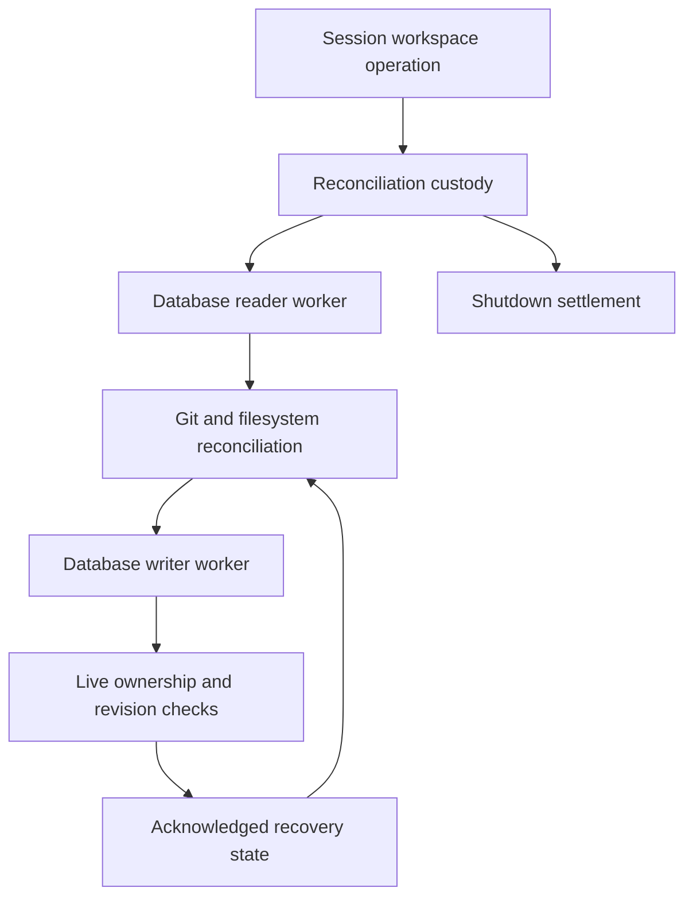

Codex review: needs maintainer review before merge. _Reviewed October 5, 2026, 10:53 AM ET / 14:53 UTC (Revision 8)._

# ClawSweeper review

## What this changes

The PR moves local sandbox workspace persistence into existing database workers while retaining ownership through synchronization, recovery, cleanup, and shutdown.

## Merge readiness

✅ **Ready for maintainer review**

This remains useful, distinct work. The previous findings and conflict blocker are resolved, and no new blocking defect was found.

**Priority:** P2
**Reviewed head:** `c038abcc24770961dc67206bcc64261dba4f560f`

## Review scores

| Measure | Result | What it means |
|---|---|---|
| **Overall readiness** | 🐚 platinum hermit **(4/6)** | A coherent worker cutover with strong recorded boundary proof and no remaining actionable findings. |
| **Proof confidence** | 🦞 diamond lobster **(5/6)** | Sufficient (terminal): Recorded production-boundary provision/sync proof exercises real Git, filesystem, SQLite readers and writers with zero caller-thread projection SQL; injected lease revocation, reply loss, and Gateway close demonstrate refusal, recovery, and settlement. Earlier evidence retains its original head binding, with affected preparation/recovery validation recorded after integration. Canonical schemas and stored formats are unchanged. |
| **Patch quality** | 🐚 platinum hermit **(4/6)** | No actionable review findings were identified. |

## Verification

| Check | Result | Evidence |
|---|---|---|
| **Real behavior** | Verified | Sufficient (terminal): Recorded production-boundary provision/sync proof exercises real Git, filesystem, SQLite readers and writers with zero caller-thread projection SQL; injected lease revocation, reply loss, and Gateway close demonstrate refusal, recovery, and settlement. Earlier evidence retains its original head binding, with affected preparation/recovery validation recorded after integration. Canonical schemas and stored formats are unchanged. |
| **Evidence reviewed** | 8 items | Current main still needs this cutover: The fetched main revision still implements projection get, revision, create, update, and delete through caller-thread database access. The merged preparation optimization does not implement this worker migration. Introduced persistence owner and repaired scalar reads: The pinned introduced diff retains one reconciliation lease across reads, effects, acknowledged mutations, and settlement. Existence replies are boolean; mutation preconditions select revision and an unsettled flag rather than recovery payloads. Both earlier scalar-read findings are resolved. Authority and lost-reply handling: The writer validates reconciliation custody, all participating live leases, and registry predicates at transaction and commit admission. Host admission invokes current caller authority; lost replies adopt only the matching native committed receipt, while uncertain outcomes reject further effects. Production-boundary regressions cover expired and replaced allocation/removal leases and one-write recovery after reply loss. |
| **Findings** | None | None. |
| **Security** | None | None. |

## How this fits together

Local sandbox workspace projections reconcile a session’s private checkout with its managed worktree. Their persistence owner records accepted changes and recovery receipts before subsequent filesystem effects and archive cleanup.

## Before merge

None.

<strong>Agent review details</strong>

### Security

None.

### PR surface

Source +359, Tests +455, Docs +13, Other +1. Total +828 across 31 files.

View PR surface stats

| Area | Files | Added | Removed | Net |
|---|---:|---:|---:|---:|
| Source | 19 | 706 | 347 | +359 |
| Tests | 10 | 543 | 88 | +455 |
| Docs | 1 | 13 | 0 | +13 |
| Config | 0 | 0 | 0 | 0 |
| Generated | 0 | 0 | 0 | 0 |
| Other | 1 | 1 | 0 | +1 |
| **Total** | **31** | **1263** | **435** | **+828** |

### Review metrics

| Metric | Value | Why it matters |
|---|---|---|
| **Production and test growth** | production +359 net lines; tests and test support +454 net lines | Production growth implements retained worker custody and acknowledged settlement; test growth protects scalar payloads, revocation, recovery, and shutdown. |

### Technical review

Best possible solution:

Keep projection persistence with the existing worker owners and preserve live custody, acknowledged recovery state, and archive retention across the complete operation.

Do we have a high-confidence way to reproduce the issue?

Not applicable as a bug reproduction: this is a performance and ownership refactor. Current-main source confirms the caller-thread SQL being replaced.

Is this the best way to solve the issue?

Yes. Reusing the existing reader, writer, lease, and settlement owners avoids competing persistence paths, and the latest integration preserves the complementary preparation optimization.

AGENTS.md: found and applied where relevant.

Codex review notes: model internal, reasoning medium; reviewed against [03795abe5e22](https://github.com/openclaw/openclaw/commit/03795abe5e22b965ced4a008f02b0df9d2fcb7f6).

### Labels

Label changes:

No label changes.

Label justifications:

- `P2`: This is a bounded persistence-performance improvement with meaningful lifecycle safeguards, without evidence of an urgent user-facing regression.
- `rating: 🐚 platinum hermit`: Overall readiness is 🐚 platinum hermit; proof is 🦞 diamond lobster and patch quality is 🐚 platinum hermit.
- `status: 👀 ready for maintainer look`: ClawSweeper has no concrete contributor-facing blocker left for this PR. Sufficient (terminal): Recorded production-boundary provision/sync proof exercises real Git, filesystem, SQLite readers and writers with zero caller-thread projection SQL; injected lease revocation, reply loss, and Gateway close demonstrate refusal, recovery, and settlement. Earlier evidence retains its original head binding, with affected preparation/recovery validation recorded after integration. Canonical schemas and stored formats are unchanged.
- `proof: sufficient`: Contributor real behavior proof is sufficient. Recorded production-boundary provision/sync proof exercises real Git, filesystem, SQLite readers and writers with zero caller-thread projection SQL; injected lease revocation, reply loss, and Gateway close demonstrate refusal, recovery, and settlement. Earlier evidence retains its original head binding, with affected preparation/recovery validation recorded after integration. Canonical schemas and stored formats are unchanged.

### Evidence

What I checked:

- **Current main still needs this cutover:** The fetched main revision still implements projection get, revision, create, update, and delete through caller-thread database access. The merged preparation optimization does not implement this worker migration. ([`src/gateway/worker-environments/local-workspace-store.ts:29`](https://github.com/openclaw/openclaw/blob/03795abe5e22b965ced4a008f02b0df9d2fcb7f6/src/gateway/worker-environments/local-workspace-store.ts#L29), [03795abe5e22](https://github.com/openclaw/openclaw/commit/03795abe5e22b965ced4a008f02b0df9d2fcb7f6))
- **Introduced persistence owner and repaired scalar reads:** The pinned introduced diff retains one reconciliation lease across reads, effects, acknowledged mutations, and settlement. Existence replies are boolean; mutation preconditions select revision and an unsettled flag rather than recovery payloads. Both earlier scalar-read findings are resolved. ([`src/gateway/worker-environments/local-workspace-store.kernel.ts:26`](https://github.com/openclaw/openclaw/blob/c038abcc24770961dc67206bcc64261dba4f560f/src/gateway/worker-environments/local-workspace-store.kernel.ts#L26), [c038abcc2477](https://github.com/openclaw/openclaw/commit/c038abcc24770961dc67206bcc64261dba4f560f))
- **Authority and lost-reply handling:** The writer validates reconciliation custody, all participating live leases, and registry predicates at transaction and commit admission. Host admission invokes current caller authority; lost replies adopt only the matching native committed receipt, while uncertain outcomes reject further effects. Production-boundary regressions cover expired and replaced allocation/removal leases and one-write recovery after reply loss. ([`src/gateway/worker-environments/local-workspace-store.worker.ts:34`](https://github.com/openclaw/openclaw/blob/c038abcc24770961dc67206bcc64261dba4f560f/src/gateway/worker-environments/local-workspace-store.worker.ts#L34), [c038abcc2477](https://github.com/openclaw/openclaw/commit/c038abcc24770961dc67206bcc64261dba4f560f))
- **Preparation conflict resolved:** The preparation callback carries allocation.workerAuthority into projection custody. Current source retains main’s reuse and initial-snapshot optimization. GitHub verifies https://github.com/openclaw/openclaw/pull/165411 merged as 404d38813cc471388e2bc68665d71b6b344fdf26; it is complementary work, not a replacement. ([`src/agents/sandbox/local-workspace.ts:53`](https://github.com/openclaw/openclaw/blob/c038abcc24770961dc67206bcc64261dba4f560f/src/agents/sandbox/local-workspace.ts#L53), [c038abcc2477](https://github.com/openclaw/openclaw/commit/c038abcc24770961dc67206bcc64261dba4f560f))
- **Retained behavior proof:** The captured PR body records real provision/synchronization reducing caller-thread projection SQL from 119 executions to zero, fault recovery and close settlement, and a published 2026.9.8 driver updating an isolated Linux Gateway to the candidate with /readyz 200. Earlier Linux and CI results retain b6dd18509e6fb6e74f3208c8f7b4cd24aa4ed6b0 attribution; the final integration separately records successful preparation and recovery checks. These are contributor-recorded results, not reviewer-executed tests. ([`src/gateway/worker-environments/local-workspace-projection.test.ts:140`](https://github.com/openclaw/openclaw/blob/c038abcc24770961dc67206bcc64261dba4f560f/src/gateway/worker-environments/local-workspace-projection.test.ts#L140), [c038abcc2477](https://github.com/openclaw/openclaw/commit/c038abcc24770961dc67206bcc64261dba4f560f))
- **Stored contracts preserved:** The introduced diff changes no canonical schema, generated database model, package dependencies, or plugin SDK paths. The kernel uses the existing additive table definition and preserves row fields, revision progression, pending-ref ordering, and unsettled-delete protection; no stored-data migration is introduced. ([`src/gateway/worker-environments/local-workspace-store.kernel.ts:75`](https://github.com/openclaw/openclaw/blob/c038abcc24770961dc67206bcc64261dba4f560f/src/gateway/worker-environments/local-workspace-store.kernel.ts#L75), [c038abcc2477](https://github.com/openclaw/openclaw/commit/c038abcc24770961dc67206bcc64261dba4f560f))

Likely related people:

- **steipete:** Suggested for follow-up; no historical authorship or introduction is verified. (role: unverified routing candidate; confidence: low)

### Rating scale

| Score | Internal tier | Crab rank | Meaning |
|---:|:---:|---|---|
| **6/6** | S | 🦀 challenger crab | Exceptional readiness |
| **5/6** | A | 🦞 diamond lobster | Very strong readiness |
| **4/6** | B | 🐚 platinum hermit | Good normal PR; ordinary maintainer review |
| **3/6** | C | 🦐 gold shrimp | Useful, but confidence is limited |
| **2/6** | D | 🦪 silver shellfish | Proof or implementation needs work |
| **1/6** | F | 🧂 unranked krab | Not merge-ready |
| N/A | NA | 🌊 off-meta tidepool | Rating does not apply |

Overall follows the weaker of proof and patch quality.
Shiny media proof means a screenshot, video, or linked artifact directly shows the changed behavior. Runtime, network, CSP, and security claims still need visible diagnostics.

### Workflow

- ClawSweeper keeps one durable marker-backed review comment per issue or PR.
- Re-runs edit this comment so the latest verdict, findings, and automation markers stay together instead of adding duplicate bot comments.
- A fresh review can be triggered by eligible `@clawsweeper re-review` comments, exact-item GitHub events, scheduled/background review runs, or manual workflow dispatch.
- PR/issue authors and users with repository write access can comment `@clawsweeper re-review` or `@clawsweeper re-run` on an open PR or issue to request a fresh review only.
- Maintainers can also comment `@clawsweeper review` to request a fresh review only.
- Fresh-review commands do not start repair, autofix, rebase, CI repair, or automerge.
- Maintainer-only repair and merge flows require explicit commands such as `@clawsweeper autofix`, `@clawsweeper automerge`, `@clawsweeper fix ci`, or `@clawsweeper address review`.
- Maintainers can comment `@clawsweeper explain` to ask for more context, or `@clawsweeper stop` to stop active automation.

### History

Review history (7 earlier review cycles)

<!-- clawsweeper-review-history v=1 total=7 -->
- reviewed 2026-10-05T11:03:33.375Z sha b33eb1210bf2e61bb37b6f2560021bcb261b18d4 :: blocked before merge. :: [P2] [P2] Preserve narrow worker reads for existence-only checks
- reviewed 2026-10-05T11:29:57.490Z sha b33eb1210bf2e61bb37b6f2560021bcb261b18d4 :: blocked before merge. :: [P2] Preserve scalar worker reads for existence-only checks
- reviewed 2026-10-05T12:01:52.498Z sha 60834713185c5fc619a4ef43ebb03fdd37664ddd :: needs changes before merge. :: [P2] Use payload-free preconditions for projection mutations
- reviewed 2026-10-05T13:51:45.996Z sha b6dd18509e6fb6e74f3208c8f7b4cd24aa4ed6b0 :: needs maintainer review before merge. :: none
- reviewed 2026-10-05T14:10:35.868Z sha b6dd18509e6fb6e74f3208c8f7b4cd24aa4ed6b0 :: needs maintainer review before merge. :: none
- reviewed 2026-10-05T14:17:37.047Z sha b6dd18509e6fb6e74f3208c8f7b4cd24aa4ed6b0 :: needs changes before merge. :: none
- reviewed 2026-10-05T14:30:26.849Z sha 74418467531424daa21ef1f2538aa238c5712e3c :: blocked before merge. :: none

<!-- clawsweeper-verdict:needs-human item=165534 sha=c038abcc24770961dc67206bcc64261dba4f560f confidence=high updated_at=2026-10-05T14:50:05Z reviewed_at=2026-10-05T14:53:28.910Z lease_owner=github-run-37327744673-1 lease_comment_id=5996888619 source_revision=df3c1b9528225ec399cc29ec629e3c04e7d7ec79199584ec6b8855268ba047aa live_verification=absent -->
<!-- clawsweeper-review-state:ready item=165534 sha=c038abcc24770961dc67206bcc64261dba4f560f v=1 -->

<!-- clawsweeper-review-version item=165534 reviewed_at=2026-10-05T14:53:28.910Z sha=c038abcc24770961dc67206bcc64261dba4f560f source_revision=df3c1b9528225ec399cc29ec629e3c04e7d7ec79199584ec6b8855268ba047aa lease_owner=github-run-37327744673-1 lease_comment_id=5996888619 v=1 -->

<!-- clawsweeper-review item=165534 -->