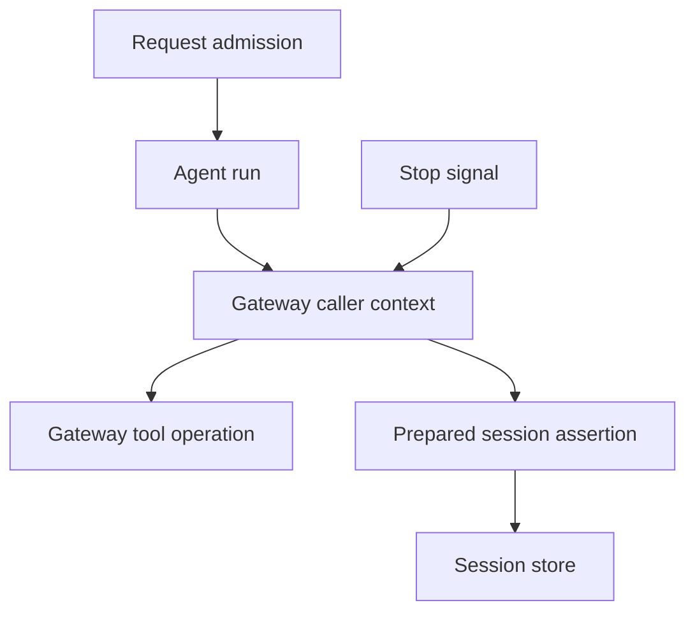

Codex review: needs changes before merge.

## What this changes

This PR removes repeated permission checks from started agent tool calls while preserving cancellation and prepared session-write fences.

**Example:** A user’s role changes from worker to readonly while an admitted tool request is running.
- **Before:** A later caller assertion can discard the request’s outcome with an authority refusal.
- **After:** The synchronous assertion permits completion unless a lifecycle signal aborts.

## Review scores

| Measure | Result | What it means |
|---|---|---|
| **Overall readiness** | 🧂 unranked krab **(1/6)** | The focused production direction is valuable, but the supplied live scenario does not establish the changed path and exact-head CI exposes incomplete test and ratchet updates. |
| **Proof confidence** | 🧂 unranked krab **(1/6)** | Real behavior proof is not required for maintainer- or bot-authored pull requests. |
| **Patch quality** | 🦪 silver shellfish **(2/6)** | 3 actionable review findings remain. |

## Product

**Kind:** Bug fix · **Worth it:** Yes · **Fix scope:** Complete
**User problem:** Accepted agent work can lose its outcome when permission changes during execution.
**Reason:** The maintainer-authored direction matches root policy, introduces no configuration or public API, and reduces repeated authority machinery.

## Merge readiness

⛔ **Needs changes before merge - 3 items remain**

Keep open: this maintainer-authored change follows the repository’s admission rule, but introduced test failures and a stale ratchet allowance need repair.

**Priority:** P2
**Reviewed head:** `afce9447c26a52d03caf9e36fc8def547058982a`

## Before merge

- [ ] **Avoid pinning the native abort exception’s wording (P2)** - Calling AbortController.abort() without a reason produces “The operation was aborted.” on CI, so the new “This operation was aborted” expectation fails despite correct cancellation. The same mismatch breaks src/gateway/server.sessions-send-resume.test.ts:277. Use an explicit synthetic abort reason or assert the stable abort contract while preserving the cancellation and cleanup checks.
- [ ] **Complete the consumer-test cutover for removed receipt checks (P2)** - Returning a Stop-only synchronous assertion changes consumers beyond the edited suites. Exact-head CI now fails sessions-create.child-custody.test.ts:653, sessions-mutations.owner.test.ts:275, and users-personal-file.test.ts:552 because they still expect a flipped receipt predicate to reject admitted work. Update these obsolete expectations to the intended accepted outcome, preserving independent source, commit, cancellation, and child-run rejection checks instead of restoring the removed policy.
- [ ] **Shrink the identity allowance after removing refusal checks (P2)** - The production deletion reduces this file’s session-identity matches from five to two, but its allowance remains five. The ratchet rejects stale decreases in scripts/lib/shrink-ratchet.mts:471–480, explaining the exact-head session-identity failure. Reduce only this allowance to the remaining count; no new exception is needed.

## Findings

- [P2] Avoid pinning the native abort exception’s wording — `src/agents/subagents/registry/subagent-registry-lifecycle-wake.retry.test.ts:127-129`
- [P2] Complete the consumer-test cutover for removed receipt checks — `src/agents/tools/gateway-caller-context.ts:460`
- [P2] Shrink the identity allowance after removing refusal checks — `config/session-identity-allowlist.txt:512`

### Tests

- Missing end-to-end proof: The supplied shell-command transcript does not establish that a Gateway-backed tool reaches the changed caller assertion across revocation; a base-failing/head-passing regression for that path is also not shown.

<strong>Agent review details</strong>

### How this fits together

The caller-context adapter carries admitted agent identity into Gateway tools and supplies synchronous cancellation checks and prepared storage assertions to downstream owners.

### Technical review

Best possible solution:

Keep the focused owner change, complete its consumer-test cutover, and shrink the obsolete ratchet allowance.

Do we have a high-confidence way to reproduce the issue?

Current-main source directly rechecks receipt, operator, selected-user, and Cron authority on synchronous assertions after admission; no target code was executed during this review.

Is this the best way to solve the issue?

Removing those repeated checks at their shared adapter is the smallest coherent repair, and preserving cancellation and prepared storage assertions respects the existing owners.

Full review comments:

- [P2] Avoid pinning the native abort exception’s wording — `src/agents/subagents/registry/subagent-registry-lifecycle-wake.retry.test.ts:127-129`
  Calling AbortController.abort() without a reason produces “The operation was aborted.” on CI, so the new “This operation was aborted” expectation fails despite correct cancellation. The same mismatch breaks src/gateway/server.sessions-send-resume.test.ts:277. Use an explicit synthetic abort reason or assert the stable abort contract while preserving the cancellation and cleanup checks.
  Confidence: 1
- [P2] Complete the consumer-test cutover for removed receipt checks — `src/agents/tools/gateway-caller-context.ts:460`
  Returning a Stop-only synchronous assertion changes consumers beyond the edited suites. Exact-head CI now fails sessions-create.child-custody.test.ts:653, sessions-mutations.owner.test.ts:275, and users-personal-file.test.ts:552 because they still expect a flipped receipt predicate to reject admitted work. Update these obsolete expectations to the intended accepted outcome, preserving independent source, commit, cancellation, and child-run rejection checks instead of restoring the removed policy.
  Confidence: 0.99
- [P2] Shrink the identity allowance after removing refusal checks — `config/session-identity-allowlist.txt:512`
  The production deletion reduces this file’s session-identity matches from five to two, but its allowance remains five. The ratchet rejects stale decreases in scripts/lib/shrink-ratchet.mts:471–480, explaining the exact-head session-identity failure. Reduce only this allowance to the remaining count; no new exception is needed.
  Confidence: 0.99

Overall correctness: patch is incorrect
Overall confidence: 0.95

AGENTS.md: found and applied where relevant.

Codex review notes: model internal, reasoning medium; reviewed against [450441b90403](https://github.com/openclaw/openclaw/commit/450441b904031b886c5fff3238f25b424907dcfe).

### Provenance checked

- `Caller receipt and operator rechecks` changes intended behavior with a stated reason (1b305870b3250562b70493df4529f8a66a2c0db5: The original installed-channel read repair retained caller lifetime through lookup, provider requests, retries, and result delivery; later source-authority work preserved prepared writer checks.)
- `Cron-specific authority recheck` changes intended behavior with a stated reason (544de1b7ae62bca90bd1fbe39ed2c909017af1cc: https://github.com/openclaw/openclaw/pull/150921 deliberately prevented later Cron effects after original-caller revocation; this PR explicitly replaces that mid-request policy with admission-time authority.)
- `Selected-user checks and refusal tests` changes intended behavior with a stated reason (d0dcc9deddc833dfd3f2152196b1f28d19b8d843: Personal-tool selection retained the requesting person’s source, and tests enforced revocation between effects; the PR explicitly retires those refusal expectations while retaining selection and independent lifecycle boundaries.)

### Testing

Proof path: shipped entry point.

### Security

None.

### Evidence

Acceptance criteria:

- pnpm test src/agents/subagents/registry/subagent-registry-lifecycle-wake.retry.test.ts src/gateway/server.sessions-send-resume.test.ts --maxWorkers=1
- pnpm test src/gateway/server-methods/sessions-create.child-custody.test.ts src/gateway/server-methods/sessions-mutations.owner.test.ts src/gateway/server-methods/users-personal-file.test.ts --maxWorkers=1
- pnpm check:session-identity-ratchet
- pnpm check:changed

What I checked:

- **Pinned production change:** The introduced diff changes only one production owner: synchronous calls now check abort signals, while receipt-backed preparation remains attached to the returned assertion. ([`src/agents/tools/gateway-caller-context.ts:438`](https://github.com/openclaw/openclaw/blob/afce9447c26a52d03caf9e36fc8def547058982a/src/agents/tools/gateway-caller-context.ts#L438), [afce9447c26a](https://github.com/openclaw/openclaw/commit/afce9447c26a52d03caf9e36fc8def547058982a))
- **Current-main behavior and accepted direction:** Fetched main retains the original helper unchanged from the merge base; root policy permits started requests to finish, and merged https://github.com/openclaw/openclaw/pull/202513 establishes the same admission direction for saved requesters. ([`AGENTS.md:12`](https://github.com/openclaw/openclaw/blob/450441b904031b886c5fff3238f25b424907dcfe/AGENTS.md#L12), [450441b90403](https://github.com/openclaw/openclaw/commit/450441b904031b886c5fff3238f25b424907dcfe))
- **Inspected live transcript:** The full comment at https://github.com/openclaw/openclaw/pull/203487#issuecomment-7079137237 matches supplied SHA-256 88a060091872dfdfc20f6f48a750da073ce1860a8c96ce00797f6c9ac7260728; it records shell-command completion after a role change, a queued-followup failure, and chat.abort cancellation. ([afce9447c26a](https://github.com/openclaw/openclaw/commit/afce9447c26a52d03caf9e36fc8def547058982a))
- **Abort assertion failures:** Exact-head CI annotations show that the changed assertions expect “This operation was aborted” while Node reports “The operation was aborted.” in both lifecycle-wake and sessions-send-resume tests. ([`src/agents/subagents/registry/subagent-registry-lifecycle-wake.retry.test.ts:128`](https://github.com/openclaw/openclaw/blob/afce9447c26a52d03caf9e36fc8def547058982a/src/agents/subagents/registry/subagent-registry-lifecycle-wake.retry.test.ts#L128), [afce9447c26a](https://github.com/openclaw/openclaw/commit/afce9447c26a52d03caf9e36fc8def547058982a))
- **Unmigrated consumer assertions:** https://github.com/openclaw/openclaw/actions/runs/45022136258/job/137207702784 reports obsolete refusal expectations in sessions-create.child-custody, sessions-mutations.owner, and users-personal-file; source inspection connects each failure to the removed receipt check. ([`src/gateway/server-methods/sessions-create.child-custody.test.ts:653`](https://github.com/openclaw/openclaw/blob/afce9447c26a52d03caf9e36fc8def547058982a/src/gateway/server-methods/sessions-create.child-custody.test.ts#L653), [afce9447c26a](https://github.com/openclaw/openclaw/commit/afce9447c26a52d03caf9e36fc8def547058982a))
- **Stale identity allowance:** The allowance remains five while the changed production file contains two matching identity-refusal occurrences; the ratchet explicitly rejects unpruned decreases, matching CI’s session-identity failure. ([`config/session-identity-allowlist.txt:512`](https://github.com/openclaw/openclaw/blob/afce9447c26a52d03caf9e36fc8def547058982a/config/session-identity-allowlist.txt#L512), [afce9447c26a](https://github.com/openclaw/openclaw/commit/afce9447c26a52d03caf9e36fc8def547058982a))

Likely related people:

- **Peter Steinberger:** Raw commit 48c022a42c131ec026291c4be79937722119b2f9 adds src/agents/tools/gateway-caller-context.ts:373 relative to its recorded parents. This identifies author metadata, not feature responsibility or a PR merger. (role: source-line author; confidence: high; commits: [48c022a42c13](https://github.com/openclaw/openclaw/commit/48c022a42c131ec026291c4be79937722119b2f9); files: `src/agents/tools/gateway-caller-context.ts`)
- **JC:** Raw commit 1b305870b3250562b70493df4529f8a66a2c0db5 adds src/agents/tools/gateway-caller-context.ts:185 relative to its recorded parents. This identifies author metadata, not feature responsibility or a PR merger. (role: source-line author; confidence: high; commits: [1b305870b325](https://github.com/openclaw/openclaw/commit/1b305870b3250562b70493df4529f8a66a2c0db5); files: `src/agents/tools/gateway-caller-context.ts`)

### PR surface

Source -27, Tests -473. Total -500 across 33 files. Added test files: 0.

View PR surface stats

| Area | Files | Added | Removed | Net |
|---|---:|---:|---:|---:|
| Source | 1 | 10 | 37 | -27 |
| Tests | 32 | 211 | 684 | -473 |
| Docs | 0 | 0 | 0 | 0 |
| Config | 0 | 0 | 0 | 0 |
| Generated | 0 | 0 | 0 | 0 |
| Other | 0 | 0 | 0 | 0 |
| **Total** | **33** | **221** | **721** | **-500** |

### Preflight source

Source unknown. Source comparison at the observed PR snapshot only. Completion is self-reported; body, policy, tests, execution, and report bytes are not verified.

### Review metrics

| Metric | Value | Why it matters |
|---|---|---|
| **Production versus test/support LOC** | Production +10/−37; tests/support +211/−684 | The change removes repeated runtime checks and their obsolete refusal cases without adding production machinery. |

### Labels

Label changes:

- add `P2`: This is a useful admission-consistency repair with focused validation defects and no demonstrated urgent production regression.
- add `rating: 🧂 unranked krab`: Overall readiness is 🧂 unranked krab; proof is 🧂 unranked krab and patch quality is 🦪 silver shellfish.
- add `status: ⏳ waiting on author`: ClawSweeper has contributor-facing work open and is waiting for author action.

Label justifications:

- `P2`: This is a useful admission-consistency repair with focused validation defects and no demonstrated urgent production regression.
- `rating: 🧂 unranked krab`: Overall readiness is 🧂 unranked krab; proof is 🧂 unranked krab and patch quality is 🦪 silver shellfish.
- `status: ⏳ waiting on author`: ClawSweeper has contributor-facing work open and is waiting for author action.

### Rating scale

6/6 🦀 challenger crab · 5/6 🦞 diamond lobster · 4/6 🐚 platinum hermit · 3/6 🦐 gold shrimp · 2/6 🦪 silver shellfish · 1/6 🧂 unranked krab. Overall follows the weaker of proof and patch quality; ✨ marks media proof (a screenshot, video, or linked artifact) that directly shows the changed behavior.

### Workflow

ClawSweeper edits this one comment on every review. Comment `@clawsweeper re-review` for a fresh review only. Repair and merge execution lanes are retired.

_Reviewed November 22, 2026, 7:46 AM ET / 12:46 UTC._

<!-- clawsweeper-verdict:needs-changes item=203487 sha=afce9447c26a52d03caf9e36fc8def547058982a confidence=high updated_at=2026-11-22T12:40:35Z reviewed_at=2026-11-22T12:46:00.567Z lease_owner=github-run-45023390071-1 lease_comment_id=7079263973 source_revision=bcde33626068debb56b21672ae1fb405493a8d109b222e1ebb75031178c09e09 -->
<!-- clawsweeper-review-state:needs-changes item=203487 sha=afce9447c26a52d03caf9e36fc8def547058982a v=1 -->

<!-- clawsweeper-review-version item=203487 reviewed_at=2026-11-22T12:46:00.567Z sha=afce9447c26a52d03caf9e36fc8def547058982a source_revision=bcde33626068debb56b21672ae1fb405493a8d109b222e1ebb75031178c09e09 lease_owner=github-run-45023390071-1 lease_comment_id=7079263973 v=1 -->

<!-- clawsweeper-review item=203487 -->