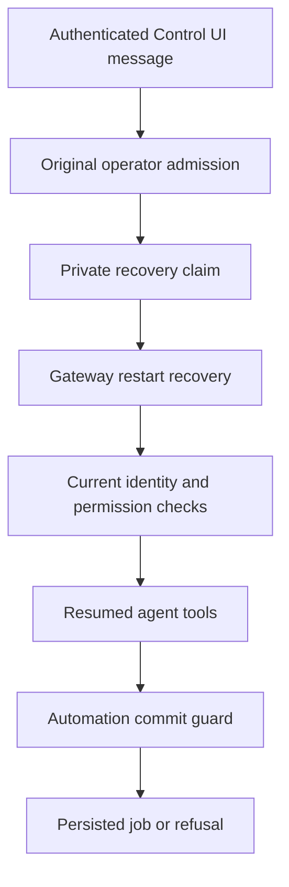

Codex review: blocked before merge. _Reviewed October 7, 2026, 12:21 PM ET / 16:21 UTC (Revision 8)._

# ClawSweeper review

## What this changes

The branch preserves authenticated operator permissions across Gateway restart recovery, adds live device-revocation fencing, and repairs the native-hook pressure fixture’s tool-output acknowledgments.

## Merge readiness

⛔ **Blocked before merge - 1 item remains**

This PR remains necessary: current main still reconstructs restricted System authority for restart recovery. No actionable introduced defect remains identified, and the prior generic compatibility blocker is resolved by the inspected source and upgrade evidence.

**Priority:** P1
**Reviewed head:** `3136c308ef49cc59095c7244aecd7926f63fbf2f`

## Review scores

| Measure | Result | What it means |
|---|---|---|
| **Overall readiness** | 🦞 diamond lobster **(5/6)** | Strong production-boundary proof, exact-head CI, and coherent authority ownership support readiness with no remaining actionable finding. |
| **Proof confidence** | 🦞 diamond lobster **(5/6)** ✨ media proof bonus | Sufficient (linked_artifact): Recorded isolated real-Gateway/browser process replacement exercises recovery admission through actual automation persistence, and the authorized production-path harness proves allowed creation plus rejection after token, role, grant, and claim revocation. Optional-source persistence/reload, claim cleanup, private projection, and restricted legacy claims establish existing-state compatibility without migration; media was not independently viewed. |
| **Patch quality** | 🦞 diamond lobster **(5/6)** | No actionable review findings were identified. |

## Verification

| Check | Result | Evidence |
|---|---|---|
| **Real behavior** | Verified | Sufficient (linked_artifact): Recorded isolated real-Gateway/browser process replacement exercises recovery admission through actual automation persistence, and the authorized production-path harness proves allowed creation plus rejection after token, role, grant, and claim revocation. Optional-source persistence/reload, claim cleanup, private projection, and restricted legacy claims establish existing-state compatibility without migration; media was not independently viewed. |
| **Evidence reviewed** | 12 items | Pinned introduction and continuing necessity: Reviewed the merge-base-to-head introduced delta. Current fetched main still dispatches recovery with a System principal and has no original-operator restoration in this path; this PR’s operator restoration remains distinct useful work. The stale test merge was not used to infer removal of base-only behavior. Compatibility checkpoint resolved: The only Gateway config-schema hunk exports an existing validator; it changes no validation rule, option, or default. The persisted addition is an optional private recovery-source record, excluded from public session projection and cleared with its claim. No SQL DDL or schema-version change is introduced. Persisted-source and legacy compatibility: Inspected coverage persists and reloads the bounded source, preserves a write-only original ceiling, and verifies that source-less legacy claims receive no restored operator authority. Different source turns, sessions, and lifecycle identities are rejected. The captured body reports passing owner and runtime replays. |
| **Findings** | None | None. |
| **Security** | None | None. |

## How this fits together

The Gateway admits Control UI messages and stores interrupted-turn recovery claims. After restart, recovery reconstructs the caller’s current authority before resumed agent tools reach automation RPCs and persistence.

## Before merge

- [ ] **Review config compatibility** - Confirm compatibility and upgrade impact for the changed config or default surface before merge.

<strong>Agent review details</strong>

### Security

None.

### PR surface

Source +1121, Tests +1772, Docs +9. Total +2902 across 62 files.

View PR surface stats

| Area | Files | Added | Removed | Net |
|---|---:|---:|---:|---:|
| Source | 48 | 1277 | 156 | +1121 |
| Tests | 13 | 1785 | 13 | +1772 |
| Docs | 1 | 9 | 0 | +9 |
| Config | 0 | 0 | 0 | 0 |
| Generated | 0 | 0 | 0 | 0 |
| Other | 0 | 0 | 0 | 0 |
| **Total** | **62** | **3071** | **169** | **+2902** |

### Review metrics

| Metric | Value | Why it matters |
|---|---|---|
| **Configuration and upgrade surface** | 0 new options or defaults; 1 optional private recovery record | The validator export adds no configuration surface, and persisted-source reload plus restricted legacy behavior clear the previous compatibility checkpoint. |
| **Production versus test growth** | production net +1118; tests and support net +1775 | Production growth is explicitly justified by exact cross-restart authority ownership and live revocation rather than a blanket scope expansion. |

### Stored data model

Persistent data-model change detected: `serialized state: src/auto-reply/reply/restart-recovery-claim.ts`, `unknown-data-model-change: src/auto-reply/reply/restart-recovery-claim.ts`. Migration or upgrade compatibility proof is recorded; maintainers should verify it before merge.

### Root-cause cluster

Relationship: `fixed_by_candidate`
Canonical: https://github.com/openclaw/openclaw/issues/166542
Summary: This PR directly owns the restart-recovery admission repair; the CLI bridge scope leak and fresh-run automation disappearance have different reported mechanisms.

Members:
- `canonical`: https://github.com/openclaw/openclaw/issues/166542 - The paired issue defines the same interrupted operator-turn reproduction and expected authority boundary.
- `adjacent_distinct`: https://github.com/openclaw/openclaw/pull/157144 - The open bridge repair isolates later CLI calls from another run’s request scope rather than restoring the interrupted caller.
- `adjacent_distinct`: https://github.com/openclaw/openclaw/issues/166336 - The report concerns fresh-run tool disappearance without a preceding restart and is explicitly outside this repair.

Proposal only: this assessment does not dispatch repair, suppress jobs, mutate sibling items, close, or merge anything.

### Technical review

Best possible solution:

Recover the exact authenticated input under current policy, preserving its original ceilings and rejecting revoked authority before persistence while retaining restricted legacy recovery.

Do we have a high-confidence way to reproduce the issue?

Yes: interrupt an authenticated automation turn after durable admission and allow startup recovery; current main reconstructs a restricted System principal that fails the admin RPC fence. The supplied baseline regression and real process-replacement evidence support this path; this review did not execute it.

Is this the best way to solve the issue?

Yes: exact-source re-admission through existing policy and commit owners repairs the lost authority without granting every recovery caller admin or deriving permission from session ownership.

AGENTS.md: found and applied where relevant.

Codex review notes: model internal, reasoning medium; reviewed against [fa8fc4242707](https://github.com/openclaw/openclaw/commit/fa8fc4242707bc34d234b7ff022a2ab273e4948e).

### Labels

Label changes:

No label changes.

Label justifications:

- `P1`: Automatic restart recovery currently blocks already-admitted operator automation work.
- `merge-risk: 🚨 security-boundary`: The patch restores privileged authority across restart; exact-source admission and recorded allowed/revoked final-effect proof cover the accepted boundary.
- `rating: 🦞 diamond lobster`: Overall readiness is 🦞 diamond lobster; proof is 🦞 diamond lobster and patch quality is 🦞 diamond lobster.
- `status: 👀 ready for maintainer look`: ClawSweeper has no concrete contributor-facing blocker left for this PR. Sufficient (linked_artifact): Recorded isolated real-Gateway/browser process replacement exercises recovery admission through actual automation persistence, and the authorized production-path harness proves allowed creation plus rejection after token, role, grant, and claim revocation. Optional-source persistence/reload, claim cleanup, private projection, and restricted legacy claims establish existing-state compatibility without migration; media was not independently viewed.
- `proof: sufficient`: Contributor real behavior proof is sufficient. Recorded isolated real-Gateway/browser process replacement exercises recovery admission through actual automation persistence, and the authorized production-path harness proves allowed creation plus rejection after token, role, grant, and claim revocation. Optional-source persistence/reload, claim cleanup, private projection, and restricted legacy claims establish existing-state compatibility without migration; media was not independently viewed.

### Evidence

What I checked:

- **Pinned introduction and continuing necessity:** Reviewed the merge-base-to-head introduced delta. Current fetched main still dispatches recovery with a System principal and has no original-operator restoration in this path; this PR’s operator restoration remains distinct useful work. The stale test merge was not used to infer removal of base-only behavior. ([`src/gateway/server-instance-runtime.ts:195`](https://github.com/openclaw/openclaw/blob/fa8fc4242707bc34d234b7ff022a2ab273e4948e/src/gateway/server-instance-runtime.ts#L195), [fa8fc4242707](https://github.com/openclaw/openclaw/commit/fa8fc4242707bc34d234b7ff022a2ab273e4948e))
- **Compatibility checkpoint resolved:** The only Gateway config-schema hunk exports an existing validator; it changes no validation rule, option, or default. The persisted addition is an optional private recovery-source record, excluded from public session projection and cleared with its claim. No SQL DDL or schema-version change is introduced. ([`src/config/zod-schema.gateway.ts:82`](https://github.com/openclaw/openclaw/blob/3136c308ef49cc59095c7244aecd7926f63fbf2f/src/config/zod-schema.gateway.ts#L82), [3136c308ef49](https://github.com/openclaw/openclaw/commit/3136c308ef49cc59095c7244aecd7926f63fbf2f))
- **Persisted-source and legacy compatibility:** Inspected coverage persists and reloads the bounded source, preserves a write-only original ceiling, and verifies that source-less legacy claims receive no restored operator authority. Different source turns, sessions, and lifecycle identities are rejected. The captured body reports passing owner and runtime replays. ([`src/gateway/operator-run-recovery.test.ts:303`](https://github.com/openclaw/openclaw/blob/3136c308ef49cc59095c7244aecd7926f63fbf2f/src/gateway/operator-run-recovery.test.ts#L303), [3136c308ef49](https://github.com/openclaw/openclaw/commit/3136c308ef49cc59095c7244aecd7926f63fbf2f))
- **Allowed and revoked final effects:** The existing production-path automation harness first persists an allowed disabled job, then pauses another actual write during awaited validation. Token rotation, role downgrade, access-grant revocation, and claim retirement each reject the pending write with the complete persisted job list unchanged. The body and follow-up comment report all four cases passing; injected principals use the real restoration, tool dispatch, RPC, and persistence owners. ([`src/gateway/server-methods/cron-creator-transports.integration.test.ts:205`](https://github.com/openclaw/openclaw/blob/3136c308ef49cc59095c7244aecd7926f63fbf2f/src/gateway/server-methods/cron-creator-transports.integration.test.ts#L205), [3136c308ef49](https://github.com/openclaw/openclaw/commit/3136c308ef49cc59095c7244aecd7926f63fbf2f))
- **Real Control UI process replacement:** Recorded proof exercises ordinary browser handshake/chat ingress against an isolated real Gateway, SIGKILL/process replacement, automatic recovery, and a persisted disabled automation. Source assertions verify the original session, exactly one original user input, and settled/cleared recovery custody. Only model responses are deterministic fixtures. Local downloaded media was not found, so no claim of independently inspecting the screenshots or recording is made. ([`extensions/qa-lab/src/control-ui-automation-management.real-gateway.e2e.test.ts:188`](https://github.com/openclaw/openclaw/blob/3136c308ef49cc59095c7244aecd7926f63fbf2f/extensions/qa-lab/src/control-ui-automation-management.real-gateway.e2e.test.ts#L188), [3136c308ef49](https://github.com/openclaw/openclaw/commit/3136c308ef49cc59095c7244aecd7926f63fbf2f))
- **Complete captured body inspected:** Read the omitted body ranges through the read-only pull endpoint and verified SHA-256 6d7f9db87fd70f8e1b21fe2c97234039ea84f36ceaaa88e46593f486360cd941, matching the supplied snapshot. It records the allowed/revoked automation results, compatibility evidence, corrected Linux real-Gateway replay, and explicit limits on attribution of the original incident. ([3136c308ef49](https://github.com/openclaw/openclaw/commit/3136c308ef49cc59095c7244aecd7926f63fbf2f))

Likely related people:

- **Peter Steinberger:** Raw commit 49c18152c8bf5b9b73f5823aa425343b617fa689 adds src/gateway/server-instance-runtime.ts:164 relative to its recorded parents. This identifies author metadata, not feature responsibility or a PR merger. (role: source-line author; confidence: high; commits: [49c18152c8bf](https://github.com/openclaw/openclaw/commit/49c18152c8bf5b9b73f5823aa425343b617fa689); files: `src/gateway/server-instance-runtime.ts`)
- **vincentkoc:** Suggested for follow-up; no historical authorship or introduction is verified. (role: unverified routing candidate; confidence: low)

### Rating scale

| Score | Internal tier | Crab rank | Meaning |
|---:|:---:|---|---|
| **6/6** | S | 🦀 challenger crab | Exceptional readiness |
| **5/6** | A | 🦞 diamond lobster | Very strong readiness |
| **4/6** | B | 🐚 platinum hermit | Good normal PR; ordinary maintainer review |
| **3/6** | C | 🦐 gold shrimp | Useful, but confidence is limited |
| **2/6** | D | 🦪 silver shellfish | Proof or implementation needs work |
| **1/6** | F | 🧂 unranked krab | Not merge-ready |
| N/A | NA | 🌊 off-meta tidepool | Rating does not apply |

Overall follows the weaker of proof and patch quality.
Shiny media proof means a screenshot, video, or linked artifact directly shows the changed behavior. Runtime, network, CSP, and security claims still need visible diagnostics.

### Workflow

- ClawSweeper keeps one durable marker-backed review comment per issue or PR.
- Re-runs edit this comment so the latest verdict, findings, and automation markers stay together instead of adding duplicate bot comments.
- A fresh review can be triggered by eligible `@clawsweeper re-review` comments, exact-item GitHub events, scheduled/background review runs, or manual workflow dispatch.
- PR/issue authors and users with repository write access can comment `@clawsweeper re-review` or `@clawsweeper re-run` on an open PR or issue to request a fresh review only.
- Maintainers can also comment `@clawsweeper review` to request a fresh review only.
- Fresh-review commands do not start repair, autofix, rebase, CI repair, or automerge.
- Maintainer-only repair and merge flows require explicit commands such as `@clawsweeper autofix`, `@clawsweeper automerge`, `@clawsweeper fix ci`, or `@clawsweeper address review`.
- Maintainers can comment `@clawsweeper explain` to ask for more context, or `@clawsweeper stop` to stop active automation.

### History

Review history (7 earlier review cycles)

<!-- clawsweeper-review-history v=1 total=7 -->
- reviewed 2026-10-07T09:58:26.577Z sha 00230a2357e34c3faf7f72e137b6e7ca4ad7231a :: needs real behavior proof before merge. :: none
- reviewed 2026-10-07T13:35:51.831Z sha e9f6ca8cfdf82d3406f11b3a13900aa7849ac4ce :: blocked before merge. :: none
- reviewed 2026-10-07T13:46:56.979Z sha 23b6b42dab1e2a114ff65956ed12b7e6c2c1741b :: blocked before merge. :: none
- reviewed 2026-10-07T14:28:25.441Z sha f60d1fbafd85c51416c4e2763bbc7e628d89b01d :: blocked before merge. :: none
- reviewed 2026-10-07T14:42:46.912Z sha c33c1a925e8807648bc411a935b277dcf065bf90 :: blocked before merge. :: none
- reviewed 2026-10-07T15:37:44.878Z sha c33c1a925e8807648bc411a935b277dcf065bf90 :: blocked before merge. :: none
- reviewed 2026-10-07T15:57:07.389Z sha 3136c308ef49cc59095c7244aecd7926f63fbf2f :: blocked before merge. :: none

<!-- clawsweeper-verdict:needs-human item=166553 sha=3136c308ef49cc59095c7244aecd7926f63fbf2f confidence=high updated_at=2026-10-07T16:17:59Z reviewed_at=2026-10-07T16:21:27.848Z lease_owner=github-run-37650779481-1 lease_comment_id=6042008811 source_revision=04b7c83bcfffc52f09096474a5a77b71de99360433c29642a33062c0b36e35d7 live_verification=absent -->
<!-- clawsweeper-review-state:blocked item=166553 sha=3136c308ef49cc59095c7244aecd7926f63fbf2f v=1 -->

<!-- clawsweeper-review-version item=166553 reviewed_at=2026-10-07T16:21:27.848Z sha=3136c308ef49cc59095c7244aecd7926f63fbf2f source_revision=04b7c83bcfffc52f09096474a5a77b71de99360433c29642a33062c0b36e35d7 lease_owner=github-run-37650779481-1 lease_comment_id=6042008811 v=1 -->

<!-- clawsweeper-review item=166553 -->