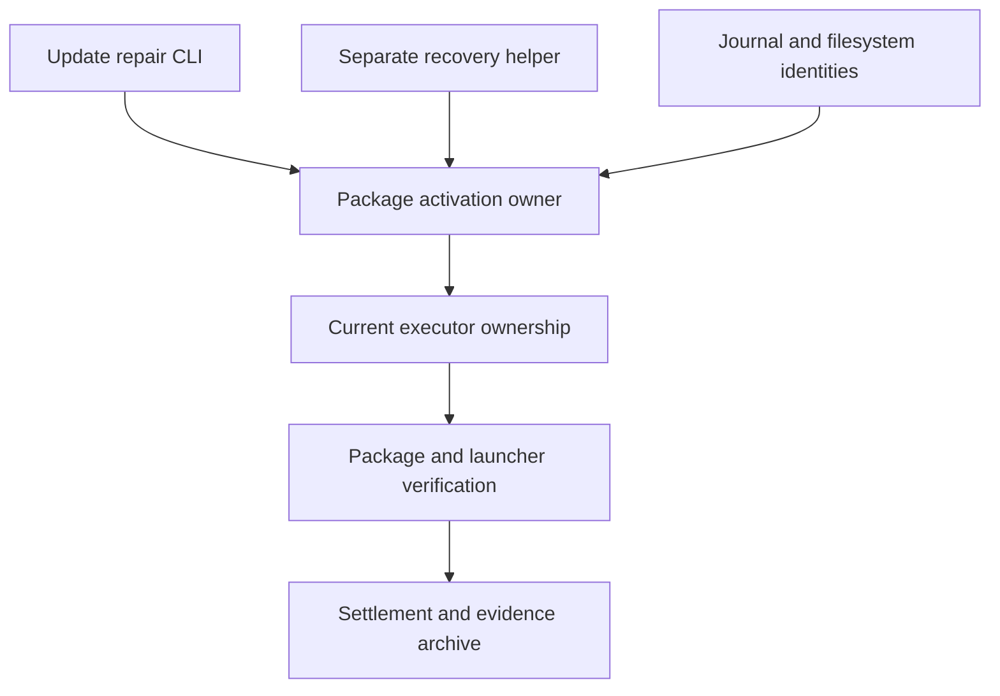

Codex review: blocked before merge.

## What this changes

This PR lets update repair settle device-remapped journals for an installed candidate or a verified newer manual installation while preserving recovery evidence.

**Example:** A retained 2026.9.9 operation records device 57, the filesystem now reports device 32, and a manual 2026.10.1 installation is live.
- **Before:** Repair refuses with “Package publication journal does not match its installation.”
- **After:** Repair verifies the newer installation and archives the obsolete operation.

## Review scores

| Measure | Result | What it means |
|---|---|---|
| **Overall readiness** | 🦪 silver shellfish **(2/6)** | Useful owner-directed recovery work with meaningful integration coverage, blocked by the retained correctness finding and incomplete persisted-recovery compatibility qualification. |
| **Proof confidence** | 🦐 gold shrimp **(3/6)** | The supplied maintainer-authored classification exempts ordinary media proof; public-repair harness coverage supports the changed owner, but released-state compatibility qualification for the broader repair path remains missing. |
| **Patch quality** | 🦪 silver shellfish **(2/6)** | 1 actionable review finding remain. |

## Product

**Kind:** Bug fix · **Worth it:** Yes · **Fix scope:** Complete
**User problem:** After filesystem device numbers change, repair cannot settle a preserved unfinished journal even when a healthy newer package is installed.
**Reason:** The linked reports establish a recovery dead end, and the supplied maintainer-authored direction authorizes extending the existing owner without new settings or public APIs.

## Merge readiness

⛔ **Blocked before merge - 2 items remain**

Keep this PR open: it addresses an evidenced update-recovery failure, but the earlier unverified previous-generation settlement finding remains unresolved.

**Priority:** P1
**Reviewed head:** `8eb11dc7cf93bf2e8c21271140ef3dc1359f3b8b`

## Before merge

- [ ] **Project identities before refusing unfinished previous-generation recovery (P2)** - The earlier finding remains unresolved. An update can stop after recording publishing/displace but before renaming the previous package. After a remount, previous identity 57:100 becomes 32:100: manualReplacement is false and externalPublication is false, but this refusal still compares 32:100 with historical identities. Repair falls through, skips both verification branches, and durably settles and archives the unfinished operation using only the live directory identity. This can clear recovery despite a damaged previous package or changed launcher. Use the projected identities in the remaining eligibility checks and retain refusal or verified retirement for this state; add a public-repair regression.
- [ ] **Add data-model compatibility proof** - The review found that existing stored data may not work after upgrade. Show that existing data still loads and works with this change.

## Findings

- [P2] Project identities before refusing unfinished previous-generation recovery — `src/infra/package-update-activation.ts:341-343`

### Tests

- Missing end-to-end proof: Qualify the changed CLI/helper repair against released installation state, including v2026.10.2 upgrade compatibility and preserved legacy journals, with settings and recovery evidence intact and subsequent update admission succeeding.

<strong>Agent review details</strong>

### How this fits together

The package-activation owner receives repair requests, persisted journals, and filesystem observations; it acquires current executor ownership and produces a durable settlement and preserved evidence archive.

### Technical review

Best possible solution:

Use projected identities consistently and preserve refusal or verified retirement whenever the previous generation remains installed.

Do we have a high-confidence way to reproduce the issue?

Reported device/inode comparisons establish the current-main refusal, and source tracing establishes the retained previous-generation bypass; this read-only review ran no target code.

Is this the best way to solve the issue?

Sharing mapping in the journal owner is appropriate, but all recovery selectors must consume that mapping consistently before relinquishing unfinished recovery.

Full review comments:

- [P2] Project identities before refusing unfinished previous-generation recovery — `src/infra/package-update-activation.ts:341-343`
  The earlier finding remains unresolved. An update can stop after recording publishing/displace but before renaming the previous package. After a remount, previous identity 57:100 becomes 32:100: manualReplacement is false and externalPublication is false, but this refusal still compares 32:100 with historical identities. Repair falls through, skips both verification branches, and durably settles and archives the unfinished operation using only the live directory identity. This can clear recovery despite a damaged previous package or changed launcher. Use the projected identities in the remaining eligibility checks and retain refusal or verified retirement for this state; add a public-repair regression.
  Confidence: 0.98

Overall correctness: patch is incorrect
Overall confidence: 0.96

AGENTS.md: found and applied where relevant.

Codex review notes: model internal, reasoning medium; reviewed against [6112e37e00f3](https://github.com/openclaw/openclaw/commit/6112e37e00f31076058bc959815ba52e1f70a560).

### Provenance checked

- `Unfinished remount admission and settlement` changes intended behavior with a stated reason (d5c2462496739bdc40d4e7e57d7cc7de1e1a756b: The earlier helper deliberately qualified only the installed-candidate lost-publication acknowledgement and prohibited unverified settlement fallthrough.)
- `Previous-generation retirement` keeps the original intent (94975271e351ce67ac99bdde0d09826bbec4b757: Untouched preparation could be retired through the publication owner while verifying the installed previous package and launchers.)
- `Settlement reporting and evidence archival` keeps the original intent (4821885e5b4d961ac0f01af1aa816e875ee3193f: Durably closed history became best-effort maintenance, with reporting before archival and current ownership retained at effects.)
- `Internal TransactionRecipes export` changes intended behavior with a stated reason (9dc64662f16ef6af61aed51c6ba16445b8d607d8: The shared experimental database adapter introduced the type; this PR explicitly mirrors the unused internal-export cleanup already present on fetched main.)

### Testing

Proof path: in-process harness.

### Security

None.

### Evidence

What I checked:

- **Current main still needs the repair extension:** The fetched main retains strict unfinished-journal admission and the narrow separate-helper recovery path; the relevant production comparison with the introduction base contains only the internal TransactionRecipes export cleanup. ([`src/infra/package-update-activation.ts:237`](https://github.com/openclaw/openclaw/blob/6112e37e00f31076058bc959815ba52e1f70a560/src/infra/package-update-activation.ts#L237), [6112e37e00f3](https://github.com/openclaw/openclaw/commit/6112e37e00f31076058bc959815ba52e1f70a560))
- **Reported remapping and manual replacement:** SergeiAug’s discussion on https://github.com/openclaw/openclaw/issues/169352 supplies device 57 becoming 32 with journal inodes preserved, a missing temporary lease database, and a newer manual installation; Patrick Schiller’s https://github.com/openclaw/openclaw/issues/169050 establishes the corresponding macOS unfinished-journal refusal.
- **Earlier finding remains reachable:** The final refusal still compares replacementIdentity with historical identities, while manualReplacement uses projected identities; a remapped installed previous generation can therefore bypass refusal and both verification branches before durable settlement. ([`src/infra/package-update-activation.ts:341`](https://github.com/openclaw/openclaw/blob/8eb11dc7cf93bf2e8c21271140ef3dc1359f3b8b/src/infra/package-update-activation.ts#L341), [8eb11dc7cf93](https://github.com/openclaw/openclaw/commit/8eb11dc7cf93bf2e8c21271140ef3dc1359f3b8b))
- **Concrete interruption point:** The publication owner records publishing/displace before renaming the live previous package, so interruption can leave the previous generation installed with unfinished publication intent. ([`src/infra/package-update-publication-owner.ts:376`](https://github.com/openclaw/openclaw/blob/8eb11dc7cf93bf2e8c21271140ef3dc1359f3b8b/src/infra/package-update-publication-owner.ts#L376), [8eb11dc7cf93](https://github.com/openclaw/openclaw/commit/8eb11dc7cf93bf2e8c21271140ef3dc1359f3b8b))
- **Follow-up comparison:** Comparison with the earlier reviewed head confirms that the follow-up consolidates settlement paths but leaves the historical-identity refusal unchanged. ([`src/infra/package-update-activation.ts:341`](https://github.com/openclaw/openclaw/blob/8eb11dc7cf93bf2e8c21271140ef3dc1359f3b8b/src/infra/package-update-activation.ts#L341), [8eb11dc7cf93](https://github.com/openclaw/openclaw/commit/8eb11dc7cf93bf2e8c21271140ef3dc1359f3b8b))
- **Existing remount qualification:** Patrick Schiller’s merged https://github.com/openclaw/openclaw/pull/169410 includes Dallin Romney’s actual APFS-remount qualification for the narrower installed-candidate helper scenario; it does not qualify this PR’s broader manual-replacement flow. ([`src/infra/package-update-activation-settlement.ts:38`](https://github.com/openclaw/openclaw/blob/d5c2462496739bdc40d4e7e57d7cc7de1e1a756b/src/infra/package-update-activation-settlement.ts#L38), [d5c246249673](https://github.com/openclaw/openclaw/commit/d5c2462496739bdc40d4e7e57d7cc7de1e1a756b))

Likely related people:

- **Peter Steinberger:** Raw commit ff6f58a8c32b6daa4bf1cf5f60b3493ae96d1764 adds src/infra/package-update-activation.ts:54 relative to its recorded parents. This identifies author metadata, not feature responsibility or a PR merger. (role: source-line author; confidence: high; commits: [ff6f58a8c32b](https://github.com/openclaw/openclaw/commit/ff6f58a8c32b6daa4bf1cf5f60b3493ae96d1764); files: `src/infra/package-update-activation.ts`)
- **Patrick Schiller:** Raw commit d5c2462496739bdc40d4e7e57d7cc7de1e1a756b adds src/infra/package-update-activation-settlement.ts:39 relative to its recorded parents. This identifies author metadata, not feature responsibility or a PR merger. (role: source-line author; confidence: high; commits: [d5c246249673](https://github.com/openclaw/openclaw/commit/d5c2462496739bdc40d4e7e57d7cc7de1e1a756b); files: `src/infra/package-update-activation-settlement.ts`)
- **Dallin Romney:** Raw commit 4821885e5b4d961ac0f01af1aa816e875ee3193f adds src/infra/package-update-activation.ts:320 relative to its recorded parents. This identifies author metadata, not feature responsibility or a PR merger. (role: source-line author; confidence: high; commits: [4821885e5b4d](https://github.com/openclaw/openclaw/commit/4821885e5b4d961ac0f01af1aa816e875ee3193f); files: `src/infra/package-update-activation.ts`)

### PR surface

Source +20, Tests +87, Docs +11. Total +118 across 9 files. Added test files: 0.

View PR surface stats

| Area | Files | Added | Removed | Net |
|---|---:|---:|---:|---:|
| Source | 5 | 163 | 143 | +20 |
| Tests | 3 | 103 | 16 | +87 |
| Docs | 1 | 17 | 6 | +11 |
| Config | 0 | 0 | 0 | 0 |
| Generated | 0 | 0 | 0 | 0 |
| Other | 0 | 0 | 0 | 0 |
| **Total** | **9** | **283** | **165** | **+118** |

### Review metrics

| Metric | Value | Why it matters |
|---|---|---|
| **Production versus test changes** | Production +163/-143; tests +103/-16 | The modest production growth adds shared journal mapping and newer-install verification while removing duplicate settlement paths; the regressions cover distinct repair and custody contracts. |

### Root-cause cluster

Relationship: `canonical`
Canonical: https://github.com/openclaw/openclaw/pull/170046
Summary: This PR owns the proposed broader recovery for unfinished journal device remapping; the merged helper addresses a narrower state.

Members:
- `fixed_by_candidate`: https://github.com/openclaw/openclaw/issues/169050 - Device drift prevents unfinished journal admission before settlement.
- `fixed_by_candidate`: https://github.com/openclaw/openclaw/issues/169352 - Confirmed device remapping and a newer manual replacement leave the obsolete operation blocked.
- `partial_overlap`: https://github.com/openclaw/openclaw/pull/169410 - The merged helper qualifies installed-candidate settlement but lacks the broader public-repair and manual-replacement path.

Proposal only: this assessment does not dispatch repair, suppress jobs, mutate sibling items, close, or merge anything.

### Labels

Label changes:

No label changes.

Label justifications:

- `P1`: Official-release installations remain blocked from subsequent updates through the documented recovery workflow.
- `merge-risk: 🚨 compatibility`: The changed recovery selector can durably close an existing unfinished operation without verifying its installed previous generation.
- `rating: 🦪 silver shellfish`: Overall readiness is 🦪 silver shellfish; proof is 🦐 gold shrimp and patch quality is 🦪 silver shellfish.
- `status: ⏳ waiting on author`: ClawSweeper has contributor-facing work open and is waiting for author action.

### Rating scale

6/6 🦀 challenger crab · 5/6 🦞 diamond lobster · 4/6 🐚 platinum hermit · 3/6 🦐 gold shrimp · 2/6 🦪 silver shellfish · 1/6 🧂 unranked krab. Overall follows the weaker of proof and patch quality; ✨ marks media proof (a screenshot, video, or linked artifact) that directly shows the changed behavior.

### Workflow

ClawSweeper edits this one comment on every review. Comment `@clawsweeper re-review` for a fresh review only. Repair and merge execution lanes are retired.

### History

Review history (1 earlier review cycle)

<!-- clawsweeper-review-history v=1 total=1 -->
- reviewed 2026-10-12T17:43:36.261Z sha 9345b5981540db857da9ba5946f1fcce2c5b22a7 :: blocked before merge. :: [P2] Project identities before refusing unfinished previous-generation recovery

_Reviewed October 12, 2026, 2:33 PM ET / 18:33 UTC (Revision 2)._

<!-- clawsweeper-verdict:needs-human item=170046 sha=8eb11dc7cf93bf2e8c21271140ef3dc1359f3b8b confidence=high updated_at=2026-10-12T18:28:17Z reviewed_at=2026-10-12T18:33:15.316Z lease_owner=github-run-38290979584-1 lease_comment_id=6130191003 source_revision=03157b0aaa3d43ee193157352f18910d33c5f69573e64714b0d791abcede3b52 hold=blocked findings=1 -->
<!-- clawsweeper-review-state:blocked item=170046 sha=8eb11dc7cf93bf2e8c21271140ef3dc1359f3b8b v=1 -->

<!-- clawsweeper-review-version item=170046 reviewed_at=2026-10-12T18:33:15.316Z sha=8eb11dc7cf93bf2e8c21271140ef3dc1359f3b8b source_revision=03157b0aaa3d43ee193157352f18910d33c5f69573e64714b0d791abcede3b52 lease_owner=github-run-38290979584-1 lease_comment_id=6130191003 v=1 -->

<!-- clawsweeper-review item=170046 -->