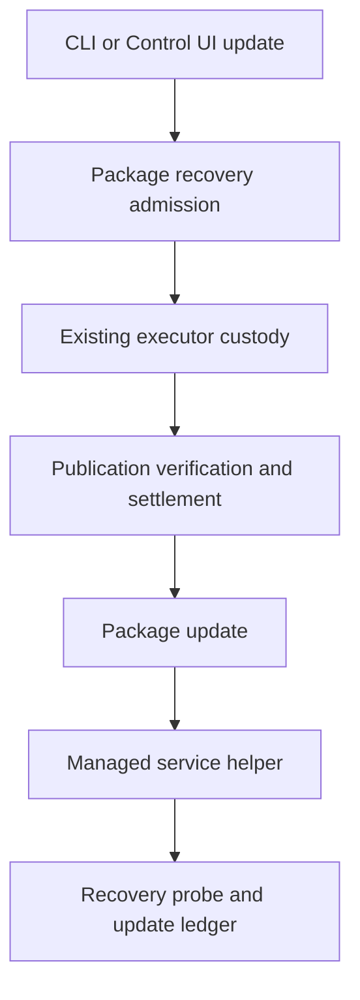

Codex review: blocked before merge.

## What this changes

This PR automatically settles eligible interrupted package updates and records missing Gateway recovery outcomes.

**Example:** An OpenClaw 2026.10.6 installation has a publishing journal whose installed candidate passes verification.
- **Before:** A new update refuses with update-recovery-pending and directs the user to terminal repair.
- **After:** The updater verifies and settles the retained publication, preserves its evidence, and continues.

## Review scores

| Measure | Result | What it means |
|---|---|---|
| **Overall readiness** | 🦐 gold shrimp **(3/6)** | Useful, focused owner reuse with meaningful CLI and lifecycle evidence, held by a confirmed preview defect and incomplete upgrade compatibility proof. |
| **Proof confidence** | 🦐 gold shrimp **(3/6)** | Real behavior proof is not required for maintainer- or bot-authored pull requests. |
| **Patch quality** | 🦐 gold shrimp **(3/6)** | 1 actionable review finding remain. |

## Product

**Kind:** Bug fix · **Worth it:** Yes · **Fix scope:** Complete
**User problem:** A recoverable interrupted update blocks another Control UI update and can leave the original Gateway's recovery outcome unrecorded.
**Reason:** The maintainer-approved direction removes an unnecessary terminal recovery step while preserving verification, retained evidence, and existing restart authority.

## Merge readiness

⛔ **Blocked before merge - 2 items remain**

Keep this PR open: it provides a useful, maintainer-directed recovery fix, but dry-run admission can incorrectly report that an unverified preparation is safe to settle.

**Priority:** P0
**Reviewed head:** `853cd38d1bb4a3dc52c5533b861a651cede00baa`

## Before merge

- [ ] **Verify same-device untouched preparations before admitting dry runs (P2)** - With an intact same-device prepared journal, null intent, and no publications, modify the live previous package in place or change a launcher. Automatic settlement now reaches the dry-run branch, but its verifier runs only for an installed candidate or remounted unused preparation. The new continuation condition then permits preview to report that the update can proceed. The real invocation instead calls retireVerified and rejects the changed previous generation or launcher. Reuse the existing previous-generation and launcher verification in the read-only preview, and cover both drift cases without mutating recovery artifacts.
- [ ] **Add data-model compatibility proof** - The review found that existing stored data may not work after upgrade. Show that existing data still loads and works with this change.

## Findings

- [P2] Verify same-device untouched preparations before admitting dry runs — `src/infra/package-update-activation.ts:130-134`

### Tests

- Missing end-to-end proof: The supplied evidence does not demonstrate a completed upgrade from latest stable v2026.10.6 with existing settings, retained recovery records, and user state preserved.

<strong>Agent review details</strong>

### How this fits together

CLI and Control UI updates enter package-recovery admission; the existing publication owner verifies retained packages under executor custody, while the managed-service helper records terminal health and recovery results.

### Technical review

Best possible solution:

Reuse verified repair automatically from Settings → Updates, with previews checking the same previous-package and launcher invariants.

Do we have a high-confidence way to reproduce the issue?

Source and the supplied fixture evidence establish the eligible interrupted-publication refusal; the reporter's exact preceding interruption remains unknown, and this read-only review ran no target code.

Is this the best way to solve the issue?

Reusing the existing verified settlement owner is the smallest complete approach; preview must also verify the previous generation before claiming admission will succeed.

Full review comments:

- [P2] Verify same-device untouched preparations before admitting dry runs — `src/infra/package-update-activation.ts:130-134`
  With an intact same-device prepared journal, null intent, and no publications, modify the live previous package in place or change a launcher. Automatic settlement now reaches the dry-run branch, but its verifier runs only for an installed candidate or remounted unused preparation. The new continuation condition then permits preview to report that the update can proceed. The real invocation instead calls retireVerified and rejects the changed previous generation or launcher. Reuse the existing previous-generation and launcher verification in the read-only preview, and cover both drift cases without mutating recovery artifacts.
  Confidence: 0.99
  Late finding: first raised on code an earlier review cycle already covered.

Overall correctness: patch is incorrect
Overall confidence: 0.94

AGENTS.md: found and applied where relevant.

Codex review notes: model internal, reasoning medium; reviewed against [7d31fe01b636](https://github.com/openclaw/openclaw/commit/7d31fe01b636c6b7bf2e3a4cb362658f4b52e5b0).

### Provenance checked

- `Automatic package settlement` changes intended behavior with a stated reason (8578b6f662919746a952174dde54adc722ec7085: https://github.com/openclaw/openclaw/pull/171993 allowed verified completed-publication settlement while explicitly retaining guards for other phases.)
- `Unstarted preparation retirement` keeps the original intent (94975271e351ce67ac99bdde0d09826bbec4b757: History added explicit repair retirement for untouched preparations; this PR deliberately reuses that existing owner during automatic admission.)
- `Managed-service recovery diagnostics` changes intended behavior with a stated reason (df387ceebf6920d0abc59db33bc0a2c10d2f2c21: https://github.com/openclaw/openclaw/pull/180777 preserved explicit child outcomes and left absent outcomes unknown; this PR adds observation without granting restart authority.)

### Testing

Proof path: shipped entry point.

### Security

None.

### Evidence

Acceptance criteria:

- pnpm test src/cli/update-cli/update-command-package-activation.test.ts --maxWorkers=1
- git diff --check

What I checked:

- **Introduced change and current main:** The pinned introduced diff expands automatic settlement beyond completed publications; fetched main still contains the earlier onlyStaleLease policy. ([`src/infra/package-update-activation.ts:348`](https://github.com/openclaw/openclaw/blob/853cd38d1bb4a3dc52c5533b861a651cede00baa/src/infra/package-update-activation.ts#L348), [853cd38d1bb4](https://github.com/openclaw/openclaw/commit/853cd38d1bb4a3dc52c5533b861a651cede00baa))
- **Verified dry-run defect:** Same-device unused preparations skip the verifier in the dry-run branch, yet return a settlement receipt; the new continuation condition then admits them. Real settlement instead calls retireVerified, which checks the selected package and launchers. ([`src/infra/package-update-activation.ts:376`](https://github.com/openclaw/openclaw/blob/853cd38d1bb4a3dc52c5533b861a651cede00baa/src/infra/package-update-activation.ts#L376), [853cd38d1bb4](https://github.com/openclaw/openclaw/commit/853cd38d1bb4a3dc52c5533b861a651cede00baa))
- **Existing review independently confirmed:** The discussion at https://github.com/openclaw/openclaw/pull/181307#discussion_r4356077839 identifies the same preview mismatch; source inspection confirms its trigger and causal path. ([`src/infra/package-update-activation.ts:134`](https://github.com/openclaw/openclaw/blob/853cd38d1bb4a3dc52c5533b861a651cede00baa/src/infra/package-update-activation.ts#L134), [853cd38d1bb4](https://github.com/openclaw/openclaw/commit/853cd38d1bb4a3dc52c5533b861a651cede00baa))
- **Executor authority retained:** Settlement acquires the existing executor against the recorded physical store before mutation. Added cases exercise live-holder rejection with unchanged package/journal snapshots and continuation after actual holder process death. ([`src/cli/update-cli/update-command-package-activation.test.ts:129`](https://github.com/openclaw/openclaw/blob/853cd38d1bb4a3dc52c5533b861a651cede00baa/src/cli/update-cli/update-command-package-activation.test.ts#L129), [853cd38d1bb4](https://github.com/openclaw/openclaw/commit/853cd38d1bb4a3dc52c5533b861a651cede00baa))
- **Official-release report and maintainer direction:** https://github.com/openclaw/openclaw/issues/181235 records a Control UI update failure on 2026.10.6; steipete's discussion endorses automatic verified settlement and requests the reporter's retained status to establish the original interruption cause.
- **Supplied behavior evidence:** The complete supplied PR body, source revision 20a71b48cce444a6f64165dc6bea0290a1224b08d72ecd9b07291b9cae1726c0, describes isolated shipped-CLI settlement and continuation into npm installation, ending at a separate migration-custody refusal; service observation uses controlled subprocess I/O. ([853cd38d1bb4](https://github.com/openclaw/openclaw/commit/853cd38d1bb4a3dc52c5533b861a651cede00baa))

### PR surface

Source +64, Tests +123, Docs +9. Total +196 across 10 files. Added test files: 0.

View PR surface stats

| Area | Files | Added | Removed | Net |
|---|---:|---:|---:|---:|
| Source | 4 | 84 | 20 | +64 |
| Tests | 5 | 142 | 19 | +123 |
| Docs | 1 | 16 | 7 | +9 |
| Config | 0 | 0 | 0 | 0 |
| Generated | 0 | 0 | 0 | 0 |
| Other | 0 | 0 | 0 | 0 |
| **Total** | **10** | **242** | **46** | **+196** |

### Review metrics

| Metric | Value | Why it matters |
|---|---|---|
| **Production versus regression coverage** | Production +84/-20; tests/support +142/-19 | Growth reuses existing settlement, executor, probe, and ledger owners; regression coverage protects distinct publication phases, live exclusion, process death, and recovery reporting. |

### Labels

Label changes:

- add `P0`: The linked official-release report describes a community user's blocked Control UI update whose available recovery requires terminal commands, meeting the required UX priority override.
- add `rating: 🦐 gold shrimp`: Overall readiness is 🦐 gold shrimp; proof is 🦐 gold shrimp and patch quality is 🦐 gold shrimp.
- add `status: ⏳ waiting on author`: ClawSweeper has contributor-facing work open and is waiting for author action.

Label justifications:

- `P0`: The linked official-release report describes a community user's blocked Control UI update whose available recovery requires terminal commands, meeting the required UX priority override.
- `rating: 🦐 gold shrimp`: Overall readiness is 🦐 gold shrimp; proof is 🦐 gold shrimp and patch quality is 🦐 gold shrimp.
- `status: ⏳ waiting on author`: ClawSweeper has contributor-facing work open and is waiting for author action.

### Rating scale

6/6 🦀 challenger crab · 5/6 🦞 diamond lobster · 4/6 🐚 platinum hermit · 3/6 🦐 gold shrimp · 2/6 🦪 silver shellfish · 1/6 🧂 unranked krab. Overall follows the weaker of proof and patch quality; ✨ marks media proof (a screenshot, video, or linked artifact) that directly shows the changed behavior.

### Workflow

ClawSweeper edits this one comment on every review. Comment `@clawsweeper re-review` for a fresh review only. Repair and merge execution lanes are retired.

_Reviewed October 23, 2026, 12:37 AM ET / 04:37 UTC._

<!-- clawsweeper-verdict:needs-human item=181307 sha=853cd38d1bb4a3dc52c5533b861a651cede00baa confidence=high updated_at=2026-10-23T04:33:19Z reviewed_at=2026-10-23T04:37:12.440Z lease_owner=github-run-39900824683-1 lease_comment_id=6357438921 source_revision=20a71b48cce444a6f64165dc6bea0290a1224b08d72ecd9b07291b9cae1726c0 hold=blocked findings=1 -->
<!-- clawsweeper-review-state:blocked item=181307 sha=853cd38d1bb4a3dc52c5533b861a651cede00baa v=1 -->

<!-- clawsweeper-review-version item=181307 reviewed_at=2026-10-23T04:37:12.440Z sha=853cd38d1bb4a3dc52c5533b861a651cede00baa source_revision=20a71b48cce444a6f64165dc6bea0290a1224b08d72ecd9b07291b9cae1726c0 lease_owner=github-run-39900824683-1 lease_comment_id=6357438921 v=1 -->

<!-- clawsweeper-review item=181307 -->