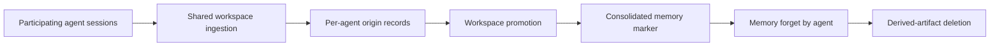

Codex review: found issues before merge. _Reviewed August 26, 2026, 1:03 PM ET / 17:03 UTC._

# ClawSweeper review

## What this changes

Adds memory-session admission exclusions, durable provenance and tombstones, and a `memory forget` command that removes session-derived memory artifacts.

## Merge readiness

⚠️ **Ready for maintainer review - 5 items remain**

Keep open: the prior P1 remains at the current head. Shared-workspace consolidation preserves provenance only for the selected sweep owner, so forgetting another participating agent’s session can miss the live replacement memory entry.

**Priority:** P1
**Reviewed head:** `72b79861f36492981048b5471e50b5b2c437363d`

## Review scores

| Measure | Result | What it means |
|---|---|---|
| **Overall readiness** | 🦐 gold shrimp **(3/6)** | The patch has strong implementation and validation signal, but the central erasure invariant still fails for shared workspaces. |
| **Proof confidence** | 🌊 off-meta tidepool | Not applicable: This maintainer-authored PR is exempt from the external-contributor proof gate; its body nevertheless reports a real isolated-gateway run, while the remaining blocker is a missing two-agent shared-workspace case. |
| **Patch quality** | 🦐 gold shrimp **(3/6)** | Security review found an item that needs attention. |

## Verification

| Check | Result | Evidence |
|---|---|---|
| **Real behavior** | Not applicable | Not applicable: This maintainer-authored PR is exempt from the external-contributor proof gate; its body nevertheless reports a real isolated-gateway run, while the remaining blocker is a missing two-agent shared-workspace case. |
| **Evidence reviewed** | 6 items | Shared-workspace source roster: The workspace resolver deliberately groups alpha and gamma under one shared workspace, establishing the multi-agent path the deletion feature must preserve.<br>Origins are stored by source agent: Session ingestion records each origin using its source agent ID and writes each group to that agent’s database.<br>Single-owner reconciliation: Promotion reconciles only options.agentId, although the sweep selects one deterministic owner for a shared workspace. |
| **Findings** | 1 actionable finding | [P1] Reconcile shared-workspace origins for every source agent |
| **Security** | Needs attention | Preserve cross-agent provenance during consolidation: A non-owner participant’s origin is not re-keyed when the shared workspace replaces a promoted marker, so its deletion request can miss the surviving derived memory. |


### Live Verification

**Command:** `pnpm openclaw memory forget --help`

**Result:** PASS (completed)

```text
$ node scripts/run-node.mjs memory forget --help
[openclaw] Building TypeScript (dist is stale: missing_build_stamp - build stamp missing).
[openclaw] Building bundled plugin assets.
[canvas] build: node scripts/bundle-a2ui.mjs
[log] ‹DIR›/a2ui.bundle.js  chunk │ size: 399.96 kB
[log] ‹DIR›/a2ui-v0.9.bundle.js  chunk │ size: 615.66 kB
[log]
[success] rolldown v1.2.0 Finished in 102.29 ms
[diffs] build: node --import tsx ../../scripts/build-diffs-viewer-runtime.mts curated
[diffs-language-pack] build: node --import tsx ../../scripts/build-diffs-viewer-runtime.mts full
[discord] build: node --import tsx ../../scripts/build-discord-activity-sdk.mts
[tsdown-build] invocation 1/2 finished in 0.7s
node_modules/playwright-core/lib/coreBundle.js (65821:28) [EVAL] Use of direct ˋevalˋ function is strongly discouraged as it poses security risks and may cause
issues with minification.
       ╭─[ node_modules/playwright-core/lib/coreBundle.js:65821:29 ]
       │
 65821 │               const value = eval(ˋ(${expr})ˋ);
       │                             ──┬─
       │                               ╰─── Use of direct ˋevalˋ here.
       │
       │ Help: Consider using indirect eval. For more information, check the documentation: https://rolldown.rs/guide/troubleshooting#avoiding-direct-eval
───────╯

node_modules/playwright-core/lib/coreBundle.js (65828:28) [EVAL] Use of direct ˋevalˋ function is strongly discouraged as it poses security risks and may cause
issues with minification.
       ╭─[ node_modules/playwright-core/lib/coreBundle.js:65828:29 ]
       │
 65828 │               const value = eval(ˋ(${expr})ˋ);
       │                             ──┬─
       │                               ╰─── Use of direct ˋevalˋ here.
       │
       │ Help: Consider using indirect eval. For more information, check the documentation: https://rolldown.rs/guide/troubleshooting#avoiding-direct-eval
───────╯

node_modules/web-tree-sitter/web-tree-sitter.js (2343:30) [EVAL] Use of direct ˋevalˋ function is strongly discouraged as it poses security risks and may cause
issues with minification.
      ╭─[ node_modules/web-tree-sitter/web-tree-sitter.js:2343:31 ]
      │
 2343 │           ASM_CONSTS[start] = eval(func);
      │                               ──┬─
      │                                 ╰─── Use of direct ˋevalˋ here.
      │
      │ Help: Consider using indirect eval. For more information, check the documentation: https://rolldown.rs/guide/troubleshooting#avoiding-direct-eval
──────╯

node_modules/web-tree-sitter/web-tree-sitter.js (2366:32) [EVAL] Use of direct ˋevalˋ function is strongly discouraged as it poses security risks and may cause
issues with minification.
      ╭─[ node_modules/web-tree-sitter/web-tree-sitter.js:2366:33 ]
      │
 2366 │           moduleExports[name] = eval(func);
      │                                 ──┬─
      │                                   ╰─── Use of direct ˋevalˋ here.
      │
      │ Help: Consider using indirect eval. For more information, check the documentation: https://rolldown.rs/guide/troubleshooting#avoiding-direct-eval
──────╯

[tsdown-build] invocation 2/2 finished in 14.0s
[plugin-control-plane-loads] verified 35 built modules with native require and checked doctor closures
runtime-postbuild: 11 phases completed in 4247ms (slowest: built plugin control-plane loads 3508ms)
│
◇

OpenClaw 2026.8.1 (72b7986) — All your chats, one OpenClaw.

Usage: openclaw memory forget [options]

Delete memories and derived artifacts from selected sessions

Options:
  --agent ‹id›              Agent id (default: default agent)
  --dry-run                 Report everything that would be deleted without writing (default: false)
  -h, --help                Display help for command
  --hook-source ‹source›    External-content hook source (repeatable) (default: [])
  --json                    Print the complete machine-readable deletion report
  --participant ‹actor-id›  Session participant ac
… output truncated …
```

**Assertions:**

- PASS `expect_output`: Delete memories and derived artifacts from selected sessions

## How this fits together

Memory Core ingests participating agents’ session transcripts into a shared workspace, promotes consolidated facts into durable memory, and later resolves session selectors to delete derived artifacts. This PR adds the provenance records that connect those stages.



## Before merge

- [ ] **Reconcile shared-workspace origins for every source agent (P1)** - This repeats the prior P1: ingestion stores gamma’s origin in gamma’s database, but a shared-workspace sweep selects one owner and this call reconciles only that owner. If alpha consolidates a gamma-derived marker, `memory forget --agent gamma` retains the retired key and cannot remove the live replacement. Reconcile all workspace participants (or use one canonical workspace store) and cover alpha/gamma consolidation followed by gamma deletion.
- [ ] **Resolve security concern: Preserve cross-agent provenance during consolidation** - A non-owner participant’s origin is not re-keyed when the shared workspace replaces a promoted marker, so its deletion request can miss the surviving derived memory.
- [ ] **Resolve merge risk (P1)** - A shared workspace can retain a consolidated memory derived from an erased participant because that participant’s provenance remains on a retired marker key.
- [ ] **Resolve merge risk (P1)** - The Codex transcript-parser contract cited by the PR could not be independently inspected because the required sibling checkout is unavailable.
- [ ] **Complete next step (P2)** - The concrete P1 is on a protected maintainer PR and needs the author’s owner-boundary repair before merge.

## Findings

- [P1] Reconcile shared-workspace origins for every source agent — `extensions/memory-core/src/short-term-promotion-apply.ts:617-630`
- [high] Preserve cross-agent provenance during consolidation — `extensions/memory-core/src/short-term-promotion-apply.ts:618`


<details>
<summary><strong>Agent review details</strong></summary>

### Security

Needs attention: The unresolved shared-workspace provenance defect can leave session-derived memory after an operator requests deletion.

### PR surface

Source +1832, Tests +1798, Docs +385, Generated +18. Total +4033 across 51 files.

<details>
<summary>View PR surface stats</summary>

| Area | Files | Added | Removed | Net |
|---|---:|---:|---:|---:|
| Source | 35 | 1882 | 50 | +1832 |
| Tests | 12 | 1804 | 6 | +1798 |
| Docs | 3 | 389 | 4 | +385 |
| Config | 0 | 0 | 0 | 0 |
| Generated | 1 | 18 | 0 | +18 |
| Other | 0 | 0 | 0 | 0 |
| **Total** | **51** | **4093** | **60** | **+4033** |

</details>

### Review metrics

| Metric | Value | Why it matters |
|---|---|---|
| **Production versus test delta** | production +1,720 net; tests +1,647; docs +373; generated typings +18 | The PR body reports substantial justified feature growth, making the missing cross-agent owner-boundary proof especially important before merge. |
| **New admission configuration** | 3 selector arrays added | The new hook-source, channel, and chat-type exclusion selectors change durable-memory admission policy for configured operators. |

### Stored data model

Persistent data-model change detected: `database schema: extensions/memory-core/src/memory-entry-origins.ts`, `database schema: src/state/openclaw-agent-db.test.ts`, `database schema: src/state/openclaw-agent-schema.sql`, `migration/backfill/repair: extensions/memory-core/src/session-backfill.test.ts`, `persistent cache schema: extensions/memory-core/src/config.test.ts`, `serialized state: extensions/memory-core/src/memory-forget-curated-writes.ts`, and 54 more. Confirm migration or upgrade compatibility proof before merge.

### Merge-risk options

**Maintainer options:**
1. **Repair shared-workspace provenance before merge (recommended)**  
   Carry the complete participant roster into reconciliation and add a two-agent consolidation-to-forget regression that proves the non-owner can erase the live replacement.

<details>
<summary>Copy recommended automerge instruction</summary>

```text
@clawsweeper automerge

Special instructions:
Reconcile provenance for every participant in a shared workspace and add an alpha/gamma consolidation followed by non-owner forget regression.
```

</details>

### Technical review

Best possible solution:

Reconcile each shared-workspace marker rewrite in every participating source-agent provenance store, then prove a two-agent consolidation followed by `memory forget --agent &lt;non-owner>` removes the live replacement without removing unrelated lineage.

Do we have a high-confidence way to reproduce the issue?

Yes, from source: configure alpha and gamma to share a workspace, consolidate a gamma-derived marker while alpha owns the sweep, then forget gamma; gamma’s store still references the retired marker.

Is this the best way to solve the issue?

No: the current single-owner reconciliation is not sufficient for a shared workspace; provenance must be reconciled across all participant stores or owned canonically by the workspace.

Full review comments:

- [P1] Reconcile shared-workspace origins for every source agent — `extensions/memory-core/src/short-term-promotion-apply.ts:617-630`
  This repeats the prior P1: ingestion stores gamma’s origin in gamma’s database, but a shared-workspace sweep selects one owner and this call reconciles only that owner. If alpha consolidates a gamma-derived marker, `memory forget --agent gamma` retains the retired key and cannot remove the live replacement. Reconcile all workspace participants (or use one canonical workspace store) and cover alpha/gamma consolidation followed by gamma deletion.
  Confidence: 0.98
  Late finding: first raised on code an earlier review cycle already covered.

Overall correctness: patch is incorrect
Overall confidence: 0.98

AGENTS.md: found and applied where relevant.

Codex review notes: model internal, reasoning high; reviewed against [8ce8085e8459](https://github.com/openclaw/openclaw/commit/8ce8085e845962cd2e461eadfabe9e5cc94d7aba).

### Labels

Label justifications:

- `P1`: The unresolved path can leave session-derived durable memory behind after an operator invokes the new erasure command.
- `merge-risk: 🚨 session-state`: Shared workspace provenance can become stale and no longer identify the live consolidated memory entry.
- `merge-risk: 🚨 security-boundary`: The defect violates the PR’s session-derived memory deletion boundary for participating agents.
- `rating: 🦐 gold shrimp`: Overall readiness is 🦐 gold shrimp; proof is 🌊 off-meta tidepool and patch quality is 🦐 gold shrimp.
- `status: ⏳ waiting on author`: ClawSweeper has contributor-facing work open and is waiting for author action. Not applicable: This maintainer-authored PR is exempt from the external-contributor proof gate; its body nevertheless reports a real isolated-gateway run, while the remaining blocker is a missing two-agent shared-workspace case.

### Evidence

Security concerns:

- [high] Preserve cross-agent provenance during consolidation — `extensions/memory-core/src/short-term-promotion-apply.ts:618`
  A non-owner participant’s origin is not re-keyed when the shared workspace replaces a promoted marker, so its deletion request can miss the surviving derived memory.
  Confidence: 0.98

What I checked:

- **Shared-workspace source roster:** The workspace resolver deliberately groups alpha and gamma under one shared workspace, establishing the multi-agent path the deletion feature must preserve. ([`src/memory-host-sdk/dreaming.test.ts:216`](https://github.com/openclaw/openclaw/blob/72b79861f364/src/memory-host-sdk/dreaming.test.ts#L216), [72b79861f364](https://github.com/openclaw/openclaw/commit/72b79861f364))
- **Origins are stored by source agent:** Session ingestion records each origin using its source agent ID and writes each group to that agent’s database. ([`extensions/memory-core/src/short-term-promotion-record.ts:321`](https://github.com/openclaw/openclaw/blob/72b79861f364/extensions/memory-core/src/short-term-promotion-record.ts#L321), [72b79861f364](https://github.com/openclaw/openclaw/commit/72b79861f364))
- **Single-owner reconciliation:** Promotion reconciles only options.agentId, although the sweep selects one deterministic owner for a shared workspace. ([`extensions/memory-core/src/short-term-promotion-apply.ts:618`](https://github.com/openclaw/openclaw/blob/72b79861f364/extensions/memory-core/src/short-term-promotion-apply.ts#L618), [72b79861f364](https://github.com/openclaw/openclaw/commit/72b79861f364))
- **Forget reads only the requested agent store:** The deletion command builds marker keys solely from the selected agent’s origin table, so a retired gamma key cannot identify alpha’s live replacement marker. ([`extensions/memory-core/src/memory-forget.ts:349`](https://github.com/openclaw/openclaw/blob/72b79861f364/extensions/memory-core/src/memory-forget.ts#L349), [72b79861f364](https://github.com/openclaw/openclaw/commit/72b79861f364))
- **History and current-head continuity:** Blame attributes the reconciliation lines to the current PR head; the current head is the same SHA reviewed for the earlier unresolved P1. ([`extensions/memory-core/src/short-term-promotion-apply.ts:618`](https://github.com/openclaw/openclaw/blob/72b79861f364/extensions/memory-core/src/short-term-promotion-apply.ts#L618), [72b79861f364](https://github.com/openclaw/openclaw/commit/72b79861f364))
- **Codex dependency inspection gap:** The PR’s transcript-derived curated-write claim depends on Codex apply_patch shapes, but the required sibling checkout is absent and DNS prevented cloning; this does not affect the independently established shared-workspace finding. ([`extensions/memory-core/src/memory-forget-curated-writes.ts:1`](https://github.com/openclaw/openclaw/blob/72b79861f364/extensions/memory-core/src/memory-forget-curated-writes.ts#L1), [72b79861f364](https://github.com/openclaw/openclaw/commit/72b79861f364))

Likely related people:

- **steipete:** Current-head blame and all five PR commits attribute the memory provenance, reconciliation, and forget paths to this author. (role: feature introducer and recent area contributor; confidence: high; commits: [0a37957681d6](https://github.com/openclaw/openclaw/commit/0a37957681d67009dd58ccae9bd7642daa8d6427), [8081a869310c](https://github.com/openclaw/openclaw/commit/8081a869310cbb080e3222402ccc286ba3c0d942), [72b79861f364](https://github.com/openclaw/openclaw/commit/72b79861f36492981048b5471e50b5b2c437363d); files: `extensions/memory-core/src/short-term-promotion-apply.ts`, `extensions/memory-core/src/memory-entry-origins.ts`, `extensions/memory-core/src/memory-forget.ts`)

### Rank-up moves

Optional improvements that raise the rating; they are not merge blockers.

- Reconcile provenance across all source agents participating in a shared workspace.
- Add a two-agent consolidation-to-forget regression at the deletion boundary.
- Provide direct Codex-source evidence for the transcript apply_patch parser claim when the sibling checkout is available.

### Rating scale

| Score | Internal tier | Crab rank | Meaning |
|---:|:---:|---|---|
| **6/6** | S | 🦀 challenger crab | Exceptional readiness |
| **5/6** | A | 🦞 diamond lobster | Very strong readiness |
| **4/6** | B | 🐚 platinum hermit | Good normal PR; ordinary maintainer review |
| **3/6** | C | 🦐 gold shrimp | Useful, but confidence is limited |
| **2/6** | D | 🦪 silver shellfish | Proof or implementation needs work |
| **1/6** | F | 🧂 unranked krab | Not merge-ready |
| N/A | NA | 🌊 off-meta tidepool | Rating does not apply |

Overall follows the weaker of proof and patch quality.
Shiny media proof means a screenshot, video, or linked artifact directly shows the changed behavior. Runtime, network, CSP, and security claims still need visible diagnostics.

### Workflow

- ClawSweeper keeps one durable marker-backed review comment per issue or PR.
- Re-runs edit this comment so the latest verdict, findings, and automation markers stay together instead of adding duplicate bot comments.
- A fresh review can be triggered by eligible `@clawsweeper re-review` comments, exact-item GitHub events, scheduled/background review runs, or manual workflow dispatch.
- PR/issue authors and users with repository write access can comment `@clawsweeper re-review` or `@clawsweeper re-run` on an open PR or issue to request a fresh review only.
- Maintainers can also comment `@clawsweeper review` to request a fresh review only.
- Fresh-review commands do not start repair, autofix, rebase, CI repair, or automerge.
- Maintainer-only repair and merge flows require explicit commands such as `@clawsweeper autofix`, `@clawsweeper automerge`, `@clawsweeper fix ci`, or `@clawsweeper address review`.
- Maintainers can comment `@clawsweeper explain` to ask for more context, or `@clawsweeper stop` to stop active automation.

### History

<details>
<summary>Review history (3 earlier review cycles)</summary>

<!-- clawsweeper-review-history v=1 total=3 -->
- reviewed 2026-08-26T13:55:37.359Z sha 566ededdbf82438bb8fd6797c35a25184dade795 :: needs changes before merge. :: [P1] Resolve archived sessions before purging memory
- reviewed 2026-08-26T14:21:09.123Z sha 366bb7e34b493115d8dac8123b8db724389f5e47 :: found issues before merge. :: [P1] Resolve archived sessions before purging memory
- reviewed 2026-08-26T15:31:06.878Z sha 72b79861f36492981048b5471e50b5b2c437363d :: found issues before merge. :: [P1] Reconcile shared-workspace origins for every source agent

</details>

</details>

<!-- clawsweeper-security:security-sensitive item=130151 sha=72b79861f36492981048b5471e50b5b2c437363d confidence=high updated_at=2026-08-26T17:01:00Z reviewed_at=2026-08-26T17:03:41.721Z lease_owner=github-run-32991594491-1 lease_comment_id=5428413160 source_revision=7993504be89021e2ec96446486516d0199d58d320070959ec758a4ef1fc93b7f -->
<!-- clawsweeper-verdict:needs-human item=130151 sha=72b79861f36492981048b5471e50b5b2c437363d confidence=high updated_at=2026-08-26T17:01:00Z reviewed_at=2026-08-26T17:03:41.721Z lease_owner=github-run-32991594491-1 lease_comment_id=5428413160 source_revision=7993504be89021e2ec96446486516d0199d58d320070959ec758a4ef1fc93b7f -->

<!-- clawsweeper-review-version item=130151 reviewed_at=2026-08-26T17:03:41.721Z sha=72b79861f36492981048b5471e50b5b2c437363d source_revision=7993504be89021e2ec96446486516d0199d58d320070959ec758a4ef1fc93b7f lease_owner=github-run-32991594491-1 lease_comment_id=5428413160 v=1 -->

<!-- clawsweeper-review item=130151 -->