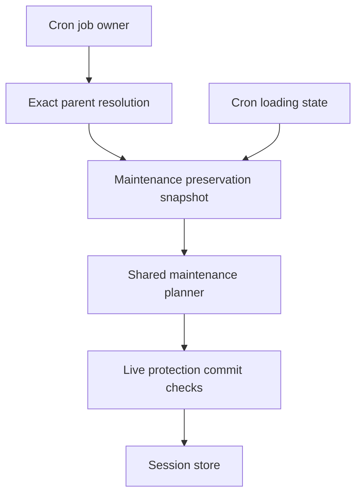

Codex review: needs maintainer review before merge.

## What this changes

This PR protects conversations with enabled parent-linked automations from automatic archiving and defers archiving while automation protection loads.

**Example:** A dashboard conversation owns an enabled weekly report and remains idle for 8 days.
- **Before:** Default 7-day maintenance archives the conversation, causing its automation to pause.
- **After:** Maintenance preserves the conversation and the report continues running; disabling the automation releases protection.

## Review scores

| Measure | Result | What it means |
|---|---|---|
| **Overall readiness** | 🦞 diamond lobster **(5/6)** | A focused owner-based repair with shipped-entry-point and latest-stable upgrade evidence, distinct regressions, and no actionable findings. |
| **Proof confidence** | 🦞 diamond lobster **(5/6)** | Sufficient (logs): Published Gateway results exercise automatic maintenance, sessions cleanup enforcement, protected-job execution, and an archived control's pause through the real Gateway with mock-openai; the final head changes only the test-line allocation, and inspected historical screenshots establish earlier UI behavior rather than this retention fix. |
| **Patch quality** | 🦞 diamond lobster **(5/6)** | No actionable review findings were identified. |

## Product

**Kind:** Bug fix · **Worth it:** Yes · **Fix scope:** Complete
**User problem:** Recurring reports, watchers, and reminders stop when automatic maintenance archives their idle creating conversation.
**Reason:** The maintainer-authored direction resolves the documented interaction using existing owners, without adding configuration or weakening explicit archive/delete behavior.

## Merge readiness

✅ **Ready for maintainer review**

Keep this PR open: it fixes a current-main retention gap, and the previous hot-reload finding is resolved; no actionable findings remain.

**Priority:** P2
**Reviewed head:** `8909743363dd1fe91689ac7e0bb581d0f80e960f`

## Before merge

None.

## Findings

None.

<strong>Agent review details</strong>

### How this fits together

The Gateway's cron owner supplies enabled jobs to session-maintenance preservation; the shared planner and commit checks use those facts to decide which session rows may be archived.

### Technical review

Best possible solution:

Merge the cron-owned preservation provider and shared loading deferral once the existing CI gates pass.

Do we have a high-confidence way to reproduce the issue?

Current-main maintenance can archive an unprotected idle dashboard parent, and scheduled admission classifies that parent as archived and pauses its job; supplied Gateway evidence exercises the repaired flow, but this review ran no target code.

Is this the best way to solve the issue?

Preserving parents at the shared maintenance boundary fixes the cause while retaining explicit archive/delete pauses, existing retention settings, and occurrence authorization checks.

AGENTS.md: found and applied where relevant.

Codex review notes: model internal, reasoning medium; reviewed against [be9444ea8617](https://github.com/openclaw/openclaw/commit/be9444ea8617305d31bfd28d4e56919b55db4963).

### Provenance checked

- `Automatic session retention eligibility` changes intended behavior with a stated reason (f2158a9c3683f65b5f8c30a7a8524a5b2a96efaf: https://github.com/openclaw/openclaw/pull/124925 introduced automatic dashboard archiving to keep durable sessions inspectable while tidying inactive conversations.)
- `Automation index lifecycle and membership publication` keeps the original intent (34c735e1ccb1cba1c9866ea4b68c1518cd5f353b: https://github.com/openclaw/openclaw/pull/151279 retained owner-controlled source registration and exact binding deltas to avoid unrelated session-row rebuilds.)
- `Maintenance preservation and worker commit checks` keeps the original intent (ecd7875e3a4d933d05319cb9bce264e4597f9d82: https://github.com/openclaw/openclaw/pull/165684 moved bulk work to workers while retaining live preservation and settlement checks; this PR extends those existing checks to pending protection.)
- `Personal-pin preservation` keeps the original intent (c4d5fddda1388a347ca4d575a52b629857fe990c: https://github.com/openclaw/openclaw/pull/180610 protects committed personal pins through cleanup settlement without rewriting preferences; the added automation facts compose with that protection.)
- `Archived-parent automation pauses` keeps the original intent (71bbd18bb2a9f149149c14279aaaae13e73a8c16: https://github.com/openclaw/openclaw/pull/178965 pauses jobs whose exact creating parent is unavailable; this PR prevents unintended automatic archiving rather than bypassing admission.)

### Testing

Proof path: shipped entry point.

### Security

None.

### Evidence

What I checked:

- **Current main still lacks automation preservation:** Fetched main retains a display-only automation index without the maintenance provider added by this PR; the linked report establishes the maintenance-to-parent-pause interaction at https://github.com/openclaw/openclaw/issues/187590. ([`src/gateway/session-automation-index.ts:26`](https://github.com/openclaw/openclaw/blob/be9444ea8617305d31bfd28d4e56919b55db4963/src/gateway/session-automation-index.ts#L26), [be9444ea8617](https://github.com/openclaw/openclaw/commit/be9444ea8617305d31bfd28d4e56919b55db4963))
- **Existing owners provide the complete fix:** Enabled jobs resolve their exact creating parent through resolveScheduledPrincipal and feed the existing preservation provider; shared planning and final commit checks carry loading deferral across SQLite, memory, and file-backed paths. ([`src/gateway/session-automation-index.ts:163`](https://github.com/openclaw/openclaw/blob/8909743363dd1fe91689ac7e0bb581d0f80e960f/src/gateway/session-automation-index.ts#L163), [8909743363dd](https://github.com/openclaw/openclaw/commit/8909743363dd1fe91689ac7e0bb581d0f80e960f))
- **Previous hot-reload finding resolved:** Replacement construction arms pending protection before predecessor unregistration, and a disabled replacement releases leftover deferral; distinct regression cases cover both transitions. ([`src/gateway/session-automation-index.ts:55`](https://github.com/openclaw/openclaw/blob/8909743363dd1fe91689ac7e0bb581d0f80e960f/src/gateway/session-automation-index.ts#L55), [8909743363dd](https://github.com/openclaw/openclaw/commit/8909743363dd1fe91689ac7e0bb581d0f80e960f))
- **Gateway behavior and stable upgrade evidence:** The PR body records a real Gateway with mock-openai: automatic maintenance and enforced cleanup preserve the enabled parent, controls archive, and the protected job reaches the model and remains enabled. Published results also cover stable-created and newly created conversations and jobs after upgrading from v2026.11.2. ([6b7c92c96d9f](https://github.com/openclaw/openclaw/commit/6b7c92c96d9f84a07678600ce728b22c16274801))
- **Runtime proof remains applicable:** The reviewed head differs from the proven revision only in the test-line allocation record; runtime code, tests, and documentation are unchanged. ([`config/test-lines-allocations/196297-automation-parent-retention.txt:1`](https://github.com/openclaw/openclaw/blob/8909743363dd1fe91689ac7e0bb581d0f80e960f/config/test-lines-allocations/196297-automation-parent-retention.txt#L1), [8909743363dd](https://github.com/openclaw/openclaw/commit/8909743363dd1fe91689ac7e0bb581d0f80e960f))
- **Recorded retention tradeoff:** The maintainer-authored direction explicitly accepts exceeding maxEntries while enabled parents are protected or cron loading remains failed; it preserves disposable-row cleanup and emits a warning for failed loading. ([`src/gateway/session-automation-index.ts:69`](https://github.com/openclaw/openclaw/blob/8909743363dd1fe91689ac7e0bb581d0f80e960f/src/gateway/session-automation-index.ts#L69), [8909743363dd](https://github.com/openclaw/openclaw/commit/8909743363dd1fe91689ac7e0bb581d0f80e960f))

Likely related people:

- **Josh Lehman:** Raw commit 34c735e1ccb1cba1c9866ea4b68c1518cd5f353b adds src/gateway/session-automation-index.ts:70 relative to its recorded parents. This identifies author metadata, not feature responsibility or a PR merger. (role: source-line author; confidence: high; commits: [34c735e1ccb1](https://github.com/openclaw/openclaw/commit/34c735e1ccb1cba1c9866ea4b68c1518cd5f353b); files: `src/gateway/session-automation-index.ts`)
- **Peter Steinberger:** Raw commit 3d9b912b88499c36d89a1e34f8aec734892062ac adds src/gateway/session-automation-index.ts:55 relative to its recorded parents. This identifies author metadata, not feature responsibility or a PR merger. (role: source-line author; confidence: high; commits: [3d9b912b8849](https://github.com/openclaw/openclaw/commit/3d9b912b88499c36d89a1e34f8aec734892062ac); files: `src/gateway/session-automation-index.ts`)
- **Vyctor H. Brzezowski:** Raw commit c4d5fddda1388a347ca4d575a52b629857fe990c adds src/config/sessions/store-maintenance-preserve.ts:107 relative to its recorded parents. This identifies author metadata, not feature responsibility or a PR merger. (role: source-line author; confidence: medium; commits: [c4d5fddda138](https://github.com/openclaw/openclaw/commit/c4d5fddda1388a347ca4d575a52b629857fe990c); files: `src/config/sessions/store-maintenance-preserve.ts`)

### PR surface

Source +125, Tests +168, Docs 0, Other +2. Total +295 across 20 files. Added test files: 1.

View PR surface stats

| Area | Files | Added | Removed | Net |
|---|---:|---:|---:|---:|
| Source | 15 | 149 | 24 | +125 |
| Tests | 2 | 172 | 4 | +168 |
| Docs | 2 | 3 | 3 | 0 |
| Config | 0 | 0 | 0 | 0 |
| Generated | 0 | 0 | 0 | 0 |
| Other | 1 | 2 | 0 | +2 |
| **Total** | **20** | **326** | **31** | **+295** |

### Preflight source

Source unknown. Source comparison at the observed PR snapshot only. Completion is self-reported; body, policy, tests, execution, and report bytes are not verified.

### Review metrics

| Metric | Value | Why it matters |
|---|---|---|
| **Production versus regression coverage** | Production +149/-24 lines; tests +172/-4 lines | Production growth carries protection through existing maintenance and lifecycle owners; regression growth covers three independent archive phases plus loading failure and reload transitions. |

### Root-cause cluster

Relationship: `same_root_cause`
Canonical: https://github.com/openclaw/openclaw/issues/187590
Summary: This PR implements the canonical report's requested protection for enabled automations' creating conversations.

Members:
- `canonical`: https://github.com/openclaw/openclaw/issues/187590 - The report identifies the same dashboard, age, and count-cap maintenance interaction with archived-parent pauses.

Proposal only: this assessment does not dispatch repair, suppress jobs, mutate sibling items, close, or merge anything.

### Labels

Label changes:

- add `rating: 🦞 diamond lobster`: Overall readiness is 🦞 diamond lobster; proof is 🦞 diamond lobster and patch quality is 🦞 diamond lobster.
- remove `rating: 🐚 platinum hermit`: Current PR rating is `rating: 🦞 diamond lobster`, so this older rating label is no longer current.

Label justifications:

- `P2`: Automatic retention can silently stop recurring automations attached to idle conversations, with a focused repair and limited affected surface.
- `rating: 🦞 diamond lobster`: Overall readiness is 🦞 diamond lobster; proof is 🦞 diamond lobster and patch quality is 🦞 diamond lobster.
- `status: 👀 ready for maintainer look`: ClawSweeper has no concrete contributor-facing blocker left for this PR.
- `proof: sufficient`: Contributor real behavior proof is sufficient.

### Rating scale

6/6 🦀 challenger crab · 5/6 🦞 diamond lobster · 4/6 🐚 platinum hermit · 3/6 🦐 gold shrimp · 2/6 🦪 silver shellfish · 1/6 🧂 unranked krab. Overall follows the weaker of proof and patch quality; ✨ marks media proof (a screenshot, video, or linked artifact) that directly shows the changed behavior.

### Workflow

ClawSweeper edits this one comment on every review. Comment `@clawsweeper re-review` for a fresh review only. Repair and merge execution lanes are retired.

### History

Review history (4 earlier review cycles)

<!-- clawsweeper-review-history v=1 total=4 -->
- reviewed 2026-11-09T23:12:28.140Z sha 3ac99f42b9c9aadfa5980e495aaa49c42c0f64d6 :: blocked before merge. :: none
- reviewed 2026-11-09T23:38:27.515Z sha 3ac99f42b9c9aadfa5980e495aaa49c42c0f64d6 :: blocked before merge. :: none
- reviewed 2026-11-10T00:26:53.971Z sha fbb1ef19153217390d8c1c641d9f9bc6ccbf7f83 :: needs changes before merge. :: [P2] Keep preservation pending across cron hot reloads
- reviewed 2026-11-10T01:24:22.547Z sha 6b7c92c96d9f84a07678600ce728b22c16274801 :: needs maintainer review before merge. :: none

_Reviewed November 9, 2026, 8:41 PM ET / November 10, 2026, 01:41 UTC (Revision 5)._

<!-- clawsweeper-verdict:needs-human item=196297 sha=8909743363dd1fe91689ac7e0bb581d0f80e960f confidence=high updated_at=2026-11-10T01:36:10Z reviewed_at=2026-11-10T01:41:30.327Z lease_owner=github-run-42736808148-1 lease_comment_id=6756380864 source_revision=452cf9a3783d2b2182ce0732f98804028bd88f177e7e4ddad07c8c566a0d447a hold=not_opted_in findings=0 -->
<!-- clawsweeper-review-state:ready item=196297 sha=8909743363dd1fe91689ac7e0bb581d0f80e960f v=1 -->

<!-- clawsweeper-review-version item=196297 reviewed_at=2026-11-10T01:41:30.327Z sha=8909743363dd1fe91689ac7e0bb581d0f80e960f source_revision=452cf9a3783d2b2182ce0732f98804028bd88f177e7e4ddad07c8c566a0d447a lease_owner=github-run-42736808148-1 lease_comment_id=6756380864 v=1 -->

<!-- clawsweeper-review item=196297 -->