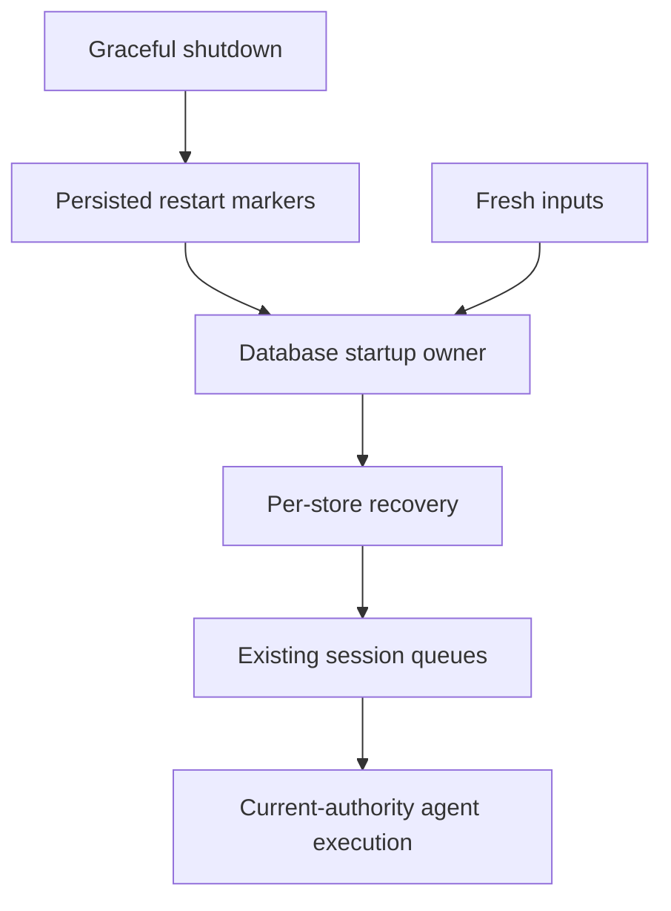

Codex review: needs maintainer review before merge.

## What this changes

Resume interrupted chats after their databases finish preparation, admitting retained follow-ups before fresh inputs.

**Example:** A guest is building an equipment-loan app with a printable-checklist follow-up queued during a source update.
- **Before:** The updated Gateway becomes healthy, but the conversation stays inactive with its restart marker and follow-up retained.
- **After:** The conversation receives a restart instruction automatically and retains its original follow-up for normal queue processing.

## Review scores

| Measure | Result | What it means |
|---|---|---|
| **Overall readiness** | 🦞 diamond lobster **(5/6)** | A complete owner-based repair with visible product evidence, native boundary coverage, preserved storage contracts, and passing exact-head gates. |
| **Proof confidence** | 🦞 diamond lobster **(5/6)** ✨ media proof bonus | Sufficient (screenshot): The inspected real-Gateway before/after screenshots show automatic continuation and the original retained follow-up on the stated head; self-contained source-update results record preserved identities and once-only consumption, addressing the earlier recovery-proof request. |
| **Patch quality** | 🦞 diamond lobster **(5/6)** | No actionable review findings were identified. |

## Product

**Kind:** Bug fix · **Worth it:** Yes · **Fix scope:** Complete
**User problem:** Interrupted conversations fail to continue automatically after an otherwise successful graceful restart or update.
**Reason:** The maintainer-authored change restores documented behavior without adding configuration, a new persistence format, or another execution owner.

## Merge readiness

✅ **Ready for maintainer review**

This PR fixes a confirmed startup-recovery bug; no actionable defect was found in the reviewed head, and its exact-head CI gate is green.

**Priority:** P1
**Reviewed head:** `f606cd3f3c4d68a9adfae6aec0c5d76935e78269`

## Before merge

None.

## Findings

None.

<strong>Agent review details</strong>

### How this fits together

Gateway startup prepares agent databases, discovers persisted restart work, and hands eligible inputs to existing session queues under current authority.

### Technical review

Best possible solution:

Land the existing startup owner's per-store recovery handoff while preserving ordinary queues and current-authority admission.

Do we have a high-confidence way to reproduce the issue?

Current-main source explains the omitted pending store, and the linked report supplies a deterministic native failure plus an observed update failure; no target code was executed during this review.

Is this the best way to solve the issue?

The fix addresses readiness at its existing owner, shares initial and deferred recovery per physical store, and preserves distinct read, write, and input admission.

AGENTS.md: found and applied where relevant.

Codex review notes: model internal, reasoning medium; reviewed against [82b8cd04ae16](https://github.com/openclaw/openclaw/commit/82b8cd04ae16a6712332dcb14b8391709b218c9d).

### Provenance checked

- `Graceful restart recovery and queued-input settlement` keeps the original intent (9344233e7a66fe36479d55b7f7ae8e10eb886586: Replace execution reconstruction with one ordinary resume input and retained FIFO input admission; later settlement work deliberately kept crash inputs inert.)
- `Independent agent startup and read/write admission` keeps the original intent (9f32d252fbd75d8b0e21ad0581b9055b1c6cbaa5: Serve committed reads before integrity completes while retaining writable safeguards and independent healthy-agent progress.)
- `Preparation waiters and cancellation` keeps the original intent (543dd39563e44192fe79a48e6a36f2563182436c: Wait for the selected agent, preserve cancellation and idempotency, and avoid a competing retry owner.)
- `Current principal authority` keeps the original intent (52bc4b51ab785d1ce7c5a127410794c7336ba3bd: Resolve current caller or session-principal authority and refuse revoked work without substituting a stronger principal.)
- `Conversation binding checks` keeps the original intent (286ff4feba36a13247aa6a9e3e37437fdb6d2020: Reject stale conversation bindings before effects after asynchronous preparation.)
- `Legacy upgrade recovery` keeps the original intent (0ebd36afdbfe8430870f034bb5df2a6944a36707: Adopt only recent interrupted legacy cycles once, without restoring old execution or authority snapshots.)

### Testing

Proof path: shipped entry point.

### Security

None.

### Evidence

What I checked:

- **Confirmed report and current-main failure path:** https://github.com/openclaw/openclaw/issues/187809 documents both a native failing reproduction and an observed source-update failure; fetched main still performs the initial inventory scan without the deferred recovery handoff. ([`src/gateway/session-restart-resume.ts:272`](https://github.com/openclaw/openclaw/blob/82b8cd04ae16a6712332dcb14b8391709b218c9d/src/gateway/session-restart-resume.ts#L272), [82b8cd04ae16](https://github.com/openclaw/openclaw/commit/82b8cd04ae16a6712332dcb14b8391709b218c9d))
- **Introduced fix and store ownership:** The introduced range captures recovery during preparation, shares one operation per physical store, and runs recovery after temporary database access ends. ([`src/gateway/session-restart-resume.ts:364`](https://github.com/openclaw/openclaw/blob/f606cd3f3c4d68a9adfae6aec0c5d76935e78269/src/gateway/session-restart-resume.ts#L364), [f606cd3f3c4d](https://github.com/openclaw/openclaw/commit/f606cd3f3c4d68a9adfae6aec0c5d76935e78269))
- **Separate database and input readiness:** Input readiness is installed before writable admission and released after recovery; recovery failures do not incorrectly degrade an admitted database. ([`src/state/agent-database-startup.ts:598`](https://github.com/openclaw/openclaw/blob/f606cd3f3c4d68a9adfae6aec0c5d76935e78269/src/state/agent-database-startup.ts#L598), [f606cd3f3c4d](https://github.com/openclaw/openclaw/commit/f606cd3f3c4d68a9adfae6aec0c5d76935e78269))
- **Native boundary coverage:** The added native scenarios exercise initially unreadable stores, independent ready stores, shared-store input ordering, preparation refusal, cancellation, revoked-principal refusal, and a legacy-only recovery row. ([`src/state/openclaw-agent-restart-recovery.test-support.ts:248`](https://github.com/openclaw/openclaw/blob/f606cd3f3c4d68a9adfae6aec0c5d76935e78269/src/state/openclaw-agent-restart-recovery.test-support.ts#L248), [f606cd3f3c4d](https://github.com/openclaw/openclaw/commit/f606cd3f3c4d68a9adfae6aec0c5d76935e78269))
- **Inspected real-Gateway evidence:** Inspected the prepared baseline and source-update images plus the final-head restart before/after images, including https://github.com/user-attachments/assets/2be9e72c-4aec-48da-8997-f73e870e89ff; they show automatic restart input and the retained follow-up. The body separately records preserved session/input identities and once-only consumption. Video inspection was unavailable: the manifest omitted the recording, scratch downloads failed to write, ffmpeg was unavailable, and browser fetching returned Cache miss; the inspected screenshots remain usable proof. ([f606cd3f3c4d](https://github.com/openclaw/openclaw/commit/f606cd3f3c4d68a9adfae6aec0c5d76935e78269))
- **Exact-head gates and mergeability:** The exact-head openclaw/ci-gate passed, all three commit statuses report success, and GitHub reports mergeable=true with a clean mergeable state; one cancelled dispatch check is outside the successful CI gate. ([f606cd3f3c4d](https://github.com/openclaw/openclaw/commit/f606cd3f3c4d68a9adfae6aec0c5d76935e78269))

### PR surface

Source +344, Tests +349, Docs +14, Other +2. Total +709 across 30 files. Added test files: 1.

View PR surface stats

| Area | Files | Added | Removed | Net |
|---|---:|---:|---:|---:|
| Source | 17 | 587 | 243 | +344 |
| Tests | 10 | 361 | 12 | +349 |
| Docs | 1 | 14 | 0 | +14 |
| Config | 0 | 0 | 0 | 0 |
| Generated | 0 | 0 | 0 | 0 |
| Other | 2 | 2 | 0 | +2 |
| **Total** | **30** | **964** | **255** | **+709** |

### Labels

Label changes:

- add `proof: sufficient`: Contributor real behavior proof is sufficient.
- add `proof: 📸 screenshot`: Contributor real behavior proof includes screenshot evidence.
- add `rating: 🦞 diamond lobster`: Overall readiness is 🦞 diamond lobster; proof is 🦞 diamond lobster and patch quality is 🦞 diamond lobster.
- remove `rating: 🧂 unranked krab`: Current PR rating is `rating: 🦞 diamond lobster`, so this older rating label is no longer current.

Label justifications:

- `P1`: A successful graceful update can silently leave active conversations and accepted follow-ups inactive.
- `rating: 🦞 diamond lobster`: Overall readiness is 🦞 diamond lobster; proof is 🦞 diamond lobster and patch quality is 🦞 diamond lobster.
- `status: 👀 ready for maintainer look`: ClawSweeper has no concrete contributor-facing blocker left for this PR.
- `proof: sufficient`: Contributor real behavior proof is sufficient.
- `proof: 📸 screenshot`: Contributor real behavior proof includes screenshot evidence.

### Rating scale

6/6 🦀 challenger crab · 5/6 🦞 diamond lobster · 4/6 🐚 platinum hermit · 3/6 🦐 gold shrimp · 2/6 🦪 silver shellfish · 1/6 🧂 unranked krab. Overall follows the weaker of proof and patch quality; ✨ marks media proof (a screenshot, video, or linked artifact) that directly shows the changed behavior.

### Workflow

ClawSweeper edits this one comment on every review. Comment `@clawsweeper re-review` for a fresh review only. Repair and merge execution lanes are retired.

### History

Review history (1 earlier review cycle)

<!-- clawsweeper-review-history v=1 total=1 -->
- reviewed 2026-10-29T18:24:52.683Z sha 9dcd0c86cf89c332953bb66b1265dd902c21f52a :: needs maintainer review before merge. :: none

_Reviewed October 29, 2026, 6:39 PM ET / 22:39 UTC (Revision 2)._

<!-- clawsweeper-verdict:needs-human item=187822 sha=f606cd3f3c4d68a9adfae6aec0c5d76935e78269 confidence=high updated_at=2026-10-29T22:33:28Z reviewed_at=2026-10-29T22:39:33.863Z lease_owner=github-run-40966625101-1 lease_comment_id=6509941780 source_revision=bd5be9c5c2fae36f279a1a8fbb86a8ee8d6bd677a4a768fdf638cbd989e78cdf hold=not_opted_in findings=0 -->
<!-- clawsweeper-review-state:ready item=187822 sha=f606cd3f3c4d68a9adfae6aec0c5d76935e78269 v=1 -->

<!-- clawsweeper-review-version item=187822 reviewed_at=2026-10-29T22:39:33.863Z sha=f606cd3f3c4d68a9adfae6aec0c5d76935e78269 source_revision=bd5be9c5c2fae36f279a1a8fbb86a8ee8d6bd677a4a768fdf638cbd989e78cdf lease_owner=github-run-40966625101-1 lease_comment_id=6509941780 v=1 -->

<!-- clawsweeper-review item=187822 -->