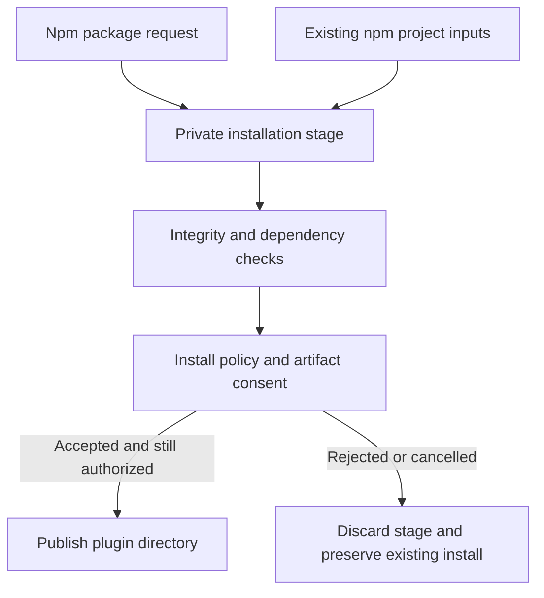

Codex review: needs maintainer review before merge. _Reviewed September 6, 2026, 9:57 AM ET / 13:57 UTC._

# ClawSweeper review

## What this changes

Prepare npm plugin installations privately, validate and obtain consent before publication, and use the shared directory transaction for replacement and rollback.

## Merge readiness

✅ **Ready for maintainer review**

This PR remains useful: current main still mutates the managed npm project before artifact consent completes. The introduced changes address that boundary coherently, and no blocking correctness finding was established.

**Priority:** P2
**Reviewed head:** `a7d56345f9623af51da0ca36e64d676e977dfb94`

## Review scores

| Measure | Result | What it means |
|---|---|---|
| **Overall readiness** | 🐚 platinum hermit **(4/6)** | A coherent owner-boundary repair with focused regression coverage and no established blocking defect. |
| **Proof confidence** | 🌊 off-meta tidepool | Not applicable: The supplied MEMBER association exempts this PR from the external-contributor proof gate. Its body reports five real-npm installer scenarios covering publication, rollback, refusal, recovery, and cancellation; this review inspected supporting source and tests without rerunning those scenarios. |
| **Patch quality** | 🐚 platinum hermit **(4/6)** | No actionable review findings were identified. |

## Verification

| Check | Result | Evidence |
|---|---|---|
| **Real behavior** | Not applicable | Not applicable: The supplied MEMBER association exempts this PR from the external-contributor proof gate. Its body reports five real-npm installer scenarios covering publication, rollback, refusal, recovery, and cancellation; this review inspected supporting source and tests without rerunning those scenarios. |
| **Evidence reviewed** | 9 items | Current main still needs the repair: Current main snapshots the managed project, materializes the package in that project, and later supplies the same installRoot as the staged artifact to consent. It does not contain this PR’s private-stage publication flow. Introduced publication boundary: The pinned introduced diff prepares and validates inside installPackageDir, checks cancellation and beforePersistentApply before publication, preserves thrown consent errors, and returns the final package path with the shared transaction. Project inputs and recovery: Staging copies manifests, lockfiles, shrinkwrap, project npm configuration, and relative pack archives without copying node_modules. Diagnosed candidate artifacts move outside stage cleanup; the existing generation-selection rules remain unchanged. |
| **Findings** | None | None. |
| **Security** | None | None. |

## How this fits together

OpenClaw’s plugin installer turns npm package requests into installed plugin directories. It checks package integrity, dependencies, install policy, and capability consent before returning the location used by plugin loading.

## Before merge

None.

<strong>Agent review details</strong>

### Security

None.

### PR surface

Source -545, Tests +13, Docs +4, Other -1. Total -529 across 11 files.

View PR surface stats

| Area | Files | Added | Removed | Net |
|---|---:|---:|---:|---:|
| Source | 6 | 125 | 670 | -545 |
| Tests | 3 | 367 | 354 | +13 |
| Docs | 1 | 5 | 1 | +4 |
| Config | 0 | 0 | 0 | 0 |
| Generated | 0 | 0 | 0 | 0 |
| Other | 1 | 1 | 2 | -1 |
| **Total** | **11** | **498** | **1027** | **-529** |

### Review metrics

None.

### Technical review

Best possible solution:

Keep npm preparation and consent inside the shared directory transaction while preserving existing generation paths and restoring the prior project on failed publication.

Do we have a high-confidence way to reproduce the issue?

Yes, from source: current main materializes the final project before consent and can accept cancellation during that callback without a final publication check. This review did not execute the reproduction.

Is this the best way to solve the issue?

Yes. Reusing the existing directory transaction removes compensating npm rollback machinery while keeping validation, generation selection, and final mutation checks together.

AGENTS.md: found and applied where relevant.

Codex review notes: model internal, reasoning medium; reviewed against [f33ea5960b50](https://github.com/openclaw/openclaw/commit/f33ea5960b5018fbf8cfa79e6fb831ff16b4712a).

### Labels

Label changes:

- add `P2`: This repairs plugin-install consent and cancellation behavior within a bounded installation workflow.
- add `rating: 🐚 platinum hermit`: Overall readiness is 🐚 platinum hermit; proof is 🌊 off-meta tidepool and patch quality is 🐚 platinum hermit.
- add `status: 👀 ready for maintainer look`: ClawSweeper has no concrete contributor-facing blocker left for this PR. Not applicable: The supplied MEMBER association exempts this PR from the external-contributor proof gate. Its body reports five real-npm installer scenarios covering publication, rollback, refusal, recovery, and cancellation; this review inspected supporting source and tests without rerunning those scenarios.

Label justifications:

- `P2`: This repairs plugin-install consent and cancellation behavior within a bounded installation workflow.
- `rating: 🐚 platinum hermit`: Overall readiness is 🐚 platinum hermit; proof is 🌊 off-meta tidepool and patch quality is 🐚 platinum hermit.
- `status: 👀 ready for maintainer look`: ClawSweeper has no concrete contributor-facing blocker left for this PR. Not applicable: The supplied MEMBER association exempts this PR from the external-contributor proof gate. Its body reports five real-npm installer scenarios covering publication, rollback, refusal, recovery, and cancellation; this review inspected supporting source and tests without rerunning those scenarios.

### Evidence

What I checked:

- **Current main still needs the repair:** Current main snapshots the managed project, materializes the package in that project, and later supplies the same installRoot as the staged artifact to consent. It does not contain this PR’s private-stage publication flow. ([`src/plugins/install-managed-npm.ts:557`](https://github.com/openclaw/openclaw/blob/f33ea5960b5018fbf8cfa79e6fb831ff16b4712a/src/plugins/install-managed-npm.ts#L557), [f33ea5960b50](https://github.com/openclaw/openclaw/commit/f33ea5960b5018fbf8cfa79e6fb831ff16b4712a))
- **Introduced publication boundary:** The pinned introduced diff prepares and validates inside installPackageDir, checks cancellation and beforePersistentApply before publication, preserves thrown consent errors, and returns the final package path with the shared transaction. ([`src/plugins/install-managed-npm.ts:573`](https://github.com/openclaw/openclaw/blob/a7d56345f9623af51da0ca36e64d676e977dfb94/src/plugins/install-managed-npm.ts#L573), [a7d56345f962](https://github.com/openclaw/openclaw/commit/a7d56345f9623af51da0ca36e64d676e977dfb94))
- **Project inputs and recovery:** Staging copies manifests, lockfiles, shrinkwrap, project npm configuration, and relative pack archives without copying node_modules. Diagnosed candidate artifacts move outside stage cleanup; the existing generation-selection rules remain unchanged. ([`src/plugins/install-managed-npm-state.ts:26`](https://github.com/openclaw/openclaw/blob/a7d56345f9623af51da0ca36e64d676e977dfb94/src/plugins/install-managed-npm-state.ts#L26), [a7d56345f962](https://github.com/openclaw/openclaw/commit/a7d56345f9623af51da0ca36e64d676e977dfb94))
- **Regression coverage inspected:** Added cases check untouched fresh and existing targets during consent, same-generation commit and rollback, publication failure, and cancellation during consent. Retained coverage exercises old-generation lazy imports; replacement peer-link coverage checks both successful and failed updates. Tests were inspected, not executed. ([`src/plugins/install.npm-spec.test.ts:1031`](https://github.com/openclaw/openclaw/blob/a7d56345f9623af51da0ca36e64d676e977dfb94/src/plugins/install.npm-spec.test.ts#L1031), [a7d56345f962](https://github.com/openclaw/openclaw/commit/a7d56345f9623af51da0ca36e64d676e977dfb94))
- **Reported production-path validation:** The captured PR body reports five installer-API scenarios using real npm 11.19 and Node 24.19 with isolated generated packages: late imports across updates, deferred rollback, consent refusal, quarantined recovery followed by rejection, and cancellation during consent. It also reports 174 owner tests and the changed-code gate passing. These are contributor-reported results, not reviewer executions; captured context sourceRevision is 2695dfcbbfa309f62cfd93441203d7d9a948cb2e8544bd5d65cfc4cb9b6bcd23. ([a7d56345f962](https://github.com/openclaw/openclaw/commit/a7d56345f9623af51da0ca36e64d676e977dfb94))
- **Related work is an aggregate draft:** https://github.com/openclaw/openclaw/pull/135599 explicitly describes independently landable slices and retains the broader restartless lifecycle candidate. Its open draft does not supersede this focused preparation.

Likely related people:

- **steipete:** Suggested for follow-up; no historical authorship or introduction is verified. (role: unverified routing candidate; confidence: low)

### Rating scale

| Score | Internal tier | Crab rank | Meaning |
|---:|:---:|---|---|
| **6/6** | S | 🦀 challenger crab | Exceptional readiness |
| **5/6** | A | 🦞 diamond lobster | Very strong readiness |
| **4/6** | B | 🐚 platinum hermit | Good normal PR; ordinary maintainer review |
| **3/6** | C | 🦐 gold shrimp | Useful, but confidence is limited |
| **2/6** | D | 🦪 silver shellfish | Proof or implementation needs work |
| **1/6** | F | 🧂 unranked krab | Not merge-ready |
| N/A | NA | 🌊 off-meta tidepool | Rating does not apply |

Overall follows the weaker of proof and patch quality.
Shiny media proof means a screenshot, video, or linked artifact directly shows the changed behavior. Runtime, network, CSP, and security claims still need visible diagnostics.

### Workflow

- ClawSweeper keeps one durable marker-backed review comment per issue or PR.
- Re-runs edit this comment so the latest verdict, findings, and automation markers stay together instead of adding duplicate bot comments.
- A fresh review can be triggered by eligible `@clawsweeper re-review` comments, exact-item GitHub events, scheduled/background review runs, or manual workflow dispatch.
- PR/issue authors and users with repository write access can comment `@clawsweeper re-review` or `@clawsweeper re-run` on an open PR or issue to request a fresh review only.
- Maintainers can also comment `@clawsweeper review` to request a fresh review only.
- Fresh-review commands do not start repair, autofix, rebase, CI repair, or automerge.
- Maintainer-only repair and merge flows require explicit commands such as `@clawsweeper autofix`, `@clawsweeper automerge`, `@clawsweeper fix ci`, or `@clawsweeper address review`.
- Maintainers can comment `@clawsweeper explain` to ask for more context, or `@clawsweeper stop` to stop active automation.

<!-- clawsweeper-verdict:needs-human item=140145 sha=a7d56345f9623af51da0ca36e64d676e977dfb94 confidence=high updated_at=2026-09-06T13:54:52Z reviewed_at=2026-09-06T13:57:33.838Z lease_owner=github-run-34037455426-1 lease_comment_id=5559685729 source_revision=2695dfcbbfa309f62cfd93441203d7d9a948cb2e8544bd5d65cfc4cb9b6bcd23 live_verification=absent -->
<!-- clawsweeper-review-state:ready item=140145 sha=a7d56345f9623af51da0ca36e64d676e977dfb94 v=1 -->

<!-- clawsweeper-review-version item=140145 reviewed_at=2026-09-06T13:57:33.838Z sha=a7d56345f9623af51da0ca36e64d676e977dfb94 source_revision=2695dfcbbfa309f62cfd93441203d7d9a948cb2e8544bd5d65cfc4cb9b6bcd23 lease_owner=github-run-34037455426-1 lease_comment_id=5559685729 v=1 -->

<!-- clawsweeper-review item=140145 -->