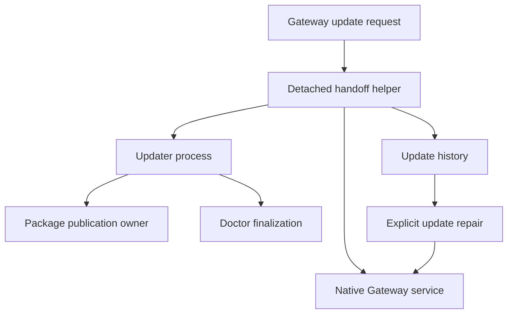

Codex review: blocked before merge.

## What this changes

This PR restores managed Gateways after updater death through the surviving helper or explicit update repair.

**Example:** SIGKILL interrupts an npm-global update during package publication on Linux/systemd.
- **Before:** The installed package and launcher can be missing, and the Gateway remains stopped.
- **After:** The helper completes publication, finalizes the update, and verifies the restarted Gateway.

## Review scores

| Measure | Result | What it means |
|---|---|---|
| **Overall readiness** | 🦪 silver shellfish **(2/6)** | The direction and owner reuse are sound, but a blocking upgrade-path defect remains. |
| **Proof confidence** | 🦐 gold shrimp **(3/6)** | Real behavior proof is not required for maintainer- or bot-authored pull requests. |
| **Patch quality** | 🦪 silver shellfish **(2/6)** | 1 actionable review finding remain. |

## Product

**Kind:** Bug fix · **Worth it:** Yes · **Fix scope:** Partial
**User problem:** A managed update can leave the Gateway unavailable after its updater dies, and successful repair can leave it stopped.
**Reason:** Automatic restoration has clear user value and explicit maintainer direction, but the linked issue also contains stalled-but-live updater behavior that this PR excludes.

## Merge readiness

⛔ **Blocked before merge - 2 items remain**

Keep open: this maintainer-authored PR addresses a verified Gateway outage, but recovery still fails when the interrupted candidate has already advanced the shared-state schema.

**Priority:** P0
**Reviewed head:** `dc9ebf080c9163815ff73189f5fa778c4db4c2da`

## Before merge

- [ ] **Read migrated history through the verified candidate runtime (P1)** - When candidate Doctor advances the shared-state schema and the updater is then killed, this reader still opens history through the staged helper's older database admission. That admission rejects newer schema versions before returning the run. The stop-history reader has the same problem, while createInstalledRuntimeLedger is initialized only after recovery finalization succeeds, which is never reached. The Gateway therefore remains parked on precisely this upgrade boundary. Select the verified installed candidate's ledger before these initial reads when state has advanced, retain the staged reader for the missing-installation case, and cover the differing-schema interruption.
- [ ] **Add data-model compatibility proof** - The review found that existing stored data may not work after upgrade. Show that existing data still loads and works with this change.

## Findings

- [P1] Read migrated history through the verified candidate runtime — `src/infra/update-managed-service-handoff-interrupted.ts:22-23`

### Tests

- Missing end-to-end proof: Supply a latest-stable upgrade with settings and data intact, followed by patched-helper recovery against a schema-advancing candidate killed after Doctor migration.

<strong>Agent review details</strong>

### How this fits together

Gateway update requests hand installation custody to a detached helper, which coordinates package publication, update history, Doctor finalization, and native service recovery.

### Technical review

Best possible solution:

Recover across schema upgrades through the existing helper and service owners, preserve operator stops, and provide a visible recovery action when automatic restoration is refused.

Do we have a high-confidence way to reproduce the issue?

Source confirms current main's signal-exit recovery refusal, and the linked discussion records real Linux reproductions; no reproduction was executed during this read-only review.

Is this the best way to solve the issue?

Reusing publication, custody, and service owners is appropriate, but initial history reads must also survive a candidate-side schema migration.

Full review comments:

- [P1] Read migrated history through the verified candidate runtime — `src/infra/update-managed-service-handoff-interrupted.ts:22-23`
  When candidate Doctor advances the shared-state schema and the updater is then killed, this reader still opens history through the staged helper's older database admission. That admission rejects newer schema versions before returning the run. The stop-history reader has the same problem, while createInstalledRuntimeLedger is initialized only after recovery finalization succeeds, which is never reached. The Gateway therefore remains parked on precisely this upgrade boundary. Select the verified installed candidate's ledger before these initial reads when state has advanced, retain the staged reader for the missing-installation case, and cover the differing-schema interruption.
  Confidence: 0.95

Overall correctness: patch is incorrect
Overall confidence: 0.93

AGENTS.md: found and applied where relevant.

Codex review notes: model internal, reasoning medium; reviewed against [7615c01eda69](https://github.com/openclaw/openclaw/commit/7615c01eda6954b6dabac6c2d44973469ade6bc0).

### Provenance checked

- `Managed successor and publication ownership` keeps the original intent (e1a700840a76d0b852503d2b0dee6ae4f60a7ea8: Keep the detached helper as the sole successor after exact native-service parking.)
- `Repair recovery grace` changes intended behavior with a stated reason (9680e57a9631b6a7060b9d4642bffb9f9fbc3000: Reclaim abandoned custody only with original-run correlation, process evidence, census exclusion, and a recovery grace.)
- `Already-stopped Gateway handling` changes intended behavior with a stated reason (ff2d58950bf7fd07c7c0daa267f9ec93325a9547: Preserve earlier and operator stops while making the manual start command visible.)
- `Fresh installed-runtime bookkeeping` keeps the original intent (61ef2a47fdc5858a38f83f3f8d03af0bb8afe2ce: Preserve child refusal details and finalize through the installed runtime after candidate-side changes.)

### Testing

Proof path: shipped entry point.

### Security

None.

### Evidence

Acceptance criteria:

- pnpm test src/infra/update-managed-service-handoff-interrupted.test.ts --maxWorkers=1
- pnpm test src/cli/update-cli/update-repair-service.test.ts --maxWorkers=1
- pnpm test src/infra/update-managed-service-handoff-recovery.test.ts --maxWorkers=1
- Show the differing-schema interruption regression failing before the repair and passing afterward.
- Verify latest-stable upgrade preservation and patched-helper recovery after schema-advancing Doctor through the shipped managed-update entry point.

What I checked:

- **Pinned introduced change:** Reviewed the merge-base-to-head hunks, including recovery, repair, retained stop evidence, callers, tests, and documentation; endpoint drift was excluded. ([dc9ebf080c91](https://github.com/openclaw/openclaw/commit/dc9ebf080c9163815ff73189f5fa778c4db4c2da))
- **Recovery starts with the staged reader:** Both initial history readers use the staged runtime's database admission; interrupted recovery reads the run before verifying the installed candidate or invoking fresh finalization. ([`src/infra/update-managed-service-handoff-interrupted.ts:22`](https://github.com/openclaw/openclaw/blob/dc9ebf080c9163815ff73189f5fa778c4db4c2da/src/infra/update-managed-service-handoff-interrupted.ts#L22), [dc9ebf080c91](https://github.com/openclaw/openclaw/commit/dc9ebf080c9163815ff73189f5fa778c4db4c2da))
- **Newer schemas are refused:** Shared-state admission rejects a content version above the reader's supported schema; cached reads also call the schema guard before consuming rows. ([`src/state/openclaw-state-db-schema-version.ts:173`](https://github.com/openclaw/openclaw/blob/dc9ebf080c9163815ff73189f5fa778c4db4c2da/src/state/openclaw-state-db-schema-version.ts#L173), [dc9ebf080c91](https://github.com/openclaw/openclaw/commit/dc9ebf080c9163815ff73189f5fa778c4db4c2da))
- **Installed reader is selected too late:** The installed-runtime ledger is created only after post-core repair succeeds, so it cannot rescue an initial staged-reader rejection after the killed updater's Doctor migrated state. ([`src/infra/update-managed-service-handoff-result-source.ts:479`](https://github.com/openclaw/openclaw/blob/dc9ebf080c9163815ff73189f5fa778c4db4c2da/src/infra/update-managed-service-handoff-result-source.ts#L479), [dc9ebf080c91](https://github.com/openclaw/openclaw/commit/dc9ebf080c9163815ff73189f5fa778c4db4c2da))
- **Current main still needs the recovery work:** Fetched main still requires a verified child recovery result after signal exit and reports standalone finalization with restart false. ([`src/infra/update-managed-service-handoff.ts`](https://github.com/openclaw/openclaw/blob/7615c01eda6954b6dabac6c2d44973469ade6bc0/src/infra/update-managed-service-handoff.ts), [7615c01eda69](https://github.com/openclaw/openclaw/commit/7615c01eda6954b6dabac6c2d44973469ade6bc0))
- **Reported production-path reproduction:** The PR body reports Linux/systemd update.run fault injection before, during, and after publication plus immediate repair after both owners die; steipete also documented baseline failures in https://github.com/openclaw/openclaw/issues/164800#issuecomment-6452481190.

Likely related people:

- **Peter Steinberger:** Raw commit ff2d58950bf7fd07c7c0daa267f9ec93325a9547 adds src/commands/doctor-maintenance-restoration.ts:39 relative to its recorded parents. This identifies author metadata, not feature responsibility or a PR merger. (role: source-line author; confidence: high; commits: [ff2d58950bf7](https://github.com/openclaw/openclaw/commit/ff2d58950bf7fd07c7c0daa267f9ec93325a9547); files: `src/commands/doctor-maintenance-restoration.ts`)
- **Jason (Json):** Raw commit 73858ce2e11f9ecf774f19aa504b92d3a46a5466 adds src/infra/update-managed-service-handoff-cleanup.ts:101 relative to its recorded parents. This identifies author metadata, not feature responsibility or a PR merger. (role: source-line author; confidence: high; commits: [73858ce2e11f](https://github.com/openclaw/openclaw/commit/73858ce2e11f9ecf774f19aa504b92d3a46a5466); files: `src/infra/update-managed-service-handoff-cleanup.ts`)

### PR surface

Source +603, Tests +732, Docs +68. Total +1403 across 46 files. Added test files: 4.

View PR surface stats

| Area | Files | Added | Removed | Net |
|---|---:|---:|---:|---:|
| Source | 25 | 854 | 251 | +603 |
| Tests | 19 | 827 | 95 | +732 |
| Docs | 2 | 82 | 14 | +68 |
| Config | 0 | 0 | 0 | 0 |
| Generated | 0 | 0 | 0 | 0 |
| Other | 0 | 0 | 0 | 0 |
| **Total** | **46** | **1763** | **360** | **+1403** |

### Labels

Label changes:

- add `P0`: The reported managed-update failure strands the Gateway and Control UI, leaving community users dependent on terminal recovery or reboot.
- add `merge-risk: 🚨 availability`: A schema-changing interrupted update can still terminate recovery before service restoration, leaving the Gateway parked.
- add `rating: 🦪 silver shellfish`: Overall readiness is 🦪 silver shellfish; proof is 🦐 gold shrimp and patch quality is 🦪 silver shellfish.
- add `status: ⏳ waiting on author`: ClawSweeper has contributor-facing work open and is waiting for author action.

Label justifications:

- `P0`: The reported managed-update failure strands the Gateway and Control UI, leaving community users dependent on terminal recovery or reboot.
- `merge-risk: 🚨 availability`: A schema-changing interrupted update can still terminate recovery before service restoration, leaving the Gateway parked.
- `rating: 🦪 silver shellfish`: Overall readiness is 🦪 silver shellfish; proof is 🦐 gold shrimp and patch quality is 🦪 silver shellfish.
- `status: ⏳ waiting on author`: ClawSweeper has contributor-facing work open and is waiting for author action.

### Rating scale

6/6 🦀 challenger crab · 5/6 🦞 diamond lobster · 4/6 🐚 platinum hermit · 3/6 🦐 gold shrimp · 2/6 🦪 silver shellfish · 1/6 🧂 unranked krab. Overall follows the weaker of proof and patch quality; ✨ marks media proof (a screenshot, video, or linked artifact) that directly shows the changed behavior.

### Workflow

ClawSweeper edits this one comment on every review. Comment `@clawsweeper re-review` for a fresh review only. Repair and merge execution lanes are retired.

_Reviewed October 30, 2026, 12:47 PM ET / 16:47 UTC._

<!-- clawsweeper-verdict:needs-human item=188497 sha=dc9ebf080c9163815ff73189f5fa778c4db4c2da confidence=high updated_at=2026-10-30T16:38:15Z reviewed_at=2026-10-30T16:47:04.004Z lease_owner=github-run-41091436230-1 lease_comment_id=6528035854 source_revision=8808fd4024d27e9f6b511c5416822732a6e87b04003eb7a8e48391ad0dcf52a0 hold=blocked findings=1 -->
<!-- clawsweeper-review-state:blocked item=188497 sha=dc9ebf080c9163815ff73189f5fa778c4db4c2da v=1 -->

<!-- clawsweeper-review-version item=188497 reviewed_at=2026-10-30T16:47:04.004Z sha=dc9ebf080c9163815ff73189f5fa778c4db4c2da source_revision=8808fd4024d27e9f6b511c5416822732a6e87b04003eb7a8e48391ad0dcf52a0 lease_owner=github-run-41091436230-1 lease_comment_id=6528035854 v=1 -->

<!-- clawsweeper-review item=188497 -->