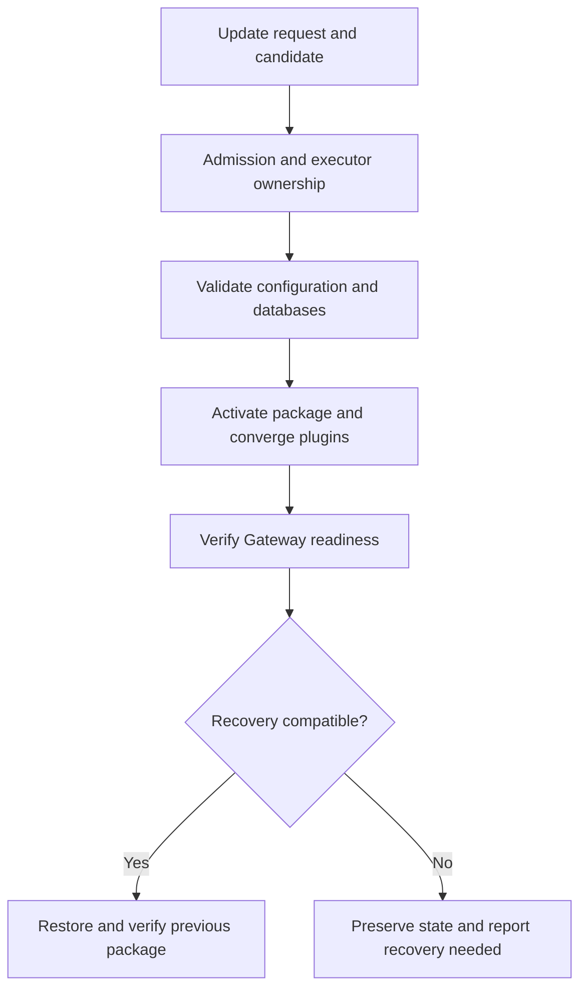

Codex review: needs real behavior proof before merge. _Reviewed September 9, 2026, 10:55 PM ET / September 10, 2026, 02:55 UTC (Revision 3)._

# ClawSweeper review

## What this changes

The branch adds guarded update admission, package rollback coordination, native service ownership checks, SQLite writer exclusion, and suppression of unrequested restart notices.

> [!WARNING]
> **SQLite table change**
>
> This PR modifies persisted SQLite tables in `src/state/openclaw-state-lease-storage.ts`. Prefer a design that avoids changing persisted SQLite tables. If the change is necessary, verify migration and upgrade compatibility against an existing database before merge.

## Merge readiness

⛔ **Blocked before merge - 9 items remain**

Keep open: this owner-assigned PR contains distinct recovery work, but executor authority does not reach the actual rollback mutations. The latest notice correction addresses the reported preservation failure at its producer; installed acceptance remains pending.

**Priority:** P2
**Reviewed head:** `ceb0674ac4d1701a2687119893313cf8b88c67b0`
**Owner decision:** Required. See [Decision needed](#decision-needed).

## Review scores

| Measure | Result | What it means |
|---|---|---|
| **Overall readiness** | 🦐 gold shrimp **(3/6)** | Useful integration and focused controls remain limited by a concrete mutation-fencing gap and outstanding installed acceptance. |
| **Proof confidence** | 🦐 gold shrimp **(3/6)** | Needs stronger real behavior proof before merge: Authority-chain proof required: the executor and rollback owners need final-effect evidence for allowed execution, an unrelated executor, and original-helper loss during awaited package/service work. Current controls use a synthetic file effect or mocked package swap; the supplied installed result does not cover those refusals. The MEMBER exemption from unrelated contributor proof remains intact. After adding proof, update the PR body; ClawSweeper should re-review automatically. If it does not, the PR author or someone with repository write access can comment `@clawsweeper re-review`. |
| **Patch quality** | 🦐 gold shrimp **(3/6)** | 1 actionable review finding remain. |

## Verification

| Check | Result | Evidence |
|---|---|---|
| **Real behavior** | Needs proof | Needs stronger real behavior proof before merge: Authority-chain proof required: the executor and rollback owners need final-effect evidence for allowed execution, an unrelated executor, and original-helper loss during awaited package/service work. Current controls use a synthetic file effect or mocked package swap; the supplied installed result does not cover those refusals. The MEMBER exemption from unrelated contributor proof remains intact. After adding proof, update the PR body; ClawSweeper should re-review automatically. If it does not, the PR author or someone with repository write access can comment `@clawsweeper re-review`. |
| **Evidence reviewed** | 9 items | Rollback authority stops outside the mutation owner: The new executor check surrounds packageTransaction.rollback(), but the ordinary package transaction receives no executor callback. Its rollback awaits integrity verification and path inspection, then calls restoreNpmPackageRoot without assertCurrent; that helper consequently uses a no-op guard before its renames. Concrete final filesystem boundary: The retained rollback closure awaits candidate existence and invokes the package restoration helper without its supported authority callback. The executor lease owner separately requires the original helper to remain alive, so helper loss during that await invalidates authority without preventing these mutations. Existing negative controls do not exercise package replacement: The rollback executor test substitutes rollback with a function that changes a Boolean and returns success. The delegation test uses real child execution, but its final effect is a synthetic file write. These protect useful orchestration behavior without establishing rejection at the real package or native-service mutation boundary. |
| **Findings** | 1 actionable finding | [P1] Carry the executor fence into the package rollback mutations |
| **Security** | None | None. |

## How this fits together

The updater takes a candidate package and the installation’s existing configuration, databases, and managed Gateway service through validation, activation, and recovery. Its outcome determines which runtime serves users and whether installation state remains usable.

## Decision needed

| Question | Recommendation |
|---|---|
| Should the new file-lock recovery mode and resource-borrowing guard become supported plugin SDK options, or remain internal updater/configuration capabilities? | **Keep updater-specific guards internal:** Preserve the shipped SDK contract and place updater-specific coordination behind a narrow internal owner unless a plugin use case requires it. |

Why: They expand a published SDK entrypoint, while the stated delivery discusses update recovery rather than the permanent plugin contract.

## Before merge

- [ ] **Add real behavior proof** - Needs stronger real behavior proof before merge: Authority-chain proof required: the executor and rollback owners need final-effect evidence for allowed execution, an unrelated executor, and original-helper loss during awaited package/service work. Current controls use a synthetic file effect or mocked package swap; the supplied installed result does not cover those refusals. The MEMBER exemption from unrelated contributor proof remains intact. After adding proof, update the PR body; ClawSweeper should re-review automatically. If it does not, the PR author or someone with repository write access can comment `@clawsweeper re-review`.
- [ ] **Carry the executor fence into the package rollback mutations (P1)** - If the original managed-update helper dies while `packageTransaction.rollback()` awaits package verification or `pathEntryExists`, the new executor lease is no longer valid, but rollback still renames the candidate and backup and restores launchers. The ordinary transaction receives no executor callback, and its call to `restoreNpmPackageRoot` omits the supported `assertCurrent` guard; the check after this await only detects loss after mutation. Bind the original fence into the actual mutation owner and recheck before subsequent filesystem effects. This is a late finding: these files were verified byte-identical to the previously reviewed head.
- [ ] **Resolve merge risk (P1)** - Installed preservation remains unverified after the notice correction; the previous installed run failed workspace/durable-queue preservation despite restoring the package and native readiness.
- [ ] **Resolve merge risk (P1)** - Unsupported retained recovery records intentionally block mutable updates and require compatible recovery or an independent verified backup; fresh-install and upgrade acceptance for this reduced contract remains pending.
- [ ] **Resolve merge risk (P1)** - The new public file-lock options and shared SQLite concurrency semantics need an explicit accepted contract before landing.
- [ ] **Complete next step (P2)** - Repair the final package-mutation fence, resolve the SDK contract, and add source-bound authority and installed-preservation evidence. Redacted terminal traces or logs are sufficient; remove credentials, private endpoints, and personal data. Update the PR body to trigger re-review, or ask a maintainer for @clawsweeper re-review if it does not run.
- [ ] **Resolve maintainer decision** - Resolve the maintainer decision shown above before merge.
- [ ] **Review config compatibility** - Confirm compatibility and upgrade impact for the changed config or default surface before merge.
- [ ] **Add data-model compatibility proof** - Confirm migration or upgrade compatibility proof before merge.

## Findings

- [P1] Carry the executor fence into the package rollback mutations — `src/cli/update-cli/update-command-rollback.ts:302-303`

<strong>Agent review details</strong>

### Security

None.

### PR surface

PR surface statistics unavailable: the file list is incomplete.

### Review metrics

| Metric | Value | Why it matters |
|---|---|---|
| **Production versus validation growth** | Production/tooling +10,811/-2,375; tests/support +16,013/-908 | Growth implements cross-process recovery coordination and its controls; installed acceptance is still needed beyond the substantial source-test coverage. |
| **Public file-lock options** | 1 new recovery mode; 1 new callback | These additions require a deliberate supported SDK contract. |

### Stored data model

Persistent data-model change detected: `database schema: src/state/openclaw-state-db-existing-write.ts`, `database schema: src/state/openclaw-state-lease-storage.ts`, `migration/backfill/repair: scripts/e2e/lib/upgrade-survivor/systemd-fixture.mjs`, `migration/backfill/repair: scripts/e2e/lib/upgrade-survivor/update-restart-auth.sh`, `migration/backfill/repair: src/cli/update-cli/schema-preflight.ts`, `migration/backfill/repair: src/cli/update-cli/update-command-config.ts`, and 8 more. Confirm migration or upgrade compatibility proof before merge.

### Merge-risk options

**Maintainer options:**
1. **Complete mutation fencing and installed acceptance (recommended)**  
   Repair the rollback authority handoff, resolve the SDK contract, and retain the hold until source-bound recovery evidence proves state preservation and native readiness.
2. **Pause the integration**  
   Keep this owner-assigned branch open while the reduced recovery contract and its installed validation are completed.

### Technical review

Best possible solution:

Keep rollback compatibility-gated, carry the original executor check into every final package mutation, and establish installed preservation and recovery without replaying unrequested work.

Do we have a high-confidence way to reproduce the issue?

Yes, from source: original-helper loss during rollback’s awaited integrity/path reads invalidates the executor, yet the subsequent package renames receive no live guard. This review did not execute that scenario.

Is this the best way to solve the issue?

Not yet: the existing package mutation owner is the right boundary, but checking authority only around its asynchronous transaction cannot prevent effects after authority is lost.

Full review comments:

- [P1] Carry the executor fence into the package rollback mutations — `src/cli/update-cli/update-command-rollback.ts:302-303`
  If the original managed-update helper dies while `packageTransaction.rollback()` awaits package verification or `pathEntryExists`, the new executor lease is no longer valid, but rollback still renames the candidate and backup and restores launchers. The ordinary transaction receives no executor callback, and its call to `restoreNpmPackageRoot` omits the supported `assertCurrent` guard; the check after this await only detects loss after mutation. Bind the original fence into the actual mutation owner and recheck before subsequent filesystem effects. This is a late finding: these files were verified byte-identical to the previously reviewed head.
  Confidence: 0.91
  Late finding: first raised on code an earlier review cycle already covered.

Overall correctness: patch is incorrect
Overall confidence: 0.88

AGENTS.md: found and applied where relevant.

Codex review notes: model internal, reasoning medium; reviewed against [b8054674868f](https://github.com/openclaw/openclaw/commit/b8054674868f0a389b3b1ae638a79921786b8235).

### Labels

Label justifications:

- `P2`: This is active update-recovery integration work with bounded maintainer follow-up, not evidence of a new widespread emergency.
- `merge-risk: 🚨 compatibility`: The branch expands the public file-lock contract and intentionally refuses unsupported retained recovery states.
- `merge-risk: 🚨 session-state`: The latest installed predecessor failed workspace/durable-queue preservation, and the correction lacks installed acceptance.
- `merge-risk: 🚨 availability`: A stale executor can continue package replacement during rollback before the outer guard detects authority loss.
- `rating: 🦐 gold shrimp`: Overall readiness is 🦐 gold shrimp; proof is 🦐 gold shrimp and patch quality is 🦐 gold shrimp.
- `status: 📣 needs proof`: The PR needs real behavior proof before ClawSweeper can clear the contributor ask. Needs stronger real behavior proof before merge: Authority-chain proof required: the executor and rollback owners need final-effect evidence for allowed execution, an unrelated executor, and original-helper loss during awaited package/service work. Current controls use a synthetic file effect or mocked package swap; the supplied installed result does not cover those refusals. The MEMBER exemption from unrelated contributor proof remains intact. After adding proof, update the PR body; ClawSweeper should re-review automatically. If it does not, the PR author or someone with repository write access can comment `@clawsweeper re-review`.

### Evidence

What I checked:

- **Rollback authority stops outside the mutation owner:** The new executor check surrounds packageTransaction.rollback(), but the ordinary package transaction receives no executor callback. Its rollback awaits integrity verification and path inspection, then calls restoreNpmPackageRoot without assertCurrent; that helper consequently uses a no-op guard before its renames. ([`src/cli/update-cli/update-command-rollback.ts:302`](https://github.com/openclaw/openclaw/blob/ceb0674ac4d1701a2687119893313cf8b88c67b0/src/cli/update-cli/update-command-rollback.ts#L302), [ceb0674ac4d1](https://github.com/openclaw/openclaw/commit/ceb0674ac4d1701a2687119893313cf8b88c67b0))
- **Concrete final filesystem boundary:** The retained rollback closure awaits candidate existence and invokes the package restoration helper without its supported authority callback. The executor lease owner separately requires the original helper to remain alive, so helper loss during that await invalidates authority without preventing these mutations. ([`src/infra/package-update-swap.ts:595`](https://github.com/openclaw/openclaw/blob/ceb0674ac4d1701a2687119893313cf8b88c67b0/src/infra/package-update-swap.ts#L595), [ceb0674ac4d1](https://github.com/openclaw/openclaw/commit/ceb0674ac4d1701a2687119893313cf8b88c67b0))
- **Existing negative controls do not exercise package replacement:** The rollback executor test substitutes rollback with a function that changes a Boolean and returns success. The delegation test uses real child execution, but its final effect is a synthetic file write. These protect useful orchestration behavior without establishing rejection at the real package or native-service mutation boundary. ([`src/cli/update-cli/update-command-rollback-executor.test.ts:98`](https://github.com/openclaw/openclaw/blob/ceb0674ac4d1701a2687119893313cf8b88c67b0/src/cli/update-cli/update-command-rollback-executor.test.ts#L98), [ceb0674ac4d1](https://github.com/openclaw/openclaw/commit/ceb0674ac4d1701a2687119893313cf8b88c67b0))
- **Re-review continuity verified:** GitHub content reads at the previously reviewed 591e2fde78ba1843a021743dd2f08e30e03e8323 were compared byte-for-byte with the checkout. update-command-rollback.ts, package-update-swap.ts, and update-command-executor.ts are unchanged. The filesystem finding is therefore a late discovery, not a new-head regression. Local historical diff/blame attempts failed fetching missing objects with HTTP 403; the GitHub content comparison supplied continuity evidence instead. ([`src/cli/update-cli/update-command-rollback.ts:303`](https://github.com/openclaw/openclaw/blob/591e2fde78ba1843a021743dd2f08e30e03e8323/src/cli/update-cli/update-command-rollback.ts#L303), [591e2fde78ba](https://github.com/openclaw/openclaw/commit/591e2fde78ba1843a021743dd2f08e30e03e8323))
- **Latest notice correction:** The producer suppresses targetless standalone CLI restart notices before publication, including for restored runtimes that lack the new consumer suppression. Explicit routing is preserved and failure rewrites match the expected run/handoff inside the atomic rewrite. ([`src/infra/update-restart-notice.ts:39`](https://github.com/openclaw/openclaw/blob/ceb0674ac4d1701a2687119893313cf8b88c67b0/src/infra/update-restart-notice.ts#L39), [ceb0674ac4d1](https://github.com/openclaw/openclaw/commit/ceb0674ac4d1701a2687119893313cf8b88c67b0))
- **Captured proof and discussion:** The supplied body, confirmed by a live read at the pinned head, records successful package restoration/native readiness but failed workspace/durable-queue preservation on the previous head, followed by source corrections and pending installed validation. The prior completed review requested real final-effect authority controls. The media manifest contains related Doctor timeout recordings, with preparation failing because ffprobe was unavailable; those recordings do not establish this PR’s reduced recovery contract and their preparation failure does not lower the rating. ([ceb0674ac4d1](https://github.com/openclaw/openclaw/commit/ceb0674ac4d1701a2687119893313cf8b88c67b0))

Likely related people:

- **fuller-stack-dev:** Suggested for follow-up; no historical authorship or introduction is verified. (role: unverified routing candidate; confidence: low)
- **steipete:** Suggested for follow-up; no historical authorship or introduction is verified. (role: unverified routing candidate; confidence: low)

### Rank-up moves

Optional improvements that raise the rating; they are not merge blockers.

- Pass the original executor fence through package restoration and prove helper loss prevents subsequent package and launcher mutations.
- Provide source-bound fresh-install and upgrade results covering preservation, incompatible rollback refusal, and native service recovery.
- Resolve whether the new file-lock options belong in the public plugin SDK.

### Rating scale

| Score | Internal tier | Crab rank | Meaning |
|---:|:---:|---|---|
| **6/6** | S | 🦀 challenger crab | Exceptional readiness |
| **5/6** | A | 🦞 diamond lobster | Very strong readiness |
| **4/6** | B | 🐚 platinum hermit | Good normal PR; ordinary maintainer review |
| **3/6** | C | 🦐 gold shrimp | Useful, but confidence is limited |
| **2/6** | D | 🦪 silver shellfish | Proof or implementation needs work |
| **1/6** | F | 🧂 unranked krab | Not merge-ready |
| N/A | NA | 🌊 off-meta tidepool | Rating does not apply |

Overall follows the weaker of proof and patch quality.
Shiny media proof means a screenshot, video, or linked artifact directly shows the changed behavior. Runtime, network, CSP, and security claims still need visible diagnostics.

### Workflow

- ClawSweeper keeps one durable marker-backed review comment per issue or PR.
- Re-runs edit this comment so the latest verdict, findings, and automation markers stay together instead of adding duplicate bot comments.
- A fresh review can be triggered by eligible `@clawsweeper re-review` comments, exact-item GitHub events, scheduled/background review runs, or manual workflow dispatch.
- PR/issue authors and users with repository write access can comment `@clawsweeper re-review` or `@clawsweeper re-run` on an open PR or issue to request a fresh review only.
- Maintainers can also comment `@clawsweeper review` to request a fresh review only.
- Fresh-review commands do not start repair, autofix, rebase, CI repair, or automerge.
- Maintainer-only repair and merge flows require explicit commands such as `@clawsweeper autofix`, `@clawsweeper automerge`, `@clawsweeper fix ci`, or `@clawsweeper address review`.
- Maintainers can comment `@clawsweeper explain` to ask for more context, or `@clawsweeper stop` to stop active automation.

### History

Review history (2 earlier review cycles)

<!-- clawsweeper-review-history v=1 total=2 -->
- reviewed 2026-09-09T23:37:37.906Z sha cec31d27bd55c685c27bf3791b8ca483c033cb88 :: blocked before merge. :: none
- reviewed 2026-09-10T02:17:31.831Z sha 591e2fde78ba1843a021743dd2f08e30e03e8323 :: needs real behavior proof before merge. :: none

<!-- clawsweeper-verdict:needs-human item=140339 sha=ceb0674ac4d1701a2687119893313cf8b88c67b0 confidence=high updated_at=2026-09-10T02:51:00Z reviewed_at=2026-09-10T02:55:05.094Z lease_owner=github-run-34430917042-1 lease_comment_id=5611916575 source_revision=960fd50d07661db9db8585cb9b43c32ae39db40f3fa133c7551919eff4ac2c82 live_verification=absent -->
<!-- clawsweeper-review-state:blocked item=140339 sha=ceb0674ac4d1701a2687119893313cf8b88c67b0 v=1 -->

<!-- clawsweeper-review-version item=140339 reviewed_at=2026-09-10T02:55:05.094Z sha=ceb0674ac4d1701a2687119893313cf8b88c67b0 source_revision=960fd50d07661db9db8585cb9b43c32ae39db40f3fa133c7551919eff4ac2c82 lease_owner=github-run-34430917042-1 lease_comment_id=5611916575 v=1 -->

<!-- clawsweeper-review item=140339 -->