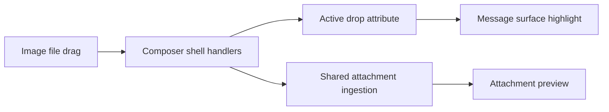

Codex review: needs changes before merge.

## What this changes

Moves the New Session image-drop highlight from the composer shell to the message surface.

**Example:** Drag pixel.png over a New Session containing “Describe this image.”
- **Before:** The context tray beneath the message box receives the tint.
- **After:** The message box receives the tint.

## Review scores

| Measure | Result | What it means |
|---|---|---|
| **Overall readiness** | 🦪 silver shellfish **(2/6)** | Direct visual proof establishes the intended correction, but the introduced dictation regression blocks merge. |
| **Proof confidence** | 🦞 diamond lobster **(5/6)** ✨ media proof bonus | Sufficient (screenshot): Inspected clean and annotated screenshots show the changed CSS in the production-bundled New Session page at 1056×740 in dark mode, using synthetic Gateway responses and dispatched image-drag events; native OS dragging and live model execution are outside this visual correction. |
| **Patch quality** | 🦪 silver shellfish **(2/6)** | 1 actionable review finding remain. |

## Product

**Kind:** Bug fix · **Worth it:** Yes · **Fix scope:** Complete
**User problem:** Dragging an image onto New Session highlights the context tray instead of the message box.
**Reason:** The maintainer-authored direction restores the existing attachment affordance with a focused CSS change.

## Merge readiness

⛔ **Needs changes before merge - 1 item remains**

This PR fixes the reported highlight placement, but introduces a CSS collision that hides the existing dictation border; repair that regression before merging.

**Priority:** P3
**Reviewed head:** `ca91749cf8d1ba92875a21d2ae789c1b08a7e555`

## Before merge

- [ ] **Preserve the pseudo-element used by active dictation (P2)** - Starting dictation in New Session adds `agent-chat__input--dictating` to this same element. Its existing animated border uses `::after` in `ui/src/styles/chat/composer.css:87`. This new, more specific selector also owns `::after` and supplies `opacity: 0`, so the dictation border disappears even when no file is being dragged; it also replaces the border's background and geometry. Use an unused paint surface, such as `::before`, for the drop tint and cover active dictation in the browser regression.

## Findings

- [P2] Preserve the pseudo-element used by active dictation — `ui/src/styles/new-session.css:820`

<strong>Agent review details</strong>

### How this fits together

The New Session composer handles file drags through shared attachment handlers; CSS presents their active state while attachment ingestion produces previews.

### Technical review

Best possible solution:

Keep the shell-wide drop handlers and paint the message-surface tint on an unused pseudo-element while preserving the existing dictation border.

Do we have a high-confidence way to reproduce the issue?

Current-main stacking rules explain the misplaced tint, and the supplied before/after browser images demonstrate it; no target code was executed during this read-only review.

Is this the best way to solve the issue?

Moving the existing overlay is appropriately small, but its destination must avoid the pseudo-element already owned by dictation.

Full review comments:

- [P2] Preserve the pseudo-element used by active dictation — `ui/src/styles/new-session.css:820`
  Starting dictation in New Session adds `agent-chat__input--dictating` to this same element. Its existing animated border uses `::after` in `ui/src/styles/chat/composer.css:87`. This new, more specific selector also owns `::after` and supplies `opacity: 0`, so the dictation border disappears even when no file is being dragged; it also replaces the border's background and geometry. Use an unused paint surface, such as `::before`, for the drop tint and cover active dictation in the browser regression.
  Confidence: 0.99

Overall correctness: patch is incorrect
Overall confidence: 0.98

AGENTS.md: found and applied where relevant.

Codex review notes: model internal, reasoning medium; reviewed against [427c8572025e](https://github.com/openclaw/openclaw/commit/427c8572025e099df2674a6bfc2fac74792bf523).

### Provenance checked

- `New Session attachment-drop overlay` keeps the original intent (da10827439a41e54c2ffb18cb361ae7dfd204758: Provide the new-session composer with the shared attachment drop pipeline and a matching visual affordance, as documented in https://github.com/openclaw/openclaw/pull/111530.)
- `Raised composer and context tray` keeps the original intent (e80a6dd9fdb4c7ce724472dd5d1b216afb4e70a7: Group placement controls around the composer while keeping compact menus and usable controls, as documented in https://github.com/openclaw/openclaw/pull/197820; the patch preserves that layout.)

### Testing

Proof path: shipped entry point.

### Security

None.

### Evidence

Acceptance criteria:

- node scripts/run-vitest.mjs run --config test/vitest/vitest.ui-e2e.config.ts --configLoader runner ui/src/e2e/file-drop-guard.e2e.test.ts
- pnpm lint:ui:styles
- git diff --check

What I checked:

- **Introduced change:** The pinned introduction diff changes two CSS selectors and adds a browser regression scenario; it does not change drag handlers or attachment admission. ([`ui/src/styles/new-session.css:820`](https://github.com/openclaw/openclaw/blob/ca91749cf8d1ba92875a21d2ae789c1b08a7e555/ui/src/styles/new-session.css#L820), [ca91749cf8d1](https://github.com/openclaw/openclaw/commit/ca91749cf8d1ba92875a21d2ae789c1b08a7e555))
- **Existing dictation paint owner:** The shared dictation border already occupies .agent-chat__input--dictating::after, and NewSessionComposer applies that class during dictation; the new selector overrides its background, inset, stacking, and opacity. ([`ui/src/styles/chat/composer.css:87`](https://github.com/openclaw/openclaw/blob/ca91749cf8d1ba92875a21d2ae789c1b08a7e555/ui/src/styles/chat/composer.css#L87), [ca91749cf8d1](https://github.com/openclaw/openclaw/commit/ca91749cf8d1ba92875a21d2ae789c1b08a7e555))
- **Inspected visual proof:** The clean and annotated images at https://github.com/openclaw/openclaw/pull/200758#issuecomment-6958175579 visibly demonstrate the corrected tint in the production-bundled UI with synthetic Gateway responses and browser-dispatched file drags. ([`ui/src/e2e/file-drop-guard.e2e.test.ts:49`](https://github.com/openclaw/openclaw/blob/ca91749cf8d1ba92875a21d2ae789c1b08a7e555/ui/src/e2e/file-drop-guard.e2e.test.ts#L49), [ca91749cf8d1](https://github.com/openclaw/openclaw/commit/ca91749cf8d1ba92875a21d2ae789c1b08a7e555))
- **Current-main behavior and history:** Fetched main retains the shell overlay. https://github.com/openclaw/openclaw/pull/111530 introduced its attachment affordance; https://github.com/openclaw/openclaw/pull/197820 subsequently introduced the raised message surface and context tray. ([`ui/src/styles/new-session.css:819`](https://github.com/openclaw/openclaw/blob/427c8572025e099df2674a6bfc2fac74792bf523/ui/src/styles/new-session.css#L819), [427c8572025e](https://github.com/openclaw/openclaw/commit/427c8572025e099df2674a6bfc2fac74792bf523))
- **Failed CI remains unattributed:** https://github.com/openclaw/openclaw/actions/runs/44156011139/job/134297928654 reports a Mermaid expansion assertion failure at markdown-mermaid-expansion.browser.test.ts:27; ci-gate reflects that failure. No base comparison establishes attribution, and the log download redirected to a blocked Azure host. ([`ui/src/components/markdown-mermaid-expansion.browser.test.ts:27`](https://github.com/openclaw/openclaw/blob/ca91749cf8d1ba92875a21d2ae789c1b08a7e555/ui/src/components/markdown-mermaid-expansion.browser.test.ts#L27), [ca91749cf8d1](https://github.com/openclaw/openclaw/commit/ca91749cf8d1ba92875a21d2ae789c1b08a7e555))
- **Review limits and cleanliness:** Root and scoped UI policy were read and applied; no maintainer-notes directory exists. Some historical blobs and the installed Solid cheatsheet are unavailable. Source, supplied screenshots, and GitHub annotations support the finding without executing target code; the checkout remains clean. ([`ui/AGENTS.md`](https://github.com/openclaw/openclaw/blob/ca91749cf8d1ba92875a21d2ae789c1b08a7e555/ui/AGENTS.md), [ca91749cf8d1](https://github.com/openclaw/openclaw/commit/ca91749cf8d1ba92875a21d2ae789c1b08a7e555))

Likely related people:

- **Vyctor H. Brzezowski:** Raw commit e80a6dd9fdb4c7ce724472dd5d1b216afb4e70a7 adds ui/src/styles/new-session.css:1590 relative to its recorded parents. This identifies author metadata, not feature responsibility or a PR merger. (role: source-line author; confidence: high; commits: [e80a6dd9fdb4](https://github.com/openclaw/openclaw/commit/e80a6dd9fdb4c7ce724472dd5d1b216afb4e70a7); files: `ui/src/styles/new-session.css`)

### PR surface

Source +1, Tests +102. Total +103 across 2 files. Added test files: 0.

View PR surface stats

| Area | Files | Added | Removed | Net |
|---|---:|---:|---:|---:|
| Source | 1 | 3 | 2 | +1 |
| Tests | 1 | 102 | 0 | +102 |
| Docs | 0 | 0 | 0 | 0 |
| Config | 0 | 0 | 0 | 0 |
| Generated | 0 | 0 | 0 | 0 |
| Other | 0 | 0 | 0 | 0 |
| **Total** | **2** | **105** | **2** | **+103** |

### Preflight source

Source unknown. Source comparison at the observed PR snapshot only. Completion is self-reported; body, policy, tests, execution, and report bytes are not verified.

### Labels

Label changes:

- add `P3`: The requested change corrects a visual drop affordance; attachment functionality remains available.
- add `proof: sufficient`: Contributor real behavior proof is sufficient.
- add `proof: 📸 screenshot`: Contributor real behavior proof includes screenshot evidence.
- add `rating: 🦪 silver shellfish`: Overall readiness is 🦪 silver shellfish; proof is 🦞 diamond lobster and patch quality is 🦪 silver shellfish.
- add `status: ⏳ waiting on author`: ClawSweeper has contributor-facing work open and is waiting for author action.

Label justifications:

- `P3`: The requested change corrects a visual drop affordance; attachment functionality remains available.
- `rating: 🦪 silver shellfish`: Overall readiness is 🦪 silver shellfish; proof is 🦞 diamond lobster and patch quality is 🦪 silver shellfish.
- `status: ⏳ waiting on author`: ClawSweeper has contributor-facing work open and is waiting for author action.
- `proof: sufficient`: Contributor real behavior proof is sufficient.
- `proof: 📸 screenshot`: Contributor real behavior proof includes screenshot evidence.

### Rating scale

6/6 🦀 challenger crab · 5/6 🦞 diamond lobster · 4/6 🐚 platinum hermit · 3/6 🦐 gold shrimp · 2/6 🦪 silver shellfish · 1/6 🧂 unranked krab. Overall follows the weaker of proof and patch quality; ✨ marks media proof (a screenshot, video, or linked artifact) that directly shows the changed behavior.

### Workflow

ClawSweeper edits this one comment on every review. Comment `@clawsweeper re-review` for a fresh review only. Repair and merge execution lanes are retired.

_Reviewed November 17, 2026, 2:29 PM ET / 19:29 UTC._

<!-- clawsweeper-verdict:needs-changes item=200758 sha=ca91749cf8d1ba92875a21d2ae789c1b08a7e555 confidence=high updated_at=2026-11-17T19:25:49Z reviewed_at=2026-11-17T19:29:10.087Z lease_owner=github-run-44158265201-1 lease_comment_id=6958513048 source_revision=3d2207864f0aaff5de904b6a47fec81a02f5fd1bc26d640d940439da3ec62bf9 -->
<!-- clawsweeper-review-state:needs-changes item=200758 sha=ca91749cf8d1ba92875a21d2ae789c1b08a7e555 v=1 -->

<!-- clawsweeper-review-version item=200758 reviewed_at=2026-11-17T19:29:10.087Z sha=ca91749cf8d1ba92875a21d2ae789c1b08a7e555 source_revision=3d2207864f0aaff5de904b6a47fec81a02f5fd1bc26d640d940439da3ec62bf9 lease_owner=github-run-44158265201-1 lease_comment_id=6958513048 v=1 -->

<!-- clawsweeper-review item=200758 -->