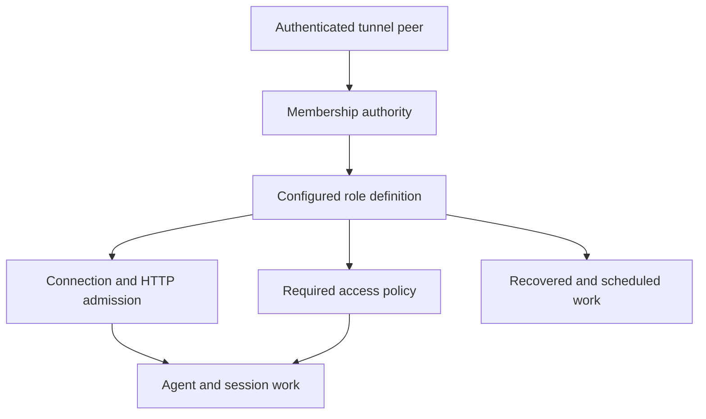

Codex review: blocked before merge.

## What this changes

This PR resolves OpenClaw ID member permissions from gateway.roles.definitions and installs editable Operator and Viewer presets.

**Example:** An owner changes the operator definition to grant only operator.sessions.read.
- **Before:** Operator members retain hardcoded write permissions.
- **After:** Operator members receive the configured conversation-read permission.

## Review scores

| Measure | Result | What it means |
|---|---|---|
| **Overall readiness** | 🧂 unranked krab **(1/6)** | The feature has a coherent owner and useful harness coverage, but affected regression fixtures remain invalid and required runtime and upgrade evidence is absent. |
| **Proof confidence** | 🧂 unranked krab **(1/6)** | Real behavior proof is not required for maintainer- or bot-authored pull requests. |
| **Patch quality** | 🦐 gold shrimp **(3/6)** | 1 actionable review finding remain. |

## Product

**Kind:** Feature · **Worth it:** Yes · **Fix scope:** Complete
**User problem:** Owners cannot customize OpenClaw ID member permissions because the Gateway hardcodes their role definitions.
**Reason:** Maintainer-authored direction establishes the product choice, and the implementation reuses the existing role catalog.

## Merge readiness

⛔ **Blocked before merge - 2 items remain**

Keep this maintainer-directed feature open; the role-definition cutover leaves existing HTTP and automation regression fixtures invalid.

**Priority:** P2
**Reviewed head:** `e2b02c186150b9ace2c3adf3ea94ecb29ebfdd25`

## Before merge

- [ ] **Update existing member fixtures for definition-based admission (P2)** - Requiring a configured definition also changes existing consumers outside the edited suites. tools-invoke-http.abort.test.ts:381 and the member case in openai-compatible-agent-run.test.ts:128 configure only reader but authenticate an operator member, so their expected successful HTTP requests are now refused. The two OCID cases in server-methods/cron-creator-transports.integration.test.ts likewise configure no operator definition and fail while capturing run authority. Install an explicit operator definition in these fixtures and run all three suites, preserving their existing execution and revocation assertions.
- [ ] **Add data-model compatibility proof** - The review found that existing stored data may not work after upgrade. Show that existing data still loads and works with this change.

## Findings

- [P2] Update existing member fixtures for definition-based admission — `src/gateway/openclaw-id/tunnel-principal.ts:200-201`

### Tests

- Missing end-to-end proof: Provide redacted Gateway output exercising member activation and definition edits, plus a latest-stable upgrade preserving existing role settings and data; redact credentials, IPs, phone numbers, and non-public endpoints.

<strong>Agent review details</strong>

### How this fits together

The Gateway maps authenticated OpenClaw ID membership to role definitions, then applies those permissions to connections, HTTP requests, retained work, and session continuations.

### Technical review

Best possible solution:

Keep one configured member-role owner, complete the affected fixture cutover, and preserve existing settings and data through activation and upgrade.

Do we have a high-confidence way to reproduce the issue?

Source inspection establishes that four existing positive regression cases lack the operator definition now required for admission; no target code or tests were executed.

Is this the best way to solve the issue?

Reusing gateway.roles.definitions is a coherent minimal design, but its existing HTTP and automation consumers must receive valid fixtures together.

Full review comments:

- [P2] Update existing member fixtures for definition-based admission — `src/gateway/openclaw-id/tunnel-principal.ts:200-201`
  Requiring a configured definition also changes existing consumers outside the edited suites. tools-invoke-http.abort.test.ts:381 and the member case in openai-compatible-agent-run.test.ts:128 configure only reader but authenticate an operator member, so their expected successful HTTP requests are now refused. The two OCID cases in server-methods/cron-creator-transports.integration.test.ts likewise configure no operator definition and fail while capturing run authority. Install an explicit operator definition in these fixtures and run all three suites, preserving their existing execution and revocation assertions.
  Confidence: 0.99

Overall correctness: patch is incorrect
Overall confidence: 0.97

AGENTS.md: found and applied where relevant.

Codex review notes: model internal, reasoning medium; reviewed against [bfd85da11eeb](https://github.com/openclaw/openclaw/commit/bfd85da11eebe7a1e35bc0a682c16e61fe5b5652).

### Provenance checked

- `Member-role permissions` changes intended behavior with a stated reason (59b8a114bf6dede71999976ddc87fd3edf382c85: Tunnel membership supplied built-in Operator and Viewer ceilings while owner devices retained owner authority.)
- `Required access-policy plugins` keeps the original intent (552b54b86c133ad9773cade18b272dd0a081ee67: Role-bound access policies must remain required when their plugin or grant is unavailable.)
- `Connection reconciliation` changes intended behavior with a stated reason (a91f7cd52cb399712392ca0ad5b57ac061a68370: https://github.com/openclaw/openclaw/pull/175251 preserved unrelated connections and harmless scope edits; this PR explicitly reconnects members when their editable definition changes.)
- `Session-principal continuation` keeps the original intent (d777e01d7e12bd0f69fdfb41925adb24f51b0de2: Profiles without named roles require their recorded authenticated source to resume bounded work.)
- `Profile role assignment` changes intended behavior with a stated reason (53dcaaedec195fdaf5af06357557c706d3c0caf5: Named roles attach to durable profiles; this PR explicitly makes membership authoritative for OpenClaw ID member connections.)

### Testing

Proof path: in-process harness.

### Security

None.

### Evidence

Acceptance criteria:

- pnpm test src/gateway/tools-invoke-http.abort.test.ts src/gateway/openai-compatible-agent-run.test.ts src/gateway/server-methods/cron-creator-transports.integration.test.ts --maxWorkers=1
- pnpm exec oxfmt --check src/gateway/tools-invoke-http.abort.test.ts src/gateway/openai-compatible-agent-run.test.ts src/gateway/server-methods/cron-creator-transports.integration.test.ts
- git diff --check

What I checked:

- **Pinned introduction and current main:** The introduced diff replaces the built-in member policy table; fetched main still hardcodes Operator and Viewer permissions. ([`src/gateway/openclaw-id/tunnel-principal.ts:197`](https://github.com/openclaw/openclaw/blob/e2b02c186150b9ace2c3adf3ea94ecb29ebfdd25/src/gateway/openclaw-id/tunnel-principal.ts#L197), [e2b02c186150](https://github.com/openclaw/openclaw/commit/e2b02c186150b9ace2c3adf3ea94ecb29ebfdd25))
- **HTTP fixtures omitted from the cutover:** tools-invoke-http.abort.test.ts and the member case in openai-compatible-agent-run.test.ts publish only a reader definition while expecting an operator member to authenticate successfully. ([`src/gateway/tools-invoke-http.abort.test.ts:381`](https://github.com/openclaw/openclaw/blob/e2b02c186150b9ace2c3adf3ea94ecb29ebfdd25/src/gateway/tools-invoke-http.abort.test.ts#L381), [e2b02c186150](https://github.com/openclaw/openclaw/commit/e2b02c186150b9ace2c3adf3ea94ecb29ebfdd25))
- **Automation fixtures omitted from the cutover:** The two OCID automation-creation cases capture an operator member under configuration with no role definitions; the changed current-principal check now rejects that source. ([`src/gateway/server-methods/cron-creator-transports.integration.test.ts:195`](https://github.com/openclaw/openclaw/blob/e2b02c186150b9ace2c3adf3ea94ecb29ebfdd25/src/gateway/server-methods/cron-creator-transports.integration.test.ts#L195), [e2b02c186150](https://github.com/openclaw/openclaw/commit/e2b02c186150b9ace2c3adf3ea94ecb29ebfdd25))
- **Persisted configuration boundary:** Activation writes missing operator and viewer definitions through the canonical config writer, preserving existing definitions, default, and assignments; this changes persisted configuration and requires upgrade compatibility evidence. ([`src/gateway/openclaw-id/member-role-presets.ts:72`](https://github.com/openclaw/openclaw/blob/e2b02c186150b9ace2c3adf3ea94ecb29ebfdd25/src/gateway/openclaw-id/member-role-presets.ts#L72), [e2b02c186150](https://github.com/openclaw/openclaw/commit/e2b02c186150b9ace2c3adf3ea94ecb29ebfdd25))
- **Full body and discussion:** The complete REST body matches the supplied content identified by sourceRevision c377433ee61da1dad5cde9a709c79529c876548e5a69cf343cc89c03943b3eee. It supplies test results and explicitly excludes live Gateway, relay, and browser E2E execution; comments contain review-status messages only. ([e2b02c186150](https://github.com/openclaw/openclaw/commit/e2b02c186150b9ace2c3adf3ea94ecb29ebfdd25))
- **Recorded product tradeoffs:** The supplied maintainer-authorship fact establishes direction; the body explicitly accepts editable administrative scopes, narrower Viewer access, preset installation removing JSON5 comments, and affected-member reconnection after definition edits. Public docs: [`docs/concepts/experimental-features.md`](https://docs.openclaw.ai/concepts/experimental-features). ([`docs/concepts/experimental-features.md:273`](https://docs.openclaw.ai/concepts/experimental-features), [e2b02c186150](https://github.com/openclaw/openclaw/commit/e2b02c186150b9ace2c3adf3ea94ecb29ebfdd25))

Likely related people:

- **Josh Lehman:** Raw commit 59b8a114bf6dede71999976ddc87fd3edf382c85 adds src/gateway/openclaw-id/tunnel-principal.ts:3 relative to its recorded parents. This identifies author metadata, not feature responsibility or a PR merger. (role: source-line author; confidence: high; commits: [59b8a114bf6d](https://github.com/openclaw/openclaw/commit/59b8a114bf6dede71999976ddc87fd3edf382c85); files: `src/gateway/openclaw-id/tunnel-principal.ts`)
- **Peter Steinberger:** Raw commit a91f7cd52cb399712392ca0ad5b57ac061a68370 adds src/gateway/server/ws-origin-policy.ts:94 relative to its recorded parents. This identifies author metadata, not feature responsibility or a PR merger. (role: source-line author; confidence: high; commits: [a91f7cd52cb3](https://github.com/openclaw/openclaw/commit/a91f7cd52cb399712392ca0ad5b57ac061a68370); files: `src/gateway/server/ws-origin-policy.ts`)
- **Vincent Koc:** Raw commit 5b3ff077dcbdf344a79b17689dc705724cccbb1c adds src/gateway/server/ws-origin-policy.ts:101 relative to its recorded parents. This identifies author metadata, not feature responsibility or a PR merger. (role: source-line author; confidence: medium; commits: [5b3ff077dcbd](https://github.com/openclaw/openclaw/commit/5b3ff077dcbdf344a79b17689dc705724cccbb1c); files: `src/gateway/server/ws-origin-policy.ts`)

### PR surface

Source +250, Tests +1305, Docs +70, Other +4. Total +1629 across 47 files. Added test files: 5.

View PR surface stats

| Area | Files | Added | Removed | Net |
|---|---:|---:|---:|---:|
| Source | 25 | 356 | 106 | +250 |
| Tests | 19 | 1317 | 12 | +1305 |
| Docs | 2 | 70 | 0 | +70 |
| Config | 0 | 0 | 0 | 0 |
| Generated | 0 | 0 | 0 | 0 |
| Other | 1 | 4 | 0 | +4 |
| **Total** | **47** | **1747** | **118** | **+1629** |

### Preflight source

Source unknown. Source comparison at the observed PR snapshot only. Completion is self-reported; body, policy, tests, execution, and report bytes are not verified.

### Review metrics

| Metric | Value | Why it matters |
|---|---|---|
| **Production versus tests** | Production +356/-106; tests +1317/-12 | The growth covers distinct admission, persistence, reload, and recovery boundaries; existing consumer fixtures still need migration. |
| **Existing configuration and defaults** | Two presets installed automatically; no new configuration key | Activation persists missing operator/viewer definitions and changes the Viewer preset to operator.sessions.read. |

### Labels

Label changes:

No label changes.

Label justifications:

- `P2`: This is a scoped Labs authorization feature with source-reproducible regression-test failures and no demonstrated urgent production incident.
- `merge-risk: 🚨 compatibility`: The maintainer-directed change automatically writes role definitions and deliberately narrows Viewer permissions.
- `merge-risk: 🚨 security-boundary`: Owner-authored definitions become authoritative for member privileges, including explicitly configured administrative and pairing scopes.
- `rating: 🧂 unranked krab`: Overall readiness is 🧂 unranked krab; proof is 🧂 unranked krab and patch quality is 🦐 gold shrimp.
- `status: ⏳ waiting on author`: ClawSweeper has contributor-facing work open and is waiting for author action.

### Rating scale

6/6 🦀 challenger crab · 5/6 🦞 diamond lobster · 4/6 🐚 platinum hermit · 3/6 🦐 gold shrimp · 2/6 🦪 silver shellfish · 1/6 🧂 unranked krab. Overall follows the weaker of proof and patch quality; ✨ marks media proof (a screenshot, video, or linked artifact) that directly shows the changed behavior.

### Workflow

ClawSweeper edits this one comment on every review. Comment `@clawsweeper re-review` for a fresh review only. Repair and merge execution lanes are retired.

_Reviewed November 12, 2026, 8:17 AM ET / 13:17 UTC._

<!-- clawsweeper-verdict:needs-human item=197739 sha=e2b02c186150b9ace2c3adf3ea94ecb29ebfdd25 confidence=high updated_at=2026-11-12T13:12:23Z reviewed_at=2026-11-12T13:17:32.114Z lease_owner=github-run-43224870025-1 lease_comment_id=6824551233 source_revision=c377433ee61da1dad5cde9a709c79529c876548e5a69cf343cc89c03943b3eee hold=blocked findings=1 -->
<!-- clawsweeper-review-state:blocked item=197739 sha=e2b02c186150b9ace2c3adf3ea94ecb29ebfdd25 v=1 -->

<!-- clawsweeper-review-version item=197739 reviewed_at=2026-11-12T13:17:32.114Z sha=e2b02c186150b9ace2c3adf3ea94ecb29ebfdd25 source_revision=c377433ee61da1dad5cde9a709c79529c876548e5a69cf343cc89c03943b3eee lease_owner=github-run-43224870025-1 lease_comment_id=6824551233 v=1 -->

<!-- clawsweeper-review item=197739 -->